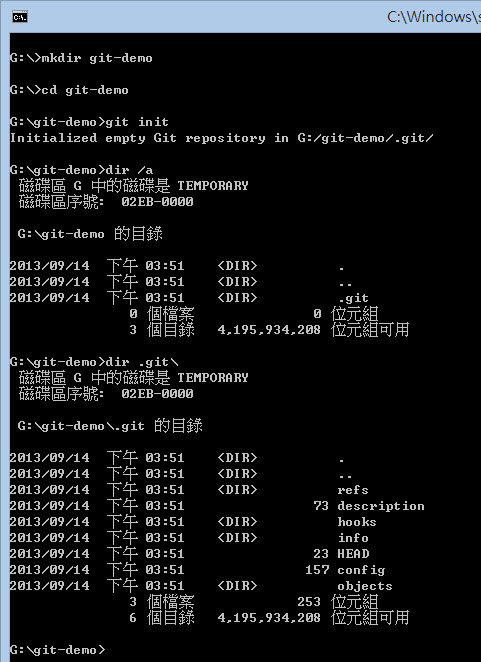
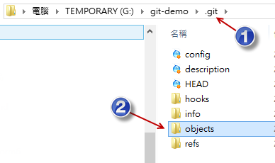

# روز ۰۵: درک رابطه بین مخزن (Repository)، دایرکتوری کاری (Working Directory)، اشیاء (Objects) و ایندکس (Index)

در فرآیند استفاده از کنترل نسخه Git، باید برخی مفاهیم بسیار اساسی ایجاد شوند تا بتوانید با کارایی بیشتر و به طور معنادارتری یاد بگیرید. با داشتن حمایت مفهومی شفاف و صحیح، نه تنها به یادگیری عملیات دستورات Git کمک می‌شود، بلکه مهم‌تر از آن، یادگیری دانش مربوط به Git آسان‌تر خواهد شد.

## درک مخزن (Repository)

زمانی که ما از Git برای کنترل نسخه استفاده می‌کنیم، طبیعتاً به یک "مخزن" برای ذخیره اطلاعات این نسخه‌ها نیاز داریم. واژه انگلیسی آن Repository است. من عادت دارم این کلمه انگلیسی را به "مخزن ذخیره‌سازی" (storage repository) ترجمه کنم، که نشان‌دهنده یک فضا یا یک پوشه و مجموعه‌ای از فایل‌های مورد استفاده برای ذخیره تمام نسخه‌ها است.

اگر تجربه استفاده از Git را داشته باشید، باید به خوبی بدانید که روش‌های زیادی برای ایجاد مخزن وجود دارد. اگر می‌خواهید در هر پوشه‌ای یک مخزن Git ایجاد کنید، فقط دستور زیر را برای تکمیل ایجاد وارد کنید:

    git init

از طریق نمودار زیر در مورد فرآیند ایجاد یک مخزن Git، می‌توانیم به وضوح بدانیم که وقتی `git init` را در دایرکتوری `G:\git-demo` اجرا می‌کنیم، Git به طور خودکار به ما کمک می‌کند تا یک به اصطلاح مخزن Git در دایرکتوری `.git` آن دایرکتوری ایجاد کنیم. شک نکنید، این پوشه `.git` یک مخزن کامل Git است. در آینده تمام تغییرات نسخه به طور خودکار در این پوشه ذخیره خواهد شد.

## درک دایرکتوری کاری (Working Directory)

در مثال بالا، دایرکتوری `G:\git-demo` به طور خودکار به "دایرکتوری کاری" ما تبدیل می‌شود. مفهوم "دایرکتوری کاری" این است که ما در حال آماده‌سازی برای توسعه فایل‌های پروژه هستیم و تمام کارهای آینده در این دایرکتوری ویرایش خواهند شد، چه اضافه کردن فایل، تغییر فایل، حذف فایل، تغییر نام فایل و ... و تمام عملیات‌های مرتبط با Git در این دایرکتوری انجام می‌شود، به همین دلیل به آن "دایرکتوری کاری" می‌گویند.

وقتی پارامترهای دستورات مرتبط با Git را اجرا می‌کنیم، معمولاً آن‌ها را در "دایرکتوری کاری" اجرا می‌کنیم.

از آنجایی که هنگام استفاده از کنترل نسخه Git موقعیت‌های زیادی برای شاخه‌سازی (branch) وجود خواهد داشت، دایرکتوری کاری ممکن است بین شاخه‌های مختلف تغییر کند. برخی از دستورات git در زمان اجرا، فایل‌های موجود در دایرکتوری کاری را به‌روزرسانی می‌کنند. به عنوان مثال، وقتی از `git checkout` برای سوئیچ کردن به یک شاخه متفاوت استفاده می‌کنید، چون ساختار دایرکتوری شاخه فعلی دقیقاً با شاخه‌ای که می‌خواهید به آن سوئیچ کنید یکی نیست، به احتمال زیاد فایل‌ها در دایرکتوری کاری فعلی شما به‌روزرسانی می‌شوند تا این دایرکتوری‌ها و فایل‌های تحت دایرکتوری کاری فعلی مشابه دایرکتوری‌ها و فایل‌های شاخه دیگری که به آن سوئیچ کرده‌اید، باشند.

بنابراین، تمیز نگه داشتن دایرکتوری کاری در زمان مناسب یک اصل اساسی در فرآیند کنترل نسخه است، به خصوص در زمان ادغام (merge) در آینده. این موضوع به ویژه مهم است. من در مقالات آینده دانش مربوطه را بیشتر توضیح خواهم داد.

## درک ساختار داده‌های Git

دو ساختار داده مهم در Git وجود دارد، یعنی "اشیاء" (objects) و "ایندکس" (index).

"اشیاء" برای ذخیره تمام فایل‌ها و سوابق نسخه در مخزن استفاده می‌شوند، در حالی که "ایندکس" برای ذخیره وضعیت دایرکتوری قبل از ورود به مخزن استفاده می‌شود.

## درباره اشیاء (Objects)

به اصطلاح "شیء" (object) یک "فایل خاص" است. فرآیند تولید این فایل بسیار جالب است. محتوای یک فایل را می‌گیرد، یک مقدار هش SHA1 از طریق محتوا تولید می‌کند و سپس فایلی را بر اساس این مقدار هش SHA1 نام‌گذاری می‌کند.

در فرآیند استفاده از Git برای کنترل نسخه، تمام دایرکتوری‌ها و فایل‌هایی که باید کنترل شوند، ابتدا بین "اطلاعات دایرکتوری" و "محتوای فایل" تمایز قائل می‌شوند که ما آن‌ها را اشیاء درختی (tree objects) و اشیاء blob (blob objects) می‌نامیم.

در میان آن‌ها، شیء blob از "محتوای فایل" اصلی به عنوان محتوای فایل blob استفاده می‌کند (توجه: شیء blob در واقع یک فایل فیزیکی است)، و سپس یک عملیات هش SHA1 روی محتوای آن انجام می‌دهد تا یک hash id تولید کند، و بعد از این hash id به عنوان نام فایل blob استفاده می‌کند. از این طریق، می‌توانیم بدانیم که یک شیء blob فایلی است که "فقط محتوا" دارد. نام فایل آن از محتوا تولید شده است، بنابراین هر تک فایل blob معمولاً به تنهایی کمکی به کنترل نسخه نمی‌کند.

یک شیء درختی (tree object) دیگر برای ذخیره اینکه کدام فایل‌ها در یک پوشه خاص گنجانده شده‌اند و نام فایل شیء blob مربوط به این فایل چیست، استفاده می‌شود. در یک شیء درختی، علاوه بر اینکه حاوی نام فایل و اطلاعات مرتبط با شیء blob است، می‌تواند حاوی سایر اشیاء درختی نیز باشد. بنابراین اشیاء درختی در واقع مترادف با "پوشه‌ها" (folders) هستند.

صرف نظر از اشیاء blob و اشیاء درختی، این‌ها همگی اشیاء هستند و این اشیاء در یک به اصطلاح "ذخیره‌سازی اشیاء" (object storage) ذخیره می‌شوند، و این "ذخیره‌سازی اشیاء" به طور پیش‌فرض در دایرکتوری `objects` از "مخزن" قرار دارد، همانطور که در شکل زیر نشان داده شده است:

ما در مقالات آینده در مورد ساختار دقیق اشیاء صحبت خواهیم کرد.

## درباره ایندکس (Index)

به اصطلاح "ایندکس" (index) یک فایل موقت است که مکرراً تغییر می‌کند و معمولاً در فایلی به نام `index` در دایرکتوری `.git` قرار دارد. به سادگی، هدف از "ایندکس" عمدتاً ثبت این است که "کدام فایل‌ها قرار است در نسخه commit بعدی ثبت شوند". به عبارت دیگر، اگر می‌خواهید یک نسخه را در مخزن Git ثبت کنید، ابتدا باید وضعیت ایندکس را به‌روزرسانی کنید تا تغییرات ثبت شوند.

این فایل ایندکس معمولاً وضعیت یک نسخه خاص را در مخزن Git ذخیره می‌کند. این وضعیت می‌تواند توسط هر شیء کامیت (commit object) و شیء درختی (tree object) نشان داده شود.

ما معمولاً مستقیماً فایل باینری `.git\index` را ویرایش نمی‌کنیم، بلکه این فایل ایندکس را از طریق دستورات استاندارد git مدیریت می‌کنیم. دستورات مدیریت فایل ایندکس تقریباً به شرح زیر است:

* git add
* git mv
* git rm
* git status
* git commit
* git ls-files

"ایندکس" گیت یک واسطه بین "ذخیره‌سازی اشیاء" (object storage) و "دایرکتوری کاری" (working directory) است.

شاید قبلاً حدس زده باشید که رابطه بین این مفاهیم که این مقاله می‌خواهد تشریح کند، با ۵ مرحله زیر قابل توضیح است:

* برای استفاده از کنترل نسخه Git، ابتدا باید یک "دایرکتوری کاری" و "مخزن" ایجاد کنید. (mkdir, git init)
* ابتدا باید در "دایرکتوری کاری" توسعه دهید، ممکن است دایرکتوری ایجاد کنید، فایل بسازید، فایل‌ها را ویرایش کنید، حذف کنید و ...
* سپس وقتی می‌خواهید نسخه جدیدی را در "مخزن" Git ثبت کنید، ابتدا باید وضعیت "ایندکس" را به‌روزرسانی کنید. (git add, git mv, ...)
* سپس Git بر اساس وضعیت فعلی "ایندکس" تصمیم می‌گیرد که کدام فایل‌ها در "مخزن" Git ثبت شوند. (git status)
* در نهایت، هنگام ثبت تغییرات (git commit)، اطلاعات نسخه در "ذخیره‌سازی اشیاء" نوشته می‌شود (در این زمان، یک شیء کامیت نوشته خواهد شد).

ما در مقالات آینده در مورد ساختار دقیق ایندکس و دستورات عملیاتی صحبت خواهیم کرد.

    توجه: از آنجایی که مفهوم tree بسیار شبیه به دایرکتوری است، در متون خارجی زبان اصلی، اغلب به جای working directory از working tree استفاده می‌شود!

## خلاصه امروز

مهم‌ترین چیز در مورد معماری Git که امروز مورد بحث قرار گرفت، رابطه بین "اشیاء" (objects) و "ایندکس" (index) است، زیرا بدون اطلاعات "ایندکس"، Git نمی‌تواند نسخه ایجاد کند.

بر اساس تفاوت بین "اشیاء" و "ایندکس"، باید متوجه شده باشید که "اشیاء" از نوع فایل‌های "تغییرناپذیر" (immutable) هستند. در اصل، هر اشیائی که در "ذخیره‌سازی اشیاء" نوشته می‌شود دیگر تغییر نخواهند کرد، زیرا تمام اشیاء از محتوای فایل اصلی تولید می‌شوند. همچنین می‌توانیم بگوییم این یک "پایگاه داده اشیاء" (object database) است، و این پایگاه داده معمولاً فقط محتوا را افزایش می‌دهد و موارد کمی از "حذف محتوا" یا "تغییر محتوا" وجود دارد. داده‌ها فقط زمان اجرای `git gc` برای پاکسازی داده‌های زباله حذف می‌شوند. "ایندکس" یک فایل ایندکس "تغییرپذیر" است که برای ثبت محتوایی که دایرکتوری کاری فعلی آماده ثبت (commit) آن است، استفاده می‌شود.

وقتی گام به گام به هسته Git نزدیک می‌شوید و آرام آرام مفاهیم انتزاعی مبهم و نامشخص را به دانش مفهومی ملموس تبدیل می‌کنید، دیگر نسبت به Git احساس نگرانی نخواهید کرد. لطفاً به تلاش خود برای یادگیری ادامه دهید، موفقیت در پیش است.

## لینک‌های مرجع

* [Git Internals - Git Objects](https://git-scm.com/book/en/Git-Internals-Git-Objects)
* [Pro Git Book](https://progit.org/)
* [Git Magic - Traditional Chinese Version](https://www-cs-students.stanford.edu/~blynn/gitmagic/intl/zh_tw/)
* [Git (software) - Wikipedia, the free encyclopedia](https://en.wikipedia.org/wiki/Git_(software) "Git (software) - Wikipedia, the free encyclopedia")

---

* [بازگشت به فهرست مطالب](README.md)
* [روز قبل: دستورات رایج کنترل نسخه Git](04.md)
* [روز بعد: تجزیه ساختار داده Git - ساختار اشیاء (Object Structure)](06.md)

---
