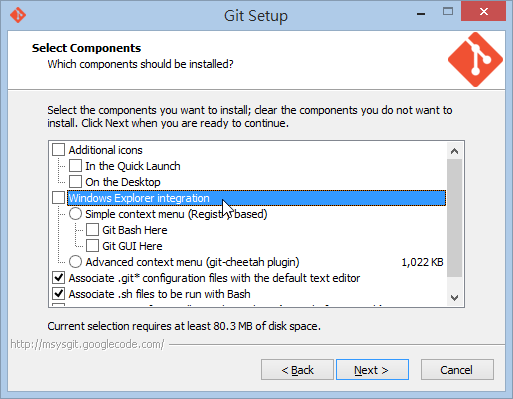
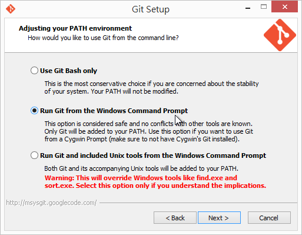
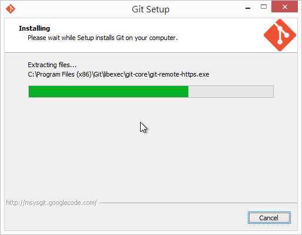
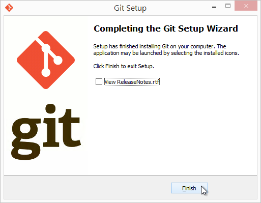
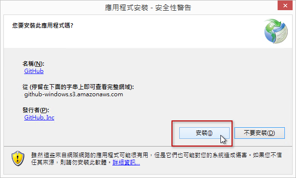
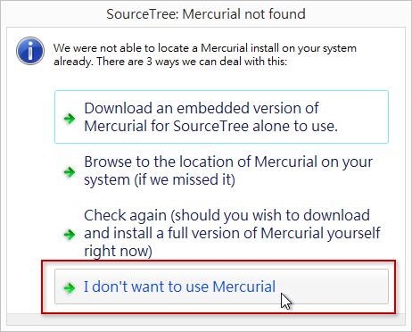
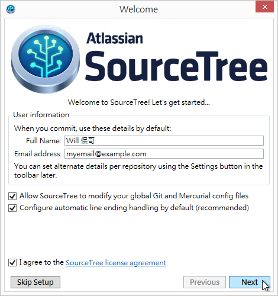
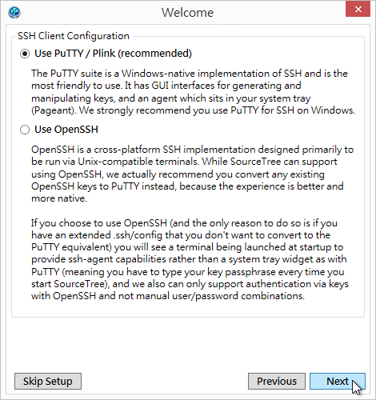

# Hari 02: Tiga Alat Git Penting untuk Platform Windows

Untuk mulai menggunakan kontrol versi Git, Anda terlebih dahulu perlu menginstal alat Git yang sesuai. Seri artikel ini terutama berfokus pada platform Windows. Artikel ini akan memperkenalkan tiga alat kontrol versi Git yang paling sering kami gunakan, memperkenalkan persamaan dan perbedaan antara alat-alat ini, dan kapan menggunakan alat yang mana.

## Alat Pertama: [Git for Windows](https://msysgit.github.io/)

Ini adalah seperangkat alat baris perintah yang dapat dijalankan di **Command Prompt**. Saat ini, semua alat GUI untuk Git di pasaran sebenarnya menjalankan alat Git tingkat rendah ini secara internal, jadi ini adalah alat manajemen Git penting yang wajib diinstal!

Berikut adalah proses instalasinya:

* Pertama, kunjungi situs web resmi https://msysgit.github.io/ untuk bersiap mengunduh penginstal

* Unduh versi terbaru, versi mana pun tidak masalah

* Langsung klik file yang diunduh untuk menginstal

* Halaman selamat datang program instalasi

* Setujui ketentuan lisensi GPL

* Pilih jalur instalasi

* Pilih komponen. **Disarankan untuk menghapus centang opsi integrasi Windows Explorer!**  ( Karena alat integrasi ini terlalu dasar, disarankan untuk menggunakan alat [TortoiseGit](https://code.google.com/p/tortoisegit/) sebagai gantinya )

* Atur nama grup program, pertahankan opsi default

* Di sini disarankan untuk **memilih opsi Run Git from the Windows Command Prompt!**  ( Karena sebagian besar pengguna Windows tidak terbiasa dengan perintah Bash )

* Konversi akhir baris, disarankan untuk mempertahankan opsi default.

* Mulai instalasi

* Instalasi selesai

* Setelah instalasi, langsung buka command prompt untuk mulai menggunakannya

* Anda dapat memasukkan perintah `git --version` untuk menanyakan versi program alat saat ini

## Alat Kedua: [GitHub for Windows](https://windows.github.com/)

Ini adalah alat yang secara resmi dikembangkan oleh [GitHub](https://github.com) untuk orang-orang yang tidak memiliki pemahaman mendalam tentang Git. Alat ini menggunakan antarmuka GUI yang sederhana dan ramah, berusaha menyembunyikan konsep dan parameter perintah Git yang sulit dipahami itu. Meskipun alat GitHub for Windows jauh lebih ramah daripada Git for Windows, bagi orang yang sama sekali tidak memiliki konsep Git, memulai dengan alat GitHub for Windows mungkin tidaklah mudah.

> [GitHub for Windows](https://windows.github.com/) memiliki alat [Git Shell](https://github.com/dahlbyk/posh-git/) bawaan, yang menggunakan [Git for Windows](https://msysgit.github.io/), jadi jika Anda belum menginstal Git for Windows, Anda tidak akan dapat menggunakan alat Git Shell dari GitHub for Windows.

Alat ini dapat membantu Anda menyelesaikan cukup banyak pekerjaan kontrol versi Git. Setidaknya fungsi kontrol versi dasar disediakan, terutama dengan kemampuan berikut:

* Meng-clone Repositori
	* Meng-clone repositori dari GitHub (git clone)
* Menelusuri Riwayat
	* Menelusuri riwayat versi repositori lokal
* Melakukan Commit Perubahan
	* Melakukan commit perubahan ke repositori lokal
* Branch Kode
	* Membuat dan mengelola branch Git, dan dapat beralih branch di direktori kerja
* Berbagi di GitHub.com
	* Menyinkronkan perubahan dengan GitHub
	* Arti "Sync" di sini adalah mengintegrasikan git pull dan git push menjadi satu
	* Ketika GitHub for Windows menyinkronkan, ia menggunakan rebase secara default untuk merging.

Sebagian besar hal yang dapat dilakukan Git for Windows selain ini tidak dapat dilakukan di GitHub for Windows! Jika Anda benar-benar ingin menerapkannya pada proyek pengembangan yang lebih besar, Anda mungkin perlu mempertimbangkan apakah itu cocok, tetapi bagi non-pengembang perangkat lunak, pekerjaan kontrol versi sederhana seharusnya lebih dari cukup.

Berikut adalah proses instalasi GitHub for Windows:

* Pertama, kunjungi https://windows.github.com/ untuk bersiap mengunduh penginstal

* Setelah mengunduh, langsung jalankan instalasi

* Masuk memerlukan akun GitHub

* Mengatur informasi akun

* Temukan repositori Git lokal
	* Jika Anda belum pernah menggunakan Git, seharusnya tidak ada hasil di sini

* Setelah instalasi, Anda akan melihat antarmuka program utama GitHub for Windows

## Alat Ketiga: [SourceTree](https://www.sourcetreeapp.com/)

[SourceTree](https://www.sourcetreeapp.com/) saat ini adalah alat yang sangat saya rekomendasikan yang dapat mendukung platform Windows dan Mac. Alat ini adalah alat GUI yang dikembangkan oleh Atlassian (perusahaan yang membuat JIRA, Confluence, Bamboo) dan disediakan secara gratis. Dengan alat ini, hampir semua pekerjaan kontrol versi Git dapat dilakukan (termasuk alur kerja git-flow), yang merupakan alat kontrol versi Git yang sangat kuat.

> [SourceTree](https://www.sourcetreeapp.com/) juga mengharuskan [Git for Windows](https://msysgit.github.io/) diinstal terlebih dahulu, karena alat ini bergantung pada alat baris perintah Git untuk bekerja.

Berikut adalah proses instalasi SourceTree:

* Pertama, kunjungi https://www.sourcetreeapp.com/ untuk bersiap mengunduh penginstal

* Unduh penginstal

* Setelah mengunduh, langsung jalankan instalasi, ini adalah program instalasi grafis

* Anda harus menyetujui perjanjian lisensi

* Pendaftaran diperlukan untuk menggunakan (ini gratis)

* Jika Anda tidak memiliki akun Bitbucket atau Google, Anda juga dapat mendaftar secara gratis

* Wizard penyiapan

* Penyiapan kunci SSH

* Apakah akan memuat SSH Key dari Pageant/PuTTY

* Instalasi selesai!

Ringkasan Hari Ini
------

Hari ini kami memperkenalkan secara singkat tiga alat kontrol versi Git yang umum di platform Windows. Yang pertama adalah [Git for Windows](https://msysgit.github.io/), yang kedua adalah [GitHub for Windows](https://windows.github.com/), dan yang ketiga adalah [SourceTree](https://www.sourcetreeapp.com/). Ketiga alat ini memiliki kelebihannya masing-masing, tetapi secara pribadi saya pikir jika Anda ingin memahami kontrol versi Git secara mendalam, Anda harus menggunakan Git for Windows dan belajar menjalankan perintah Git melalui baris perintah. Jika Anda menginginkan alat GUI yang lebih intuitif, gunakan [SourceTree](https://www.sourcetreeapp.com/).

Saya ingin menekankan bahwa untuk benar-benar menguasai kontrol versi Git, Anda harus memahami apa yang dilakukan Git di lapisan bawah. Jadi dalam artikel-artikel berikut, saya pada dasarnya akan memperkenalkan pengoperasian kontrol versi Git menggunakan [Git for Windows](https://msysgit.github.io/), dan menggunakan [SourceTree](https://www.sourcetreeapp.com/) sebagai alat bantu untuk membantu Anda lebih memahami operasi kontrol versi Git dan perubahan dalam repositori.

---

* [Kembali ke Daftar Isi](README.md)
* [Hari Sebelumnya: Memahami Kontrol Versi Git](01.md)
* [Hari Berikutnya: Membuat Repositori](03.md)

---
