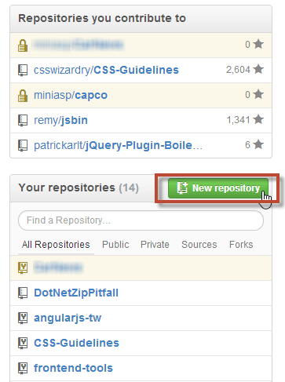
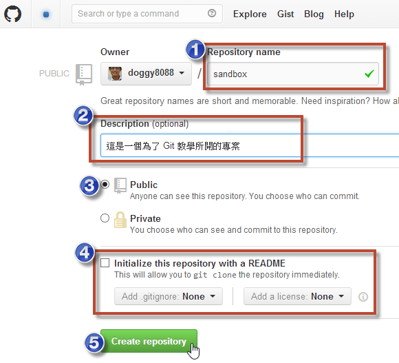
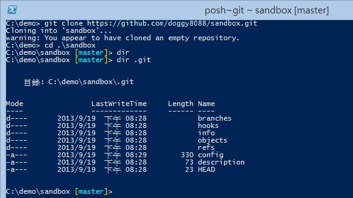

# Hari 03: Membuat Repositori

Untuk mulai menggunakan Git, hal terpenting adalah memiliki repositori Git terlebih dahulu. Tetapi dari mana repositori ini berasal? Artikel ini akan memperkenalkan berbagai cara untuk membuat repositori.

Untuk membuat repositori, sebenarnya, Anda memiliki banyak pilihan, misalnya:

* Membuat repositori lokal di komputer Anda
* Membuat repositori bersama di komputer Anda
* Membuat repositori remote di GitHub atau platform Git lainnya

Apa pun itu, Anda selalu membutuhkan repositori. Kami akan menjelaskan masing-masing sebagai berikut:

## Membuat Repositori Lokal di Komputer Anda

Mari pertama-tama buka alat Git Shell dari [GitHub for Windows](https://windows.github.com/). Alat ini sebenarnya adalah antarmuka Windows PowerShell tetapi dengan beberapa variabel lingkungan terkait Git dan pengaturan command prompt:

Setelah dibuka, alat ini secara default akan berada di folder `%USERPROFILE%\Documents\GitHub`. Ini adalah direktori root proyek default dari [GitHub for Windows](https://windows.github.com/), yang berarti semua proyek yang di-clone dari GitHub melalui [GitHub for Windows](https://windows.github.com/) akan ditempatkan di direktori ini secara default.

Jadi kita dapat langsung membuat direktori baru di sini untuk berfungsi sebagai "direktori kerja" kita. Kita dapat memasukkan perintah `mkdir git-demo` untuk membuat direktori, lalu menggunakan `cd git-demo` untuk masuk ke direktori tersebut.

Karena ini adalah direktori kosong dan tidak berisi repositori Git apa pun, kita dapat menggunakan perintah `git init` untuk membuat repositori. Secara default, repositori akan ditempatkan di direktori `.git` di bawah direktori kerja.

Langkah-langkah operasi lengkap ditunjukkan pada gambar berikut:

Setelah pembuatan, Anda seharusnya memperhatikan sesuatu yang berbeda di command prompt Git Shell — ia menambahkan `[master]` yang disorot setelah jalur saat ini. Prompt ini akan menampilkan berbagai keadaan dari `direktori kerja` Anda saat ini. Jika Anda dapat memahaminya, ini adalah sumber informasi yang sangat berguna yang dapat membantu Anda menghindari mengetik banyak perintah `git status` untuk menanyakan keadaan direktori kerja saat ini ketika menggunakan alat baris perintah untuk mengoperasikan Git. Bagian ini akan dijelaskan secara khusus dalam artikel berikutnya.

## Membuat Repositori Bersama di Komputer Anda

Repositori bersama mengacu pada pembuatan repositori Git tanpa direktori kerja. Situasi ini lebih umum pada sistem operasi Linux karena sistem operasi Linux biasanya digunakan oleh banyak orang pada host Linux yang sama. Meskipun ini juga dapat digunakan pada sistem operasi Windows, lingkungan pengembangan kami sebagian besar berada di lingkungan Windows Client, dan jarang ada banyak orang berbagi satu komputer.

Untuk membuat repositori bersama, Anda dapat menggunakan perintah `git init --bare` untuk membuatnya, seperti yang ditunjukkan pada gambar berikut. Anda dapat melihat bahwa ketika `git init` digunakan dengan parameter `--bare`, ia membuat semua file dan folder terkait repositori Git di direktori saat ini. Anda harus memberikan perhatian khusus bahwa folder ini tidak dapat digunakan secara langsung untuk keperluan pengembangan. Folder ini hanya dapat digunakan untuk menyimpan informasi terkait Git. Dalam kebanyakan kasus, Anda tidak boleh mengedit file apa pun di folder ini secara manual. Lebih baik beroperasi melalui perintah git.

Karena ini adalah "repositori murni tanpa direktori kerja," repositori bersama juga memiliki alias yang disebut "bare repository."

Saya harus menekankan lagi bahwa Git adalah "kontrol versi terdistribusi," dan setiap orang memiliki repositori yang lengkap. Artinya, ketika Anda ingin membuat "direktori kerja," Anda harus terlebih dahulu mendapatkan isi dari "bare repository" ini kembali. Pada saat ini, Anda harus menggunakan perintah `git clone [REPO_URI]` untuk "meng-clone" sebuah salinan kembali. Melalui proses `git clone`, tidak hanya direktori kerja akan dibuat secara otomatis, tetapi "bare repository" ini juga akan di-clone kembali sepenuhnya. Proses cloning ini seperti "cadangan lengkap," menyalin semua catatan versi dalam repositori Git, semua versi file, dan sebagainya, semua data kembali sepenuhnya. Proses operasi perintah lengkap dapat dilihat pada gambar berikut:

Dalam praktiknya, mungkin ada beberapa cara untuk menggunakan "repositori bersama" atau "bare repository":

* Pengembangan kolaboratif pada mesin yang digunakan oleh banyak orang, di mana sebagian besar orang dapat diberikan izin hanya-baca ke "folder bare repository" ini, dan hanya satu orang atau beberapa orang yang memiliki izin tulis.
* Beberapa orang menempatkan bare repository di Dropbox untuk menyinkronkan bare repository ini dengan beberapa komputer mereka.

Harap dicatat: Meskipun direktori `.git` di bawah "direktori kerja" juga merupakan "repositori," repositori di bawah direktori kerja juga berisi beberapa informasi indeks dari direktori kerja, yang mencatat informasi keadaan direktori kerja. Informasi keadaan ini tidak akan muncul di "repositori bersama," yang hanya berisi informasi versi (yaitu, informasi objek Git).

## Membuat Repositori Remote di GitHub atau Platform Git Lainnya

Sebenarnya, "repositori remote" dan "repositori bersama" hampir sama. Perbedaannya hanya bahwa "repositori bersama" sebagian besar menggunakan akses file langsung, sedangkan "repositori remote" biasanya menggunakan protokol seperti SSH, protokol Git, HTTP, dan lain-lain untuk mengakses repositori Git secara "remote". Metode penggunaan lainnya pada dasarnya sama.

Berikut ini menunjukkan cara membuat repositori melalui GitHub dan meng-clone repositori kembali ke lokal:

* Pertama, masuk ke GitHub, lalu buat repositori baru

* Atur informasi yang relevan untuk proyek GitHub dan buat repositori

* Setelah pembuatan, ia akan meminta Anda tentang cara mendapatkan proyek atau mengimpor proyek lokal Anda yang ada ke GitHub

* Seperti yang ditunjukkan di atas, kita dapat mengklik "Set up in Desktop" di bagian Quick setup. Komputer Anda akan secara otomatis membuka alat GitHub for Windows dan secara otomatis meng-clone repositori ini kembali dan membuat direktori kerja.

* Anda juga dapat menyalin URL repositori Git remote, lalu menjalankan `git clone [REPO_URL]` untuk meng-clone sebuah salinan kembali.

## Ringkasan Hari Ini

Di atas adalah tiga cara untuk membuat repositori Git. Izinkan saya menyusun kembali perintah dan parameter Git yang dipelajari hari ini:

* git init
* git init --bare
* git clone \[REPOSITORY\_URI]

## Tautan Referensi

* [Git for Windows](https://msysgit.github.io/)
* [GitHub for Windows](https://windows.github.com/)

---

* [Kembali ke Daftar Isi](README.md)
* [Hari Sebelumnya: Tiga Alat Git Penting untuk Platform Windows](02.md)
* [Hari Berikutnya: Perintah Kontrol Versi Git yang Umum Digunakan](04.md)

---
