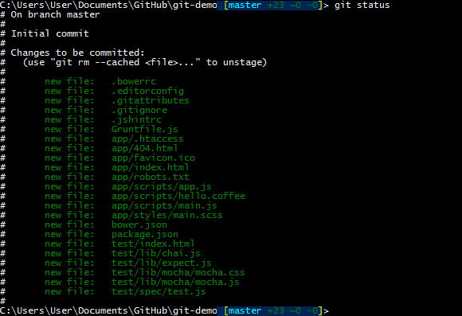
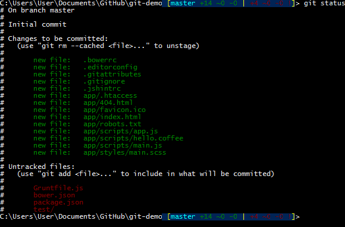
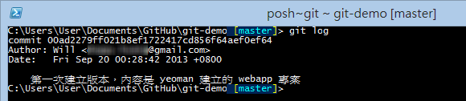
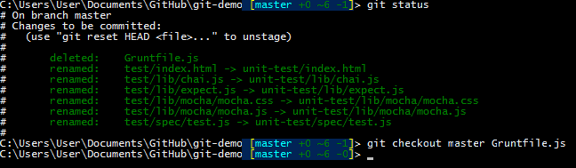

# Hari 04: Perintah Kontrol Versi Git yang Umum Digunakan

Artikel ini akan membantu Anda mempelajari beberapa tugas kontrol versi yang paling penting dan dasar, termasuk operasi file dasar seperti menambah, menghapus, mengganti nama file, melakukan commit perubahan (membuat versi baru), dan menanyakan catatan riwayat.

## Menyiapkan Direktori Kerja

Meninjau konten dari artikel sebelumnya "Hari 03: Membuat Repositori," mari langsung buat repositori lokal untuk memulai semua latihan dalam artikel ini.

```
mkdir git-demo
cd git-demo
git init
```

## Menambahkan File

Mari letakkan beberapa file di direktori kerja. File apa pun boleh; cukup salin beberapa file dan direktori yang ada ke dalam direktori kerja saat ini.

Untuk artikel ini, saya akan menggunakan alat [YEOMAN](https://yeoman.io/) untuk dengan cepat menghasilkan situs web contoh webapp. Hanya dengan satu perintah, Anda dapat membuat situs web yang lengkap:

```
yo webapp
```

**Catatan**: Mengenai penggunaan [YEOMAN](https://yeoman.io/) pada platform Windows, Anda dapat merujuk ke artikel penulis [Cara Menginstal dan Menggunakan Alat Terkait Yeoman 1.0 pada Platform Windows](https://blog.miniasp.com/post/2013/08/11/Yeoman-1-0-Installation-and-Usage-on-Windows), yang menjelaskan proses instalasi dan penggunaan secara lengkap dan terperinci.

Setelah menambahkan file, jika Anda masih berada di antarmuka Git Shell, Anda seharusnya segera melihat prompt seperti berikut:


Yaitu, prompt berikut yang terletak setelah jalur:

```
[master +10 ~0 -0 !]
```

Pada bagian prompt ini, Anda dapat melihat beberapa hal:

* master mewakili direktori kerja saat ini adalah branch **master**, yang juga merupakan nama branch default Git.
* Angka "Merah" semuanya mewakili file Untracked, yang berarti perubahan ini tidak akan masuk ke kontrol versi.
* +10 mewakili 10 file yang "ditambahkan"
* ~0 mewakili 0 file yang "dimodifikasi"
* -0 mewakili 0 file yang "dihapus"

Jika Anda ingin menambahkan file baru ini ke kontrol versi Git, Anda harus menjalankan perintah berikut:

```
git add .
```

Dengan cara ini, semua file, direktori, dan semua file dalam subdirektori di bawah direktori kerja ini akan ditambahkan ke [index] atau [cache] dari direktori kerja Git ini. Harap dicatat: Pada saat ini, belum ada versi yang dibuat. Ini hanya memberi tahu Git bahwa file-file ini "akan" ditambahkan ke repositori Git.

Seperti yang ditunjukkan pada gambar berikut, ini adalah hasil setelah saya menjalankan `git add .` di sini. Pesan peringatan yang muncul di sini tidak terlalu serius. Mereka yang tertarik untuk memahami dapat merujuk ke artikel lain oleh penulis: [Catatan tentang Konversi Akhir Baris Git for Windows (CRLF)](https://blog.miniasp.com/post/2013/09/15/Git-for-Windows-Line-Ending-Conversion-Notes).


Namun, yang menarik adalah bahwa "angka merah" yang semula kini telah berubah menjadi "angka hijau." Arti yang diwakili di sini adalah:

* Angka "Hijau" semuanya mewakili file Staged (siap), yang berarti perubahan ini akan masuk ke kontrol versi.
* +23 mewakili 23 file yang "ditambahkan" akan dibuat sebagai sebuah versi
* ~0 mewakili 0 file yang "dimodifikasi" akan dibuat sebagai sebuah versi
* -0 mewakili 0 file yang "dihapus" akan dibuat sebagai sebuah versi

Tetapi bukankah semula hanya +10 (merah)? Bagaimana bisa menjadi +23 (hijau) setelah eksekusi?

Kita jalankan `git reset` untuk mengatur ulang keadaan indeks direktori kerja, lalu jalankan `git status` lagi untuk menanyakan keadaan terperinci direktori kerja saat ini, seperti yang ditunjukkan pada gambar berikut:


Anda dapat melihat bahwa hanya "file dan direktori di bawah direktori tingkat pertama" yang tercantum di sini karena git tidak akan memeriksa berapa banyak file yang tidak dilacak di subdirektori pada saat ini.

Ketika kita menjalankan `git add .` dan kemudian menjalankan `git status` lagi untuk menanyakan status, Anda dapat menemukan bahwa file di subdirektori semuanya telah ditambahkan, jadi jumlah ini meningkat, seperti yang ditunjukkan pada gambar berikut:



## Menambahkan Sebagian File

Perintah `git add .` yang baru saja disebutkan akan secara otomatis menambahkan semua file (termasuk file di subdirektori) ke indeks direktori kerja. Terkadang kita hanya ingin menambahkan direktori tertentu atau file tertentu ke versi. Pada saat ini, Anda juga dapat menentukan direktori tertentu atau menggunakan wildcard untuk menambahkan file.

Mari jalankan `git reset` lagi untuk mengatur ulang keadaan indeks direktori kerja, lalu gunakan `git add app` untuk menambahkan folder app dan semua file di bawahnya, dan gunakan `git add .*` untuk menambahkan semua file yang dimulai dengan "titik," seperti yang ditunjukkan pada gambar berikut:


**Catatan**: Wildcard `.*` tidak dapat menambahkan semua file "dot" karena karakter pertama `.` hanya dapat cocok dengan satu direktori. Jika Anda ingin menambahkan semua file yang dimulai dengan titik, Anda harus menggunakan `.??*` untuk memastikan itu cocok dengan file yang dimulai dengan titik.

## Melakukan Commit Perubahan

Setelah menambahkan file ke indeks, Anda dapat melakukan commit perubahan untuk membuat sebuah versi. Perintah commit adalah:

```
git commit -m "Initial commit"
```

Parameter `-m` diikuti oleh pesan commit. Pesan ini akan dicatat dalam riwayat versi. Disarankan untuk menulis pesan commit yang bermakna untuk membantu Anda dan orang lain memahami tujuan versi ini di masa depan.



## Melihat Riwayat Commit

Setelah melakukan commit, Anda dapat menggunakan perintah `git log` untuk melihat riwayat commit:

```
git log
```


Anda juga dapat menggunakan parameter `git log --oneline` untuk menampilkan versi log yang disederhanakan:

```
git log --oneline
```


## Memodifikasi File

Sekarang mari kita coba memodifikasi file. Buka file apa pun di direktori kerja dan buat beberapa perubahan, lalu simpan.

Setelah modifikasi, jika Anda menjalankan `git status`, Anda akan melihat informasi tentang file yang dimodifikasi:



Anda dapat melihat bahwa file yang dimodifikasi akan ditampilkan dalam warna merah, dan jumlah file yang dimodifikasi ditampilkan sebagai ~1.

## Melihat Perbedaan File

Sebelum melakukan commit file yang dimodifikasi, Anda mungkin ingin melihat perubahan apa yang telah dibuat. Anda dapat menggunakan perintah `git diff`:

```
git diff
```


Perintah git diff akan menampilkan perbedaan antara direktori kerja dan indeks.

## Melakukan Commit File yang Dimodifikasi

Untuk melakukan commit file yang dimodifikasi, Anda juga perlu menjalankan `git add` terlebih dahulu untuk menambahkan file yang dimodifikasi ke indeks, lalu menjalankan `git commit`:

```
git add .
git commit -m "Update files"
```


## Menghapus File

Jika Anda ingin menghapus file dan membuat tindakan penghapusan ini dicatat dalam versi, Anda dapat menggunakan perintah `git rm`:

```
git rm [filename]
```

Setelah menjalankan perintah ini, file akan dihapus dari direktori kerja dan indeks. Kemudian jalankan `git commit` untuk melakukan commit tindakan penghapusan ini.


## Mengganti Nama atau Memindahkan File

Jika Anda ingin mengganti nama atau memindahkan file, Anda dapat menggunakan perintah `git mv`:

```
git mv [old_filename] [new_filename]
```

Perintah ini akan mengganti nama atau memindahkan file dan secara otomatis menambahkan perubahan ini ke indeks. Kemudian jalankan `git commit` untuk melakukan commit perubahan ini.



## Ringkasan Hari Ini

Hari ini kita mempelajari beberapa perintah dasar Git, yang dirangkum sebagai berikut:

* `git add [file]` - Menambahkan file ke indeks
* `git add .` - Menambahkan semua file di direktori saat ini ke indeks
* `git commit -m "message"` - Melakukan commit perubahan dari indeks untuk membuat versi baru
* `git status` - Melihat keadaan direktori kerja saat ini
* `git log` - Melihat riwayat commit
* `git log --oneline` - Melihat riwayat commit yang disederhanakan
* `git diff` - Melihat perbedaan antara direktori kerja dan indeks
* `git rm [file]` - Menghapus file dari direktori kerja dan indeks
* `git mv [old] [new]` - Mengganti nama atau memindahkan file
* `git reset` - Mengatur ulang keadaan indeks

## Tautan Referensi

* [Git - Recording Changes to the Repository](https://git-scm.com/book/en/v2/Git-Basics-Recording-Changes-to-the-Repository)

---

* [Kembali ke Daftar Isi](README.md)
* [Hari Sebelumnya: Membuat Repositori](03.md)
* [Hari Berikutnya: Memahami Hubungan antara Repositori, Direktori Kerja, Objek, dan Indeks](05.md)

---
