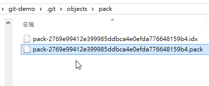

# Hari 06: Mengurai Struktur Data Git - Struktur Objek

Dalam struktur data Git, "objek" adalah jenis file yang "tidak dapat diubah" (immutable). Semua file yang disimpan dalam "penyimpanan objek" biasanya hanya masuk dan tidak keluar, dan isinya tidak akan dimodifikasi. Alasannya adalah jika Anda mengubah isi file, nilai hash SHA1 yang dihitung dari isi baru akan berbeda dari nama file objek asli, yang akan menyebabkan Git gagal untuk terus berjalan, dan secara relatif juga memberikan tingkat perlindungan tertentu untuk repositori Git. Artikel ini akan memperkenalkan struktur objek Git secara lebih terperinci, dan akhirnya juga akan menjelaskan secara terperinci proses dan logika bagaimana objek dihasilkan melalui sebuah video.

## Tentang Basis Data Objek

Seperti yang disebutkan dalam artikel sebelumnya, baik objek blob maupun objek tree, ini semua adalah objek, dan objek-objek ini akan disimpan dalam apa yang disebut "penyimpanan objek" (object storage), dan "penyimpanan objek" ini secara default berada di direktori objects dari "repositori", seperti yang ditunjukkan pada gambar berikut:

Namun, setiap "objek" dalam repositori Git melakukan operasi hash SHA1 pada "isi file" untuk menghitung nilai hash, dan menggunakan nilai hash ini sebagai nama objek (nama file). Mengambil 8a6b275638f3cf164395e65066a1132bb36b7896 sebagai contoh, Git pertama-tama akan mengambil dua karakter pertama (8a) sebagai direktori, dan kemudian menggunakan nilai hash yang tersisa sebagai nama file (6b275638f3cf164395e65066a1132bb36b7896). Direktori fisik dan file dari objek-objek ini juga akan ditempatkan di direktori .git\objects, seperti yang ditunjukkan pada gambar berikut:

## Jenis Objek

Dalam "basis data objek" ini, ada 4 jenis objek:

1. **objek blob**: Ini adalah "isi" dari sebuah file dalam direktori kerja, dan hanya isinya. Ketika Anda menjalankan perintah git add, isi file baru ini akan segera ditulis sebagai objek blob. Nama file adalah hasil hash dari isi objek, tanpa informasi lain apa pun. Informasi seperti waktu file, nama file asli, atau informasi file lainnya akan disimpan dalam jenis objek lain (yaitu, objek tree).

2. **objek tree**: Jenis objek ini menyimpan semua informasi di bawah direktori tertentu, termasuk nama file di bawah direktori tersebut, nama objek blob yang sesuai, tautan simbolik, atau objek tree lainnya. Karena objek tree dapat berisi objek tree lainnya, menelusuri objek tree sebenarnya sama dengan "folder" dalam sistem file. Sederhananya, objek tree adalah snapshot dari sebuah folder pada versi tertentu.

3. **objek commit**: Digunakan untuk mencatat objek tree mana saja yang termasuk dalam versi. Objek commit mewakili sebuah commit Git, mencatat objek tree mana saja yang ada dalam versi commit tertentu, serta waktu commit versi, pesan commit, dan lain-lain. Biasanya, ia juga mencatat nama objek commit sebelumnya (hanya versi commit pertama yang tidak memiliki nama objek commit sebelumnya).

4. **objek tag**: Ini adalah sebuah kontainer, biasanya digunakan untuk mengaitkan dengan objek commit tertentu (juga dapat dikaitkan dengan objek blob dan tree tertentu), dan menyimpan beberapa informasi referensi tambahan (metadata), seperti nama tag. Penggunaan objek tag yang paling umum adalah menandai versi tertentu dari objek commit dengan nama yang mudah dipahami, yang mungkin mewakili versi rilis tertentu atau versi dengan makna khusus.

Git akan membuat objek blob yang sesuai untuk setiap file dalam setiap versi. Demikian pula, nama file objek blob dihitung dengan cara di atas. Dari file blob ini, Anda tidak dapat melihat hubungan apa pun dengan versi. Anda harus menggunakan objek tree (snapshot folder) dan objek commit (snapshot setiap versi) untuk mengaitkan hubungan antara blob dan versi ini.

Semua objek dikompresi menggunakan algoritma zlib, yang tidak hanya dapat secara efektif meningkatkan efisiensi akses file tetapi juga menggunakan algoritma kompresi delta untuk menghemat ruang saat melakukan pemaketan di masa depan. Ia akan secara otomatis menemukan blob yang mirip, secara otomatis menghitung perbedaan antara blob, dan menyimpan perbedaan ini dalam file yang disebut *packfile*, yang dapat sangat menghemat ruang disk). Biasanya, *packfiles* ditempatkan di direktori .git\objects\pack, seperti yang ditunjukkan pada gambar berikut:

Hubungan antara keempat jenis objek ini dapat dilihat pada diagram berikut:

Namun, hanya dengan melihat teks dan diagram mungkin masih sulit untuk melihat hubungan antara jenis objek ini. Tidak apa-apa. Saya telah secara khusus merekam video tutorial untuk mencoba menjelaskan struktur objek Git dan proses pembuatan objek menggunakan perintah git, agar semua orang dapat lebih jelas memahami bagaimana Git menghasilkan dan mengelola file-file ini.

Tautan video YouTube: [Memahami Hubungan antara Basis Data Objek dan Objek dalam Struktur Data Git](https://www.youtube.com/watch?v=PZbSRy_ow0U)

## Keunggulan Struktur Objek

Anda seharusnya secara bertahap memahami betapa indahnya desain "objek" Git. Dalam artikel pertama, kami menyebutkan beberapa desain penting Git. Mari kita cantumkan kembali beberapa desain yang terkait dengan karakteristik "objek":

* Penanganan proyek besar yang efisien
* Tidak hanya repositori lengkap akan di-clone ke komputer lokal, tetapi karena semua objek blob dapat dialamatkan melalui "isi" (content addressable), menemukan isi yang sama di antara versi yang berbeda sangatlah efisien.
* Perlindungan catatan historis
* Dalam proses kontrol versi Git, setiap commit menghasilkan objek commit, dan nama objek commit ini dihasilkan melalui isi objek commit. Lebih jauh, objek commit dikaitkan dengan objek tree, dan nama objek tree dihasilkan melalui isi objek tree. Objek tree dikaitkan dengan objek blob dan tree, dan nama objek-objek ini juga dihasilkan melalui isi. Lapisan demi lapisan asosiasi seperti ini, jika Anda benar-benar ingin mengubah riwayat versi tertentu hari ini, kesulitannya cukup tinggi!
* Karena repositori Git sering di-clone atau di-fork, selama repositori di-clone, jika ada objek di repositori sumber yang dimodifikasi, akan sulit bagi repositori hasil clone ini untuk digabungkan kembali, jadi Anda hampir tidak dapat mengubah catatan versi secara sembarangan.
* Pemaketan objek secara berkala
* "Objek" yang kami sebutkan di Git sebenarnya mewakili file dalam repositori. Dalam proses perubahan versi, kode atau file lain dalam proyek akan diperbarui. Setiap kali diperbarui, selama isi file berbeda, "objek" baru akan dibuat, dan semua file dengan isi berbeda ini akan dipertahankan.
* Anda dapat membayangkan bahwa seiring proyek menjadi lebih besar dan memiliki lebih banyak versi, akan ada semakin banyak objek. Meskipun setiap file dapat dikompresi secara individual untuk membuat file lebih kecil, terlalu banyak file tetap akan membuat akses file semakin tidak efisien. Oleh karena itu, desain Git memiliki mekanisme yang dapat secara otomatis memaketkan sekelompok "objek" lama ke dalam packfile untuk meningkatkan efisiensi akses file.
* File-file yang baru ditambahkan itu akan tetap ada sebagai file tunggal, yang juga berarti sebuah "file" dalam repositori Git adalah sebuah "objek" Git, tetapi perlu dipaketkan ulang sesekali.
* Agaknya, Git akan secara otomatis melakukan tindakan seperti pemaketan ulang, tetapi Anda tetap dapat mengeluarkan perintah untuk menjalankannya sendiri. Misalnya: git gc
* Jika Anda ingin memeriksa apakah sistem file yang dikelola oleh Git lengkap, Anda dapat menjalankan perintah berikut: git fsck

## Ringkasan Hari Ini

"Objek" dalam Git sangat penting, dan karakteristiknya juga sangat penting. Meskipun kita biasanya tidak perlu menyentuh file-file ini secara langsung selama proses mengoperasikan perintah Git, memahami keberadaan objek-objek ini memang membantu Anda lebih memahami mode operasi Git dan konsep desain Git yang unik.

## Tautan Referensi

* [Git Internals - Git Objects](https://git-scm.com/book/en/Git-Internals-Git-Objects)
* [Pro Git Book](https://progit.org/)
* [Git Magic - Versi Bahasa Mandarin Tradisional](https://www-cs-students.stanford.edu/~blynn/gitmagic/intl/zh_tw/)
* [Git (software) - Wikipedia, ensiklopedia bebas](https://en.wikipedia.org/wiki/Git_(software) "Git (software) - Wikipedia, ensiklopedia bebas")

---

* [Kembali ke Daftar Isi](README.md)
* [Hari Sebelumnya: Memahami Hubungan antara Repositori, Direktori Kerja, Objek, dan Indeks](05.md)
* [Hari Berikutnya: Mengurai Struktur Data Git - Struktur Indeks](07.md)

---
