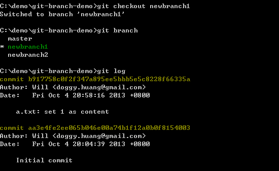
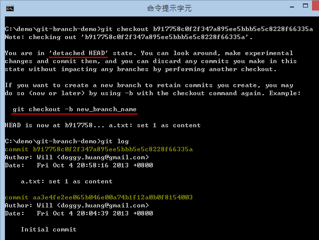
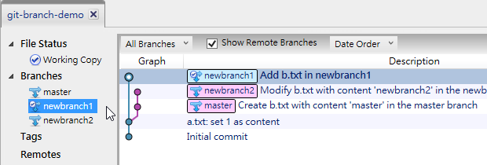

# Hari 08: Konsep Dasar dan Penggunaan Branch

Di Git, **branch** adalah mekanisme yang sangat penting dan harus digunakan dengan sangat hati-hati karena sebuah proyek tidak dapat bercabang tanpa batas. Pada akhirnya, branch harus digabungkan (merge), tetapi merging adalah topik untuk nanti. Artikel ini pertama-tama akan membantu Anda mempelajari konsep dasar dan penggunaan branch Git.

## Konsep Dasar Branch

Tujuan utama menggunakan mekanisme "branch" dalam kontrol versi adalah untuk memecahkan masalah konflik versi selama proses pengembangan. Saya percaya bahwa banyak orang yang telah menggunakan mekanisme kontrol versi apa pun akan berpikir bahwa "branching" adalah biang keladi yang "menyebabkan konflik versi" karena ketika Anda mulai membuat branch, Anda pasti akan memikirkan masalah merging. Setelah membuat branch, jika seseorang memodifikasi baris yang sama dari file yang sama dengan Anda, itu akan menyebabkan "konflik versi." Setiap kali konflik terjadi, Anda harus bersusah payah menyelesaikannya.

Ketika konflik terjadi, terkadang Anda dapat dengan mudah memutuskan untuk menggunakan versi Anda sendiri atau versi pihak lain, tetapi terkadang tidak semudah itu. Ketika rumit, Anda juga harus menemukan orang yang awalnya memodifikasi baris-baris ini berdasarkan fragmen yang berkonflik, mengoordinasikan dampak perubahan masing-masing terhadap sistem, dan akhirnya memutuskan cara menggabungkannya. Masalah seperti itu sangat membosankan, jadi banyak orang akan berusaha menghindari "branching" untuk menghindari "konflik."

Namun, jika tim pengembangan menjadi lebih besar dan ada semakin banyak fungsi sistem, bahkan jika Anda tidak membuat branch pada versi, konflik semua orang tetap akan muncul tanpa henti. Terkadang itu bahkan bukan masalah konflik, tetapi A menyelesaikan sebuah fungsi dan ditimpa oleh versi B berikutnya tanpa konflik apa pun, yang bukan hal yang ingin dilihat semua orang. Namun, ini juga merupakan situasi "konflik tak terlihat".

Di masa lalu, dalam mekanisme kontrol versi terpusat Subversion, juga ada konsep branching, yang dapat bekerja dengan sangat baik. Tentu saja, jika arsitektur perangkat lunak Anda tidak cukup baik, jika Anda tidak terlalu jelas tentang konsep branching dan penggunaan alat, saya percaya menggunakan "branching" tidak akan berjalan mulus. Ini adalah hasil yang tak terhindarkan. Tidak akan pernah ada alat kontrol versi di dunia ini yang memungkinkan Anda "belajar tanpa usaha, tanpa rasa sakit, secara alami mempelajari branching." Itu tergantung pada orangnya. Jika konsep orang salah, alat apa pun tidak akan bekerja dengan lancar.

Karena Git adalah "mekanisme kontrol versi terdistribusi," dalam skenario manajemen versi terdistribusi, hal terakhir yang ingin Anda lakukan adalah "manajemen," jadi Git jarang memiliki apa yang disebut mekanisme manajemen atau mekanisme kontrol izin. Satu-satunya hal yang ingin dilakukannya adalah memungkinkan semua orang dengan lancar membuat "branch" dan "merge".

Mengambil "repositori remote" yang disebutkan dalam [Hari 03: Membuat Repositori] sebagai contoh, Anda dapat membayangkan: sejak saat kita menggunakan perintah `git clone`, itu sebenarnya adalah awal dari "branching." Anda menyalin repositori lengkap dari repositori remote, kemudian mulai membuat versi di komputer lokal Anda sendiri. Setelah perangkat lunak direvisi sampai batas tertentu, Anda "menggabungkannya" kembali. Hanya saja perintah merge pada saat ini disebut `git push`.

Situasi branching dan merging ini ada di mana-mana dalam proses kontrol versi Git. Repositori remote dapat memiliki branch, repositori lokal dapat memiliki branch. Anda dapat melakukan merge (pull) dari branch remote mana pun ke branch lokal, atau Anda dapat melakukan push branch lokal ke branch remote. Tentu saja, Anda juga dapat melakukan merge dari branch lokal mana pun ke branch lokal lain. Dapat dibayangkan bahwa jika "branching" tidak memiliki logika kontrol yang baik, Anda akhirnya dapat menggabungkan berbagai skenario kontrol versi yang sangat kompleks, yang bukan hal yang ingin dilihat semua orang. Oleh karena itu, sangat penting untuk mempelajari "branching" dan "merging" dengan baik. Misalnya, git-flow adalah model manajemen branch yang sangat populer. Ini bukan alat, tetapi logika untuk mengelola branch. Saya akan menjelaskan bagian ini dalam artikel-artikel saya mendatang.

Selama pengembangan kernel Linux, puluhan ribu pengembang dari seluruh dunia berpartisipasi bersama. Untuk mengelola tim pengembangan sebesar itu, Git lahir. Ini adalah mekanisme kontrol versi terdistribusi. Setiap orang memiliki versi yang lengkap. Setelah versi didistribusikan, setiap orang harus mengelola versi mereka sendiri dan kemudian menggabungkannya kembali sesuai dengan kebutuhan tim. Namun, sebelum menggabungkan kembali, mekanisme ini memastikan bahwa setiap orang dapat berkembang dengan lancar tanpa terpengaruh oleh versi pengembang lain mana pun. Git memang telah melakukan ini sambil juga mengurangi kompleksitas kontrol versi.

Tentu saja, saya juga harus mengatakan bahwa jika tim yang berpartisipasi dalam pengembangan perangkat lunak hanya memiliki dua atau tiga orang, dan orang-orang ini masih berkumpul bersama, maka memang tidak perlu menggunakan kontrol versi Git. Menggunakan Subversion juga merupakan pilihan yang sangat baik, sederhana dan intuitif. Jika masalah ditemui selama proses pengembangan, masalah itu dapat diselesaikan dengan berkoordinasi dengan orang-orang di sekitar Anda. Ini jauh lebih nyaman daripada membiarkan seluruh tim memahami Git.

Jika tim Anda memiliki skala tertentu, atau semua orang tidak bekerja bersama, dan Anda perlu melakukan kontrol versi, mungkin Git adalah pilihan yang baik. Namun, memiliki konsep atau kebiasaan kontrol versi yang konsisten di antara tim kerja juga merupakan hal yang sangat penting.

## Menyiapkan Direktori Kerja

Kami dengan cepat membuat repositori Git dan direktori kerja dengan dua versi melalui perintah berikut:

```
mkdir git-branch-demo
cd git-branch-demo
git init

echo. > a.txt
git add .
git commit -m "Initial commit"

echo 1 > a.txt
git add .
git commit -m "a.txt: set 1 as content"
```

Kemudian gunakan `git log` untuk mendapatkan informasi versi sebagai berikut:

```
C:\demo\git-branch-demo>git log
commit b917758c0f2f347a895ee5bbb5e5c8228f66335a
Author: Will <doggy.huang@gmail.com>
Date:   Fri Oct 4 20:58:16 2013 +0800

    a.txt: set 1 as content

commit aa3e4fe2ee065b046e00a74b1f12a0b0f8154003
Author: Will <doggy.huang@gmail.com>
Date:   Fri Oct 4 20:04:39 2013 +0800

    Initial commit
```

Kemudian kita menggunakan perintah `git branch` untuk mengetahui bahwa kita sudah memiliki branch bernama `master`, yang merupakan branch default dalam repositori Git. Jika Anda mencoba menghapus branch ini melalui `git branch -d master`, Anda akan mendapatkan pesan kesalahan `error: Cannot delete the branch 'master' which you are currently on.` Ini berarti "ketika branch direktori kerja Anda saat ini diatur ke master, Anda tidak dapat menghapus branch saat ini," yang berarti Anda harus terlebih dahulu beralih ke "branch lain" sebelum menghapus branch ini.


Tentu saja, kita sekarang hanya memiliki satu branch, jadi secara alami kita tidak dapat menghapus diri kita sendiri.

## Membuat Branch

Ada dua cara paling umum untuk membuat branch:

1. Buat branch, tetapi pertahankan direktori kerja saat ini pada branch Anda sendiri: `git branch [BranchName]`

   Ketika saya menjalankan perintah `git branch newbranch1`, ini akan membuat branch `newbranch1` baru. Kita kemudian menggunakan `git branch` untuk melihat berapa banyak branch yang ada saat ini. Anda akan melihat dua, tetapi direktori kerja saat ini akan tetap berada di branch `master`, seperti yang ditunjukkan pada gambar berikut:

   

   Jika Anda membuat versi di direktori kerja saat ini pada saat ini, itu akan dibuat di branch `master`. Kita membuat file baru pada saat ini dan membuat versi melalui `git commit`. Perintahnya adalah sebagai berikut:

   ```
    echo master > b.txt
    git add .
    git commit -m "Create b.txt with content 'master' in the master branch"
   ```

   Harap diingat: Kami pertama-tama membuat dua versi di branch `master` default, kemudian membuat sebuah branch, dan kemudian membuat versi lain di branch `master`.

2. Buat branch dan alihkan direktori kerja saat ini ke branch baru: `git checkout -b [BranchName]`

   Selanjutnya, kita membuat branch menggunakan metode kedua. Ketika saya menjalankan perintah `git checkout -b newbranch2`, tidak hanya branch baru akan dibuat, tetapi direktori kerja saat ini juga akan dialihkan ke branch lain. Terakhir, gunakan `git branch` untuk melihat berapa banyak branch yang ada saat ini. Anda akan melihat bahwa sudah ada tiga, dan direktori kerja saat ini telah dialihkan ke branch `newbranch2` yang baru saja dibuat, seperti yang ditunjukkan pada gambar berikut:

   

   Jika Anda membuat versi di direktori kerja saat ini pada saat ini, itu akan dibuat di branch `newbranch2`. Kita membuat file baru pada saat ini dan membuat versi melalui `git commit`. Perintahnya adalah sebagai berikut:

   ```
    echo newbranch2 > b.txt
    git add .
    git commit -m "Modify b.txt with content 'newbranch2' in the newbranch2 branch"
   ```

   Harap diingat: Kami pertama-tama membuat dua versi di branch `master` default, kemudian membuat sebuah branch, kemudian membuat versi lain di branch `master`, kemudian membuat branch `newbranch2` baru berdasarkan keadaan branch `master` saat ini, mengalihkan direktori kerja ke branch `newbranch2`, dan kemudian membuat versi lain. Jika kita menjalankan `git log` pada saat ini, ia akan menampilkan 4 catatan versi karena branch akan secara otomatis mewarisi riwayat lengkap dari branch sumber.

**Catatan**: Untuk deskripsi perintah dan parameter yang terperinci, Anda dapat memasukkan `git help branch` untuk menanyakan dokumentasi lengkap.

```
git branch [branch_name]
```

## Beralih Branch

Jika Anda ingin mengalihkan direktori kerja ke branch lain, Anda dapat memasukkan perintah berikut (tanpa parameter -b):

```
git checkout [branch_name]
```

Misalkan kita ingin mengalihkan direktori kerja ke branch `newbranch1`, kita dapat memasukkan `git checkout newbranch1` untuk beralih. Kemudian Anda dapat segera menggunakan `git branch` untuk memeriksa apakah direktori kerja saat ini telah beralih, dan kemudian menggunakan `git log` untuk memeriksa catatan historis dari branch `newbranch1` saat ini. Karena ini adalah branch pertama yang kami buat, secara teoritis keadaan branch ini seharusnya hanya memiliki dua catatan historis, seperti yang ditunjukkan pada gambar berikut:



**Catatan**: Untuk deskripsi perintah dan parameter yang terperinci, Anda dapat memasukkan `git help checkout` untuk menanyakan dokumentasi lengkap.

```
git checkout [branch_name]
```

## Menghapus Branch

Jika Anda ingin menghapus branch yang ada, seperti yang kami sebutkan dalam **Menyiapkan Direktori Kerja**, perintahnya adalah sebagai berikut:

```
git branch -d [branch_name]
```

Juga disebutkan sebelumnya bahwa Anda tidak dapat menghapus branch yang ditentukan oleh direktori kerja saat ini. Anda harus terlebih dahulu beralih ke branch lain sebelum menghapus branch Anda saat ini. Misalnya, jika Anda ingin menghapus branch `newbranch1` saat ini, maka Anda harus terlebih dahulu beralih ke branch lain, seperti branch `master`, dan kemudian mengeluarkan perintah `git branch -d newbranch1` untuk menghapus branch, seperti yang ditunjukkan pada gambar berikut:


## Memeriksa Branch yang Sedang Aktif di Direktori Kerja

Anda dapat menggunakan perintah `git branch` untuk melihat branch mana yang sedang Anda gunakan, seperti yang ditunjukkan pada gambar berikut:


## Melihat Grafik Branch Lengkap dari Repositori Git

Terakhir, saya menggunakan alat SourceTree untuk menampilkan grafik branch saat ini dari repositori Git. Saat ini, kami hanya memiliki dua branch, satu adalah branch `master`, dan yang lainnya adalah branch `newbranch2`, karena branch `newbranch1` telah dihapus selama latihan. Untuk memberikan branch kami nuansa "pohon", selanjutnya saya akan menunjukkan cara membuat ulang branch dengan keadaan yang sama seperti `newbranch1` sebelumnya dan menambahkan versi baru di bawah branch ini.

Saya tidak tahu apakah Anda masih ingat, kami membuat branch `newbranch1` setelah membuat dua versi di branch `master`. Sekarang mari kita terlebih dahulu menemukan id objek commit dari versi ini, yang dapat diperoleh melalui `git log`, seperti yang ditunjukkan pada gambar berikut:


Jadi id objek commit saya adalah: b917758c0f2f347a895ee5bbb5e5c8228f66335a

Kemudian saya pertama-tama mengalihkan direktori kerja ke versi ini, yang dapat diselesaikan melalui `git checkout [commit_id]`:

```
git checkout b917758c0f2f347a895ee5bbb5e5c8228f66335a
```

Pada saat ini, jika Anda menggunakan `git log`, Anda seharusnya hanya melihat dua catatan versi karena kami telah mengalihkan keadaan direktori kerja ke versi ini. Dari gambar berikut, Anda dapat melihat bahwa ketika kami menjalankan `git checkout b917758c0f2f347a895ee5bbb5e5c8228f66335a`, sepasang pesan akan muncul. Pesan-pesan ini sangat penting dan harus dipahami, seperti yang ditunjukkan pada gambar berikut:



Pertama, karena Anda mengalihkan versi direktori kerja ke versi "lama", Anda akan diingatkan bahwa direktori kerja ini telah memasuki keadaan yang disebut **detached HEAD**. Ini adalah pengingat bahwa "direktori kerja saat ini tidak berada pada versi terbaru." Anda dapat beralih ke versi mana pun dari repositori Git kapan saja, tetapi karena versi ini sudah memiliki "versi berikutnya," jika Anda menjalankan `git commit` pada "versi lama" saat ini, versi baru ini tidak akan dilacak perubahannya, jadi disarankan untuk tidak melakukan ini.

Jika Anda ingin membuat versi yang dapat dilacak dalam keadaan **detached HEAD**, maka metode yang benar adalah melacak melalui "membuat branch." Sekarang kita akan membuat branch `newbranch1` baru pada versi ini dan mengalihkan direktori kerja ke sana. Perintahnya adalah sebagai berikut:

```
git checkout -b newbranch1
```


Kemudian kita membuat file `b.txt` baru dengan isi `newbranch1` dan membuat versi baru. Perintahnya adalah sebagai berikut:

```
echo newbranch1 > b.txt
git add .
git commit -m "Add b.txt in newbranch1"
```

Baik, kami sekarang memiliki dua branch selain `master`, dan kedua branch memiliki versinya sendiri. Pikirkan seperti apa pohon ini dalam pikiran Anda!

Selanjutnya, kami membuka alat SourceTree dan menambahkan direktori kerja ini ke alat manajemen SourceTree:


Setelah menambahkan, kami beralih ke branch dari repositori Git ini. Ada tiga secara total. Mari beralih ke masing-masing:





Versi paling awal berada di bagian bawah, dan versi terbaru berada di bagian atas. Ketika kami beralih ke branch yang berbeda, Anda dapat melihat bahwa ketiga diagram branch sama, hanya "bilah cahaya" default yang berbeda. Pertama, dari gambar, yang Anda lihat adalah "seluruh repositori Git" dengan semua versi, semua branch, dan dari versi mana branch dimulai. "Bilah cahaya" adalah "versi terbaru" dari branch tersebut yang terletak di versi mana dalam seluruh repositori Git.

## Ringkasan Hari Ini

Sebenarnya, menggunakan branch di Git adalah hal yang mudah. Bagian yang sulit adalah membiarkan semua orang tahu apa yang dilakukan "branching", dan apakah **imajinasi** semua orang tentang "branching" konsisten. Selama imajinasi semua orang tentang branching konsisten, tidak akan ada terlalu banyak kesenjangan dalam kontrol versi tim.

Bagi saya, saya akan membayangkan branch sebagai semacam fungsi "snapshot", membuat snapshot dari versi commit tertentu dan versi historisnya, kemudian menyalinnya, dan memberinya nama branch. Anda dapat membuat versi pada branch-branch ini dan menunggu merging di masa depan.

Seluruh repositori Git akan mempertahankan semua branch dan versi, dan akhirnya menyajikan diagram branch berstruktur pohon. Terakhir, melalui alat SourceTree, kita dapat dengan jelas melihat situasi branch dan perubahan versi dalam repositori Git. Saya melihat diagram ini sangat awal, tetapi pertama kali saya melihatnya, saya sama sekali tidak dapat memahaminya. Saya hanya berpikir itu adalah "sebuah diagram" tanpa perasaan. Tetapi sejak saya belajar semakin banyak tentang Git, diagram branch ini memungkinkan saya untuk memahami perubahan dalam seluruh repositori Git sekilas dan lebih memahami perubahan versi Git.

Saya berharap bahwa melalui teks dan demonstrasi perintah saya dengan gambar, saya dapat membantu Anda menguraikan struktur branch dalam pikiran Anda sendiri dan memiliki pemahaman yang lebih dalam tentang struktur branch Git.

Izinkan saya menyusun kembali perintah dan parameter Git yang dipelajari hari ini:

* git branch
* git branch \[branch\_name]
* git checkout -b \[branch\_name]
* git checkout \[branch\_name]
* git branch -d \[branch\_name]
* git log

---

* [Kembali ke Daftar Isi](README.md)
* [Hari Sebelumnya: Mengurai Struktur Data Git - Struktur Indeks](07.md)
* [Hari Berikutnya: Membandingkan Perbedaan File dan Versi](09.md)

---
