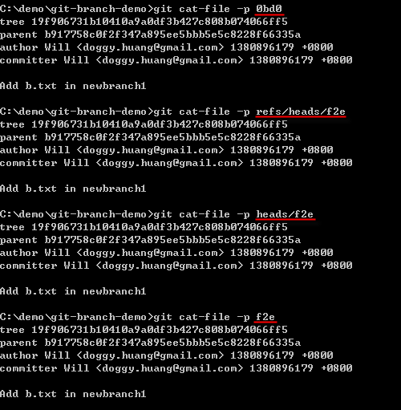
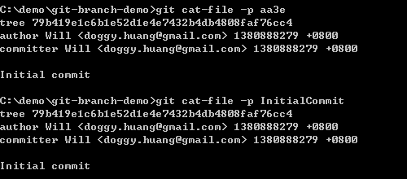
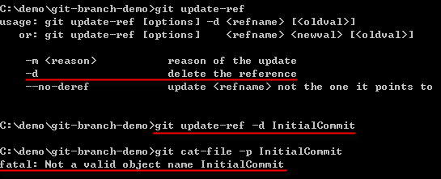

# Hari 11: Memahami Referensi Objek Git dan Referensi Simbolik

Setelah memahami "nama absolut" objek Git, selanjutnya kami akan memperkenalkan "nama referensi" yang paling umum digunakan dalam proses kontrol versi Git.

## Memahami Nama Referensi Objek

Nama referensi (ref) pada dasarnya adalah sebuah "penunjuk" ke objek Git, atau "nama lain yang mudah diingat" dibandingkan dengan "nama absolut". Nama referensi menggunakan nama yang telah ditentukan sebelumnya atau yang ditentukan oleh pengguna untuk mewakili objek Git tertentu.

"Nama branch" yang telah kita pelajari sebelumnya, HEAD yang telah kita gunakan (mewakili versi terbaru), atau "nama tag" yang akan kita pelajari nanti — semuanya adalah "nama referensi", yang pada dasarnya dibuat agar lebih mudah diingat.

Kita akan menggunakan "nama branch" sebagai contoh untuk menjelaskan seperti apa struktur fisik dari "nama referensi". Pada gambar berikut, kami menggunakan `git branch` untuk mendapatkan semua nama branch. Anda dapat melihat bahwa saat ini kami memiliki tiga branch. Namun, ketiga nama branch ini sebenarnya adalah "nama referensi", yang berarti ketiga "nama referensi" ini berkorespondensi dengan tiga objek commit di repositori objek Git. Pada gambar berikut, Anda juga dapat melihat bahwa nama referensi branch ini sebenarnya hanyalah file. Semua nama referensi "branch lokal" terletak di direktori `.git\refs\heads`:

Kemudian saya akan menggunakan gambar berikut untuk membuktikan bagaimana file ini terhubung dengan "nama absolut". Pertama-tama saya menggunakan `git branch` untuk mendapatkan semua nama branch dan menemukan bahwa "direktori kerja" saat ini menunjuk ke branch `newbranch1`. Pada saat ini, kita dapat memperoleh semua catatan versi dari branch ini melalui `git log --pretty=oneline`. Secara default, "nama referensi" branch ini akan menunjuk ke "versi terbaru" dari branch tersebut. Kita hanya perlu membuka isi file `.git\refs\heads\newbranch1` untuk melihat bahwa ini hanyalah file teks biasa yang menunjuk ke "versi terbaru" dalam riwayat versi. Terakhir, gunakan `git cat-file -p 0bd0` untuk mendapatkan isi objek commit tersebut dan `git show 0bd0` untuk mendapatkan catatan perubahan versi tersebut, sehingga membuktikan bahwa file-file ini adalah tujuan utama dari "nama referensi".

Kemudian kita menggunakan perintah untuk melihat isi pembacaan objek commit tertentu menggunakan "nama absolut" dan "nama referensi", membuktikan bahwa hasil kedua perintah ini sama:

Dalam kebanyakan kasus, "nama referensi" biasanya menunjuk ke objek commit, tetapi tidak harus demikian. Anda juga dapat menunjuk ke jenis objek Git lainnya, seperti objek blob, objek tree, objek tag, dan sebagainya.

## Tentang Direktori .git/refs/

Dari contoh di atas, Anda sebenarnya dapat melihat bahwa semua "nama referensi" adalah file dan semuanya ditempatkan di direktori `git/refs/`. Lokasi direktori tempat nama referensi Git ditempatkan terutama ada tiga:

* Branch lokal: `.git/refs/heads/`
* Branch remote: `.git/refs/remotes/`
* Tag: `.git/refs/tags/`

Izinkan saya memberi Anda contoh sederhana. Jika Anda membuat branch bernama `f2e`, pada saat ini Anda akan mengetahui bahwa "nama referensi" dari branch lokal akan membuat file `.git/refs/heads/f2e`, seperti yang ditunjukkan pada gambar berikut:

Sebenarnya, "nama lengkap" dari `f2e` ini seharusnya disebut `refs/heads/f2e`. Hanya saja Git memungkinkan Anda memasukkan singkatan untuk memudahkan input nama referensi yang cepat. Seperti yang ditunjukkan pada gambar berikut, ketiga cara penggunaan "nama referensi" ini semuanya dapat dilakukan:

Namun, ketika Anda memasukkan "singkatan" dari nama referensi, Git akan mencari nama referensi yang sesuai dalam urutan berikut secara default. Selama file yang sesuai ditemukan, Git akan segera mengembalikan "nama absolut objek" dari isi file tersebut:

* `.git/<reference abbreviation>`
* `.git/refs/<reference abbreviation>`
* `.git/refs/tags/<reference abbreviation; tag name>`
* `.git/refs/heads/<reference abbreviation; local branch name>`
* `.git/refs/remotes/<reference abbreviation>`
* `.git/refs/remotes/<reference abbreviation; remote branch name>/HEAD`

Sebagai contoh, ketika Anda memasukkan perintah `git cat-file -p f2e`, Git akan menemukan "file nama referensi" relatif dalam urutan berikut dan mengekstrak isi file tersebut (yaitu nama absolut dari objek Git):

* `.git/f2e` --> File tidak ditemukan
* `.git/refs/f2e` --> File tidak ditemukan
* `.git/refs/tags/f2e` --> File tidak ditemukan
* `.git/refs/heads/f2e` --> **Nama referensi ditemukan, pencarian tidak dilanjutkan**
* `.git/refs/remotes/f2e`
* `.git/refs/remotes/f2e/HEAD`

## Memahami Nama Referensi Simbolik Objek (symref)

Nama referensi simbolik (symref) sebenarnya juga merupakan jenis nama referensi (ref), hanya saja isinya berbeda. Kita dapat melihat perbedaan isi dari gambar berikut. "Referensi simbolik" akan menunjuk ke "nama referensi" lain dan isinya diawali dengan `ref:`:

Dalam alat Git, beberapa referensi simbolik khusus dipertahankan secara default untuk memudahkan akses cepat ke objek commit yang umum digunakan, dan objek-objek ini disimpan di direktori `.git/` secara default. Referensi simbolik ini ada empat berikut:

* HEAD
* Akan selalu menunjuk ke "versi terbaru" dalam "branch" yang diatur di "direktori kerja".
* Jadi ketika Anda menjalankan `git commit` di branch ini, referensi simbolik `HEAD` ini juga akan diperbarui ke objek commit versi terbaru dari branch tersebut.
* ORIG_HEAD
* Sederhananya, ini adalah "versi sebelumnya" dari objek commit HEAD, sering digunakan untuk memulihkan perubahan versi sebelumnya.
* FETCH_HEAD
* Ketika menggunakan repositori remote, Anda dapat menggunakan perintah `git fetch` untuk mengambil semua objek dari repositori remote. Referensi simbolik FETCH_HEAD ini akan mencatat "nama absolut" dari HEAD (versi terbaru) setiap branch di repositori remote.
* MERGE_HEAD
* Ketika Anda melakukan pekerjaan merge (topik merge akan disebutkan dalam artikel mendatang), nama absolut objek commit dari "sumber merge" akan dicatat dalam referensi simbolik MERGE_HEAD ini.

## Penggunaan Referensi Umum dan Referensi Simbolik

Kita tahu bahwa "nama referensi" memiliki tujuan khusus dan biasanya digunakan dalam skenario seperti "branch lokal", "branch remote", dan "tag", tetapi sebenarnya Anda dapat membuat "nama referensi kustom" dalam jumlah berapa pun. Anda dapat dengan bebas membuat "referensi umum" melalui `git update-ref`.

Saya mencoba membuat referensi umum bernama `InitialCommit` dan menunjuk ke versi pertama dalam repositori Git. Silakan merujuk ke gambar berikut untuk urutan eksekusi perintah guna mempelajari cara membuat referensi umum:

Setelah dibuat, file default akan ditempatkan di folder `.git`, dan pada saat ini, Anda dapat mengakses isi objek Git tertentu dengan "nama absolut" maupun "nama referensi":

**Catatan**: Harap diingat bahwa nama referensi dapat menunjuk ke objek Git apa pun dan tidak terbatas pada objek commit.

Untuk membuat nama referensi yang lebih formal, sebaiknya tambahkan awalan `refs/`, misalnya: `git update-ref refs/InitialCommit [object_id]`.

Untuk menghapus referensi umum, Anda dapat menggunakan opsi `-d`. Seperti yang ditunjukkan pada gambar berikut:

Untuk menampilkan semua referensi, Anda dapat menggunakan perintah `git show-ref`, seperti yang ditunjukkan pada gambar berikut:

Untuk membuat dan menghapus "referensi simbolik", Anda dapat merujuk ke gambar berikut untuk penggunaan `git symbolic-ref`. Silakan lihat gambarnya dan ceritakan kisahnya. Setelah memahaminya, Anda akan benar-benar menemukan bahwa Git sangat fleksibel dan kuat dalam penggunaan referensi. Selain itu, menjalankan `git show-ref` hanya akan menampilkan referensi yang berada di direktori `.git\refs`, dan hal ini berlaku sama untuk "referensi umum" maupun "referensi simbolik":

Di awal artikel ini, telah disebutkan bahwa Anda dapat membuat referensi ke direktori berikut:

* `.git/<reference abbreviation>`
* `.git/refs/<reference abbreviation>`
* `.git/refs/tags/<reference abbreviation; tag name>`
* `.git/refs/heads/<reference abbreviation; local branch name>`
* `.git/refs/remotes/<reference abbreviation>`
* `.git/refs/remotes/<reference abbreviation; remote branch name>/HEAD`

Referensi kustom biasanya dibuat di dua jalur pertama untuk menghindari kebingungan dengan penggunaan "branch lokal", "branch remote", dan "tag" kita. Namun, Anda memang dapat menggunakan `git update-ref` untuk membuat referensi kustom apa pun. Jika Anda membuat referensi kustom di `refs/heads/Will`, itu setara dengan membuat branch bernama `Will`. Git memang sesederhana itu. Semakin Anda memahami struktur internal Git, semakin Anda akan menyukai berbagai fitur Git.

## Ringkasan Hari Ini

Kita tahu bahwa "nama referensi (ref)" pada dasarnya adalah "penunjuk" ke objek Git, digunakan untuk menunjuk ke objek Git tertentu. Jadi Anda dapat membayangkan "nama referensi" sebagai alias untuk nama absolut objek Git, digunakan untuk membantu ingatan. Di Git, ada banyak mekanisme untuk membantu Anda mengendalikan proyek, seperti "branch", "tag", dan sebagainya. Mekanisme ini sebenarnya dicapai oleh "referensi" di balik layar.

Nama referensi Git selanjutnya dibagi menjadi "referensi umum" dan "referensi simbolik". Keduanya memiliki tujuan yang sama, hanya isinya sedikit berbeda. "Referensi simbolik" akan menunjuk ke "referensi umum" lain, sedangkan "referensi umum" menunjuk ke "nama absolut" dari sebuah objek Git.

Izinkan saya menyusun kembali perintah dan parameter Git yang dipelajari hari ini:

* git branch
* git log --pretty=oneline
* git log --oneline
* git cat-file -p [ref or object_id]
* git show [ref or object_id]
* git update-ref
* git symbolic-ref
* git show-ref

---

* [Kembali ke Daftar Isi](README.md)
* [Hari Sebelumnya: Memahami Nama Absolut Objek Git](10.md)
* [Hari Berikutnya: Memahami Nama Relatif Objek Git](12.md)

---
