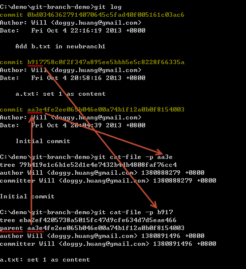

# Hari 12: Memahami Nama Relatif Objek Git

Setelah memahami "nama absolut" dan "nama referensi" objek Git, sekarang kami akan memperkenalkan "nama relatif", yang juga umum digunakan dalam proses kontrol versi Git.

Mari kita tinjau kembali. Dalam kontrol versi Git, setiap versi mewakili sebuah objek commit. Setiap objek commit memiliki "nama absolut" — string 40 karakter yang diperoleh dengan hashing SHA1 terhadap isinya. Anda dapat menggunakan 4 hingga 40 karakter pertama sebagai nama identifikasi objek commit tersebut. Selama kontrol versi, Anda juga dapat menggunakan "nama referensi" untuk mewakili objek commit tertentu. Setiap "nama referensi" pada akhirnya berkorespondensi dengan "nama absolut" dari sebuah objek. "Nama referensi" selanjutnya dibagi menjadi "referensi umum" dan "referensi simbolik". Di antaranya, "referensi umum" berkorespondensi langsung dengan "nama absolut", sedangkan "referensi simbolik" berkorespondensi dengan "referensi umum" lain.

Yang akan diperkenalkan dalam artikel ini adalah penggunaan notasi "nama relatif", yang memungkinkan Anda menemukan "objek commit" lain berdasarkan posisi relatifnya setelah menemukan objek commit tertentu.

## Notasi Nama Relatif

Menggunakan nama relatif sebenarnya sangat sederhana. Ada dua simbol khusus yang harus Anda ingat, yang satu adalah `^` dan yang lainnya adalah `~`.

Untuk menemukan versi sebelumnya dari `HEAD`, kita akan menggunakan `HEAD~` atau `HEAD~1` untuk mewakili "versi sebelumnya dari objek commit HEAD". **Catatan**: Di sini Anda seharusnya sudah mengetahui dengan sangat baik bahwa `HEAD` adalah "nama referensi simbolik" bawaan di Git, yang mewakili versi terbaru dari branch saat ini.

Jika Anda ingin menemukan dua versi sebelum branch `f2e` lain (tidak termasuk versi `HEAD` dari `f2e`), Anda dapat menggunakan `f2e~2` atau `f2e~~` untuk mewakilinya. Ini adalah metode representasi yang paling dasar.

Di repositori tanpa branch dan merge, makna yang dinyatakan oleh `^1` dan `~1` persis sama, keduanya mewakili "versi sebelumnya". Tetapi sebenarnya, di repositori dengan branch dan merge, keduanya memiliki makna yang berbeda. Bagian ini akan dijelaskan nanti.

Ini adalah notasi "nama relatif" yang paling dasar.

## Tautan antar Objek Commit

Di repositori Git yang lebih umum, secara default hanya akan ada satu "objek commit akar", yaitu versi pertama yang kita buat, juga dikenal sebagai "Initial Commit". Anda juga perlu memiliki setidaknya objek commit pertama sebelum dapat mulai membuat branch. Jadi kita dapat mengatakan: "Dalam repositori Git, di antara semua objek commit, kecuali objek commit pertama, objek commit lainnya pasti memiliki satu atau lebih objek commit induk." Mengapa mungkin ada "lebih dari satu" objek commit induk? Karena sangat mungkin Anda menggabungkan dua branch atau lebih ke branch lain. Jadi objek commit setelah merge akan memiliki beberapa objek commit induk.

Mari kita gunakan contoh sederhana untuk membuktikan hal ini. Kita menggunakan `git cat-file -p [object_id]` untuk mendapatkan isi dua objek commit pertama, sehingga memahami bahwa setiap objek commit memang akan memiliki atribut induk yang menunjuk ke nama absolut objek commit induk, kecuali objek commit pertama yang tidak akan memiliki atribut induk. Seperti yang ditunjukkan pada gambar berikut:

## Memahami Perbedaan antara `^` dan `~` dalam Notasi Nama Relatif

Makna `~` mewakili "objek commit induk pertama".

Makna yang diwakili oleh `^` adalah "ketika ada beberapa objek commit induk, objek induk generasi pertama yang mana yang diwakili".

Jika Anda memiliki "nama referensi" `C`, untuk menemukan objek commit induk pertamanya, Anda dapat menggunakan ekspresi berikut:

* `C^`
* `C^1`
* `C~`
* `C~1`

Jika Anda ingin menemukan objek commit induk keduanya (tanpa merge), Anda dapat menggunakan ekspresi berikut:

* `C^^`
* `C^1^1`
* `C~2`
* `C~~`
* `C~1~1`

Tetapi Anda tidak dapat menggunakan `C^2` untuk menyatakan "objek commit induk kedua"! Alasannya adalah tanpa merge, `C` ini hanya memiliki satu objek induk. Anda hanya dapat menggunakan `C^2` untuk mewakili "objek induk kedua dari objek lapisan sebelumnya".

Penjelasan di atas mungkin terdengar agak abstrak dan membingungkan. Saya khusus menggambar diagram untuk Anda lihat. Melalui diagram, mungkin akan lebih jelas. Seperti yang ditunjukkan pada gambar berikut, kita ingin menemukan objek commit lain (objek induk) dalam jalur relatif objek commit `C`. Karena objek commit `C` ini memiliki tiga objek induk, ini berarti objek commit ini dibuat melalui merge. Kemudian untuk menemukan setiap jalur melalui "nama relatif", Anda harus menggunakan kombinasi keterampilan `^` dan `~` untuk menemukan setiap versi yang ingin Anda buka.

## Memperkenalkan Perintah `git rev-parse`

Dalam alat Git for Windows, ada perintah `git rev-parse`. Melalui perintah ini, Anda dapat menguraikan "nama referensi" atau "nama relatif" apa pun menjadi "nama absolut". Meskipun alat ini tidak terlalu sering digunakan, alat ini cukup praktis ketika mengajar Git. Contoh penggunaannya adalah sebagai berikut:

* git rev-parse master
* git rev-parse HEAD
* git rev-parse ORIG_HEAD
* git rev-parse HEAD^
* git rev-parse HEAD~5

## Ringkasan Hari Ini

Setelah memahami "nama relatif", berbagai cara mewakili objek commit di Git telah dijelaskan. Saya yakin Anda seharusnya dapat lebih mengendalikan operasi antar berbagai versi Git.

Izinkan saya menyusun kembali perintah dan parameter Git yang dipelajari hari ini:

* git log
* git cat-file -p [object_id]
* git rev-parse

---

* [Kembali ke Daftar Isi](README.md)
* [Hari Sebelumnya: Memahami Referensi Objek Git dan Referensi Simbolik](11.md)
* [Hari Berikutnya: Menyimpan Sementara Perubahan di Direktori Kerja dan Indeks (Stash)](13.md)

---
