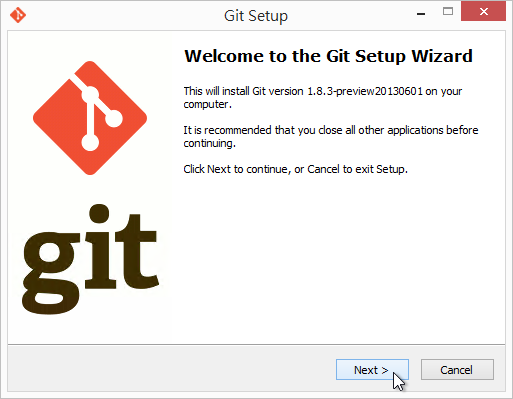
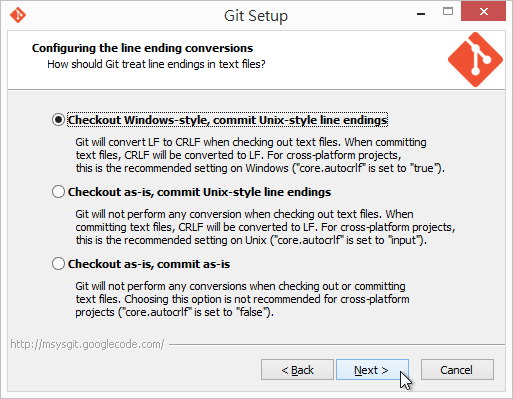
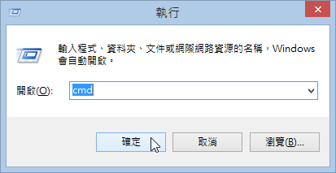
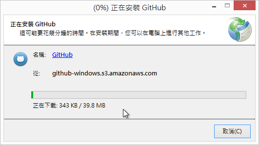
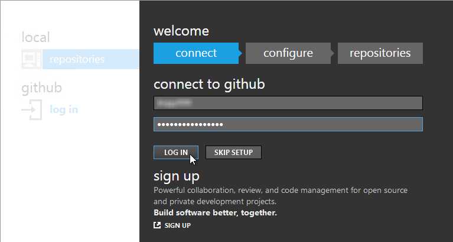
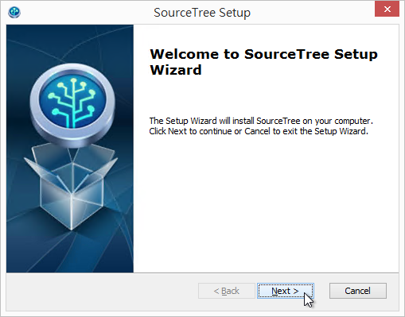
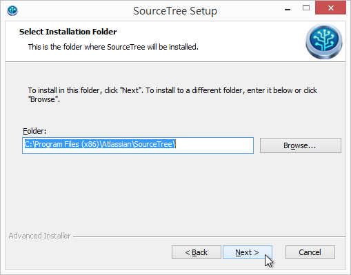
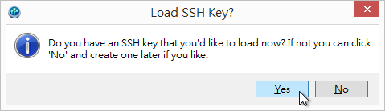

# Day 02: Windows プラットフォームで必須の Git ツール 3 選

Git バージョン管理を使い始めるには、まず適切な Git ツールをインストールする必要があります。このシリーズの記事は主に Windows プラットフォームに焦点を当てています。本記事では、私たちが最もよく使う 3 つの Git バージョン管理ツールを紹介し、それらの類似点と相違点、そしてどのようなときにどのツールを使うべきかを紹介します。

## 1 つ目のツール： [Git for Windows](https://msysgit.github.io/)

これは、**コマンド プロンプト**で実行できるコマンドラインツールのセットです。現在、市場に出ている Git の GUI ツールはすべて、実際には内部でこれらの低レベルの Git ツールを実行しています。そのため、必ずインストールしなければならない必須の Git 管理ツールです！

以下はインストールの手順です。

* まず https://msysgit.github.io/ 公式サイトにアクセスし、インストーラのダウンロードを準備します

* バージョンを問わず、最新バージョンをダウンロードします

* ダウンロードしたファイルを直接クリックしてインストールします

* インストールプログラムのようこそ画面

* GPL ライセンス条項に同意します

* インストールパスを選択します

* コンポーネントを選択します。**Windows Explorer integration オプションのチェックを外すことをお勧めします！**  ( この統合ツールはあまりにも基本的なものなので、代わりに [TortoiseGit](https://code.google.com/p/tortoisegit/) ツールを使うことをお勧めします )

* プログラムグループ名を設定します。デフォルトのオプションのままにします

* ここでは **Run Git from the Windows Command Prompt オプションを選択することをお勧めします！**  ( ほとんどの Windows ユーザーは Bash コマンドに慣れていないためです )

* 改行コードの変換については、デフォルトのオプションのままにすることをお勧めします。

* インストールを開始します

* インストール完了

* インストール後、コマンド プロンプトを直接開いて使い始めることができます

* `git --version` コマンドを入力して、ツールプログラムの現在のバージョンを確認できます

## 2 つ目のツール： [GitHub for Windows](https://windows.github.com/)

これは、Git を深く理解していない人のために [GitHub](https://github.com) が公式に開発したツールです。シンプルで親しみやすい GUI インターフェースを採用し、Git の理解しにくい概念やコマンドパラメータを隠そうとしています。GitHub for Windows ツールは Git for Windows よりもずっと親しみやすいものですが、Git の概念をまったく持っていない人にとっては、GitHub for Windows ツールを使い始めるのも容易ではないかもしれません。

> [GitHub for Windows](https://windows.github.com/) には [Git Shell](https://github.com/dahlbyk/posh-git/) ツールが組み込まれており、[Git for Windows](https://msysgit.github.io/) を使用しています。そのため、Git for Windows がインストールされていない場合、GitHub for Windows の Git Shell ツールは使用できません。

このツールを使えば、かなりの量の Git バージョン管理の作業をこなすことができます。少なくとも基本的なバージョン管理機能は提供されており、主に以下の機能があります。

* リポジトリのクローン（Clone Repositories）
	* GitHub からリポジトリをクローンする（git clone）
* 履歴の閲覧（Browse History）
	* ローカルリポジトリのバージョン履歴を閲覧する
* 変更のコミット（Commit Changes）
	* ローカルリポジトリに変更をコミットする
* コードのブランチ（Branch Code）
	* Git ブランチを作成・管理し、ワーキングディレクトリでブランチを切り替えることができる
* GitHub.com での共有（Share on GitHub.com）
	* GitHub と変更を同期する
	* ここでの「Sync（同期）」の意味は、git pull と git push を統合したものである
	* GitHub for Windows が同期する際、マージにはデフォルトで rebase を使用する。

これ以外に Git for Windows でできることは、GitHub for Windows ではできません！本当に大規模な開発プロジェクトに適用したい場合は、適しているかどうかを検討する必要があるかもしれませんが、ソフトウェア開発者でない人にとっては、シンプルなバージョン管理の作業には十分すぎるほどでしょう。

以下は GitHub for Windows のインストール手順です。

* まず https://windows.github.com/ にアクセスし、インストーラのダウンロードを準備します

* ダウンロード後、直接インストールを実行します

* ログインには GitHub アカウントが必要です

* アカウント情報を設定します

* ローカルの Git リポジトリを探します
	* Git を使ったことがない場合、ここには何も表示されないはずです

* インストール後、GitHub for Windows のメインプログラムのインターフェースが表示されます

## 3 つ目のツール： [SourceTree](https://www.sourcetreeapp.com/)

[SourceTree](https://www.sourcetreeapp.com/) は現在私が強くお勧めするツールで、Windows と Mac の両プラットフォームに対応しています。このツールは Atlassian（JIRA、Confluence、Bamboo を開発している会社）が開発した GUI ツールで、無料で提供されています。このツールを使えば、ほぼすべての Git バージョン管理の作業（git-flow ワークフローを含む）を行うことができ、非常に強力な Git バージョン管理ツールです。

> [SourceTree](https://www.sourcetreeapp.com/) も、まず [Git for Windows](https://msysgit.github.io/) がインストールされている必要があります。Git のコマンドラインツールに依存して動作するためです。

以下は SourceTree のインストール手順です。

* まず https://www.sourcetreeapp.com/ にアクセスし、インストーラのダウンロードを準備します

* インストーラをダウンロードします

* ダウンロード後、直接インストールを実行します。これはグラフィカルなインストールプログラムです

* ライセンス契約に同意する必要があります

* 使用には登録が必要です（無料です）

* Bitbucket または Google のアカウントを持っていない場合も、無料で登録できます

* セットアップウィザード

* SSH キーの設定

* Pageant/PuTTY から SSH キーを読み込むかどうか

* インストール完了！

本日のまとめ
------

本日は、Windows プラットフォームでよく使われる 3 つの Git バージョン管理ツールを簡単に紹介しました。1 つ目は [Git for Windows](https://msysgit.github.io/)、2 つ目は [GitHub for Windows](https://windows.github.com/)、3 つ目は [SourceTree](https://www.sourcetreeapp.com/) です。これら 3 つのツールにはそれぞれ長所がありますが、個人的には、Git バージョン管理を深く理解したいのであれば、Git for Windows を使ってコマンドラインから Git コマンドを実行することを学ぶべきだと思います。より直感的な GUI ツールが欲しいのであれば、[SourceTree](https://www.sourcetreeapp.com/) を使いましょう。

強調しておきたいのは、Git バージョン管理を真にマスターするには、Git が低レイヤーで何をしているのかを理解しなければならないということです。そのため、今後の記事では基本的に [Git for Windows](https://msysgit.github.io/) を使って Git バージョン管理の操作を紹介し、[SourceTree](https://www.sourcetreeapp.com/) を補助ツールとして使用して、Git のバージョン管理の操作とリポジトリの変化をよりよく理解できるよう支援します。

---

* [目次に戻る](README.md)
* [Day 01: Git バージョン管理を理解する](01.md)
* [Day 03: リポジトリを作成する](03.md)

---
