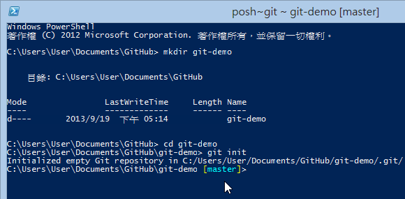

# Day 03: リポジトリを作成する

Git を使い始めるにあたって、最も重要なことは、まず Git リポジトリを持つことです。しかし、そのリポジトリはどこから来るのでしょうか。本記事では、リポジトリを作成するさまざまな方法を紹介します。

リポジトリを作成するには、実際には多くの選択肢があります。たとえば：

* ローカルマシン上にローカルリポジトリを作成する
* ローカルマシン上に共有リポジトリを作成する
* GitHub やその他の Git プラットフォーム上にリモートリポジトリを作成する

いずれにせよ、リポジトリは常に必要です。以下、それぞれについて説明します。

## ローカルマシン上にローカルリポジトリを作成する

まず [GitHub for Windows](https://windows.github.com/) の Git Shell ツールを開きましょう。このツールは実際には Windows PowerShell のインターフェースですが、Git 関連の環境変数とコマンドプロンプトの設定が追加されています。

開くと、デフォルトで `%USERPROFILE%\Documents\GitHub` フォルダが表示されます。これは [GitHub for Windows](https://windows.github.com/) のデフォルトのプロジェクトルートディレクトリであり、[GitHub for Windows](https://windows.github.com/) を通じて GitHub からクローンしたすべてのプロジェクトは、デフォルトでこのディレクトリに配置されることを意味します。

そこで、ここに直接新しいディレクトリを作成して、私たちの「ワーキングディレクトリ」として使うことができます。コマンド `mkdir git-demo` を入力してディレクトリを作成し、次に `cd git-demo` を使ってそのディレクトリに入ります。

これは空のディレクトリで、Git リポジトリは含まれていないため、`git init` コマンドを使ってリポジトリを作成できます。デフォルトでは、リポジトリはワーキングディレクトリ配下の `.git` ディレクトリに配置されます。

完全な操作手順は以下の図のとおりです。

作成後、Git Shell のコマンドプロンプトに何か違いがあることに気づくはずです。現在のパスの後に、強調表示された `[master]` が追加されています。このプロンプトには、現在の `working directory` のさまざまな状態が表示されます。理解できれば非常に便利な情報源となり、コマンドラインツールで Git を操作する際に、ワーキングディレクトリの現在の状態を確認するために何度も `git status` コマンドを入力する手間を省くことができます。この部分については、次の記事で具体的に説明します。

## ローカルマシン上に共有リポジトリを作成する

共有リポジトリとは、ワーキングディレクトリを持たない Git リポジトリを作成することを指します。この状況は Linux オペレーティングシステムでより一般的です。Linux オペレーティングシステムは通常、同じ Linux ホストを複数人で使用するためです。Windows オペレーティングシステムでも使用できますが、私たちの開発環境はほとんどが Windows Client 環境であり、複数人で 1 台のコンピュータを共有することはまれです。

共有リポジトリを作成するには、以下の図のように `git init --bare` コマンドを使って作成できます。`git init` に `--bare` パラメータを付けて使用すると、現在のディレクトリに Git リポジトリ関連のすべてのファイルとフォルダが作成されることが分かります。このフォルダは開発目的に直接使用することはできない点に特に注意しなければなりません。Git 関連の情報を格納するためにのみ使用できます。ほとんどの場合、このフォルダ内のファイルは手動で編集すべきではありません。git コマンドを通じて操作するのが最善です。

これは「ワーキングディレクトリのない純粋なリポジトリ」であるため、共有リポジトリには「ベアリポジトリ（bare repository）」という別名もあります。

繰り返し強調しなければなりませんが、Git は「分散型バージョン管理」であり、全員が完全なリポジトリを持っています。つまり、「ワーキングディレクトリ」を作成したい場合は、まずこの「ベアリポジトリ」の内容を取得しなければなりません。その際、`git clone [REPO_URI]` コマンドを使ってコピーを「クローン」する必要があります。`git clone` のプロセスを通じて、ワーキングディレクトリが自動的に作成されるだけでなく、この「ベアリポジトリ」も完全にクローンされます。このクローンのプロセスは「完全なバックアップ」のようなもので、Git リポジトリ内のすべてのバージョン記録、すべてのバージョンのファイルなど、すべてのデータを完全にコピーします。完全なコマンド操作のプロセスは以下の図を参照してください。

実務では、「共有リポジトリ」や「ベアリポジトリ」の使い方にはいくつかの方法があります。

* 複数人が使用するマシンでの共同開発。この場合、ほとんどの人にはこの「ベアリポジトリのフォルダ」への読み取り専用権限を与え、1 人または数人だけに書き込み権限を与えます。
* ベアリポジトリを Dropbox に置いて、そのベアリポジトリを自分の複数のコンピュータと同期する人もいます。

注意してください：「ワーキングディレクトリ」配下の `.git` ディレクトリも「リポジトリ」ではありますが、ワーキングディレクトリ配下のリポジトリにはワーキングディレクトリのインデックス情報も含まれており、ワーキングディレクトリの状態情報が記録されています。この状態情報は「共有リポジトリ」には現れません。共有リポジトリにはバージョン情報（つまり Git オブジェクト情報）のみが含まれます。

## GitHub やその他の Git プラットフォーム上にリモートリポジトリを作成する

実際、「リモートリポジトリ」と「共有リポジトリ」はほぼ同じものです。違いは、「共有リポジトリ」は主にファイルへの直接アクセスを使うのに対し、「リモートリポジトリ」は通常 SSH、Git プロトコル、HTTP などのプロトコルを使って Git リポジトリに「リモート」でアクセスする点だけです。その他の使用方法は基本的に同じです。

以下では、GitHub を通じてリポジトリを作成し、そのリポジトリをローカルにクローンする手順を示します。

* まず GitHub にログインし、新しいリポジトリを作成します

* GitHub プロジェクトの関連情報を設定し、リポジトリを作成します

* 作成後、プロジェクトの取得方法や、ローカルの既存プロジェクトを GitHub にインポートする方法が案内されます

* 上記のように、Quick setup セクションの「Set up in Desktop」をクリックできます。コンピュータが自動的に GitHub for Windows ツールを開き、このリポジトリを自動的にクローンしてワーキングディレクトリを作成します。

* リモート Git リポジトリの URL をコピーし、`git clone [REPO_URL]` を実行してコピーをクローンすることもできます。

## 本日のまとめ

以上が Git リポジトリを作成する 3 つの方法です。本日学んだ Git コマンドとパラメータを整理しておきます。

* git init
* git init --bare
* git clone \[REPOSITORY\_URI]

## 参考リンク

* [Git for Windows](https://msysgit.github.io/)
* [GitHub for Windows](https://windows.github.com/)

---

* [目次に戻る](README.md)
* [Day 02: Windows プラットフォームで必須の Git ツール 3 選](02.md)
* [Day 04: よく使う Git バージョン管理コマンド](04.md)

---
