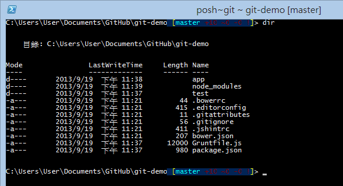

# Day 04: よく使う Git バージョン管理コマンド

本記事では、ファイルの追加、削除、名前変更、変更のコミット（新しいバージョンの作成）、履歴記録の照会といった基本的なファイル操作を含む、最も重要で基本的なバージョン管理タスクのいくつかを学びます。

## ワーキングディレクトリの準備

前回の記事「Day 03: リポジトリを作成する」の内容を振り返り、本記事のすべての演習を始めるために、直接ローカルリポジトリを作成しましょう。

```
mkdir git-demo
cd git-demo
git init
```

## ファイルの追加

ワーキングディレクトリにいくつかファイルを置きましょう。どんなファイルでも構いません。既存のファイルやディレクトリを現在のワーキングディレクトリにコピーするだけです。

本記事では、[YEOMAN](https://yeoman.io/) ツールを使って webapp のサンプル Web サイトを素早く生成します。コマンド 1 つで、完全な Web サイトを作成できます。

```
yo webapp
```

**注記**： Windows プラットフォームでの [YEOMAN](https://yeoman.io/) の使用については、著者の記事 [How to Install and Use Yeoman 1.0 Related Tools on Windows Platform](https://blog.miniasp.com/post/2013/08/11/Yeoman-1-0-Installation-and-Usage-on-Windows) を参照してください。完全なインストールと使用のプロセスが詳しく説明されています。

ファイルを追加した後、まだ Git Shell のインターフェースにいる場合は、次のようなプロンプトがすぐに表示されるはずです。



つまり、パスの後に表示される次のプロンプトです。

```
[master +10 ~0 -0 !]
```

このプロンプトの部分では、いくつかのことが分かります。

* master は、現在のワーキングディレクトリが **master** ブランチであることを表します。これは Git のデフォルトのブランチ名でもあります。
* 「赤い」数字はすべて Untracked（未追跡）ファイルを表し、これらの変更はバージョン管理に入らないことを意味します。
* +10 は「追加された」ファイルが 10 個あることを表します
* ~0 は「変更された」ファイルが 0 個であることを表します
* -0 は「削除された」ファイルが 0 個であることを表します

これらの新しいファイルを Git のバージョン管理に追加したい場合は、次のコマンドを実行しなければなりません。

```
git add .
```

このようにすると、このワーキングディレクトリ配下のすべてのファイル、ディレクトリ、およびサブディレクトリ内のすべてのファイルが、この Git ワーキングディレクトリの [index] または [cache] に追加されます。注意してください：この時点では、まだバージョンは作成されていません。Git に対して、これらのファイルが Git リポジトリに「まさに追加されようとしている」ことを伝えているだけです。

以下の図は、ここで `git add .` を実行した後の結果です。ここで表示される警告メッセージはそれほど深刻なものではありません。詳しく知りたい方は、著者の別の記事 [Notes on Git for Windows Line Ending Conversion (CRLF)](https://blog.miniasp.com/post/2013/09/15/Git-for-Windows-Line-Ending-Conversion-Notes) を参照してください。


しかし、興味深いのは、もともと「赤い数字」だったものが「緑の数字」に変わっていることです。ここで表されている意味は次のとおりです。

* 「緑の」数字はすべて Staged（準備完了）ファイルを表し、これらの変更はバージョン管理に入ることを意味します。
* +23 は、23 個の「追加された」ファイルがバージョンとして作成されることを表します
* ~0 は、0 個の「変更された」ファイルがバージョンとして作成されることを表します
* -0 は、0 個の「削除された」ファイルがバージョンとして作成されることを表します

しかし、もともとは +10（赤）しかなかったはずです。実行後にどうして +23（緑）になったのでしょうか？

`git reset` を実行してワーキングディレクトリのインデックスの状態をリセットし、次に `git status` を再度実行して現在のワーキングディレクトリの詳細な状態を確認すると、以下の図のようになります。


ここには「第 1 階層のディレクトリ配下のファイルとディレクトリ」のみがリストされていることが分かります。この時点では、git はサブディレクトリ内に追跡されていないファイルがいくつあるかをチェックしないためです。

`git add .` を実行してから `git status` を再度実行して状態を確認すると、サブディレクトリ内のファイルがすべて追加されていることが分かり、そのためこの数が増えます。以下の図のとおりです。


## 一部のファイルの追加

先ほど述べた `git add .` コマンドは、すべてのファイル（サブディレクトリ内のファイルを含む）を自動的にワーキングディレクトリのインデックスに追加します。特定のディレクトリや特定のファイルだけをバージョンに追加したい場合もあります。その場合は、特定のディレクトリを指定したり、ワイルドカードを使ってファイルを追加したりすることもできます。

再度 `git reset` を実行してワーキングディレクトリのインデックスの状態をリセットし、次に `git add app` を使って app フォルダとその配下のすべてのファイルを追加し、`git add .*` を使って「ドット」で始まるすべてのファイルを追加します。以下の図のとおりです。


**注記**： `.*` ワイルドカードではすべての「ドット」ファイルを追加することはできません。`.` の最初の文字は 1 つのディレクトリにしかマッチしないためです。ドットで始まるすべてのファイルを追加したい場合は、`.??*` を使ってドットで始まるファイルに確実にマッチさせる必要があります。

## 変更のコミット

ファイルをインデックスに追加した後、変更をコミットしてバージョンを作成できます。コミットコマンドは次のとおりです。

```
git commit -m "Initial commit"
```

`-m` パラメータの後にはコミットメッセージが続きます。このメッセージはバージョン履歴に記録されます。将来、あなたや他の人がこのバージョンの目的を理解する助けとなるよう、意味のあるコミットメッセージを書くことをお勧めします。


## コミット履歴の表示

コミットした後は、`git log` コマンドを使ってコミット履歴を表示できます。

```
git log
```


`git log --oneline` パラメータを使って、簡略化されたバージョンのログを表示することもできます。

```
git log --oneline
```


## ファイルの変更

では、ファイルを変更してみましょう。ワーキングディレクトリ内の任意のファイルを開いて変更を加え、保存します。

変更した後、`git status` を実行すると、変更されたファイルに関する情報が表示されます。


変更されたファイルは赤で表示され、変更されたファイルの数は ~1 と表示されることが分かります。

## ファイルの差分の表示

変更されたファイルをコミットする前に、どのような変更が加えられたかを確認したい場合があります。`git diff` コマンドを使うことができます。

```
git diff
```


git diff コマンドは、ワーキングディレクトリとインデックスの差分を表示します。

## 変更されたファイルのコミット

変更されたファイルをコミットするには、まず `git add` を実行して変更されたファイルをインデックスに追加し、次に `git commit` を実行する必要があります。

```
git add .
git commit -m "Update files"
```


## ファイルの削除

ファイルを削除し、その削除アクションをバージョンに記録したい場合は、`git rm` コマンドを使うことができます。

```
git rm [filename]
```

このコマンドを実行すると、ファイルはワーキングディレクトリとインデックスの両方から削除されます。その後 `git commit` を実行して、この削除アクションをコミットします。


## ファイルの名前変更または移動

ファイルの名前を変更したり移動したりしたい場合は、`git mv` コマンドを使うことができます。

```
git mv [old_filename] [new_filename]
```

このコマンドはファイルの名前変更または移動を行い、この変更を自動的にインデックスに追加します。その後 `git commit` を実行して、この変更をコミットします。


## 本日のまとめ

本日は基本的な Git コマンドをいくつか学びました。まとめると以下のとおりです。

* `git add [file]` - ファイルをインデックスに追加する
* `git add .` - 現在のディレクトリ内のすべてのファイルをインデックスに追加する
* `git commit -m "message"` - インデックスから変更をコミットして新しいバージョンを作成する
* `git status` - ワーキングディレクトリの現在の状態を表示する
* `git log` - コミット履歴を表示する
* `git log --oneline` - 簡略化されたコミット履歴を表示する
* `git diff` - ワーキングディレクトリとインデックスの差分を表示する
* `git rm [file]` - ワーキングディレクトリとインデックスからファイルを削除する
* `git mv [old] [new]` - ファイルの名前を変更または移動する
* `git reset` - インデックスの状態をリセットする

## 参考リンク

* [Git - Recording Changes to the Repository](https://git-scm.com/book/en/v2/Git-Basics-Recording-Changes-to-the-Repository)

---

* [目次に戻る](README.md)
* [Day 03: リポジトリを作成する](03.md)
* [Day 05: リポジトリ、ワーキングディレクトリ、オブジェクト、インデックスの関係を理解する](05.md)

---
