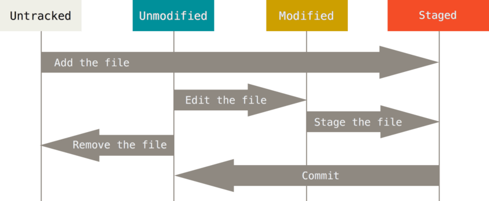

# Day 07: Git のデータ構造を解析する - インデックス構造

Git には 2 つの重要なデータ構造があることを私たちは知っています。すなわち「オブジェクト」と「インデックス」です。本記事は主に「インデックス」の詳細を説明するために使われます。Git バージョン管理を使う過程では、git コマンドの使い方は簡単に理解できるかもしれませんが、丸暗記に陥りやすく、柔軟に使いこなすことができません。Linus Torvalds でさえメーリングリストでこう述べています。「ユーザーがインデックスの意味を理解するまでは、Git の能力を完全に理解することはできない」。したがって、「インデックス」の目的を理解することは非常に重要です。

## インデックスについて

簡単に言えば、「インデックス」の目的は主に「次のコミットバージョンに提出されるファイルはどれか」を記録することです。

言い換えれば、「Git リポジトリにバージョンを提出したい場合は、まずインデックスの状態を更新しなければならず、その変更が提出される」ということです。

この「インデックス」には、実は多くの外国の記事でたくさんの別名がありますが、すべて同じ意味です。今後、関連する単語を見ても混乱しないでください。

* Index
* Cache
* Directory cache
* Current directory cache
* Staging area
* Staged files

たとえば、コマンド `git diff --cached` は `git diff --staged` と完全に同義です。

## インデックスを操作するコマンド

「インデックス」は Git にとって非常に重要であるため、ほとんどのコマンドには Git のインデックスに関連するパラメータがあります。しかし、ここでは「インデックス」に直接関連するコマンドをいくつか大まかに挙げて説明します。

コマンドを説明する前に、まず以下の図をご覧ください。この図は、コマンドを通じて状態が変化するライフサイクルを示しています。実際、これらの変化のプロセスはすべて「インデックスファイル」を更新するプロセスです。



まず、4 つのファイルの状態を紹介します。

* untracked（未追跡。まだ Git リポジトリに追加されていないファイルの状態を表します）
* unmodified（未変更。ファイルが初めて追加されたときの状態、またはファイルの内容が HEAD の内容と一致している状態を表します）
* modified（変更済み。ファイルが編集されたこと、またはファイルの内容が HEAD の内容と一致していないことを表します）
* staged（コミット待ち。これらのファイルは次に git commit が実行されるときにすべてリポジトリに送られることを表します）

### git status

**ワーキングツリー**（working tree）の状態を取得します。

リポジトリ、ワーキングディレクトリ、オブジェクト、インデックスの関係についてはすでに話しましたので、この関係を一文で説明できます。

```txt
Git repository operation is to write data into Git objects by updating the index with changes in the working directory.
```

ここでの `git status` コマンドの目的は、**最新バージョン**と**インデックスファイル**の差分を表示することです。ここでの差分には、いくつかの微妙な関係が含まれています。例を使ってこの関係を説明しましょう。

以下は git status を実行した結果です。

```sh
G:\git-demo>git status
# On branch master
# Changes to be committed:
#   (use "git reset HEAD <file>..." to unstage)
#
#       new file:   c.txt
#
# Changes not staged for commit:
#   (use "git add <file>..." to update what will be committed)
#   (use "git checkout -- <file>..." to discard changes in working directory)
#
#       modified:   a.txt
#
# Untracked files:
#   (use "git add <file>..." to include in what will be committed)
#
#       b.txt
```

ここでは 3 つの異なるグループが表示されます。すなわち：

* Changes to be committed（提出準備のできた変更）
  * この領域には `new file: c.txt` ファイルがあり、c.txt が新しいファイルであり、コミット準備完了としてマークされていることを意味します。
  * これはいくつかのことを表します：
    1. c.txt ファイルは現在**ワーキングディレクトリ**に存在する
    2. c.txt ファイルは**インデックス**に追加されている
    3. **インデックス**内の c.txt の内容は、**ワーキングディレクトリ**内の内容と一致している
    4. git commit を実行すると、**インデックス**内の内容がコミットされる（ワーキングディレクトリ内の内容ではない）

* Changes not staged for commit（変更されたが、まだコミット用にステージされていない変更）
  * この領域には `modified: a.txt` ファイルがあり、a.txt が変更されたファイルですが、コミット準備完了としてマークされていないことを意味します。
  * これはいくつかのことを表します：
    1. a.txt ファイルは現在**ワーキングディレクトリ**に存在する
    2. a.txt ファイルは**インデックス**に追加されている
    3. **インデックス**内の a.txt の内容は、**ワーキングディレクトリ**内の内容と一致していない
    4. git commit を実行すると、**インデックス**内の内容のみがコミットされる（ワーキングディレクトリ内の内容ではない）

* Untracked files（未追跡ファイル）
  * この領域には `b.txt` ファイルがあり、b.txt が新しいファイルであり、インデックスに追加されていないことを意味します。
  * これはいくつかのことを表します：
    1. b.txt ファイルは現在**ワーキングディレクトリ**に存在する
    2. b.txt ファイルは**インデックス**に追加されていない
    3. git commit を実行しても、このファイルはコミットされない

### git add

ファイルの内容をインデックスに追加します（次のコミットのためにファイルをステージします）。

`git add` コマンドには多くの使い方があります。簡単に言えば、このコマンドを実行すると「インデックスが更新」されますが、インデックスの更新方法は現在のファイルの状態によって異なる場合があります。

* ファイルが **untracked** 状態の場合、`git add` を実行するとファイルの内容がインデックスに追加されます
* ファイルが **modified** 状態の場合、`git add` を実行するとファイルの内容がインデックスに更新されます
* ファイルが **staged** 状態の場合、`git add` を実行するとファイルの内容が再びインデックスに更新されます

### git rm

ワーキングツリーとインデックスからファイルを削除します。

このコマンドは、**ワーキングディレクトリ**と**インデックス**の両方からファイルを削除します。削除した後は、git commit を実行してこの削除アクションを完了する必要があります。

### git mv

ファイル、ディレクトリ、またはシンボリックリンクを移動または名前変更します。

このコマンドは、**ワーキングディレクトリ**と**インデックス**の両方でファイルを移動または名前変更します。移動または名前変更した後は、git commit を実行してこのアクションを完了する必要があります。

### git commit

変更をリポジトリに記録します。

このコマンドは、現在の**インデックス**の内容を**オブジェクトデータベース**に書き込み、commit オブジェクトを生成します。

### git ls-files

インデックスとワーキングツリー内のファイルに関する情報を表示します。

このコマンドは、インデックス内のファイルリストと状態を表示できます。これは非常に便利なコマンドで、インデックスの現在の状態を理解する助けとなります。

よく使われるパラメータ：

* `git ls-files -s` または `git ls-files --stage` : インデックス内のファイルリストと詳細情報を表示する
* `git ls-files -c` または `git ls-files --cached` : キャッシュされたファイルリストを表示する
* `git ls-files -d` または `git ls-files --deleted` : 削除されたファイルリストを表示する
* `git ls-files -m` または `git ls-files --modified` : 変更されたファイルリストを表示する
* `git ls-files -o` または `git ls-files --others` : 未追跡ファイルリストを表示する

## 本日のまとめ

Git における「インデックス」は非常に重要な概念です。インデックスを通じて、Git は次のコミットバージョンに提出されるファイルがどれかを知ることができます。さまざまなコマンドを通じて、インデックスの状態を更新し、提出されるファイルを制御できます。インデックスを理解することで、Git バージョン管理をよりよくマスターする助けとなります。

## 参考リンク

* [Git Internals - Git Objects](https://git-scm.com/book/en/Git-Internals-Git-Objects)
* [Pro Git Book](https://progit.org/)

---

* [目次に戻る](README.md)
* [Day 06: Git のデータ構造を解析する - オブジェクト構造](06.md)
* [Day 08: ブランチの基本概念と使い方](08.md)

---
