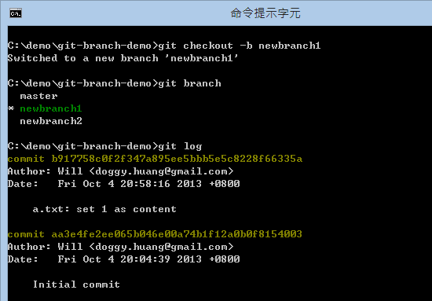
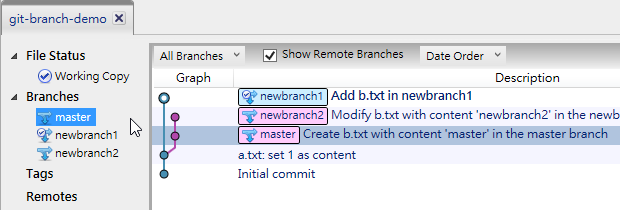

# Day 08: ブランチの基本概念と使い方

Git において、**ブランチ**は非常に重要な仕組みであり、特別な注意を払って使用しなければなりません。プロジェクトが無限に分岐し続けることはできないからです。最終的にはブランチをマージしなければなりませんが、マージは後のトピックです。本記事ではまず、Git ブランチの基本概念と使い方を学びます。

## ブランチの基本概念

バージョン管理で「ブランチ」の仕組みを使用する主な目的は、開発プロセスにおけるバージョンの競合の問題を解決することです。何らかのバージョン管理の仕組みを使ったことのある多くの人は、「ブランチ」が「バージョンの競合を引き起こす」元凶だと考えるでしょう。ブランチを開始すると、必ずマージの問題を考えることになるからです。ブランチした後、誰かがあなたと同じファイルの同じ行を変更すると、「バージョンの競合」が発生します。競合が発生するたびに、それを解決するために手間をかけなければなりません。

競合が発生したとき、自分のバージョンを使うか相手のバージョンを使うかを簡単に決められる場合もありますが、そう簡単ではない場合もあります。複雑な場合は、競合した断片に基づいて元々これらの行を変更した人を探し出し、互いの変更がシステムに与える影響を調整し、最終的にどのようにマージするかを決定しなければなりません。このような問題は非常に面倒であるため、多くの人は「競合」を避けるために「ブランチ」を避けようとします。

しかし、開発チームが大きくなりシステムの機能が増えていくと、バージョンをブランチしなくても、全員の競合は絶え間なく発生します。時には競合の問題ですらなく、A が完成させた機能が、競合もなしに B の後続バージョンで上書きされてしまうこともあり、これは誰も望んでいないことです。しかし、これも「目に見えない競合」の状況です。

過去、集中型の Subversion バージョン管理の仕組みにもブランチの概念があり、非常にうまく機能させることができました。もちろん、ソフトウェアアーキテクチャが十分に良くなかったり、ブランチの概念やツールの使い方をあまり理解していなかったりすれば、「ブランチ」を使うのがスムーズにいかないと私は思います。これは避けられない結果です。この世界には「努力なしに学べ、苦痛なく、自然にブランチを覚えられる」バージョン管理ツールは決して存在しません。人次第です。人の概念が間違っていれば、どのツールもうまく機能しません。

Git は「分散型バージョン管理の仕組み」であるため、分散型バージョン管理のシナリオでは、最もやりたくないことは「管理」です。そのため、Git にはいわゆる管理の仕組みや権限管理の仕組みはほとんどありません。Git がやりたい唯一のことは、全員がスムーズに「ブランチ」し「マージ」できるようにすることです。

[Day 03: リポジトリを作成する] で述べた「リモートリポジトリ」を例にとると、想像してみてください：`git clone` コマンドを使う瞬間から、それは実際には「ブランチ」の始まりなのです。リモートリポジトリから完全なリポジトリをコピーし、自分のローカルマシンでバージョンの作成を開始します。ソフトウェアがある程度改訂された後、「マージ」して戻します。このときのマージコマンドは `git push` と呼ばれるだけです。

ブランチとマージのこの状況は、Git のバージョン管理プロセスの至る所にあります。リモートリポジトリにもブランチがあり、ローカルリポジトリにもブランチがあります。任意のリモートブランチからローカルブランチにマージ（pull）することも、ローカルブランチをリモートブランチに push することもできます。もちろん、任意のローカルブランチから別のローカルブランチにマージすることもできます。「ブランチ」に優れた管理ロジックがなければ、最終的に非常に複雑なバージョン管理シナリオをさまざまに組み合わせることができてしまうことは想像に難くありませんが、これは誰も望んでいないことです。したがって、「ブランチ」と「マージ」をしっかり学ぶことは本当に重要です。たとえば git-flow は非常に人気のあるブランチ管理モデルです。これはツールではなく、ブランチを管理するためのロジックです。この部分については、今後の記事で説明します。

Linux カーネルの開発期間中、世界中から数万人の開発者が共に参加しました。このような大規模な開発チームを管理するために、Git が誕生しました。これは分散型バージョン管理の仕組みです。全員が完全なバージョンを持ちます。バージョンが分散された後、全員が自分のバージョンを管理し、チームの要件に従ってマージして戻さなければなりません。しかし、マージして戻す前に、この仕組みにより、全員が他の開発者のバージョンの影響を受けることなくスムーズに開発できることが保証されます。Git は確かにこれを実現し、同時にバージョン管理の複雑さも軽減しました。

もちろん、ソフトウェア開発に参加するチームが 2、3 人しかおらず、しかもそれらの人々が一堂に集まっているのであれば、Git バージョン管理を使う必要は本当にないことも言っておかなければなりません。Subversion を使うのも非常に良い選択であり、シンプルで直感的です。開発プロセスで問題が発生した場合は、周りの人と調整することで解決でき、全チームに Git を理解させるよりもずっと便利です。

あなたのチームがある程度の規模であったり、全員が一緒に作業していなかったりして、バージョン管理が必要な場合は、おそらく Git が良い選択です。しかし、作業チームの間で一貫したバージョン管理の概念や習慣を持つことも、非常に重要なことです。

## ワーキングディレクトリの準備

以下のコマンドで、2 つのバージョンを持つ Git リポジトリとワーキングディレクトリを素早く作成します。

```
mkdir git-branch-demo
cd git-branch-demo
git init

echo. > a.txt
git add .
git commit -m "Initial commit"

echo 1 > a.txt
git add .
git commit -m "a.txt: set 1 as content"
```

次に `git log` を使って、次のようなバージョン情報を取得します。

```
C:\demo\git-branch-demo>git log
commit b917758c0f2f347a895ee5bbb5e5c8228f66335a
Author: Will <doggy.huang@gmail.com>
Date:   Fri Oct 4 20:58:16 2013 +0800

    a.txt: set 1 as content

commit aa3e4fe2ee065b046e00a74b1f12a0b0f8154003
Author: Will <doggy.huang@gmail.com>
Date:   Fri Oct 4 20:04:39 2013 +0800

    Initial commit
```

次に `git branch` コマンドを使って、`master` という名前のブランチがすでにあることを確認します。これは Git リポジトリのデフォルトブランチです。`git branch -d master` でこのブランチを削除しようとすると、`error: Cannot delete the branch 'master' which you are currently on.` というエラーメッセージが表示されます。これは「現在のワーキングディレクトリのブランチが master に設定されている場合、現在のブランチを削除することはできない」という意味であり、このブランチを削除する前に、まず「別のブランチ」に切り替えなければならないことを意味します。


もちろん、現在ブランチは 1 つしかないため、当然自分自身を削除することはできません。

## ブランチの作成

ブランチを作成する最も一般的な方法は 2 つあります。

1. ブランチを作成するが、現在のワーキングディレクトリは自分のブランチのままにする： `git branch [BranchName]`

   `git branch newbranch1` コマンドを実行すると、新しい `newbranch1` ブランチが作成されます。次に `git branch` を使って、現在いくつのブランチがあるかを確認します。2 つ表示されますが、現在のワーキングディレクトリは `master` ブランチのままです。以下の図のとおりです。

   

   このとき現在のワーキングディレクトリでバージョンを作成すると、`master` ブランチに作成されます。ここで新しいファイルを作成し、`git commit` でバージョンを作成します。コマンドは以下のとおりです。

   ```
    echo master > b.txt
    git add .
    git commit -m "Create b.txt with content 'master' in the master branch"
   ```

   覚えておいてください：まずデフォルトの `master` ブランチで 2 つのバージョンを作成し、次にブランチを作成し、その後 `master` ブランチでもう 1 つのバージョンを作成しました。

2. ブランチを作成し、現在のワーキングディレクトリを新しいブランチに切り替える： `git checkout -b [BranchName]`

   次に、2 つ目の方法でブランチを作成します。`git checkout -b newbranch2` コマンドを実行すると、新しいブランチが作成されるだけでなく、現在のワーキングディレクトリも別のブランチに切り替わります。最後に `git branch` を使って、現在いくつのブランチがあるかを確認します。すでに 3 つあり、現在のワーキングディレクトリは作成したばかりの `newbranch2` ブランチに切り替わっていることが分かります。以下の図のとおりです。

   

   このとき現在のワーキングディレクトリでバージョンを作成すると、`newbranch2` ブランチに作成されます。ここで新しいファイルを作成し、`git commit` でバージョンを作成します。コマンドは以下のとおりです。

   ```
    echo newbranch2 > b.txt
    git add .
    git commit -m "Modify b.txt with content 'newbranch2' in the newbranch2 branch"
   ```

   覚えておいてください：まずデフォルトの `master` ブランチで 2 つのバージョンを作成し、次にブランチを作成し、その後 `master` ブランチでもう 1 つのバージョンを作成し、次に `master` ブランチの現在の状態に基づいて新しい `newbranch2` ブランチを作成し、ワーキングディレクトリを `newbranch2` ブランチに切り替え、その後もう 1 つのバージョンを作成しました。このとき `git log` を実行すると、ブランチがソースブランチの完全な履歴を自動的に継承するため、4 件のバージョン記録が表示されます。

**注記**： コマンドとパラメータの詳細な説明については、`git help branch` と入力して完全なドキュメントを参照できます。

```
git branch [branch_name]
```

## ブランチの切り替え

ワーキングディレクトリを別のブランチに切り替えたい場合は、次のコマンドを入力できます（-b パラメータなし）。

```
git checkout [branch_name]
```

ワーキングディレクトリを `newbranch1` ブランチに切り替えたいとします。`git checkout newbranch1` と入力して切り替えることができます。次にすぐに `git branch` を使って、現在のワーキングディレクトリが切り替わったかどうかを確認し、`git log` を使って現在の `newbranch1` ブランチの履歴記録を確認できます。これは私たちが作成した最初のブランチであるため、理論的にはこのブランチの状態には 2 件の履歴記録しかないはずです。以下の図のとおりです。


**注記**： コマンドとパラメータの詳細な説明については、`git help checkout` と入力して完全なドキュメントを参照できます。

```
git checkout [branch_name]
```

## ブランチの削除

既存のブランチを削除したい場合は、**ワーキングディレクトリの準備**で述べたように、コマンドは以下のとおりです。

```
git branch -d [branch_name]
```

前述したように、現在のワーキングディレクトリで指定されているブランチを削除することはできません。現在のブランチを削除する前に、まず別のブランチに切り替えなければなりません。たとえば、現在の `newbranch1` ブランチを削除したい場合は、まず `master` ブランチなど別のブランチに切り替え、次に `git branch -d newbranch1` コマンドを発行してブランチを削除します。以下の図のとおりです。


## ワーキングディレクトリがどのブランチにあるかを確認する

`git branch` コマンドを使って、現在どのブランチにいるかを確認できます。以下の図のとおりです。


## Git リポジトリの完全なブランチグラフを表示する

最後に、SourceTree ツールを使って Git リポジトリの現在のブランチグラフを表示します。現在、ブランチは 2 つしかありません。1 つは `master` ブランチ、もう 1 つは `newbranch2` ブランチです。`newbranch1` ブランチは演習中に削除されたためです。ブランチに「ツリー」らしい感覚を持たせるために、次に、以前の `newbranch1` と同じ状態のブランチを再作成し、このブランチ配下に新しいバージョンを追加する方法を実演します。

まだ覚えているでしょうか。私たちは `master` ブランチで 2 つのバージョンを作成した後に `newbranch1` ブランチを作成しました。ではまず、このバージョンの commit オブジェクト ID を見つけましょう。これは `git log` で取得できます。以下の図のとおりです。


私の commit オブジェクト ID は次のとおりです： b917758c0f2f347a895ee5bbb5e5c8228f66335a

次にまず、ワーキングディレクトリをこのバージョンに切り替えます。これは `git checkout [commit_id]` で完了できます。

```
git checkout b917758c0f2f347a895ee5bbb5e5c8228f66335a
```

このとき `git log` を使うと、ワーキングディレクトリの状態をこのバージョンに切り替えたため、バージョン記録が 2 件だけ表示されるはずです。以下の図から分かるように、`git checkout b917758c0f2f347a895ee5bbb5e5c8228f66335a` を実行すると、一対のメッセージが表示されます。これらのメッセージは非常に重要であり、理解しなければなりません。以下の図のとおりです。


まず、ワーキングディレクトリのバージョンを「古い」バージョンに切り替えるため、ワーキングディレクトリがいわゆる **detached HEAD** 状態に入ったことが通知されます。これは「現在のワーキングディレクトリが最新バージョンにない」ことを知らせるものです。Git リポジトリの任意のバージョンにいつでも切り替えることができますが、このバージョンにはすでに「次のバージョン」があるため、現在の「古いバージョン」で `git commit` を実行すると、この新しいバージョンは変更を追跡されません。そのため、これは行わないことをお勧めします。

**detached HEAD** 状態で追跡可能なバージョンを作成したい場合、正しい方法は「ブランチを作成する」ことで追跡することです。ここで、このバージョンに新しい `newbranch1` ブランチを作成し、ワーキングディレクトリを切り替えます。コマンドは以下のとおりです。

```
git checkout -b newbranch1
```



次に、内容が `newbranch1` の新しいファイル `b.txt` を作成し、新しいバージョンを作成します。コマンドは以下のとおりです。

```
echo newbranch1 > b.txt
git add .
git commit -m "Add b.txt in newbranch1"
```

さて、`master` 以外に 2 つのブランチがあり、両方のブランチにそれぞれ独自のバージョンがあります。このツリーがあなたの頭の中でどのように見えるか考えてみてください！

次に、SourceTree ツールを開き、このワーキングディレクトリを SourceTree 管理ツールに追加します。


追加した後、この Git リポジトリのブランチに切り替えます。合計 3 つあります。それぞれに切り替えてみましょう。




最も古いバージョンが下部にあり、最新バージョンが上部にあります。異なるブランチに切り替えると、3 つのブランチ図は同じで、デフォルトの「ライトバー」だけが異なることが分かります。まず、図から見えるのは「Git リポジトリ全体」であり、すべてのバージョン、すべてのブランチ、そしてブランチがどのバージョンから始まったかが見えます。「ライトバー」は、そのブランチの「最新バージョン」が Git リポジトリ全体のどのバージョンに位置するかを示します。

## 本日のまとめ

実際、Git でブランチを使うのは簡単なことです。難しいのは、全員に「ブランチ」が何をしているのかを知ってもらうこと、そして全員の「ブランチ」に対する**想像**が一致しているかどうかです。全員のブランチに対する想像が一致してさえいれば、チームのバージョン管理に大きな差は生じません。

私の場合、ブランチを一種の「スナップショット」機能として想像します。あるコミットバージョンとその履歴バージョンのスナップショットを作成し、1 つコピーして、ブランチ名を付けるのです。これらのブランチ上でバージョンを作成し、将来のマージを待つことができます。

Git リポジトリ全体はすべてのブランチとバージョンを保持し、最終的にツリー構造のブランチ図を提示します。最後に、SourceTree ツールを通じて、Git リポジトリ内のブランチの状況とバージョンの変化を明確に見ることができます。私はこの図を非常に早い段階で見ましたが、初めて見たときはまったく理解できず、ただ「図」だと思っただけで何の感覚もありませんでした。しかし、Git について学べば学ぶほど、このブランチ図によって Git リポジトリ全体の変化を一目で理解し、Git のバージョン変化をよりよく把握できるようになりました。

私の文章と図付きのコマンド実演を通じて、あなた自身の頭の中にブランチ構造の輪郭を描き、Git のブランチ構造についてより深く理解する助けとなれば幸いです。

本日学んだ Git コマンドとパラメータを整理しておきます。

* git branch
* git branch \[branch\_name]
* git checkout -b \[branch\_name]
* git checkout \[branch\_name]
* git branch -d \[branch\_name]
* git log

---

* [目次に戻る](README.md)
* [Day 07: Git のデータ構造を解析する - インデックス構造](07.md)
* [Day 09: ファイルとバージョンの差分を比較する](09.md)

---
