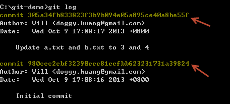
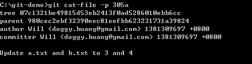
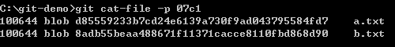

# Day 10: Git オブジェクトの絶対名を理解する

Git のバージョン管理プロセスでは、各バージョンが commit オブジェクトを表します。バージョン管理中にはブランチが頻繁に作成されるため、結果として得られるコミットグラフは非常に複雑になることがあります。したがって、異なるバージョンをどのように識別するか、あるいは特定のバージョンを素早く見つけて情報を取得するかが非常に重要になります。本記事では、Git でよく使われるオブジェクト名の概念と使用方法を理解します。

## オブジェクトの絶対名

Git では、各オブジェクトには SHA1 ハッシュで計算された ID があり、この ID がいわゆる「絶対名」です。オブジェクトが commit オブジェクトであれば、これは commit オブジェクトの絶対名です。そのため、commit オブジェクトの絶対名さえ分かれば、いつでもそのバージョンを取得できます。以下の図の矢印が示すように、これは `git log` を通じて取得した commit オブジェクト ID です。私たちはその commit オブジェクトに関する詳細情報をいつでも取得できます。

上記の図の commit オブジェクトの内容を見たい場合は、`git cat-file -p commitid` を使って取得できます。以下の図のとおりです。

## オブジェクト絶対名の短縮構文

Git オブジェクト ID は内容の SHA1 ハッシュの結果であるため、非常に長くなります（40 文字）。Git で「絶対名」を指定する際は、代わりに最初の数文字だけを使うことができ、最小で 4 文字です。つまり、長さが 4 文字から 40 文字までの「絶対名」はすべて、オブジェクトを識別するために使うことができます。

たとえば、上記の図からも分かるように、この commit オブジェクトの内容には tree オブジェクトが含まれており、その tree オブジェクトにも `07c1321be49815d53eb2413f0ad5286010ebb6cc` という絶対名があります。そのため、`git cat-file -p treeid` を再度使ってその tree オブジェクトの内容を取得することもできます。以下の図のとおりです。

バージョン記録を取得したい場合は `git log` コマンドを使いますが、これも各ファイルの変更の比較結果を出力するため、結果は非常に長くなります。このとき、`git log --pretty=oneline` コマンドを使うことで、より簡潔な履歴記録を取得でき、commit オブジェクトの完全な「絶対名」も取得できます。以下の図のとおりです。

もう 1 つのよく使われるテクニックは、「絶対名」の一部だけを出力することです。これは `git log --pretty=oneline --abbrev-commit` コマンドで実行できます。以下の図のとおりです。

## 本日のまとめ

以上が絶対名の使い方です。Git オブジェクトの特性により、オブジェクトの絶対名を通じて Git リポジトリ内の任意のオブジェクトにアクセスできます。絶対名を使う git コマンドは他にもたくさんあります。これらの概念と表現に慣れることで、Git オブジェクトをよりよくマスターできるでしょう。

本日学んだ Git コマンドとパラメータを整理しておきます。

* git log
* git cat-file -p [object_id]
* git log --pretty=oneline
* git log --pretty=oneline --abbrev-commit

---

* [目次に戻る](README.md)
* [Day 09: ファイルとバージョンの差分を比較する](09.md)
* [Day 11: Git オブジェクトの参照とシンボリック参照を理解する](11.md)

---
