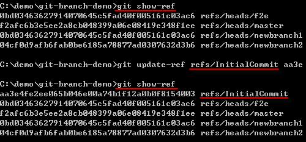

# Day 11: Git オブジェクトの参照とシンボリック参照を理解する

Git オブジェクトの「絶対名」を理解したところで、次は Git のバージョン管理プロセスで最もよく使われる「参照名」を紹介します。

## オブジェクトの参照名を理解する

参照名（ref）とは、簡単に言えば Git オブジェクトへの「ポインタ」であり、「絶対名」と比べると覚えやすい別名です。あらかじめ定義された名前、またはユーザー定義の名前を使って、特定の Git オブジェクトを表します。

以前に学んだ「ブランチ名」、これまで使ってきた HEAD（最新バージョンを表す）、そして後で学ぶ「タグ名」——これらはすべて「参照名」であり、本質的には覚えやすくするために作られたものです。

「ブランチ名」を例に、「参照名」の物理的な構造がどのようなものか説明します。以下の図では、`git branch` を使ってすべてのブランチ名を取得しています。現在 3 つのブランチがあることが分かります。しかし、この 3 つのブランチ名は実際には「参照名」であり、この 3 つの「参照名」が Git オブジェクトリポジトリ内の 3 つの commit オブジェクトに対応しているということです。以下の図では、これらのブランチ参照名が実際には単なるファイルであることも分かります。すべての「ローカルブランチ」参照名は `.git\refs\heads` ディレクトリに配置されています。

次に、以下の図で、このファイルが「絶対名」とどのように結びついているかを証明します。まず `git branch` を使ってすべてのブランチ名を取得し、現在の「ワーキングディレクトリ」が `newbranch1` ブランチを指していることを確認します。このとき、`git log --pretty=oneline` を通じてこのブランチのすべてのバージョン記録を取得できます。デフォルトでは、これらのブランチ「参照名」はブランチの「最新バージョン」を指します。`.git\refs\heads\newbranch1` ファイルの内容を開いてみれば、これがバージョン履歴の「最新バージョン」を指すプレーンテキストファイルにすぎないことが分かります。最後に、`git cat-file -p 0bd0` を使ってその commit オブジェクトの内容を取得し、`git show 0bd0` を使ってそのバージョンの変更記録を取得することで、これらのファイルこそが「参照名」の主な用途であることを証明します。

続いて、コマンドを使って「絶対名」と「参照名」で特定の commit オブジェクトの内容を読み取り、2 つのコマンドの結果が同じであることを証明します。

ほとんどの場合、「参照名」は通常 commit オブジェクトを指しますが、必ずしもそうとは限りません。blob オブジェクト、tree オブジェクト、tag オブジェクトなど、他の Git オブジェクトタイプを指すこともできます。

## .git/refs/ ディレクトリについて

上記の例から、すべての「参照名」はファイルであり、すべて `git/refs/` ディレクトリに配置されていることが分かります。Git の参照名が配置されるディレクトリは、主に次の 3 つです。

* ローカルブランチ：`.git/refs/heads/`
* リモートブランチ：`.git/refs/remotes/`
* タグ：`.git/refs/tags/`

簡単な例を挙げましょう。`f2e` という名前のブランチを作成すると、このときローカルブランチの「参照名」によって `.git/refs/heads/f2e` ファイルが作成されることが分かります。以下の図のとおりです。

実際、この `f2e` の「完全名」は `refs/heads/f2e` と呼ぶべきです。Git が参照名を素早く入力できるように、略称の入力を許可しているだけです。以下の図のとおり、これら 3 つの「参照名」の使い方はすべて可能です。

ただし、「参照名」の「略称」を入力した場合、Git はデフォルトで以下の順序で適切な参照名を検索します。対応するファイルが見つかり次第、そのファイル内容の「オブジェクト絶対名」を直ちに返します。

* `.git/<参照の略称>`
* `.git/refs/<参照の略称>`
* `.git/refs/tags/<参照の略称；タグ名>`
* `.git/refs/heads/<参照の略称；ローカルブランチ名>`
* `.git/refs/remotes/<参照の略称>`
* `.git/refs/remotes/<参照の略称；リモートブランチ名>/HEAD`

たとえば、`git cat-file -p f2e` コマンドを入力すると、Git は以下の順序で対応する「参照名ファイル」を見つけ、そのファイルの内容（すなわち Git オブジェクトの絶対名）を取り出します。

* `.git/f2e` --> ファイルが見つかりません
* `.git/refs/f2e` --> ファイルが見つかりません
* `.git/refs/tags/f2e` --> ファイルが見つかりません
* `.git/refs/heads/f2e` --> **参照名が見つかりました。これ以上検索しません**
* `.git/refs/remotes/f2e`
* `.git/refs/remotes/f2e/HEAD`

## オブジェクトのシンボリック参照名（symref）を理解する

シンボリック参照名（symref）も、実は参照名（ref）の一種であり、内容が異なるだけです。内容の違いは以下の図から分かります。「シンボリック参照」は別の「参照名」を指し、内容は `ref:` で始まります。

Git ツールでは、よく使う commit オブジェクトへ素早くアクセスできるよう、いくつかの特殊なシンボリック参照がデフォルトで維持されており、これらのオブジェクトはデフォルトで `.git/` ディレクトリに保存されます。これらのシンボリック参照には次の 4 つがあります。

* HEAD
* 常に「ワーキングディレクトリ」で設定された「ブランチ」の「最新バージョン」を指します。
* そのため、このブランチで `git commit` を実行すると、この `HEAD` シンボリック参照もこのブランチの最新バージョンの commit オブジェクトに更新されます。
* ORIG_HEAD
* 簡単に言えば、HEAD commit オブジェクトの「1 つ前のバージョン」であり、以前のバージョンの変更を復元する際によく使われます。
* FETCH_HEAD
* リモートリポジトリを使う場合、`git fetch` コマンドを使ってリモートリポジトリからすべてのオブジェクトを取得することがあります。この FETCH_HEAD シンボリック参照は、リモートリポジトリ内の各ブランチの HEAD（最新バージョン）の「絶対名」を記録します。
* MERGE_HEAD
* マージ作業を行う際（マージの話題は今後の記事で触れます）、この MERGE_HEAD シンボリック参照に「マージ元」の commit オブジェクトの絶対名が記録されます。

## 一般参照とシンボリック参照の使い方

「参照名」には特殊な用途があり、通常は「ローカルブランチ」「リモートブランチ」「タグ」などのシナリオで使われることが分かっていますが、実際には「カスタム参照名」をいくつでも作成できます。`git update-ref` を通じて「一般参照」を自由に作成できます。

`InitialCommit` という名前の一般参照を作成し、Git リポジトリ内の最初のバージョンを指すようにしてみます。一般参照の作成方法を学ぶため、コマンドの実行順序については以下の図を参照してください。

作成後、デフォルトのファイルは `.git` フォルダに配置されます。このとき、「絶対名」と「参照名」の両方で特定の Git オブジェクトの内容にアクセスできます。

**注意**：参照名は任意の Git オブジェクトを指すことができ、commit オブジェクトに限定されないことを覚えておいてください。

より正式な参照名を作成するには、`refs/` プレフィックスを付けるのが最適です。たとえば：`git update-ref refs/InitialCommit [object_id]`。

一般参照を削除するには、`-d` オプションを使います。以下の図のとおりです。

すべての参照を表示するには、`git show-ref` コマンドを使います。以下の図のとおりです。

「シンボリック参照」の作成と削除については、以下の図で `git symbolic-ref` の使い方を参照してください。図を見て、物語を語ってみてください。理解すれば、Git の参照の使い方がいかに柔軟で強力かを実感できるでしょう。また、`git show-ref` を実行すると `.git\refs` ディレクトリ内の参照のみが表示され、これは「一般参照」と「シンボリック参照」のどちらについても同様です。

本記事の前半では、参照を以下のディレクトリに作成できることを述べました。

* `.git/<参照の略称>`
* `.git/refs/<参照の略称>`
* `.git/refs/tags/<参照の略称；タグ名>`
* `.git/refs/heads/<参照の略称；ローカルブランチ名>`
* `.git/refs/remotes/<参照の略称>`
* `.git/refs/remotes/<参照の略称；リモートブランチ名>/HEAD`

カスタム参照は通常、「ローカルブランチ」「リモートブランチ」「タグ」の使い方と混同しないよう、最初の 2 つのパスに作成されます。とはいえ、`git update-ref` を使えば、任意のカスタム参照を実際に作成できます。`refs/heads/Will` にカスタム参照を作成すれば、それは `Will` という名前のブランチを作成することと同じです。Git は本当にそれだけシンプルなのです。Git の内部構造を理解すればするほど、Git のさまざまな機能が好きになるでしょう。

## 本日のまとめ

「参照名（ref）」とは、簡単に言えば Git オブジェクトへの「ポインタ」であり、特定の Git オブジェクトを指すために使われることが分かっています。そのため、「参照名」は Git オブジェクト絶対名のエイリアスであり、記憶を助けるために使われるとイメージできます。Git には、「ブランチ」や「タグ」など、プロジェクトの管理を助ける仕組みが数多くあります。これらの仕組みは、実際には裏側で「参照」によって実現されています。

Git の参照名はさらに「一般参照」と「シンボリック参照」に分けられます。両者の目的は同じで、内容が少し異なるだけです。「シンボリック参照」は別の「一般参照」を指し、「一般参照」は Git オブジェクトの「絶対名」を指します。

本日学んだ Git コマンドとパラメータを整理しておきます。

* git branch
* git log --pretty=oneline
* git log --oneline
* git cat-file -p [ref or object_id]
* git show [ref or object_id]
* git update-ref
* git symbolic-ref
* git show-ref

---

* [目次に戻る](README.md)
* [Day 10: Git オブジェクトの絶対名を理解する](10.md)
* [Day 12: Git オブジェクトの相対名を理解する](12.md)

---
