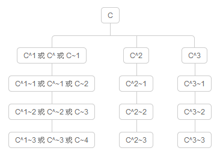

# Day 12: Git オブジェクトの相対名を理解する

Git オブジェクトの「絶対名」と「参照名」を理解したところで、次は Git のバージョン管理プロセスでもよく使われる「相対名」を紹介します。

改めて復習しましょう。Git のバージョン管理では、各バージョンが commit オブジェクトを表します。各 commit オブジェクトには「絶対名」、すなわち内容を SHA1 ハッシュして得られる 40 文字の文字列があります。その commit オブジェクトの識別名として、最初の 4 文字から 40 文字までを使うことができます。バージョン管理中は、「参照名」を使って特定の commit オブジェクトを表すこともできます。各「参照名」は最終的にオブジェクトの「絶対名」に対応します。「参照名」はさらに「一般参照」と「シンボリック参照」に分けられます。そのうち「一般参照」は「絶対名」に直接対応し、「シンボリック参照」は別の「一般参照」に対応します。

本記事で紹介するのは「相対名」表記の使い方です。特定の commit オブジェクトを見つけた後、その相対的な位置に基づいて他の「commit オブジェクト」を見つけることができます。

## 相対名表記

相対名の使い方は実はとても簡単です。覚えるべき特殊な記号が 2 つあり、1 つは `^`、もう 1 つは `~` です。

`HEAD` の 1 つ前のバージョンを見つけるには、`HEAD~` または `HEAD~1` を使って「HEAD commit オブジェクトの 1 つ前のバージョン」を表します。**注意**：ここで、`HEAD` は Git に組み込まれた「シンボリック参照名」であり、現在のブランチの最新バージョンを表すことを、すでによく理解しているはずです。

別の `f2e` ブランチより 2 つ前のバージョン（`f2e` の `HEAD` バージョンは含まない）を見つけたい場合は、`f2e~2` または `f2e~~` を使って表すことができます。これが最も基本的な表現方法です。

ブランチやマージのないリポジトリでは、`^1` と `~1` が表す意味はまったく同じで、どちらも「1 つ前のバージョン」を表します。しかし実際には、ブランチやマージのあるリポジトリでは、両者の意味は異なります。この部分は後ほど説明します。

これが最も基本的な「相対名」表記です。

## commit オブジェクト間のつながり

より一般的な Git リポジトリでは、デフォルトで「ルート commit オブジェクト」は 1 つだけであり、それは私たちが作成した最初のバージョンで、「Initial Commit」とも呼ばれます。また、ブランチを開始するには、少なくとも最初の commit オブジェクトが必要です。したがって、「Git リポジトリでは、すべての commit オブジェクトのうち、最初の commit オブジェクトを除き、他のいかなる commit オブジェクトも 1 つ以上の親 commit オブジェクトを持たなければならない」と言えます。なぜ親 commit オブジェクトが「複数」になることがあるのでしょうか。それは、2 つ以上のブランチを別のブランチにマージする可能性が非常に高いからです。そのため、マージ後の commit オブジェクトには複数の親 commit オブジェクトが存在することになります。

簡単な例でこれを証明しましょう。`git cat-file -p [object_id]` を使って最初の 2 つの commit オブジェクトの内容を取得することで、各 commit オブジェクトには実際に親 commit オブジェクトの絶対名を指す parent 属性があり、最初の commit オブジェクトだけには parent 属性がないことが分かります。以下の図のとおりです。

## 相対名表記における `^` と `~` の違いを理解する

`~` が表す意味は「第 1 親 commit オブジェクト」です。

`^` が表す意味は「複数の親 commit オブジェクトがある場合、第 1 世代のどの親オブジェクトを表すか」です。

`C` という「参照名」がある場合、その第 1 親 commit オブジェクトを見つけるには、以下の表現が使えます。

* `C^`
* `C^1`
* `C~`
* `C~1`

その第 2 親 commit オブジェクト（マージなし）を見つけたい場合は、以下の表現が使えます。

* `C^^`
* `C^1^1`
* `C~2`
* `C~~`
* `C~1~1`

しかし、「第 2 親 commit オブジェクト」を表すのに `C^2` は使えません！理由は、マージがなければ、この `C` には親オブジェクトが 1 つしかないからです。`C^2` は「1 つ上の階層のオブジェクトの第 2 親オブジェクト」を表すためにのみ使えます。

上記の説明は少し抽象的でややこしく聞こえるかもしれません。分かりやすいように、特別に図を用意しました。図を通して見れば、より明確になるでしょう。以下の図のとおり、`C` commit オブジェクトの相対パスにある他の commit オブジェクト（親オブジェクト）を見つけたいと思います。この `C` commit オブジェクトには 3 つの親オブジェクトがあるため、この commit オブジェクトはマージによって作成されたことが分かります。各パスを「相対名」で見つけるには、`^` と `~` のテクニックを組み合わせて、開きたい各バージョンの位置を特定しなければなりません。

## `git rev-parse` コマンドの紹介

Git for Windows ツールには `git rev-parse` コマンドがあります。このコマンドを通じて、任意の「参照名」や「相対名」を「絶対名」に解析できます。このツールはそれほど頻繁に使われるものではありませんが、Git を教える際にはかなり実用的です。使用例は以下のとおりです。

* git rev-parse master
* git rev-parse HEAD
* git rev-parse ORIG_HEAD
* git rev-parse HEAD^
* git rev-parse HEAD~5

## 本日のまとめ

「相対名」を理解したことで、Git における commit オブジェクトのさまざまな表現方法が説明されました。Git のさまざまなバージョン間の操作をよりよく制御できるようになったと思います。

本日学んだ Git コマンドとパラメータを整理しておきます。

* git log
* git cat-file -p [object_id]
* git rev-parse

---

* [目次に戻る](README.md)
* [Day 11: Git オブジェクトの参照とシンボリック参照を理解する](11.md)
* [Day 13: ワーキングディレクトリとインデックスの変更を退避する（stash）](13.md)

---
