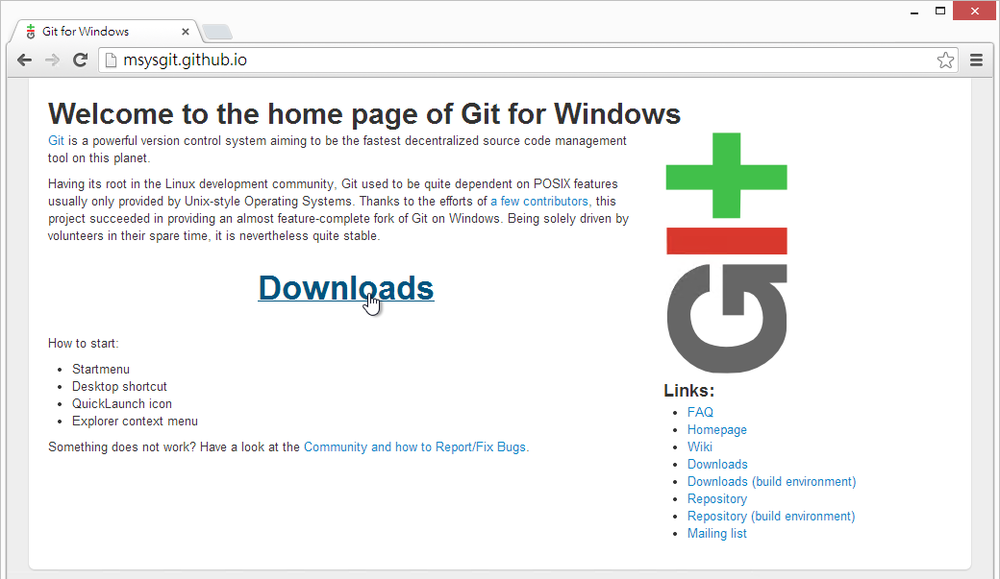
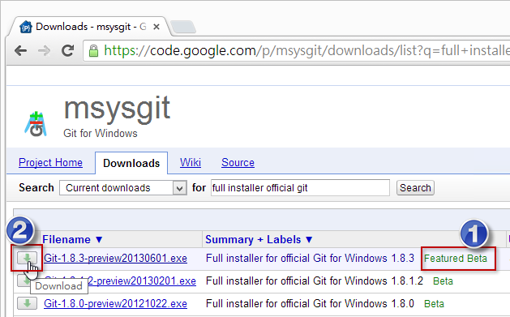
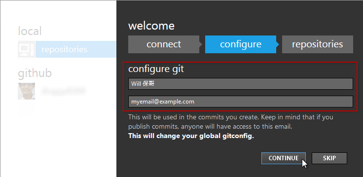
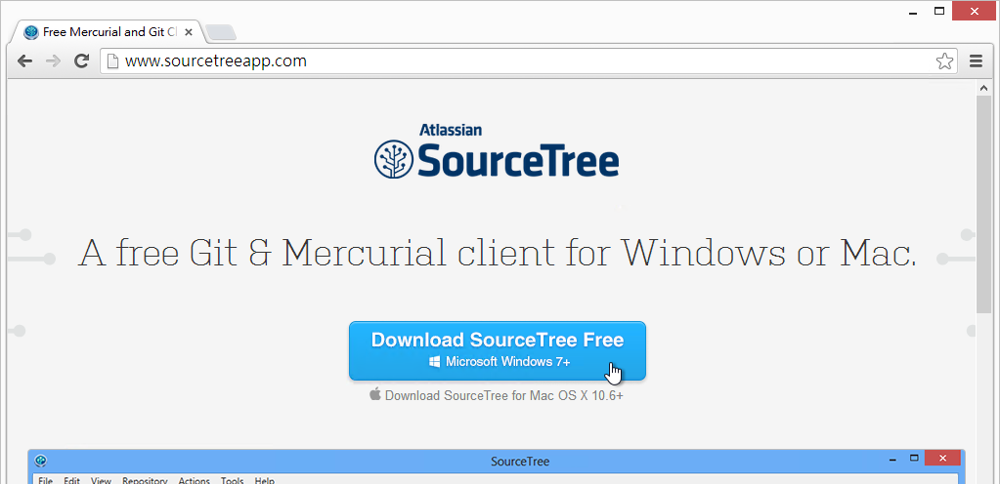

# Day 02: Windows 플랫폼 필수 Git 도구 3가지

Git 버전 관리를 사용하기 시작하려면 먼저 적절한 Git 도구를 설치해야 합니다. 이 시리즈는 주로 Windows 플랫폼에 초점을 맞춥니다. 이 글에서는 가장 자주 사용하는 세 가지 Git 버전 관리 도구를 소개하고, 이 도구들의 공통점과 차이점, 그리고 어떤 상황에서 어떤 도구를 사용해야 하는지 설명하겠습니다.

## 첫 번째 도구: [Git for Windows](https://msysgit.github.io/)

이것은 **명령 프롬프트**에서 실행할 수 있는 명령줄 도구 세트입니다. 현재 시중에 나와 있는 모든 Git GUI 도구는 실제로 내부에서 이 하위 수준 Git 도구를 실행하므로, 반드시 설치해야 하는 필수 Git 관리 도구입니다!

다음은 설치 과정입니다.

* 먼저 https://msysgit.github.io/ 공식 웹사이트로 이동하여 설치 프로그램을 다운로드할 준비를 합니다

* 버전에 관계없이 최신 버전을 다운로드합니다

* 다운로드한 파일을 직접 클릭하여 설치합니다

* 설치 프로그램 시작 페이지

* GPL 라이선스 약관에 동의합니다

* 설치 경로를 선택합니다

* 구성 요소를 선택합니다. **Windows 탐색기 통합 옵션은 체크 해제하는 것을 권장합니다!**  ( 이 통합 도구는 너무 기본적이기 때문에 대신 [TortoiseGit](https://code.google.com/p/tortoisegit/) 도구를 사용하는 것을 권장합니다 )

* 프로그램 그룹 이름을 설정합니다. 기본 옵션을 유지합니다

* 여기서는 **Run Git from the Windows Command Prompt 옵션을 선택하는 것을 권장합니다!**  ( 대부분의 Windows 사용자는 Bash 명령어에 익숙하지 않기 때문입니다 )

* 줄 바꿈 변환은 기본 옵션을 유지하는 것을 권장합니다.

* 설치를 시작합니다

* 설치 완료

* 설치 후 명령 프롬프트를 직접 열면 바로 사용할 수 있습니다

* `git --version` 명령어를 입력하여 도구 프로그램의 현재 버전을 조회할 수 있습니다

## 두 번째 도구: [GitHub for Windows](https://windows.github.com/)

이것은 Git을 깊이 이해하지 못한 사람들을 위해 [GitHub](https://github.com)가 공식적으로 개발한 도구입니다. 단순하고 친숙한 GUI 인터페이스를 사용하여, Git의 이해하기 어려운 개념과 명령어 매개변수를 숨기려고 합니다. GitHub for Windows 도구가 Git for Windows보다 훨씬 친숙하지만, Git에 대한 개념이 전혀 없는 사람에게는 GitHub for Windows 도구를 시작하는 것이 쉽지 않을 수 있습니다.

> [GitHub for Windows](https://windows.github.com/)에는 [Git for Windows](https://msysgit.github.io/)를 사용하는 [Git Shell](https://github.com/dahlbyk/posh-git/) 도구가 내장되어 있으므로, Git for Windows가 설치되어 있지 않으면 GitHub for Windows의 Git Shell 도구를 사용할 수 없습니다.

이 도구는 꽤 많은 Git 버전 관리 작업을 수행하는 데 도움이 됩니다. 최소한 기본적인 버전 관리 기능이 제공되며, 주로 다음과 같은 기능을 갖추고 있습니다.

* 리포지토리 복제(Clone Repositories)
	* GitHub에서 리포지토리 복제하기(git clone)
* 이력 탐색(Browse History)
	* 로컬 리포지토리의 버전 이력 탐색하기
* 변경 사항 커밋(Commit Changes)
	* 로컬 리포지토리에 변경 사항 커밋하기
* 코드 브랜치(Branch Code)
	* Git 브랜치를 만들고 관리하며, 작업 디렉터리에서 브랜치를 전환할 수 있습니다
* GitHub.com에 공유(Share on GitHub.com)
	* GitHub와 변경 사항 동기화하기
	* 여기서 "Sync"의 의미는 git pull과 git push를 하나로 통합한 것입니다
	* GitHub for Windows는 동기화할 때 기본적으로 병합에 rebase를 사용합니다.

이 외에 Git for Windows가 할 수 있는 대부분의 작업은 GitHub for Windows에서 할 수 없습니다! 더 큰 규모의 개발 프로젝트에 실제로 적용하려면 적합한지 고려해야 할 수 있지만, 소프트웨어 개발자가 아닌 사람에게는 간단한 버전 관리 작업만으로도 충분할 것입니다.

다음은 GitHub for Windows 설치 과정입니다.

* 먼저 https://windows.github.com/ 으로 이동하여 설치 프로그램을 다운로드할 준비를 합니다

* 다운로드 후 직접 설치를 실행합니다

* 로그인하려면 GitHub 계정이 필요합니다

* 계정 정보를 설정합니다

* 로컬 Git 리포지토리를 찾습니다
	* Git을 한 번도 사용한 적이 없다면 여기에 결과가 없을 것입니다

* 설치 후 GitHub for Windows의 메인 프로그램 인터페이스를 볼 수 있습니다

## 세 번째 도구: [SourceTree](https://www.sourcetreeapp.com/)

[SourceTree](https://www.sourcetreeapp.com/)는 현재 제가 적극 추천하는 도구로, Windows와 Mac 플랫폼을 모두 지원합니다. 이 도구는 Atlassian(JIRA, Confluence, Bamboo를 만드는 회사)이 개발한 GUI 도구로, 무료로 제공됩니다. 이 도구를 사용하면 거의 모든 Git 버전 관리 작업(git-flow 워크플로 포함)을 수행할 수 있어, 매우 강력한 Git 버전 관리 도구입니다.

> [SourceTree](https://www.sourcetreeapp.com/)도 먼저 [Git for Windows](https://msysgit.github.io/)가 설치되어 있어야 합니다. Git의 명령줄 도구에 의존하여 작동하기 때문입니다.

다음은 SourceTree 설치 과정입니다.

* 먼저 https://www.sourcetreeapp.com/ 으로 이동하여 설치 프로그램을 다운로드할 준비를 합니다

* 설치 프로그램을 다운로드합니다

* 다운로드 후 직접 설치를 실행합니다. 이것은 그래픽 설치 프로그램입니다

* 라이선스 계약에 동의해야 합니다

* 사용하려면 등록이 필요합니다(이것은 무료입니다)

* Bitbucket이나 Google 계정이 없다면 무료로 등록할 수도 있습니다

* 설치 마법사

* SSH 키 설정

* Pageant/PuTTY에서 SSH 키를 불러올지 여부

* 설치 완료!

오늘의 요약
------

오늘은 Windows 플랫폼에서 흔히 사용하는 세 가지 Git 버전 관리 도구를 간략히 소개했습니다. 첫 번째는 [Git for Windows](https://msysgit.github.io/), 두 번째는 [GitHub for Windows](https://windows.github.com/), 세 번째는 [SourceTree](https://www.sourcetreeapp.com/)입니다. 이 세 가지 도구는 각각 장점이 있지만, 개인적으로 Git 버전 관리를 깊이 이해하고 싶다면 Git for Windows를 사용하고 명령줄을 통해 Git 명령어를 실행하는 법을 배워야 한다고 생각합니다. 더 직관적인 GUI 도구를 원한다면 [SourceTree](https://www.sourcetreeapp.com/)를 사용하세요.

강조하고 싶은 것은, Git 버전 관리를 진정으로 마스터하려면 Git이 하위 수준에서 무엇을 하는지 이해해야 한다는 점입니다. 따라서 이후의 글에서는 기본적으로 [Git for Windows](https://msysgit.github.io/)를 사용하여 Git 버전 관리 작업을 소개하고, [SourceTree](https://www.sourcetreeapp.com/)를 보조 도구로 사용하여 Git의 버전 관리 작업과 리포지토리의 변화를 더 잘 이해할 수 있도록 돕겠습니다.

---

* [목차로 돌아가기](README.md)
* [이전 날: Git 버전 관리 이해하기](01.md)
* [다음 날: 리포지토리 만들기](03.md)

---
