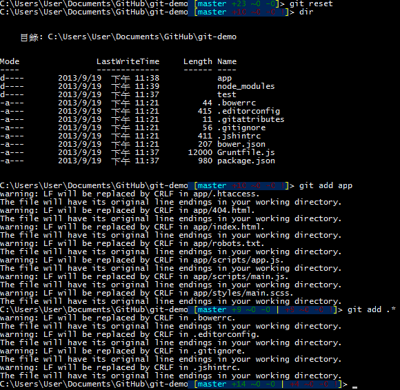
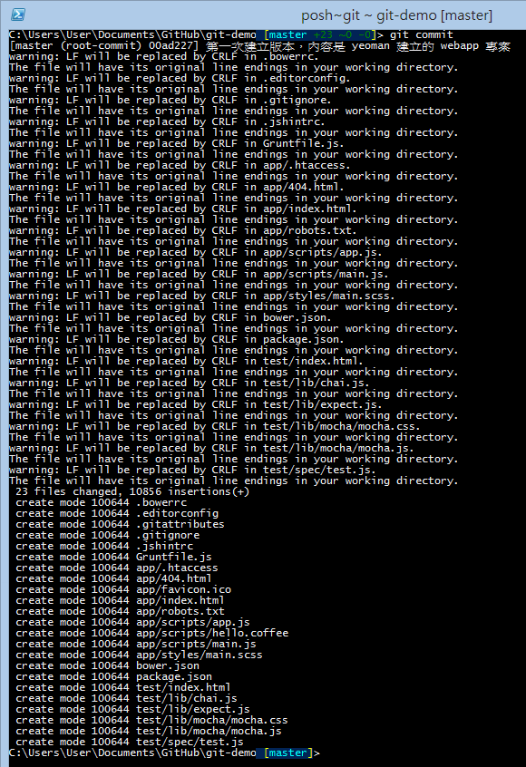

# Day 04: 자주 사용하는 Git 버전 관리 명령어

이 글에서는 파일 추가, 삭제, 이름 변경, 변경 사항 커밋(새 버전 만들기), 이력 기록 조회 등 기본적인 파일 작업을 포함하여, 가장 중요하고 기본적인 버전 관리 작업 몇 가지를 배우는 데 도움을 드리겠습니다.

## 작업 디렉터리 준비하기

이전 글 "Day 03: 리포지토리 만들기"의 내용을 복습하면서, 이 글의 모든 연습을 시작하기 위해 로컬 리포지토리를 바로 만들어 보겠습니다.

```
mkdir git-demo
cd git-demo
git init
```

## 파일 추가하기

작업 디렉터리에 파일을 몇 개 넣어 보겠습니다. 어떤 파일이든 상관없으니, 기존 파일과 디렉터리를 현재 작업 디렉터리로 복사해 오면 됩니다.

이 글에서는 [YEOMAN](https://yeoman.io/) 도구를 사용하여 webapp 예제 웹사이트를 빠르게 생성하겠습니다. 명령어 하나로 완전한 웹사이트를 만들 수 있습니다.

```
yo webapp
```

**참고**: Windows 플랫폼에서 [YEOMAN](https://yeoman.io/)을 사용하는 방법은 저자의 글 [How to Install and Use Yeoman 1.0 Related Tools on Windows Platform](https://blog.miniasp.com/post/2013/08/11/Yeoman-1-0-Installation-and-Usage-on-Windows)을 참고하시면 전체 설치 및 사용 과정이 자세히 설명되어 있습니다.

파일을 추가한 후에도 여전히 Git Shell 인터페이스에 있다면, 다음과 같은 프롬프트를 즉시 볼 수 있을 것입니다.


즉, 경로 뒤에 위치한 다음 프롬프트입니다.

```
[master +10 ~0 -0 !]
```

이 프롬프트 부분에서 몇 가지를 확인할 수 있습니다.

* master는 현재 작업 디렉터리가 **master** 브랜치임을 나타내며, 이는 Git의 기본 브랜치 이름이기도 합니다.
* "빨간색" 숫자는 모두 추적되지 않는(Untracked) 파일을 나타내며, 이러한 변경 사항은 버전 관리에 들어가지 않는다는 의미입니다.
* +10은 "추가된" 파일 10개를 나타냅니다
* ~0은 "수정된" 파일 0개를 나타냅니다
* -0은 "삭제된" 파일 0개를 나타냅니다

이 새 파일들을 Git 버전 관리에 추가하려면 다음 명령어를 실행해야 합니다.

```
git add .
```

이렇게 하면 이 작업 디렉터리 아래의 모든 파일과 디렉터리, 그리고 하위 디렉터리의 모든 파일이 이 Git 작업 디렉터리의 [인덱스(index)] 또는 [캐시(cache)]에 모두 추가됩니다. 주의하세요: 이 시점에서는 아직 버전이 만들어지지 않았습니다. 단지 이 파일들이 Git 리포지토리에 "추가될 예정"임을 Git에 알려 주는 것뿐입니다.

다음 그림은 여기서 `git add .`를 실행한 후의 결과입니다. 여기서 발생하는 경고 메시지는 그다지 심각하지 않습니다. 더 자세히 알고 싶은 분은 저자의 또 다른 글 [Notes on Git for Windows Line Ending Conversion (CRLF)](https://blog.miniasp.com/post/2013/09/15/Git-for-Windows-Line-Ending-Conversion-Notes)을 참고하세요.


그런데 흥미로운 점은, 원래 "빨간색 숫자"였던 것이 이제 "초록색 숫자"로 바뀌었다는 것입니다. 여기서 나타내는 의미는 다음과 같습니다.

* "초록색" 숫자는 모두 스테이징된(Staged, 준비된) 파일을 나타내며, 이러한 변경 사항이 버전 관리에 들어간다는 의미입니다.
* +23은 23개의 "추가된" 파일이 버전으로 만들어질 것임을 나타냅니다
* ~0은 0개의 "수정된" 파일이 버전으로 만들어질 것임을 나타냅니다
* -0은 0개의 "삭제된" 파일이 버전으로 만들어질 것임을 나타냅니다

그런데 원래는 +10(빨간색)이었는데, 실행 후에는 어떻게 +23(초록색)이 되었을까요?

`git reset`을 실행하여 작업 디렉터리의 인덱스 상태를 초기화한 다음, 다시 `git status`를 실행하여 현재 작업 디렉터리의 상세 상태를 조회하면 다음 그림과 같습니다.


여기에는 "첫 번째 수준 디렉터리 아래의 파일과 디렉터리"만 나열되어 있는 것을 볼 수 있습니다. 이때 git은 하위 디렉터리에서 추적되지 않는 파일이 몇 개인지 확인하지 않기 때문입니다.

`git add .`를 실행한 후 다시 `git status`를 실행하여 상태를 조회하면, 하위 디렉터리의 파일이 모두 추가되어 이 숫자가 증가한 것을 확인할 수 있습니다. 다음 그림과 같습니다.


## 일부 파일만 추가하기

방금 언급한 `git add .` 명령어는 모든 파일(하위 디렉터리의 파일 포함)을 작업 디렉터리 인덱스에 자동으로 추가합니다. 때로는 특정 디렉터리나 특정 파일만 버전에 추가하고 싶을 때가 있습니다. 이때 특정 디렉터리를 지정하거나 와일드카드를 사용하여 파일을 추가할 수도 있습니다.

다시 `git reset`을 실행하여 작업 디렉터리의 인덱스 상태를 초기화한 다음, `git add app`을 사용하여 app 폴더와 그 아래의 모든 파일을 추가하고, `git add .*`를 사용하여 "점"으로 시작하는 모든 파일을 추가하면 다음 그림과 같습니다.



**참고**: `.*` 와일드카드는 모든 "점" 파일을 추가할 수 없습니다. `.`의 첫 번째 문자는 하나의 디렉터리만 매칭할 수 있기 때문입니다. 점으로 시작하는 모든 파일을 추가하려면 `.??*`를 사용하여 점으로 시작하는 파일과 확실히 매칭되도록 해야 합니다.

## 변경 사항 커밋하기

파일을 인덱스에 추가한 후에는 변경 사항을 커밋하여 버전을 만들 수 있습니다. 커밋 명령어는 다음과 같습니다.

```
git commit -m "Initial commit"
```

`-m` 매개변수 뒤에는 커밋 메시지가 옵니다. 이 메시지는 버전 이력에 기록됩니다. 나중에 여러분과 다른 사람들이 이 버전의 목적을 이해하는 데 도움이 되도록 의미 있는 커밋 메시지를 작성하는 것을 권장합니다.


## 커밋 이력 보기

커밋한 후에는 `git log` 명령어를 사용하여 커밋 이력을 볼 수 있습니다.

```
git log
```


`git log --oneline` 매개변수를 사용하여 로그의 간략한 버전을 표시할 수도 있습니다.

```
git log --oneline
```



## 파일 수정하기

이제 파일을 수정해 보겠습니다. 작업 디렉터리의 아무 파일이나 열어 변경한 다음 저장합니다.

수정한 후 `git status`를 실행하면 수정된 파일에 대한 정보를 볼 수 있습니다.


수정된 파일이 빨간색으로 표시되고, 수정된 파일 수가 ~1로 표시되는 것을 볼 수 있습니다.

## 파일 차이 보기

수정된 파일을 커밋하기 전에 어떤 변경이 이루어졌는지 보고 싶을 수 있습니다. `git diff` 명령어를 사용할 수 있습니다.

```
git diff
```


git diff 명령어는 작업 디렉터리와 인덱스 사이의 차이를 표시합니다.

## 수정된 파일 커밋하기

수정된 파일을 커밋하려면 먼저 `git add`를 실행하여 수정된 파일을 인덱스에 추가한 다음, `git commit`을 실행해야 합니다.

```
git add .
git commit -m "Update files"
```


## 파일 삭제하기

파일을 삭제하고 이 삭제 작업을 버전에 기록하려면 `git rm` 명령어를 사용할 수 있습니다.

```
git rm [filename]
```

이 명령어를 실행하면 파일이 작업 디렉터리와 인덱스 모두에서 삭제됩니다. 그런 다음 `git commit`을 실행하여 이 삭제 작업을 커밋합니다.


## 파일 이름 변경 또는 이동하기

파일의 이름을 변경하거나 이동하려면 `git mv` 명령어를 사용할 수 있습니다.

```
git mv [old_filename] [new_filename]
```

이 명령어는 파일의 이름을 변경하거나 이동하고, 이 변경 사항을 인덱스에 자동으로 추가합니다. 그런 다음 `git commit`을 실행하여 이 변경 사항을 커밋합니다.


## 오늘의 요약

오늘은 다음과 같이 몇 가지 기본 Git 명령어를 배웠습니다.

* `git add [file]` - 파일을 인덱스에 추가
* `git add .` - 현재 디렉터리의 모든 파일을 인덱스에 추가
* `git commit -m "message"` - 인덱스의 변경 사항을 커밋하여 새 버전 만들기
* `git status` - 작업 디렉터리의 현재 상태 보기
* `git log` - 커밋 이력 보기
* `git log --oneline` - 간략한 커밋 이력 보기
* `git diff` - 작업 디렉터리와 인덱스 사이의 차이 보기
* `git rm [file]` - 작업 디렉터리와 인덱스에서 파일 삭제
* `git mv [old] [new]` - 파일 이름 변경 또는 이동
* `git reset` - 인덱스 상태 초기화

## 참고 링크

* [Git - Recording Changes to the Repository](https://git-scm.com/book/en/v2/Git-Basics-Recording-Changes-to-the-Repository)

---

* [목차로 돌아가기](README.md)
* [이전 날: 리포지토리 만들기](03.md)
* [다음 날: 리포지토리, 작업 디렉터리, 개체, 인덱스의 관계 이해하기](05.md)

---
