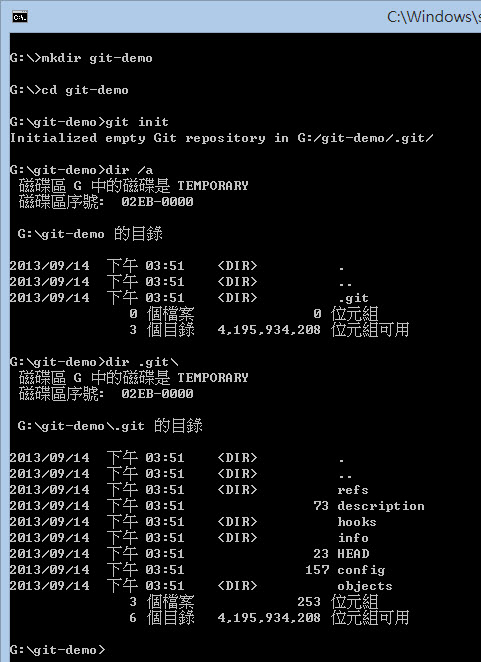
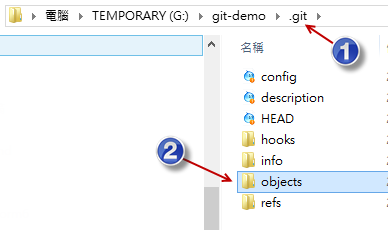

# Day 05: 리포지토리, 작업 디렉터리, 개체, 인덱스의 관계 이해하기

Git 버전 관리를 사용하는 과정에서는 더 효율적이고 의미 있게 학습할 수 있도록 몇 가지 매우 기본적인 개념을 확립해야 합니다. 명확하고 올바른 개념적 토대가 있으면 Git 명령어 작업을 배우는 데 도움이 될 뿐만 아니라, 더 중요하게는 Git 관련 지식을 배우는 것이 더 쉬워집니다.

## 리포지토리 이해하기

Git을 버전 관리에 사용할 때, 당연히 이 버전 정보를 저장할 "리포지토리"가 필요합니다. 영어 단어 Repository가 바로 이 의미입니다. 저는 이 영어 단어를 "리포지토리"로 옮기는 데 익숙하며, 모든 버전을 저장하는 데 사용되는 공간이나 폴더, 그리고 파일들의 집합을 나타냅니다.

Git 사용 경험이 있다면 리포지토리를 만드는 방법이 여러 가지라는 것을 잘 아실 겁니다. 어떤 폴더에든 Git 리포지토리를 만들고 싶다면, 다음 명령어를 입력하면 만들기가 완료됩니다.

    git init

다음의 Git 리포지토리 만들기 과정 다이어그램을 통해, G:\git-demo 디렉터리에서 git init을 실행하면 Git이 자동으로 해당 디렉터리의 .git 디렉터리에 이른바 Git 리포지토리를 만들어 준다는 것을 명확히 알 수 있습니다. 의심하지 마세요. 이 .git 폴더가 완전한 Git 리포지토리입니다. 앞으로 모든 버전 변경 사항은 자동으로 이 폴더에 저장됩니다.

## 작업 디렉터리 이해하기

위 예제에서 G:\git-demo 디렉터리는 자동으로 우리의 "작업 디렉터리"가 됩니다. "작업 디렉터리"의 의미는 프로젝트 파일을 개발할 준비를 하는 곳으로, 앞으로의 모든 작업은 이 디렉터리에서 편집된다는 것입니다. 파일 추가, 파일 수정, 파일 삭제, 파일 이름 변경 등 그 밖의 모든 Git 관련 작업이 이 디렉터리에서 완료되므로 "작업 디렉터리"라고 부릅니다.

Git 관련 명령어 매개변수를 사용할 때는 보통 "작업 디렉터리"에서 실행합니다.

Git 버전 관리를 사용할 때는 브랜치 상황이 많이 발생하므로, 작업 디렉터리는 서로 다른 브랜치 사이를 전환할 수 있습니다. 일부 git 명령어는 실행될 때 작업 디렉터리의 파일을 업데이트합니다. 예를 들어 git checkout을 사용하여 다른 브랜치로 전환할 때, 현재 브랜치의 디렉터리 구조가 전환하려는 브랜치와 다소 다르기 때문에, 현재 작업 디렉터리의 파일을 업데이트하여 현재 작업 디렉터리 아래의 디렉터리와 파일이 전환하려는 다른 브랜치 아래의 디렉터리 및 파일과 같아질 가능성이 매우 높습니다.

따라서 적절한 시기에 작업 디렉터리를 깨끗하게 유지하는 것은 버전 관리 과정의 기본 원칙이며, 특히 향후 병합할 때 더욱 중요합니다. 관련 지식은 이후 글에서 더 자세히 설명하겠습니다.

## Git의 데이터 구조 이해하기

Git에는 두 가지 중요한 데이터 구조, 즉 "개체"와 "인덱스"가 있습니다.

"개체"는 리포지토리의 모든 파일과 버전 기록을 저장하는 데 사용되고, "인덱스"는 리포지토리에 들어가기 전 디렉터리의 상태를 저장하는 데 사용됩니다.

## 개체에 대하여

이른바 "개체"는 "특수한 파일"입니다. 이 파일이 생성되는 과정은 매우 흥미롭습니다. 파일의 내용을 가져와 그 내용을 통해 SHA1 해시 값을 생성한 다음, 이 SHA1 해시 값에 따라 파일의 이름을 짓습니다.

Git을 버전 관리에 사용하는 과정에서, 관리 대상이 되는 모든 디렉터리와 파일은 먼저 "디렉터리 정보"와 "파일 내용"으로 구분되며, 이를 트리 개체(tree object)와 블롭 개체(blob object)라고 부릅니다.

그중 블롭 개체는 원래의 "파일 내용"을 블롭 파일의 내용으로 사용하고(참고: 블롭 개체는 실제로 물리적 파일입니다), 그 내용에 대해 SHA1 해시 연산을 수행하여 해시 ID를 생성한 다음, 이 해시 ID를 블롭 파일의 파일 이름으로 사용합니다. 이를 통해 블롭 개체는 "내용만 있는" 파일이라는 것을 알 수 있습니다. 그 파일 이름은 내용으로부터 생성되므로, 단일 블롭 파일 하나만으로는 보통 버전 관리에 도움이 되지 않습니다.

또 다른 트리 개체는 특정 폴더에 어떤 파일이 포함되어 있는지, 그리고 이 파일에 대응하는 블롭 개체의 파일 이름이 무엇인지를 저장하는 데 사용됩니다. 트리 개체에는 블롭 개체의 파일 이름과 관련 정보 외에도 다른 트리 개체가 포함될 수 있습니다. 따라서 트리 개체는 사실 "폴더"와 동의어입니다.

블롭 개체든 트리 개체든 모두 개체이며, 이 개체들은 이른바 "개체 저장소(object storage)"에 저장됩니다. 이 "개체 저장소"는 기본적으로 "리포지토리"의 objects 디렉터리에 있으며, 다음 그림과 같습니다.

자세한 개체 구조는 다가올 글에서 다루겠습니다.

## 인덱스에 대하여

이른바 "인덱스"는 자주 변경되는 임시 파일로, 보통 .git 디렉터리의 index라는 이름의 파일에 위치합니다. 간단히 말해, "인덱스"의 목적은 주로 "어떤 파일이 다음 커밋 버전에 제출될 것인지"를 기록하는 것입니다. 다시 말해, Git 리포지토리에 버전을 제출하려면 먼저 인덱스 상태를 업데이트해야 하며, 그래야 변경 사항이 제출됩니다.

이 인덱스 파일은 보통 Git 리포지토리에 있는 특정 버전의 상태를 저장합니다. 이 상태는 임의의 커밋 개체와 트리 개체로 나타낼 수 있습니다.

우리는 보통 .git\index 바이너리 파일을 직접 편집하지 않고, 표준 git 명령어를 통해 이 인덱스 파일을 조작합니다. 인덱스 파일을 조작하는 명령어는 대략 다음과 같습니다.

* git add
* git mv
* git rm
* git status
* git commit
* git ls-files

Git의 "인덱스"는 "개체 저장소(object storage)"와 "작업 디렉터리(working directory)" 사이의 매개체입니다.

이 글에서 자세히 설명하고자 하는 이 개념들 사이의 관계는 다음 5단계로 설명할 수 있다는 것을 이미 짐작하셨을 것입니다.

* Git 버전 관리를 사용하려면 먼저 "작업 디렉터리"와 "리포지토리"를 만들어야 합니다. (mkdir, git init)
* 먼저 "작업 디렉터리"에서 개발해야 하며, 디렉터리 만들기, 파일 만들기, 파일 수정, 파일 삭제 등의 작업을 할 수 있습니다.
* 그런 다음 Git의 "리포지토리"에 새 버전을 제출하려면 먼저 "인덱스" 상태를 업데이트해야 합니다. (git add, git mv, ...)
* 그러면 Git은 "인덱스"의 현재 상태를 기준으로 Git의 "리포지토리"에 제출할 파일을 결정합니다. (git status)
* 마지막으로 변경 사항을 제출하면(git commit), 버전 정보가 "개체 저장소"에 기록됩니다(이때 커밋 개체가 기록됩니다).

자세한 인덱스 구조와 명령어 작업은 다가올 글에서 다루겠습니다.

    참고: 트리(tree)라는 개념이 디렉터리와 매우 비슷하기 때문에, 외국 원문을 읽을 때 작업 디렉터리(working directory)는 종종 working tree로 쓰이기도 합니다!

## 오늘의 요약

오늘 다룬 Git 아키텍처에서 가장 중요한 것은 "개체"와 "인덱스" 사이의 관계입니다. "인덱스" 정보가 없으면 Git은 버전을 만들 수 없기 때문입니다.

"개체"와 "인덱스"의 차이를 바탕으로, "개체"는 "변경 불가능한(immutable)" 파일 유형이라는 것을 알 수 있을 것입니다. 원칙적으로 "개체 저장소"에 기록된 개체는 다시 변경되지 않습니다. 모든 개체가 원본 파일 내용으로부터 생성되기 때문입니다. 이를 "개체 데이터베이스(object database)"라고도 할 수 있으며, 이 데이터베이스는 보통 내용만 증가하고, "내용을 삭제"하거나 "내용을 변경"하는 경우는 더 적습니다. 데이터는 git gc를 실행하여 가비지 데이터를 정리할 때만 삭제됩니다. "인덱스"는 현재 작업 디렉터리가 커밋할 준비가 된 내용을 기록하는 데 사용되는 "변경 가능한(mutable)" 인덱스 파일입니다.

한 걸음씩 Git의 핵심에 다가가면서, 막연하고 불분명했던 추상적인 개념을 구체적인 개념적 지식으로 천천히 바꿔 나가면, 더 이상 Git에 대해 불안함을 느끼지 않게 될 것입니다. 계속 열심히 공부하세요. 성공이 앞에 있습니다.

## 참고 링크

* [Git Internals - Git Objects](https://git-scm.com/book/en/Git-Internals-Git-Objects)
* [Pro Git Book](https://progit.org/)
* [Git Magic - Traditional Chinese Version](https://www-cs-students.stanford.edu/~blynn/gitmagic/intl/zh_tw/)
* [Git (software) - Wikipedia, the free encyclopedia](https://en.wikipedia.org/wiki/Git_(software) "Git (software) - Wikipedia, the free encyclopedia")

---

* [목차로 돌아가기](README.md)
* [이전 날: 자주 사용하는 Git 버전 관리 명령어](04.md)
* [다음 날: Git 데이터 구조 파헤치기 - 개체 구조](06.md)

---
