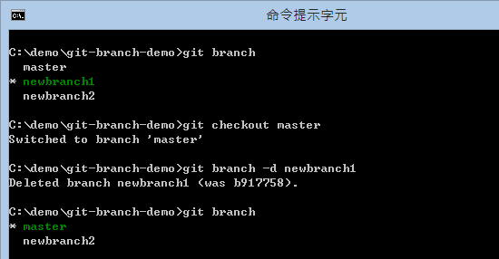
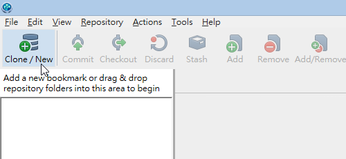
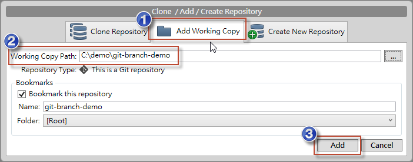

# Day 08: 브랜치의 기본 개념과 사용법

Git에서 **브랜치**는 매우 중요한 메커니즘이며, 프로젝트가 무한히 브랜치를 나눌 수는 없으므로 특별히 주의해서 사용해야 합니다. 결국 브랜치는 병합되어야 하지만, 병합은 나중에 다룰 주제입니다. 이 글에서는 먼저 Git 브랜치의 기본 개념과 사용법을 배우는 데 도움을 드리겠습니다.

## 브랜치의 기본 개념

버전 관리에서 "브랜치" 메커니즘을 사용하는 주된 목적은 개발 과정에서 발생하는 버전 충돌 문제를 해결하기 위해서입니다. 어떤 버전 관리 메커니즘을 사용해 본 많은 사람들은 "브랜치"가 "버전 충돌을 일으키는" 주범이라고 생각할 것입니다. 브랜치를 나누기 시작하면 반드시 병합 문제를 생각하게 되기 때문입니다. 브랜치를 나눈 후, 누군가가 여러분과 같은 파일의 같은 줄을 수정하면 "버전 충돌"이 발생합니다. 충돌이 발생할 때마다 이를 해결하기 위해 애를 써야 합니다.

충돌이 발생했을 때, 때로는 자신의 버전을 사용할지 상대방의 버전을 사용할지 쉽게 결정할 수 있지만, 때로는 그렇게 쉽지 않습니다. 복잡한 경우에는 충돌하는 부분을 원래 수정한 사람을 찾아서, 서로의 변경 사항이 시스템에 미치는 영향을 조율한 뒤, 최종적으로 어떻게 병합할지 결정해야 합니다. 이러한 문제는 매우 번거롭기 때문에, 많은 사람들이 "충돌"을 피하기 위해 "브랜치"를 피하려고 합니다.

그러나 개발 팀이 커지고 시스템 기능이 점점 많아지면, 버전을 브랜치로 나누지 않더라도 모두의 충돌은 여전히 끝없이 발생합니다. 때로는 충돌 문제가 아니라, A가 기능을 완성했는데 아무 충돌 없이 B의 후속 버전에 덮어씌워지는 경우도 있는데, 이는 모두가 보고 싶어 하는 상황이 아닙니다. 그러나 이것 또한 "보이지 않는 충돌" 상황입니다.

과거의 중앙 집중식 Subversion 버전 관리 메커니즘에도 브랜치 개념이 있었고, 매우 잘 작동할 수 있었습니다. 물론 소프트웨어 아키텍처가 충분히 좋지 않거나, 브랜치 개념과 도구 사용법에 대해 명확히 알지 못한다면, "브랜치"를 사용하는 것이 순조롭지 않을 것이라고 생각합니다. 이는 피할 수 없는 결과입니다. 이 세상에 "노력 없이 배우고, 고통 없이 자연스럽게 브랜치를 익힐 수 있게" 해 주는 버전 관리 도구는 결코 존재하지 않습니다. 사람에게 달려 있습니다. 사람의 개념이 잘못되어 있으면 어떤 도구도 순조롭게 작동하지 않습니다.

Git은 "분산 버전 관리 메커니즘"이므로, 분산 버전 관리 시나리오에서는 가장 하고 싶지 않은 것이 "관리"입니다. 그래서 Git에는 이른바 관리 메커니즘이나 권한 제어 메커니즘이 거의 없습니다. Git이 하고자 하는 유일한 일은 모두가 순조롭게 "브랜치"하고 "병합"할 수 있게 하는 것입니다.

[Day 03: 리포지토리 만들기]에서 언급한 "원격 리포지토리"를 예로 들면, 이렇게 상상할 수 있습니다. `git clone` 명령어를 사용하는 순간부터, 그것은 실제로 "브랜치"의 시작입니다. 원격 리포지토리에서 완전한 리포지토리를 복사한 다음, 자신의 로컬 머신에서 버전을 만들기 시작합니다. 소프트웨어가 어느 정도 개정된 후에는 다시 "병합"합니다. 단지 이때의 병합 명령어는 `git push`라고 불릴 뿐입니다.

이처럼 브랜치와 병합이 이루어지는 상황은 Git 버전 관리 과정 곳곳에 존재합니다. 원격 리포지토리에도 브랜치가 있을 수 있고, 로컬 리포지토리에도 브랜치가 있을 수 있습니다. 어떤 원격 브랜치에서든 로컬 브랜치로 병합(pull)할 수 있고, 로컬 브랜치를 원격 브랜치로 푸시할 수도 있습니다. 물론 어떤 로컬 브랜치에서든 다른 로컬 브랜치로 병합할 수도 있습니다. "브랜치"에 좋은 제어 논리가 없다면, 최종적으로 극도로 복잡한 버전 관리 시나리오를 다양하게 조합할 수 있다는 것을 상상할 수 있는데, 이는 모두가 보고 싶어 하는 상황이 아닙니다. 따라서 "브랜치"와 "병합"을 잘 배우는 것은 정말 중요합니다. 예를 들어 git-flow는 매우 인기 있는 브랜치 관리 모델입니다. 이것은 도구가 아니라 브랜치를 관리하는 논리입니다. 이 부분은 향후 글에서 설명하겠습니다.

Linux 커널 개발 과정에서는 전 세계 수만 명의 개발자가 함께 참여했습니다. 이처럼 거대한 개발 팀을 관리하기 위해 Git이 탄생했습니다. 이것은 분산 버전 관리 메커니즘입니다. 모두가 완전한 버전을 가지고 있습니다. 버전이 배포된 후에는 각자가 자신의 버전을 관리하고, 팀의 요구 사항에 따라 다시 병합해야 합니다. 그러나 다시 병합하기 전에, 이 메커니즘은 모든 개발자가 다른 어떤 개발자의 버전에도 영향을 받지 않고 순조롭게 개발할 수 있도록 보장합니다. Git은 버전 관리의 복잡성을 줄이면서 이를 실제로 해냈습니다.

물론, 소프트웨어 개발에 참여하는 팀이 두세 명뿐이고, 그 사람들이 여전히 한곳에 모여 있다면, Git 버전 관리를 사용할 필요가 실제로는 없다고 말해야겠습니다. Subversion을 사용하는 것도 매우 좋은 선택이며, 단순하고 직관적입니다. 개발 과정에서 문제가 발생하면 주변 사람들과 조율하여 해결할 수 있습니다. 이는 팀 전체가 Git을 이해하게 하는 것보다 훨씬 편리합니다.

팀에 일정한 규모가 있거나, 모두가 함께 작업하지 않으며, 버전 관리를 해야 한다면, Git이 좋은 선택일 수 있습니다. 그러나 작업 팀 사이에 일관된 버전 관리 개념이나 습관이 있는 것도 매우 중요한 일입니다.

## 작업 디렉터리 준비하기

다음 명령어를 통해 두 개의 버전이 있는 Git 리포지토리와 작업 디렉터리를 빠르게 만들겠습니다.

```
mkdir git-branch-demo
cd git-branch-demo
git init

echo. > a.txt
git add .
git commit -m "Initial commit"

echo 1 > a.txt
git add .
git commit -m "a.txt: set 1 as content"
```

그런 다음 `git log`를 사용하여 다음과 같이 버전 정보를 가져옵니다.

```
C:\demo\git-branch-demo>git log
commit b917758c0f2f347a895ee5bbb5e5c8228f66335a
Author: Will <doggy.huang@gmail.com>
Date:   Fri Oct 4 20:58:16 2013 +0800

    a.txt: set 1 as content

commit aa3e4fe2ee065b046e00a74b1f12a0b0f8154003
Author: Will <doggy.huang@gmail.com>
Date:   Fri Oct 4 20:04:39 2013 +0800

    Initial commit
```

그런 다음 `git branch` 명령어를 사용하면 이미 `master`라는 이름의 브랜치가 있다는 것을 알 수 있습니다. 이것은 Git 리포지토리의 기본 브랜치입니다. `git branch -d master`를 통해 이 브랜치를 삭제하려고 하면, `error: Cannot delete the branch 'master' which you are currently on.`이라는 오류 메시지가 표시됩니다. 이는 "현재 작업 디렉터리 브랜치가 master로 설정되어 있을 때는 현재 브랜치를 삭제할 수 없다"는 의미로, 이 브랜치를 삭제하려면 먼저 "다른 브랜치"로 전환해야 한다는 뜻입니다.


물론 지금은 브랜치가 하나뿐이므로 당연히 자기 자신을 삭제할 수 없습니다.

## 브랜치 만들기

브랜치를 만드는 가장 흔한 방법은 두 가지입니다.

1. 브랜치를 만들되, 현재 작업 디렉터리는 자신의 브랜치에 그대로 둡니다: `git branch [BranchName]`

   `git branch newbranch1` 명령어를 실행하면 새로운 `newbranch1` 브랜치가 만들어집니다. 그런 다음 `git branch`를 사용하여 현재 브랜치가 몇 개인지 확인합니다. 두 개가 보이지만, 현재 작업 디렉터리는 여전히 `master` 브랜치에 머물러 있을 것입니다. 다음 그림과 같습니다.

   

   이때 현재 작업 디렉터리에서 버전을 만들면 `master` 브랜치에 만들어집니다. 이때 새 파일을 만들고 `git commit`을 통해 버전을 만듭니다. 명령어는 다음과 같습니다.

   ```
    echo master > b.txt
    git add .
    git commit -m "Create b.txt with content 'master' in the master branch"
   ```

   기억하세요: 먼저 기본 `master` 브랜치에서 두 개의 버전을 만든 다음, 브랜치를 만들고, 그다음 `master` 브랜치에서 또 하나의 버전을 만들었습니다.

2. 브랜치를 만들고 현재 작업 디렉터리를 새 브랜치로 전환합니다: `git checkout -b [BranchName]`

   다음으로, 두 번째 방법을 사용하여 브랜치를 만듭니다. `git checkout -b newbranch2` 명령어를 실행하면 새 브랜치가 만들어질 뿐만 아니라, 현재 작업 디렉터리도 다른 브랜치로 전환됩니다. 마지막으로 `git branch`를 사용하여 현재 브랜치가 몇 개인지 확인합니다. 이미 세 개가 있고, 현재 작업 디렉터리가 방금 만든 `newbranch2` 브랜치로 전환된 것을 볼 수 있습니다. 다음 그림과 같습니다.

   

   이때 현재 작업 디렉터리에서 버전을 만들면 `newbranch2` 브랜치에 만들어집니다. 이때 새 파일을 만들고 `git commit`을 통해 버전을 만듭니다. 명령어는 다음과 같습니다.

   ```
    echo newbranch2 > b.txt
    git add .
    git commit -m "Modify b.txt with content 'newbranch2' in the newbranch2 branch"
   ```

   기억하세요: 먼저 기본 `master` 브랜치에서 두 개의 버전을 만든 다음, 브랜치를 만들고, 그다음 `master` 브랜치에서 또 하나의 버전을 만들고, 그다음 `master` 브랜치의 현재 상태를 기반으로 새로운 `newbranch2` 브랜치를 만들고, 작업 디렉터리를 `newbranch2` 브랜치로 전환한 다음, 또 하나의 버전을 만들었습니다. 이때 `git log`를 실행하면, 브랜치가 소스 브랜치의 전체 이력을 자동으로 상속하므로 4개의 버전 기록이 표시됩니다.

**참고**: 자세한 명령어 및 매개변수 설명은 `git help branch`를 입력하여 전체 문서를 조회할 수 있습니다.

```
git branch [branch_name]
```

## 브랜치 전환하기

작업 디렉터리를 다른 브랜치로 전환하려면 다음 명령어를 입력할 수 있습니다(-b 매개변수 없이).

```
git checkout [branch_name]
```

작업 디렉터리를 `newbranch1` 브랜치로 전환하고 싶다고 가정하면, `git checkout newbranch1`을 입력하여 전환할 수 있습니다. 그런 다음 즉시 `git branch`를 사용하여 현재 작업 디렉터리가 전환되었는지 확인하고, `git log`를 사용하여 현재 `newbranch1` 브랜치의 이력 기록을 확인할 수 있습니다. 이것은 우리가 만든 첫 번째 브랜치이므로, 이론적으로 이 브랜치 상태에는 이력 기록이 두 개만 있어야 합니다. 다음 그림과 같습니다.


**참고**: 자세한 명령어 및 매개변수 설명은 `git help checkout`을 입력하여 전체 문서를 조회할 수 있습니다.

```
git checkout [branch_name]
```

## 브랜치 삭제하기

기존 브랜치를 삭제하려면, **작업 디렉터리 준비하기**에서 언급했듯이 명령어는 다음과 같습니다.

```
git branch -d [branch_name]
```

앞서 언급했듯이 현재 작업 디렉터리가 지정한 브랜치는 삭제할 수 없습니다. 현재 브랜치를 삭제하려면 먼저 다른 브랜치로 전환해야 합니다. 예를 들어 현재 `newbranch1` 브랜치를 삭제하려면, 먼저 `master` 브랜치와 같은 다른 브랜치로 전환한 다음, `git branch -d newbranch1` 명령어를 내려 브랜치를 삭제해야 합니다. 다음 그림과 같습니다.



## 작업 디렉터리가 어떤 브랜치에 있는지 확인하기

`git branch` 명령어를 사용하면 현재 어떤 브랜치에 있는지 확인할 수 있습니다. 다음 그림과 같습니다.


## Git 리포지토리의 전체 브랜치 그래프 보기

마지막으로, SourceTree 도구를 사용하여 Git 리포지토리의 현재 브랜치 그래프를 표시하겠습니다. 현재 브랜치는 두 개뿐입니다. 하나는 `master` 브랜치이고, 다른 하나는 `newbranch2` 브랜치입니다. `newbranch1` 브랜치는 실습 중에 삭제되었기 때문입니다. 우리 브랜치에 "트리" 같은 느낌을 주기 위해, 다음으로 이전 `newbranch1`과 같은 상태의 브랜치를 다시 만들고 이 브랜치 아래에 새 버전을 추가하는 방법을 시연하겠습니다.

아직 기억하실지 모르겠지만, 우리는 `master` 브랜치에서 두 개의 버전을 만든 후에 `newbranch1` 브랜치를 만들었습니다. 이제 먼저 이 버전의 커밋 개체 ID를 찾아 보겠습니다. 이것은 `git log`를 통해 얻을 수 있습니다. 다음 그림과 같습니다.


그래서 제 커밋 개체 ID는 다음과 같습니다: b917758c0f2f347a895ee5bbb5e5c8228f66335a

그런 다음 먼저 작업 디렉터리를 이 버전으로 전환합니다. 이것은 `git checkout [commit_id]`를 통해 완료할 수 있습니다.

```
git checkout b917758c0f2f347a895ee5bbb5e5c8228f66335a
```

이때 `git log`를 사용하면, 작업 디렉터리의 상태를 이 버전으로 전환했으므로 버전 기록이 두 개만 보여야 합니다. 다음 그림에서 볼 수 있듯이, `git checkout b917758c0f2f347a895ee5bbb5e5c8228f66335a`를 실행하면 한 쌍의 메시지가 나타납니다. 이 메시지는 매우 중요하며 반드시 이해해야 합니다. 다음 그림과 같습니다.


첫째, 작업 디렉터리의 버전을 "오래된" 버전으로 전환했으므로, 이 작업 디렉터리가 이른바 **detached HEAD** 상태에 들어갔다는 안내를 받게 됩니다. 이것은 "현재 작업 디렉터리가 최신 버전에 있지 않다"는 알림입니다. 언제든지 Git 리포지토리의 어떤 버전으로든 전환할 수 있지만, 이 버전에는 이미 "다음 버전"이 있으므로, 현재 "오래된 버전"에서 `git commit`을 실행하면 이 새 버전은 변경 사항이 추적되지 않으므로, 이렇게 하지 않는 것이 좋습니다.

**detached HEAD** 상태에서 추적 가능한 버전을 만들고 싶다면, 올바른 방법은 "브랜치를 만들어" 추적하는 것입니다. 이제 이 버전에서 새로운 `newbranch1` 브랜치를 만들고 작업 디렉터리를 그쪽으로 전환하겠습니다. 명령어는 다음과 같습니다.

```
git checkout -b newbranch1
```


그런 다음 내용이 `newbranch1`인 새 파일 `b.txt`를 만들고 새 버전을 만듭니다. 명령어는 다음과 같습니다.

```
echo newbranch1 > b.txt
git add .
git commit -m "Add b.txt in newbranch1"
```

좋습니다. 이제 `master` 외에도 두 개의 브랜치가 있고, 두 브랜치 모두 각자의 버전을 가지고 있습니다. 이 트리가 마음속에서 어떤 모습일지 생각해 보세요!

다음으로, SourceTree 도구를 열고 이 작업 디렉터리를 SourceTree 관리 도구에 추가합니다.





추가한 후, 이 Git 리포지토리의 브랜치로 전환합니다. 총 세 개가 있습니다. 각각으로 전환해 보겠습니다.


가장 오래된 버전이 맨 아래에 있고, 최신 버전이 맨 위에 있습니다. 서로 다른 브랜치로 전환하면, 세 개의 브랜치 다이어그램이 같고 기본 "라이트 바"만 다르다는 것을 볼 수 있습니다. 먼저 그림에서 볼 수 있는 것은 모든 버전, 모든 브랜치가 있는 "전체 Git 리포지토리"와, 브랜치가 어떤 버전에서 시작되었는지입니다. "라이트 바"는 그 브랜치의 "최신 버전"이 전체 Git 리포지토리에서 어떤 버전에 위치하는지를 나타냅니다.

## 오늘의 요약

사실 Git에서 브랜치를 사용하는 것은 쉬운 일입니다. 어려운 부분은 모든 사람이 "브랜치"가 무엇을 하는지, 그리고 모든 사람의 "브랜치"에 대한 **상상**이 일치하는지를 아는 것입니다. 브랜치에 대한 모두의 상상이 일치하기만 하면, 팀 버전 관리에서 큰 차이가 생기지 않을 것입니다.

제 경우, 브랜치를 일종의 "스냅샷" 기능으로 상상하겠습니다. 특정 커밋 버전과 그 이력 버전의 스냅샷을 만들고, 그것을 복사한 다음, 브랜치 이름을 붙이는 것입니다. 이 브랜치들에서 버전을 만들고 향후 병합을 기다릴 수 있습니다.

전체 Git 리포지토리는 모든 브랜치와 버전을 유지하고, 최종적으로 트리 구조의 브랜치 다이어그램을 제시합니다. 마지막으로 SourceTree 도구를 통해 Git 리포지토리의 브랜치 상황과 버전 변화를 명확히 볼 수 있습니다. 저는 이 다이어그램을 아주 일찍 보았지만, 처음 봤을 때는 전혀 이해할 수 없었습니다. 그저 "다이어그램"일 뿐이라고 생각했고 아무 느낌도 없었습니다. 그러나 Git에 대해 점점 더 많이 배우면서, 이 브랜치 다이어그램을 통해 전체 Git 리포지토리의 변화를 한눈에 이해하고 Git의 버전 변화를 더 잘 파악할 수 있게 되었습니다.

제 글과 그림이 있는 명령어 시연을 통해, 여러분 마음속에 브랜치 구조를 그려 내고 Git 브랜치 구조를 더 깊이 이해하는 데 도움이 되기를 바랍니다.

오늘 배운 Git 명령어와 매개변수를 다시 정리하겠습니다.

* git branch
* git branch \[branch\_name]
* git checkout -b \[branch\_name]
* git checkout \[branch\_name]
* git branch -d \[branch\_name]
* git log

---

* [목차로 돌아가기](README.md)
* [이전 날: Git 데이터 구조 파헤치기 - 인덱스 구조](07.md)
* [다음 날: 파일 및 버전 차이 비교하기](09.md)

---
