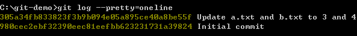

# Day 10: Git 개체 절대 이름 이해하기

Git 버전 관리 과정에서 각 버전은 커밋 개체를 나타냅니다. 버전 관리 중에는 브랜치가 자주 만들어지므로, 그 결과로 생기는 커밋 그래프는 상당히 복잡해질 수 있습니다. 따라서 서로 다른 버전을 식별하거나 특정 버전을 빠르게 찾아 정보를 얻는 방법이 매우 중요해집니다. 이 글에서는 Git에서 흔히 사용되는 개체 이름 개념과 사용 방법을 이해하는 데 도움을 드리겠습니다.

## 개체 절대 이름

Git에서 각 개체에는 SHA1 해싱으로 계산된 ID가 있으며, 이 ID가 이른바 "절대 이름"입니다. 개체가 커밋 개체라면, 이것이 커밋 개체의 절대 이름입니다. 따라서 커밋 개체의 절대 이름만 찾으면 언제든지 그 버전을 가져올 수 있습니다. 다음 그림의 화살표가 가리키는 것처럼, 이것은 `git log`를 통해 얻은 커밋 개체 ID입니다. 언제든지 그 커밋 개체에 대한 상세 정보를 얻을 수 있습니다.

위 그림에 있는 커밋 개체의 내용을 보고 싶다면, `git cat-file -p commitid`를 사용하여 가져올 수 있습니다. 다음 그림과 같습니다.

## 개체 절대 이름의 짧은 구문

Git 개체 ID는 내용의 SHA1 해싱 결과이므로 상당히 깁니다(40자). Git에서 "절대 이름"을 지정할 때는 처음 몇 문자만 사용해도 되며, 최소 4자까지 가능합니다. 이는 길이가 4자에서 40자 사이인 "절대 이름"은 모두 개체를 식별하는 데 사용할 수 있다는 의미입니다.

예를 들어, 위 그림에서도 볼 수 있듯이 이 커밋 개체의 내용에는 트리 개체가 포함되어 있으며, 이 트리 개체 역시 `07c1321be49815d53eb2413f0ad5286010ebb6cc`라는 절대 이름을 가지고 있습니다. 따라서 다시 `git cat-file -p treeid`를 사용하여 그 트리 개체의 내용을 가져올 수도 있습니다. 다음 그림과 같습니다.

때로는 버전 기록을 가져오고 싶어서 `git log` 명령어를 사용하는데, 이 명령어는 각 파일의 변경 사항 비교 결과도 함께 출력합니다. 결과가 매우 길어질 것입니다. 이때 `git log --pretty=oneline` 명령어를 사용하면 더 간결한 이력 기록을 얻을 수 있고, 커밋 개체의 완전한 "절대 이름"도 얻을 수 있습니다. 다음 그림과 같습니다.

또 다른 흔히 사용되는 기법은 "절대 이름"의 일부만 출력하는 것입니다. `git log --pretty=oneline --abbrev-commit` 명령어를 통해 실행할 수 있습니다. 다음 그림과 같습니다.

## 오늘의 요약

이상이 절대 이름의 사용법입니다. Git 개체의 특성 덕분에, 개체의 절대 이름을 통해 Git 리포지토리의 어떤 개체에도 접근할 수 있습니다. 절대 이름을 사용하는 git 명령어는 훨씬 더 많습니다. 이러한 개념과 표현에 익숙해지면 Git 개체를 더 잘 마스터할 수 있을 것입니다.

오늘 배운 Git 명령어와 매개변수를 다시 정리하겠습니다.

* git log
* git cat-file -p [object_id]
* git log --pretty=oneline
* git log --pretty=oneline --abbrev-commit

---

* [목차로 돌아가기](README.md)
* [이전 날: 파일 및 버전 차이 비교하기](09.md)
* [다음 날: Git 개체 참조와 심볼릭 참조 이해하기](11.md)

---
