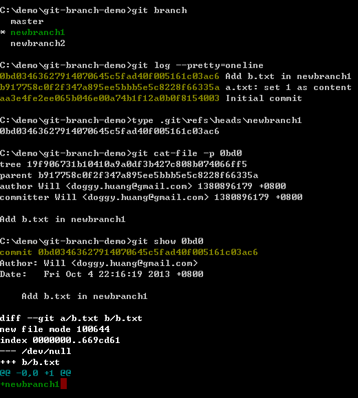
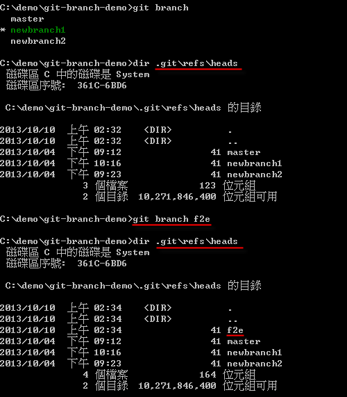
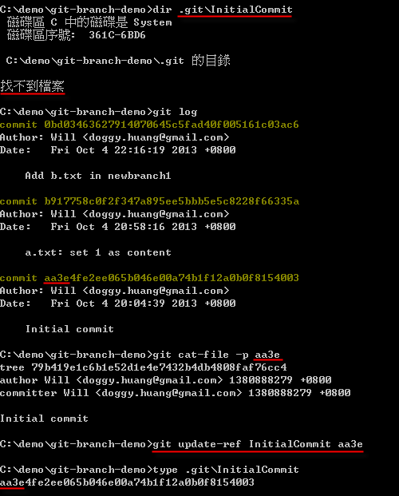
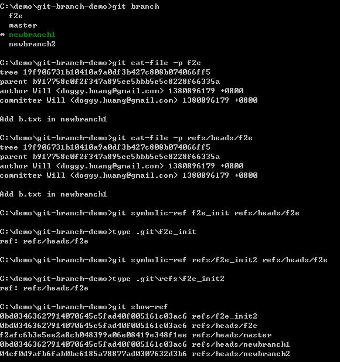

# Day 11: Git 개체 참조와 심볼릭 참조 이해하기

Git 개체의 "절대 이름"을 이해한 다음에는, Git 버전 관리 과정에서 가장 흔히 사용되는 "참조 이름"을 소개하겠습니다.

## 개체 참조 이름 이해하기

참조 이름(ref)은 간단히 말해 Git 개체를 가리키는 "포인터"이거나, "절대 이름"과 비교해 더 기억하기 쉬운 또 다른 이름입니다. 미리 정의되었거나 사용자가 정의한 이름을 사용해 특정 Git 개체를 나타냅니다.

이전에 배운 "브랜치 이름", 우리가 사용해 온 HEAD(최신 버전을 나타냄), 그리고 나중에 배울 "태그 이름"은 모두 "참조 이름"으로, 본질적으로 기억하기 쉽게 만들기 위해 존재합니다.

"브랜치 이름"을 예로 들어 "참조 이름"의 물리적 구조가 무엇인지 설명하겠습니다. 다음 그림에서는 `git branch`를 사용해 모든 브랜치 이름을 가져옵니다. 현재 세 개의 브랜치가 있는 것을 볼 수 있습니다. 하지만 이 세 개의 브랜치 이름은 사실 "참조 이름"이며, 이는 이 세 개의 "참조 이름"이 Git 개체 리포지토리의 세 개의 커밋 개체에 대응한다는 의미입니다. 다음 그림에서 이 브랜치 참조 이름들이 사실은 그냥 파일이라는 것도 볼 수 있습니다. 모든 "로컬 브랜치" 참조 이름은 `.git\refs\heads` 디렉터리에 위치합니다.

다음으로 다음 그림을 사용해 이 파일이 "절대 이름"과 어떻게 연결되는지 증명하겠습니다. 먼저 `git branch`를 사용해 모든 브랜치 이름을 가져오면, 현재 "작업 디렉터리"가 `newbranch1` 브랜치를 가리키고 있는 것을 알 수 있습니다. 이때 `git log --pretty=oneline`을 통해 이 브랜치의 모든 버전 기록을 가져올 수 있습니다. 기본적으로 이 브랜치 "참조 이름"은 브랜치의 "최신 버전"을 가리킵니다. `.git\refs\heads\newbranch1` 파일의 내용을 열기만 하면, 이것이 버전 기록의 "최신 버전"을 가리키는 평범한 텍스트 파일에 불과하다는 것을 알 수 있습니다. 마지막으로 `git cat-file -p 0bd0`를 사용해 해당 커밋 개체의 내용을 가져오고 `git show 0bd0`를 사용해 해당 버전의 변경 기록을 가져옴으로써, 이 파일들이 "참조 이름"의 주된 목적임을 증명합니다.

그런 다음 명령어를 사용해 "절대 이름"과 "참조 이름"으로 특정 커밋 개체의 내용을 읽은 결과를 확인하여, 이 두 명령어의 결과가 동일함을 증명합니다.

대부분의 경우 "참조 이름"은 보통 커밋 개체를 가리키지만, 반드시 그래야 하는 것은 아닙니다. blob 개체, 트리 개체, 태그 개체 등 다른 Git 개체 유형을 가리킬 수도 있습니다.

## .git/refs/ 디렉터리 소개

위 예시에서 실제로 모든 "참조 이름"은 파일이며 모두 `git/refs/` 디렉터리에 놓인다는 것을 알 수 있습니다. Git의 참조 이름이 놓이는 디렉터리 위치는 주로 세 가지입니다.

* 로컬 브랜치: `.git/refs/heads/`
* 원격 브랜치: `.git/refs/remotes/`
* 태그: `.git/refs/tags/`

간단한 예를 들어 보겠습니다. `f2e`라는 이름의 브랜치를 만들면, 이때 로컬 브랜치의 "참조 이름"이 `.git/refs/heads/f2e` 파일을 만들 것이라는 것을 알 수 있습니다. 다음 그림과 같습니다.

사실 이 `f2e`의 "전체 이름"은 `refs/heads/f2e`라고 해야 합니다. 다만 Git에서는 참조 이름을 빠르게 입력할 수 있도록 약어를 입력하는 것을 허용합니다. 다음 그림과 같이, "참조 이름"을 사용하는 이 세 가지 방법은 모두 가능합니다.

그러나 "참조 이름"의 약어를 입력하면, Git은 기본적으로 다음 순서대로 적절한 참조 이름을 검색합니다. 대응하는 파일을 찾는 즉시 해당 파일 내용의 "개체 절대 이름"을 반환합니다.

* `.git/<reference abbreviation>`
* `.git/refs/<reference abbreviation>`
* `.git/refs/tags/<reference abbreviation; tag name>`
* `.git/refs/heads/<reference abbreviation; local branch name>`
* `.git/refs/remotes/<reference abbreviation>`
* `.git/refs/remotes/<reference abbreviation; remote branch name>/HEAD`

예를 들어 `git cat-file -p f2e` 명령어를 입력하면, Git은 다음 순서대로 상대적인 "참조 이름 파일"을 찾아 해당 파일의 내용(즉, Git 개체의 절대 이름)을 추출합니다.

* `.git/f2e` --> 파일을 찾을 수 없음
* `.git/refs/f2e` --> 파일을 찾을 수 없음
* `.git/refs/tags/f2e` --> 파일을 찾을 수 없음
* `.git/refs/heads/f2e` --> **참조 이름을 찾았으므로 더 이상 검색하지 않음**
* `.git/refs/remotes/f2e`
* `.git/refs/remotes/f2e/HEAD`

## 개체 심볼릭 참조 이름(symref) 이해하기

심볼릭 참조 이름(symref)도 사실 참조 이름(ref)의 한 종류로, 단지 내용이 다를 뿐입니다. 다음 그림에서 내용의 차이를 볼 수 있습니다. "심볼릭 참조"는 또 다른 "참조 이름"을 가리키며, 내용이 `ref:`로 시작합니다.

Git 도구에서는 자주 사용하는 커밋 개체에 빠르게 접근할 수 있도록 몇 가지 특수한 심볼릭 참조가 기본적으로 유지되며, 이 개체들은 기본적으로 `.git/` 디렉터리에 저장됩니다. 이러한 심볼릭 참조는 다음 네 가지입니다.

* HEAD
* 항상 "작업 디렉터리"에 설정된 "브랜치"의 "최신 버전"을 가리킵니다.
* 따라서 이 브랜치에서 `git commit`을 실행하면, 이 `HEAD` 심볼릭 참조도 이 브랜치 최신 버전의 커밋 개체로 업데이트됩니다.
* ORIG_HEAD
* 간단히 말해 HEAD 커밋 개체의 "이전 버전"으로, 이전 버전 변경을 복원할 때 자주 사용됩니다.
* FETCH_HEAD
* 원격 리포지토리를 사용할 때는 `git fetch` 명령어를 사용해 원격 리포지토리의 모든 개체를 가져올 수 있습니다. 이 FETCH_HEAD 심볼릭 참조는 원격 리포지토리의 각 브랜치 HEAD(최신 버전)의 "절대 이름"을 기록합니다.
* MERGE_HEAD
* 병합 작업을 수행할 때(이후 글에서 병합 주제를 다룰 예정입니다), "병합 소스"의 커밋 개체 절대 이름이 이 MERGE_HEAD 심볼릭 참조에 기록됩니다.

## 일반 참조와 심볼릭 참조의 사용법

"참조 이름"에는 특수한 용도가 있으며 보통 "로컬 브랜치", "원격 브랜치", "태그"와 같은 시나리오에서 사용되지만, 사실 "사용자 지정 참조 이름"은 얼마든지 만들 수 있습니다. `git update-ref`를 통해 "일반 참조"를 자유롭게 만들 수 있습니다.

`InitialCommit`이라는 이름의 일반 참조를 만들어 Git 리포지토리의 첫 번째 버전을 가리키도록 해 보겠습니다. 일반 참조를 만드는 방법은 다음 그림의 명령어 실행 순서를 참고하시기 바랍니다.

만든 후에는 기본 파일이 `.git` 폴더에 놓이며, 이때 "절대 이름"과 "참조 이름" 모두로 특정 Git 개체의 내용에 접근할 수 있습니다.

**참고**: 참조 이름은 모든 Git 개체를 가리킬 수 있으며 커밋 개체에만 한정되지 않는다는 점을 기억하시기 바랍니다.

좀 더 정식인 참조 이름을 만들려면 `refs/` 접두사를 추가하는 것이 가장 좋습니다. 예를 들면 `git update-ref refs/InitialCommit [object_id]`와 같습니다.

일반 참조를 삭제하려면 `-d` 옵션을 사용할 수 있습니다. 다음 그림과 같습니다.

모든 참조를 표시하려면 `git show-ref` 명령어를 사용할 수 있습니다. 다음 그림과 같습니다.

"심볼릭 참조"를 만들고 삭제하려면 다음 그림에서 `git symbolic-ref`의 사용법을 참고하시기 바랍니다. 그림을 보고 이야기를 풀어 보시기 바랍니다. 이해하고 나면 Git이 참조를 사용하는 방식이 정말 유연하고 강력하다는 것을 알게 될 것입니다. 또한 `git show-ref`를 실행하면 `.git\refs` 디렉터리에 있는 참조만 표시되며, 이는 "일반 참조"와 "심볼릭 참조" 모두 마찬가지입니다.

이 글의 앞부분에서 다음 디렉터리에 참조를 만들 수 있다고 언급했습니다.

* `.git/<reference abbreviation>`
* `.git/refs/<reference abbreviation>`
* `.git/refs/tags/<reference abbreviation; tag name>`
* `.git/refs/heads/<reference abbreviation; local branch name>`
* `.git/refs/remotes/<reference abbreviation>`
* `.git/refs/remotes/<reference abbreviation; remote branch name>/HEAD`

사용자 지정 참조는 보통 "로컬 브랜치", "원격 브랜치", "태그"의 사용과 혼동되지 않도록 처음 두 경로에 만듭니다. 그러나 실제로는 `git update-ref`를 사용해 어떤 사용자 지정 참조도 만들 수 있습니다. `refs/heads/Will`에 사용자 지정 참조를 만들면, 이는 `Will`이라는 이름의 브랜치를 만드는 것과 같습니다. Git은 정말 이렇게 단순합니다. Git의 내부 구조를 더 많이 이해할수록 Git의 다양한 기능을 더욱 좋아하게 될 것입니다.

## 오늘의 요약

"참조 이름(ref)"은 간단히 말해 특정 Git 개체를 가리키는 데 사용되는 Git 개체의 "포인터"라는 것을 알 수 있습니다. 따라서 "참조 이름"은 기억을 돕기 위해 사용되는 Git 개체 절대 이름의 별칭이라고 생각하면 됩니다. Git에는 "브랜치", "태그" 등 프로젝트를 관리하는 데 도움이 되는 메커니즘이 많이 있습니다. 이러한 메커니즘은 실제로 내부적으로 "참조"에 의해 구현됩니다.

Git 참조 이름은 "일반 참조"와 "심볼릭 참조"로 나뉩니다. 두 가지의 목적은 같고 내용만 조금 다릅니다. "심볼릭 참조"는 또 다른 "일반 참조"를 가리키는 반면, "일반 참조"는 Git 개체의 "절대 이름"을 가리킵니다.

오늘 배운 Git 명령어와 매개변수를 다시 정리하겠습니다.

* git branch
* git log --pretty=oneline
* git log --oneline
* git cat-file -p [ref or object_id]
* git show [ref or object_id]
* git update-ref
* git symbolic-ref
* git show-ref

---

* [목차로 돌아가기](README.md)
* [이전 날: Git 개체 절대 이름 이해하기](10.md)
* [다음 날: Git 개체 상대 이름 이해하기](12.md)

---
