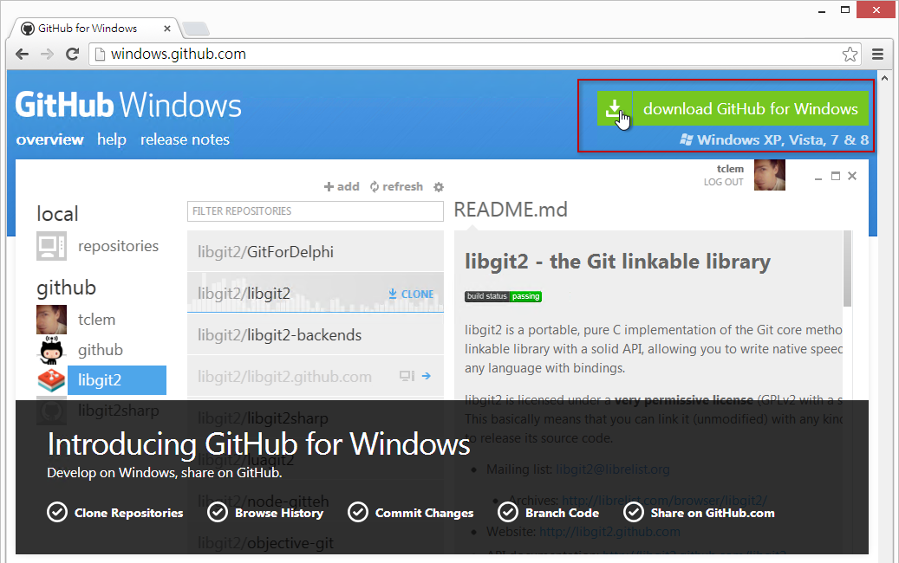
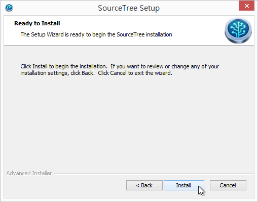
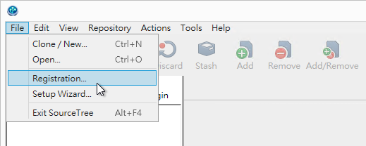

# Hari 02: Tiga Alat Git Penting untuk Platform Windows

Untuk mula menggunakan kawalan versi Git, anda perlu memasang alat Git yang sesuai terlebih dahulu. Siri artikel ini terutamanya memberi tumpuan kepada platform Windows. Artikel ini akan memperkenalkan tiga alat kawalan versi Git yang paling kerap kami gunakan, memperkenalkan persamaan dan perbezaan antara alat ini, dan bila hendak menggunakan alat yang mana.

## Alat Pertama: [Git for Windows](https://msysgit.github.io/)

Ini ialah satu set alat baris perintah yang boleh dilaksanakan dalam **Command Prompt**. Pada masa ini, semua alat GUI untuk Git di pasaran sebenarnya melaksanakan alat Git peringkat rendah ini secara dalaman, jadi ia ialah alat pengurusan Git penting yang mesti dipasang!

Berikut ialah proses pemasangan:

* Mula-mula pergi ke laman web rasmi https://msysgit.github.io/ untuk bersedia memuat turun pemasang

* Muat turun versi terkini tanpa mengira versi mana

* Klik terus fail yang dimuat turun untuk memasang

* Halaman selamat datang program pemasangan

* Setuju dengan terma lesen GPL

* Pilih laluan pemasangan

* Pilih komponen. **Adalah disyorkan untuk menyahtanda pilihan integrasi Windows Explorer!**  ( Kerana alat integrasi ini terlalu asas, adalah disyorkan untuk menggunakan alat [TortoiseGit](https://code.google.com/p/tortoisegit/) sebagai gantinya )

* Tetapkan nama kumpulan program, kekalkan pilihan lalai

* Di sini adalah disyorkan untuk **memilih pilihan Run Git from the Windows Command Prompt!**  ( Kerana kebanyakan pengguna Windows tidak biasa dengan perintah Bash )

* Penukaran penamat baris, adalah disyorkan untuk mengekalkan pilihan lalai.

* Mulakan pemasangan

* Pemasangan selesai

* Selepas pemasangan, buka terus command prompt untuk mula menggunakannya

* Anda boleh memasukkan perintah `git --version` untuk menyoal versi semasa program alat

## Alat Kedua: [GitHub for Windows](https://windows.github.com/)

Ini ialah alat yang dibangunkan secara rasmi oleh [GitHub](https://github.com) untuk orang yang tidak mempunyai pemahaman mendalam tentang Git. Ia menggunakan antara muka GUI yang mudah dan mesra, cuba menyembunyikan konsep dan parameter perintah Git yang sukar difahami itu. Walaupun alat GitHub for Windows jauh lebih mesra daripada Git for Windows, bagi orang yang langsung tidak mempunyai konsep Git, bermula dengan alat GitHub for Windows mungkin tidak mudah.

> [GitHub for Windows](https://windows.github.com/) mempunyai alat [Git Shell](https://github.com/dahlbyk/posh-git/) terbina dalam, yang menggunakan [Git for Windows](https://msysgit.github.io/), jadi jika anda tidak memasang Git for Windows, anda tidak akan dapat menggunakan alat Git Shell bagi GitHub for Windows.

Alat ini boleh membantu anda menyelesaikan agak banyak kerja kawalan versi Git. Sekurang-kurangnya fungsi kawalan versi asas disediakan, terutamanya dengan keupayaan berikut:

* Klon Repositori
	* Klon repositori daripada GitHub (git clone)
* Semak Imbas Sejarah
	* Semak imbas sejarah versi repositori setempat
* Commit Perubahan
	* Commit perubahan ke repositori setempat
* Cabang Kod
	* Cipta dan urus cabang Git, dan boleh menukar cabang dalam direktori kerja
* Kongsi di GitHub.com
	* Segerakkan perubahan dengan GitHub
	* Maksud "Sync" di sini ialah menyepadukan git pull dan git push bersama
	* Apabila GitHub for Windows menyegerak, ia menggunakan rebase secara lalai untuk cantuman.

Kebanyakan perkara yang boleh dilakukan oleh Git for Windows selain ini tidak boleh dilakukan dalam GitHub for Windows! Jika anda benar-benar ingin mengaplikasikannya kepada projek pembangunan yang lebih besar, anda mungkin perlu mempertimbangkan sama ada ia sesuai, tetapi bagi bukan pembangun perisian, kerja kawalan versi yang mudah sepatutnya lebih daripada mencukupi.

Berikut ialah proses pemasangan GitHub for Windows:

* Mula-mula pergi ke https://windows.github.com/ untuk bersedia memuat turun pemasang

* Selepas memuat turun, laksanakan pemasangan secara langsung

* Log masuk memerlukan akaun GitHub

* Menyediakan maklumat akaun

* Cari repositori Git setempat
	* Jika anda tidak pernah menggunakan Git, sepatutnya tiada hasil di sini

* Selepas pemasangan, anda akan melihat antara muka program utama GitHub for Windows

## Alat Ketiga: [SourceTree](https://www.sourcetreeapp.com/)

[SourceTree](https://www.sourcetreeapp.com/) pada masa ini ialah alat yang sangat saya syorkan yang boleh menyokong platform Windows dan Mac. Alat ini ialah alat GUI yang dibangunkan oleh Atlassian (syarikat yang membuat JIRA, Confluence, Bamboo) dan disediakan secara percuma. Dengan alat ini, hampir semua kerja kawalan versi Git boleh dilakukan (termasuk aliran kerja git-flow), yang merupakan alat kawalan versi Git yang sangat berkuasa.

> [SourceTree](https://www.sourcetreeapp.com/) juga memerlukan [Git for Windows](https://msysgit.github.io/) dipasang terlebih dahulu, kerana ia bergantung kepada alat baris perintah Git untuk berfungsi.

Berikut ialah proses pemasangan SourceTree:

* Mula-mula pergi ke https://www.sourcetreeapp.com/ untuk bersedia memuat turun pemasang

* Muat turun pemasang

* Selepas memuat turun, laksanakan pemasangan secara langsung, ini ialah program pemasangan grafik

* Anda perlu bersetuju dengan perjanjian lesen

* Pendaftaran diperlukan untuk menggunakan (ini percuma)

* Jika anda tidak mempunyai akaun Bitbucket atau Google, anda juga boleh mendaftar secara percuma

* Wizard persediaan

* Persediaan kunci SSH

* Sama ada untuk memuatkan SSH Key daripada Pageant/PuTTY

* Pemasangan selesai!

Ringkasan Hari Ini
------

Hari ini kami memperkenalkan secara ringkas tiga alat kawalan versi Git yang lazim pada platform Windows. Yang pertama ialah [Git for Windows](https://msysgit.github.io/), yang kedua ialah [GitHub for Windows](https://windows.github.com/), dan yang ketiga ialah [SourceTree](https://www.sourcetreeapp.com/). Ketiga-tiga alat ini mempunyai kelebihan masing-masing, tetapi secara peribadi saya berpendapat jika anda ingin memahami kawalan versi Git dengan mendalam, anda harus menggunakan Git for Windows dan belajar melaksanakan perintah Git melalui baris perintah. Jika anda mahukan alat GUI yang lebih intuitif, maka gunakan [SourceTree](https://www.sourcetreeapp.com/).

Saya ingin menekankan bahawa untuk benar-benar menguasai kawalan versi Git, anda mesti memahami apa yang Git lakukan pada lapisan bawah. Jadi dalam artikel berikut, saya pada asasnya akan memperkenalkan operasi kawalan versi Git menggunakan [Git for Windows](https://msysgit.github.io/), dan menggunakan [SourceTree](https://www.sourcetreeapp.com/) sebagai alat bantuan untuk membantu anda lebih memahami operasi kawalan versi Git dan perubahan dalam repositori.

---

* [Kembali ke Jadual Kandungan](README.md)
* [Hari Sebelumnya: Memahami Kawalan Versi Git](01.md)
* [Hari Berikutnya: Mencipta Repositori](03.md)

---
