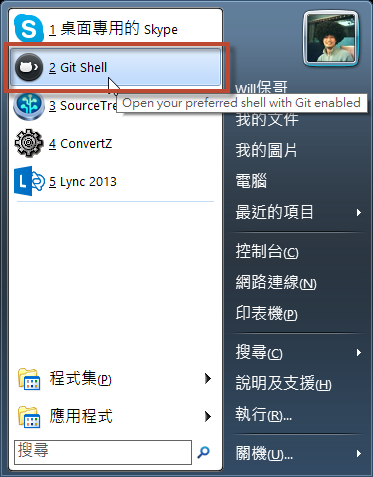
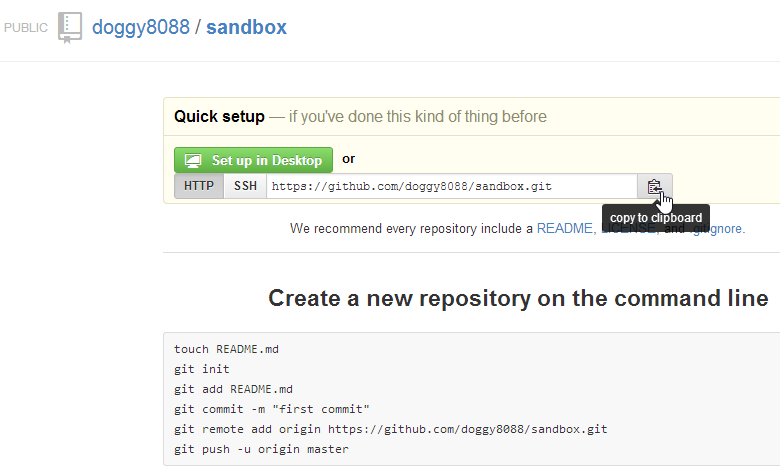

# Hari 03: Mencipta Repositori

Untuk mula menggunakan Git, perkara yang paling penting ialah mempunyai repositori Git terlebih dahulu. Tetapi dari mana datangnya repositori ini? Artikel ini akan memperkenalkan pelbagai cara untuk mencipta repositori.

Untuk mencipta repositori, sebenarnya, anda mempunyai banyak pilihan, contohnya:

* Cipta repositori setempat pada mesin setempat anda
* Cipta repositori berkongsi pada mesin setempat anda
* Cipta repositori jauh di GitHub atau platform Git lain

Walau apa pun, anda sentiasa memerlukan repositori. Kami akan menerangkan setiap satu seperti berikut:

## Mencipta Repositori Setempat pada Mesin Setempat Anda

Mari kita buka dahulu alat Git Shell bagi [GitHub for Windows](https://windows.github.com/). Alat ini sebenarnya ialah antara muka Windows PowerShell tetapi dengan beberapa pemboleh ubah persekitaran berkaitan Git dan tetapan command prompt:

Selepas dibuka, ia akan lalai ke folder `%USERPROFILE%\Documents\GitHub`. Ini ialah direktori akar projek lalai bagi [GitHub for Windows](https://windows.github.com/), yang bermakna semua projek yang diklon daripada GitHub melalui [GitHub for Windows](https://windows.github.com/) akan diletakkan dalam direktori ini secara lalai.

Jadi kita boleh terus mencipta direktori baharu di sini untuk berfungsi sebagai "direktori kerja" kita. Kita boleh memasukkan perintah `mkdir git-demo` untuk mencipta direktori, kemudian gunakan `cd git-demo` untuk masuk ke direktori itu.

Oleh kerana ini ialah direktori kosong dan tidak mengandungi sebarang repositori Git, kita boleh menggunakan perintah `git init` untuk mencipta repositori. Secara lalai, repositori akan diletakkan dalam direktori `.git` di bawah direktori kerja.

Langkah operasi lengkap ditunjukkan dalam rajah berikut:

Selepas penciptaan, anda sepatutnya perasan sesuatu yang berbeza dalam command prompt Git Shell - ia menambah `[master]` yang diserlahkan selepas laluan semasa. Prompt ini akan memaparkan pelbagai keadaan `direktori kerja` semasa anda. Jika anda boleh memahaminya, ia ialah sumber maklumat yang sangat berguna yang boleh membantu anda mengelakkan menaip banyak perintah `git status` untuk menyoal keadaan semasa direktori kerja apabila menggunakan alat baris perintah untuk mengendalikan Git. Bahagian ini akan diterangkan secara khusus dalam artikel seterusnya.

## Mencipta Repositori Berkongsi pada Mesin Setempat Anda

Repositori berkongsi merujuk kepada mencipta repositori Git tanpa direktori kerja. Situasi ini lebih lazim pada sistem pengendalian Linux kerana sistem pengendalian Linux biasanya digunakan oleh ramai orang pada hos Linux yang sama. Walaupun ini juga boleh digunakan pada sistem pengendalian Windows, persekitaran pembangunan kami kebanyakannya berada dalam persekitaran Windows Client, dan jarang sekali berbilang orang berkongsi komputer.

Untuk mencipta repositori berkongsi, anda boleh menggunakan perintah `git init --bare` untuk menciptanya, seperti yang ditunjukkan dalam rajah berikut. Anda boleh lihat bahawa apabila `git init` digunakan dengan parameter `--bare`, ia mencipta semua fail dan folder berkaitan repositori Git dalam direktori semasa. Anda mesti memberi perhatian khusus bahawa folder ini tidak boleh digunakan secara langsung untuk tujuan pembangunan. Ia hanya boleh digunakan untuk menyimpan maklumat berkaitan Git. Dalam kebanyakan kes, anda tidak sepatutnya mengedit secara manual sebarang fail dalam folder ini. Adalah lebih baik untuk beroperasi melalui perintah git.

Oleh kerana ini ialah "repositori tulen tanpa direktori kerja," repositori berkongsi juga mempunyai nama lain yang dipanggil "bare repository."

Saya mesti menekankan sekali lagi bahawa Git ialah "kawalan versi teragih," dan semua orang mempunyai repositori yang lengkap. Maksudnya, apabila anda ingin mencipta "direktori kerja," anda mesti terlebih dahulu mendapatkan kandungan "bare repository" ini kembali. Pada masa ini, anda mesti menggunakan perintah `git clone [REPO_URI]` untuk "mengklon" satu salinan kembali. Melalui proses `git clone`, bukan sahaja direktori kerja akan dicipta secara automatik, tetapi "bare repository" ini juga akan diklon kembali sepenuhnya. Proses pengklonan ini seperti "sandaran lengkap," menyalin semua rekod versi dalam repositori Git, semua versi fail, dsb., semua data kembali sepenuhnya. Proses operasi perintah yang lengkap boleh dirujuk dalam rajah berikut:

Dalam amalan, mungkin terdapat beberapa cara untuk menggunakan "repositori berkongsi" atau "bare repository":

* Pembangunan kolaboratif pada mesin yang digunakan oleh ramai orang, di mana kebanyakan orang boleh diberikan kebenaran baca sahaja kepada "folder bare repository" ini, dan hanya seorang atau beberapa orang mempunyai kebenaran tulis.
* Sesetengah orang meletakkan bare repository pada Dropbox untuk menyegerakkan bare repository ini dengan berbilang komputer mereka.

Sila ambil perhatian: Walaupun direktori `.git` di bawah "direktori kerja" juga ialah "repositori," repositori di bawah direktori kerja juga mengandungi beberapa maklumat indeks direktori kerja, merekodkan maklumat keadaan direktori kerja. Maklumat keadaan ini tidak akan muncul dalam "repositori berkongsi," yang hanya mengandungi maklumat versi (iaitu, maklumat objek Git).

## Mencipta Repositori Jauh di GitHub atau Platform Git Lain

Sebenarnya, "repositori jauh" dan "repositori berkongsi" hampir sama. Perbezaannya hanyalah bahawa "repositori berkongsi" kebanyakannya menggunakan akses fail secara langsung, manakala "repositori jauh" biasanya menggunakan protokol seperti SSH, protokol Git, HTTP, dsb. untuk mengakses repositori Git secara "jauh". Kaedah penggunaan lain pada asasnya adalah sama.

Berikut menunjukkan mencipta repositori melalui GitHub dan mengklon repositori kembali ke setempat:

* Mula-mula log masuk ke GitHub, kemudian cipta repositori baharu

* Tetapkan maklumat berkaitan untuk projek GitHub dan cipta repositori

* Selepas penciptaan, ia akan menggesa anda tentang cara mendapatkan projek atau mengimport projek sedia ada setempat anda ke GitHub

* Seperti yang ditunjukkan di atas, kita boleh klik "Set up in Desktop" dalam bahagian Quick setup. Komputer anda akan membuka alat GitHub for Windows secara automatik dan mengklon repositori ini kembali secara automatik serta mencipta direktori kerja.

* Anda juga boleh menyalin URL repositori Git jauh, kemudian laksanakan `git clone [REPO_URL]` untuk mengklon satu salinan kembali.

## Ringkasan Hari Ini

Di atas ialah tiga cara untuk mencipta repositori Git. Izinkan saya menyusun semula perintah dan parameter Git yang dipelajari hari ini:

* git init
* git init --bare
* git clone \[REPOSITORY\_URI]

## Pautan Rujukan

* [Git for Windows](https://msysgit.github.io/)
* [GitHub for Windows](https://windows.github.com/)

---

* [Kembali ke Jadual Kandungan](README.md)
* [Hari Sebelumnya: Tiga Alat Git Penting untuk Platform Windows](02.md)
* [Hari Berikutnya: Perintah Kawalan Versi Git yang Lazim Digunakan](04.md)

---
