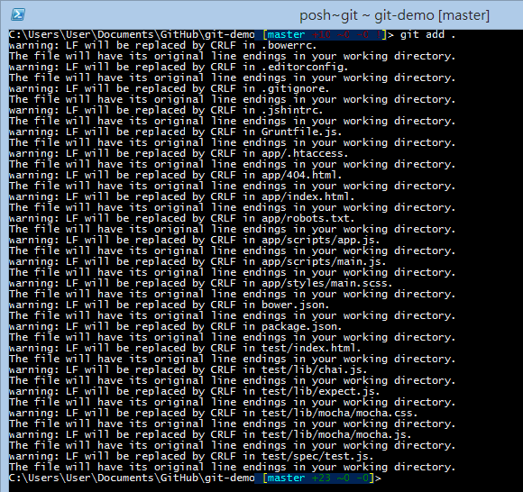

# Hari 04: Perintah Kawalan Versi Git yang Lazim Digunakan

Artikel ini akan membantu anda mempelajari beberapa tugas kawalan versi yang paling penting dan asas, termasuk operasi fail asas seperti menambah, memadam, menamakan semula fail, commit perubahan (mencipta versi baharu), dan menyoal rekod sejarah.

## Menyediakan Direktori Kerja

Menyemak kandungan daripada artikel sebelumnya "Hari 03: Mencipta Repositori," mari kita terus mencipta repositori setempat untuk memulakan semua latihan dalam artikel ini.

```
mkdir git-demo
cd git-demo
git init
```

## Menambah Fail

Mari kita letakkan beberapa fail dalam direktori kerja. Sebarang fail pun boleh; hanya salin beberapa fail dan direktori sedia ada ke dalam direktori kerja semasa.

Untuk artikel ini, saya akan menggunakan alat [YEOMAN](https://yeoman.io/) untuk menjana laman web contoh webapp dengan pantas. Dengan hanya satu perintah, anda boleh mencipta laman web yang lengkap:

```
yo webapp
```

**Nota**: Berkenaan penggunaan [YEOMAN](https://yeoman.io/) pada platform Windows, anda boleh merujuk artikel pengarang [How to Install and Use Yeoman 1.0 Related Tools on Windows Platform](https://blog.miniasp.com/post/2013/08/11/Yeoman-1-0-Installation-and-Usage-on-Windows), yang menerangkan proses pemasangan dan penggunaan yang lengkap dengan terperinci.

Selepas menambah fail, jika anda masih berada dalam antara muka Git Shell, anda sepatutnya segera melihat prompt seperti berikut:


Iaitu, prompt berikut yang terletak selepas laluan:

```
[master +10 ~0 -0 !]
```

Dalam bahagian prompt ini, anda boleh melihat beberapa perkara:

* master mewakili direktori kerja semasa ialah cabang **master**, yang juga merupakan nama cabang lalai Git.
* Nombor "merah" semuanya mewakili fail Untracked, yang bermakna perubahan ini tidak akan masuk ke kawalan versi.
* +10 mewakili 10 fail "ditambah"
* ~0 mewakili 0 fail "diubah suai"
* -0 mewakili 0 fail "dipadam"

Jika anda ingin menambah fail baharu ini ke kawalan versi Git, anda mesti melaksanakan perintah berikut:

```
git add .
```

Dengan cara ini, semua fail, direktori, dan semua fail dalam subdirektori di bawah direktori kerja ini semuanya akan ditambah ke [index] atau [cache] direktori kerja Git ini. Sila ambil perhatian: Pada masa ini, tiada versi telah dicipta. Ia hanya memberitahu Git bahawa fail ini "akan" ditambah ke repositori Git.

Seperti yang ditunjukkan dalam rajah berikut, ini ialah hasil selepas saya melaksanakan `git add .` di sini. Mesej amaran yang berlaku di sini tidak begitu serius. Mereka yang berminat untuk memahami boleh merujuk artikel lain oleh pengarang: [Notes on Git for Windows Line Ending Conversion (CRLF)](https://blog.miniasp.com/post/2013/09/15/Git-for-Windows-Line-Ending-Conversion-Notes).



Walau bagaimanapun, apa yang menarik ialah "nombor merah" yang asal kini telah bertukar menjadi "nombor hijau." Maksud yang diwakili di sini ialah:

* Nombor "hijau" semuanya mewakili fail Staged (sedia), yang bermakna perubahan ini akan masuk ke kawalan versi.
* +23 mewakili 23 fail "ditambah" akan dicipta sebagai versi
* ~0 mewakili 0 fail "diubah suai" akan dicipta sebagai versi
* -0 mewakili 0 fail "dipadam" akan dicipta sebagai versi

Tetapi bukankah asalnya hanya +10 (merah)? Bagaimana ia menjadi +23 (hijau) selepas pelaksanaan?

Kita laksanakan `git reset` untuk menetapkan semula keadaan indeks direktori kerja, kemudian laksanakan `git status` sekali lagi untuk menyoal keadaan terperinci direktori kerja semasa, seperti yang ditunjukkan dalam rajah berikut:


Anda boleh lihat bahawa hanya "fail dan direktori di bawah direktori peringkat pertama" disenaraikan di sini kerana git tidak akan menyemak berapa banyak fail yang tidak dijejak dalam subdirektori pada masa ini.

Apabila kita melaksanakan `git add .` dan kemudian melaksanakan `git status` sekali lagi untuk menyoal status, anda boleh dapati bahawa fail dalam subdirektori semuanya telah ditambah, jadi nombor ini meningkat, seperti yang ditunjukkan dalam rajah berikut:


## Menambah Sebahagian Fail

Perintah `git add .` yang baru disebutkan akan menambah semua fail secara automatik (termasuk fail dalam subdirektori) ke indeks direktori kerja. Kadangkala kita hanya ingin menambah direktori tertentu atau fail tertentu ke versi. Pada masa ini, anda juga boleh menentukan direktori tertentu atau menggunakan wildcard untuk menambah fail.

Mari kita laksanakan `git reset` sekali lagi untuk menetapkan semula keadaan indeks direktori kerja, kemudian gunakan `git add app` untuk menambah folder app dan semua fail di bawahnya, dan gunakan `git add .*` untuk menambah semua fail yang bermula dengan "titik," seperti yang ditunjukkan dalam rajah berikut:


**Nota**: Wildcard `.*` tidak boleh menambah semua fail "titik" kerana aksara pertama `.` hanya boleh memadankan satu direktori. Jika anda ingin menambah semua fail yang bermula dengan titik, anda harus menggunakan `.??*` untuk memastikan ia memadankan fail yang bermula dengan titik.

## Commit Perubahan

Selepas menambah fail ke indeks, anda boleh commit perubahan untuk mencipta versi. Perintah commit ialah:

```
git commit -m "Initial commit"
```

Parameter `-m` diikuti oleh mesej commit. Mesej ini akan direkodkan dalam sejarah versi. Adalah disyorkan untuk menulis mesej commit yang bermakna untuk membantu anda dan orang lain memahami tujuan versi ini pada masa hadapan.


## Melihat Sejarah Commit

Selepas commit, anda boleh menggunakan perintah `git log` untuk melihat sejarah commit:

```
git log
```


Anda juga boleh menggunakan parameter `git log --oneline` untuk memaparkan versi log yang diringkaskan:

```
git log --oneline
```


## Mengubah Suai Fail

Sekarang mari kita cuba mengubah suai fail. Buka mana-mana fail dalam direktori kerja dan buat beberapa perubahan, kemudian simpan.

Selepas pengubahsuaian, jika anda melaksanakan `git status`, anda akan melihat maklumat tentang fail yang diubah suai:


Anda boleh lihat bahawa fail yang diubah suai akan dipaparkan dalam warna merah, dan bilangan fail yang diubah suai dipaparkan sebagai ~1.

## Melihat Perbezaan Fail

Sebelum commit fail yang diubah suai, anda mungkin ingin melihat perubahan apa yang telah dibuat. Anda boleh menggunakan perintah `git diff`:

```
git diff
```


Perintah git diff akan memaparkan perbezaan antara direktori kerja dan indeks.

## Commit Fail yang Diubah Suai

Untuk commit fail yang diubah suai, anda juga perlu melaksanakan `git add` terlebih dahulu untuk menambah fail yang diubah suai ke indeks, kemudian laksanakan `git commit`:

```
git add .
git commit -m "Update files"
```


## Memadam Fail

Jika anda ingin memadam fail dan mahu tindakan pemadaman ini direkodkan dalam versi, anda boleh menggunakan perintah `git rm`:

```
git rm [filename]
```

Selepas melaksanakan perintah ini, fail akan dipadam daripada kedua-dua direktori kerja dan indeks. Kemudian laksanakan `git commit` untuk commit tindakan pemadaman ini.


## Menamakan Semula atau Memindahkan Fail

Jika anda ingin menamakan semula atau memindahkan fail, anda boleh menggunakan perintah `git mv`:

```
git mv [old_filename] [new_filename]
```

Perintah ini akan menamakan semula atau memindahkan fail dan menambah perubahan ini secara automatik ke indeks. Kemudian laksanakan `git commit` untuk commit perubahan ini.


## Ringkasan Hari Ini

Hari ini kita mempelajari beberapa perintah asas Git, diringkaskan seperti berikut:

* `git add [file]` - Tambah fail ke indeks
* `git add .` - Tambah semua fail dalam direktori semasa ke indeks
* `git commit -m "message"` - Commit perubahan daripada indeks untuk mencipta versi baharu
* `git status` - Lihat keadaan semasa direktori kerja
* `git log` - Lihat sejarah commit
* `git log --oneline` - Lihat sejarah commit yang diringkaskan
* `git diff` - Lihat perbezaan antara direktori kerja dan indeks
* `git rm [file]` - Padam fail daripada direktori kerja dan indeks
* `git mv [old] [new]` - Namakan semula atau pindahkan fail
* `git reset` - Tetapkan semula keadaan indeks

## Pautan Rujukan

* [Git - Recording Changes to the Repository](https://git-scm.com/book/en/v2/Git-Basics-Recording-Changes-to-the-Repository)

---

* [Kembali ke Jadual Kandungan](README.md)
* [Hari Sebelumnya: Mencipta Repositori](03.md)
* [Hari Berikutnya: Memahami Hubungan antara Repositori, Direktori Kerja, Objek, dan Indeks](05.md)

---
