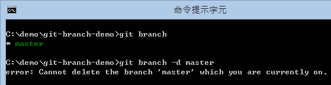
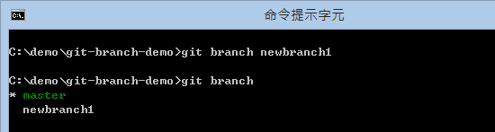
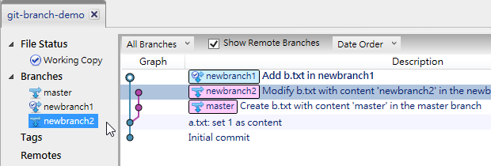

# Hari 08: Konsep Asas dan Penggunaan Cabang

Dalam Git, **cabang** ialah mekanisme yang sangat penting dan mesti digunakan dengan berhati-hati kerana projek tidak boleh bercabang tanpa had. Akhirnya, cabang mesti dicantumkan, tetapi cantuman ialah topik untuk kemudian. Artikel ini akan terlebih dahulu membantu anda mempelajari konsep asas dan penggunaan cabang Git.

## Konsep Asas Cabang

Tujuan utama menggunakan mekanisme "cabang" dalam kawalan versi ialah untuk menyelesaikan masalah konflik versi semasa proses pembangunan. Saya percaya bahawa ramai orang yang telah menggunakan sebarang mekanisme kawalan versi akan berpendapat bahawa "pencabangan" ialah punca yang "menyebabkan konflik versi" kerana apabila anda mula bercabang, anda pasti akan memikirkan isu cantuman. Selepas bercabang, jika seseorang mengubah suai baris yang sama pada fail yang sama seperti anda, ia akan menyebabkan "konflik versi." Setiap kali konflik berlaku, anda mesti bersusah payah menyelesaikannya.

Apabila konflik berlaku, kadangkala anda boleh memutuskan dengan mudah untuk menggunakan versi anda sendiri atau versi pihak lain, tetapi kadangkala ia tidak semudah itu. Apabila ia rumit, anda juga perlu mencari orang yang asalnya mengubah suai baris ini berdasarkan serpihan yang berkonflik, menyelaraskan kesan perubahan masing-masing pada sistem, dan akhirnya memutuskan cara untuk mencantum. Masalah seperti ini sangat membosankan, jadi ramai orang akan cuba mengelakkan "pencabangan" untuk mengelakkan "konflik."

Walau bagaimanapun, jika pasukan pembangunan menjadi lebih besar dan terdapat semakin banyak fungsi sistem, walaupun anda tidak mencabangkan versi, konflik semua orang masih akan muncul tanpa henti. Kadangkala ia bukan pun masalah konflik, tetapi A menyelesaikan fungsi dan ditimpa oleh versi B yang berikutnya tanpa sebarang konflik, yang bukan apa yang semua orang mahu lihat. Walau bagaimanapun, ini juga ialah situasi "konflik tidak kelihatan".

Pada masa lalu, dalam mekanisme kawalan versi berpusat Subversion, terdapat juga konsep pencabangan, yang boleh berfungsi dengan sangat baik. Sudah tentu, jika seni bina perisian anda tidak cukup baik, jika anda tidak begitu jelas tentang konsep pencabangan dan penggunaan alat, saya percaya bahawa menggunakan "pencabangan" tidak akan lancar. Ini ialah hasil yang tidak dapat dielakkan. Tidak akan ada alat kawalan versi di dunia ini yang membolehkan anda "belajar tanpa usaha, tanpa kesakitan, belajar pencabangan secara semula jadi." Ia bergantung kepada orang. Jika konsep orang salah, tiada alat akan berfungsi dengan lancar.

Oleh kerana Git ialah "mekanisme kawalan versi teragih," dalam senario pengurusan versi teragih, perkara terakhir yang anda mahu lakukan ialah "pengurusan," jadi Git jarang mempunyai apa yang dipanggil mekanisme pengurusan atau mekanisme kawalan kebenaran. Satu-satunya perkara yang ia mahu lakukan ialah membenarkan semua orang "bercabang" dan "mencantum" dengan lancar.

Mengambil "repositori jauh" yang disebutkan dalam [Hari 03: Mencipta Repositori] sebagai contoh, anda boleh bayangkan: dari saat kita menggunakan perintah `git clone`, ia sebenarnya ialah permulaan "pencabangan." Anda menyalin repositori lengkap daripada repositori jauh, kemudian mula mencipta versi pada mesin setempat anda sendiri. Selepas perisian disemak semula ke tahap tertentu, anda "mencantumkannya" kembali. Cuma perintah cantuman pada masa ini dipanggil `git push`.

Situasi pencabangan dan cantuman ini ada di mana-mana dalam proses kawalan versi Git. Repositori jauh boleh mempunyai cabang, repositori setempat boleh mempunyai cabang. Anda boleh mencantum (pull) daripada mana-mana cabang jauh ke cabang setempat, atau anda boleh push cabang setempat ke cabang jauh. Sudah tentu, anda juga boleh mencantum daripada mana-mana cabang setempat ke cabang setempat yang lain. Boleh dibayangkan bahawa jika "pencabangan" tidak mempunyai logik kawalan yang baik, anda akhirnya boleh menggabungkan pelbagai senario kawalan versi yang amat kompleks, yang bukan apa yang semua orang mahu lihat. Oleh itu, adalah sangat penting untuk mempelajari "pencabangan" dan "cantuman" dengan baik. Contohnya, git-flow ialah model pengurusan cabang yang sangat popular. Ini bukan alat, tetapi logik untuk mengurus cabang. Saya akan menerangkan bahagian ini dalam artikel saya yang akan datang.

Semasa pembangunan kernel Linux, puluhan ribu pembangun dari seluruh dunia mengambil bahagian bersama-sama. Untuk mengurus pasukan pembangunan yang begitu besar, Git dilahirkan. Ini ialah mekanisme kawalan versi teragih. Semua orang mempunyai versi yang lengkap. Selepas versi diagihkan, semua orang mesti mengurus versi mereka sendiri dan kemudian mencantumkannya kembali mengikut keperluan pasukan. Walau bagaimanapun, sebelum mencantum kembali, mekanisme ini memastikan bahawa semua orang boleh membangun dengan lancar tanpa terjejas oleh versi pembangun lain. Git sememangnya telah melakukan ini sambil juga mengurangkan kerumitan kawalan versi.

Sudah tentu, saya juga mesti mengatakan bahawa jika pasukan yang mengambil bahagian dalam pembangunan perisian hanya mempunyai dua atau tiga orang, dan orang ini masih berkumpul bersama, maka sememangnya tidak perlu menggunakan kawalan versi Git. Menggunakan Subversion juga ialah pilihan yang sangat baik, mudah dan intuitif. Jika masalah ditemui semasa proses pembangunan, ia boleh diselesaikan dengan menyelaraskan dengan orang di sekeliling anda. Ini jauh lebih mudah daripada membiarkan seluruh pasukan memahami Git.

Jika pasukan anda mempunyai skala tertentu, atau semua orang tidak bekerja bersama, dan anda perlu melakukan kawalan versi, mungkin Git ialah pilihan yang baik. Walau bagaimanapun, mempunyai konsep atau tabiat kawalan versi yang konsisten dalam kalangan pasukan kerja juga ialah perkara yang sangat penting.

## Menyediakan Direktori Kerja

Kita dengan cepat mencipta repositori Git dan direktori kerja dengan dua versi melalui perintah berikut:

```
mkdir git-branch-demo
cd git-branch-demo
git init

echo. > a.txt
git add .
git commit -m "Initial commit"

echo 1 > a.txt
git add .
git commit -m "a.txt: set 1 as content"
```

Kemudian gunakan `git log` untuk mendapatkan maklumat versi seperti berikut:

```
C:\demo\git-branch-demo>git log
commit b917758c0f2f347a895ee5bbb5e5c8228f66335a
Author: Will <doggy.huang@gmail.com>
Date:   Fri Oct 4 20:58:16 2013 +0800

    a.txt: set 1 as content

commit aa3e4fe2ee065b046e00a74b1f12a0b0f8154003
Author: Will <doggy.huang@gmail.com>
Date:   Fri Oct 4 20:04:39 2013 +0800

    Initial commit
```

Kemudian kita menggunakan perintah `git branch` untuk mengetahui bahawa kita sudah mempunyai cabang bernama `master`, yang merupakan cabang lalai dalam repositori Git. Jika anda cuba memadam cabang ini melalui `git branch -d master`, anda akan mendapat mesej ralat `error: Cannot delete the branch 'master' which you are currently on.` Ini bermakna "apabila cabang direktori kerja semasa anda ditetapkan kepada master, anda tidak boleh memadam cabang semasa," yang bermakna anda mesti terlebih dahulu beralih ke "cabang lain" sebelum memadam cabang ini.



Sudah tentu, kita kini hanya mempunyai satu cabang, jadi secara semula jadi kita tidak boleh memadam diri kita sendiri.

## Mencipta Cabang

Terdapat dua cara paling lazim untuk mencipta cabang:

1. Cipta cabang, tetapi kekalkan direktori kerja semasa pada cabang anda sendiri: `git branch [BranchName]`

   Apabila saya melaksanakan perintah `git branch newbranch1`, ini akan mencipta cabang `newbranch1` baharu. Kita kemudian menggunakan `git branch` untuk melihat berapa banyak cabang yang ada pada masa ini. Anda akan melihat dua, tetapi direktori kerja semasa akan kekal pada cabang `master`, seperti yang ditunjukkan dalam rajah berikut:

   

   Jika anda mencipta versi dalam direktori kerja semasa pada masa ini, ia akan dicipta dalam cabang `master`. Kita mencipta fail baharu pada masa ini dan mencipta versi melalui `git commit`. Perintahnya adalah seperti berikut:

   ```
    echo master > b.txt
    git add .
    git commit -m "Create b.txt with content 'master' in the master branch"
   ```

   Sila ingat: Kita mula-mula mencipta dua versi dalam cabang `master` lalai, kemudian mencipta cabang, dan kemudian mencipta versi lain dalam cabang `master`.

2. Cipta cabang dan tukar direktori kerja semasa ke cabang baharu: `git checkout -b [BranchName]`

   Seterusnya, kita mencipta cabang menggunakan kaedah kedua. Apabila saya melaksanakan perintah `git checkout -b newbranch2`, bukan sahaja cabang baharu akan dicipta, tetapi direktori kerja semasa juga akan ditukar ke cabang lain. Akhir sekali, gunakan `git branch` untuk melihat berapa banyak cabang yang ada pada masa ini. Anda akan melihat bahawa sudah ada tiga, dan direktori kerja semasa telah ditukar ke cabang `newbranch2` yang baru dicipta, seperti yang ditunjukkan dalam rajah berikut:

   

   Jika anda mencipta versi dalam direktori kerja semasa pada masa ini, ia akan dicipta dalam cabang `newbranch2`. Kita mencipta fail baharu pada masa ini dan mencipta versi melalui `git commit`. Perintahnya adalah seperti berikut:

   ```
    echo newbranch2 > b.txt
    git add .
    git commit -m "Modify b.txt with content 'newbranch2' in the newbranch2 branch"
   ```

   Sila ingat: Kita mula-mula mencipta dua versi dalam cabang `master` lalai, kemudian mencipta cabang, kemudian mencipta versi lain dalam cabang `master`, kemudian mencipta cabang `newbranch2` baharu berdasarkan keadaan semasa cabang `master`, menukar direktori kerja ke cabang `newbranch2`, dan kemudian mencipta versi lain. Jika kita melaksanakan `git log` pada masa ini, ia akan memaparkan 4 rekod versi kerana cabang akan mewarisi sejarah lengkap cabang sumber secara automatik.

**Nota**: Untuk penerangan perintah dan parameter yang terperinci, anda boleh memasukkan `git help branch` untuk menyoal dokumentasi lengkap.

```
git branch [branch_name]
```

## Menukar Cabang

Jika anda ingin menukar direktori kerja ke cabang lain, anda boleh memasukkan perintah berikut (tanpa parameter -b):

```
git checkout [branch_name]
```

Andaikan kita ingin menukar direktori kerja ke cabang `newbranch1`, kita boleh memasukkan `git checkout newbranch1` untuk beralih ke sana. Kemudian anda boleh segera menggunakan `git branch` untuk menyemak sama ada direktori kerja semasa telah beralih, dan kemudian gunakan `git log` untuk menyemak rekod sejarah cabang `newbranch1` semasa. Oleh kerana ini ialah cabang pertama yang kita cipta, secara teorinya keadaan cabang ini sepatutnya hanya mempunyai dua rekod sejarah, seperti yang ditunjukkan dalam rajah berikut:


**Nota**: Untuk penerangan perintah dan parameter yang terperinci, anda boleh memasukkan `git help checkout` untuk menyoal dokumentasi lengkap.

```
git checkout [branch_name]
```

## Memadam Cabang

Jika anda ingin memadam cabang sedia ada, sama seperti yang kami sebutkan dalam **Menyediakan Direktori Kerja**, perintahnya adalah seperti berikut:

```
git branch -d [branch_name]
```

Ia juga disebutkan sebelum ini bahawa anda tidak boleh memadam cabang yang ditentukan oleh direktori kerja semasa. Anda mesti terlebih dahulu beralih ke cabang lain sebelum memadam cabang semasa anda. Contohnya, jika anda ingin memadam cabang `newbranch1` semasa, maka anda mesti terlebih dahulu beralih ke cabang lain, seperti cabang `master`, dan kemudian mengeluarkan perintah `git branch -d newbranch1` untuk memadam cabang, seperti yang ditunjukkan dalam rajah berikut:


## Menyemak Cabang Mana Direktori Kerja Berada

Anda boleh menggunakan perintah `git branch` untuk melihat cabang mana anda berada pada masa ini, seperti yang ditunjukkan dalam rajah berikut:


## Melihat Graf Cabang Lengkap Repositori Git

Akhir sekali, saya menggunakan alat SourceTree untuk memaparkan graf cabang semasa repositori Git. Pada masa ini, kita hanya mempunyai dua cabang, satu ialah cabang `master`, dan satu lagi ialah cabang `newbranch2`, kerana cabang `newbranch1` telah dipadam semasa latihan. Untuk memberikan cabang kita rasa "pokok", seterusnya saya akan menunjukkan cara mencipta semula cabang dengan keadaan yang sama seperti `newbranch1` sebelumnya dan menambah versi baharu di bawah cabang ini.

Saya tidak tahu sama ada anda masih ingat, kita mencipta cabang `newbranch1` selepas mencipta dua versi dalam cabang `master`. Sekarang mari kita cari dahulu id objek commit versi ini, yang boleh diperoleh melalui `git log`, seperti yang ditunjukkan dalam rajah berikut:


Jadi id objek commit saya ialah: b917758c0f2f347a895ee5bbb5e5c8228f66335a

Kemudian saya terlebih dahulu menukar direktori kerja ke versi ini, yang boleh diselesaikan melalui `git checkout [commit_id]`:

```
git checkout b917758c0f2f347a895ee5bbb5e5c8228f66335a
```

Pada masa ini, jika anda menggunakan `git log`, anda sepatutnya hanya melihat dua rekod versi kerana kita telah menukar keadaan direktori kerja ke versi ini. Daripada rajah berikut, anda boleh lihat bahawa apabila kita melaksanakan `git checkout b917758c0f2f347a895ee5bbb5e5c8228f66335a`, sepasang mesej akan muncul. Mesej ini sangat penting dan mesti difahami, seperti yang ditunjukkan dalam rajah berikut:


Pertama, oleh kerana anda menukar versi direktori kerja ke versi "lama", anda akan digesa bahawa direktori kerja ini telah memasuki keadaan yang dipanggil **detached HEAD**. Ini ialah peringatan bahawa "direktori kerja semasa tidak berada pada versi terkini." Anda boleh beralih ke mana-mana versi repositori Git pada bila-bila masa, tetapi oleh kerana versi ini sudah mempunyai "versi seterusnya," jika anda melaksanakan `git commit` dalam "versi lama" semasa, versi baharu ini tidak akan dijejak untuk perubahan, jadi adalah disyorkan untuk tidak berbuat demikian.

Jika anda ingin mencipta versi yang boleh dijejak dalam keadaan **detached HEAD**, maka kaedah yang betul ialah menjejak melalui "mencipta cabang." Sekarang kita akan mencipta cabang `newbranch1` baharu dalam versi ini dan menukar direktori kerja ke sana. Perintahnya adalah seperti berikut:

```
git checkout -b newbranch1
```


Kemudian kita mencipta fail `b.txt` baharu dengan kandungan `newbranch1` dan mencipta versi baharu. Perintahnya adalah seperti berikut:

```
echo newbranch1 > b.txt
git add .
git commit -m "Add b.txt in newbranch1"
```

Baiklah, kita kini mempunyai dua cabang selain `master`, dan kedua-dua cabang mempunyai versi mereka sendiri. Fikirkan bagaimana pokok ini kelihatan dalam fikiran anda!

Seterusnya, kita membuka alat SourceTree dan menambah direktori kerja ini ke alat pengurusan SourceTree:


Selepas menambah, kita beralih ke cabang repositori Git ini. Terdapat tiga kesemuanya. Mari kita beralih ke setiap satu:




Versi terawal berada di bahagian bawah, dan versi terkini berada di bahagian atas. Apabila kita beralih ke cabang yang berbeza, anda boleh lihat bahawa tiga rajah cabang adalah sama, hanya "bar cahaya" lalai yang berbeza. Pertama, daripada gambar, apa yang anda lihat ialah "keseluruhan repositori Git" dengan semua versi, semua cabang, dan versi mana cabang bermula. "Bar cahaya" ialah "versi terkini" cabang itu yang terletak pada versi mana dalam keseluruhan repositori Git.

## Ringkasan Hari Ini

Sebenarnya, menggunakan cabang dalam Git ialah perkara yang mudah. Bahagian yang sukar ialah membiarkan semua orang tahu apa yang "pencabangan" lakukan, dan sama ada **imaginasi** semua orang tentang "pencabangan" adalah konsisten. Selagi imaginasi semua orang tentang pencabangan adalah konsisten, tidak akan ada terlalu banyak jurang dalam kawalan versi pasukan.

Bagi saya, saya akan membayangkan cabang sebagai sejenis fungsi "snapshot", mencipta snapshot versi commit tertentu dan versi sejarahnya, kemudian menyalin satu, dan memberikannya nama cabang. Anda boleh mencipta versi pada cabang ini dan menunggu cantuman masa hadapan.

Keseluruhan repositori Git akan mengekalkan semua cabang dan versi, dan akhirnya membentangkan rajah cabang berstruktur pokok. Akhir sekali, melalui alat SourceTree, kita boleh melihat dengan jelas situasi cabang dan perubahan versi dalam repositori Git. Saya melihat rajah ini sangat awal, tetapi kali pertama saya melihatnya, saya langsung tidak dapat memahaminya. Saya hanya berpendapat ia adalah "rajah" tanpa perasaan. Tetapi sejak saya mempelajari lebih banyak tentang Git, rajah cabang ini membolehkan saya memahami perubahan keseluruhan repositori Git sepintas lalu dan lebih memahami perubahan versi Git.

Saya berharap bahawa melalui teks saya dan demonstrasi perintah dengan gambar, saya dapat membantu anda menggariskan struktur cabang dalam fikiran anda sendiri dan mempunyai pemahaman yang lebih mendalam tentang struktur cabang Git.

Izinkan saya menyusun semula perintah dan parameter Git yang dipelajari hari ini:

* git branch
* git branch \[branch\_name]
* git checkout -b \[branch\_name]
* git checkout \[branch\_name]
* git branch -d \[branch\_name]
* git log

---

* [Kembali ke Jadual Kandungan](README.md)
* [Hari Sebelumnya: Menghurai Struktur Data Git - Struktur Indeks](07.md)
* [Hari Berikutnya: Membandingkan Perbezaan Fail dan Versi](09.md)

---
