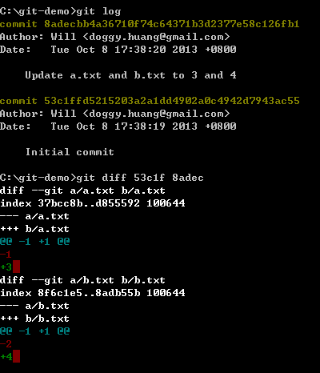

# Hari 09: Membandingkan Perbezaan Fail dan Versi

Dalam proses menggunakan sebarang perisian kawalan versi, anda sering perlu melihat rekod sejarah dan membandingkan perbezaan antara versi. Cara membandingkan dalam Git akan menjadi tumpuan artikel ini.

## Menyediakan Direktori Kerja

Kita dengan cepat mencipta repositori Git dan direktori kerja dengan dua fail dan dua rekod perubahan versi melalui perintah berikut:

```
mkdir git-demo
cd git-demo
git init

echo 1 > a.txt
echo 2 > b.txt
git add .
git commit -m "Initial commit"

echo 3 > a.txt
echo 4 > b.txt
git add .
git commit -m "Update a.txt and b.txt to 3 and 4"
```

## Konsep Asas git diff

Untuk membandingkan perbezaan antara dua versi dalam Git, anda biasanya menggunakan perintah `git diff`. Mari kita laksanakan dahulu perintah mudah untuk membandingkan perbezaan antara dua versi:

1. Mula-mula laksanakan `git log` untuk mendapatkan maklumat versi dan mendapatkan id dua objek commit terakhir
2. Kita laksanakan perintah `git diff commit1 commit2` untuk membandingkan perbezaan antara dua versi, di mana commit1 harus menggunakan versi yang lebih lama dan commit2 harus menggunakan versi yang lebih baharu.

Seperti yang ditunjukkan dalam rajah berikut:



Daripada output pelaksanaan `git diff`, kita boleh mendapatkan hasil pelaksanaan. Oleh kerana kita mempunyai dua fail dalam dua repositori ini, dan kedua-duanya telah berubah antara dua versi ini, ia akan menyenaraikan dua segmen hasil "perbandingan perbezaan".

Anda boleh lihat daripada rajah di atas bahawa setiap segmen bermula dengan `diff --git`, mewakili dua fail mana yang sedang dibandingkan oleh git.

Baris kedua `index 37bcc8b..d855592 100644` mewakili "Header Line" apabila git melakukan perbandingan ini. Mungkin terdapat beberapa baris di sini, dan maklumatnya tidak semestinya hanya ini. Banyak maklumat tambahan tentang perbandingan perbezaan ini akan ditandakan di sini. Contohnya, baris index, dua id hash selepasnya (`37bcc8b..d855592`) mewakili dua id objek blob dalam storan objek Git (object storage), digunakan untuk membandingkan dua objek blob ini. `100644` selepasnya ialah atribut git, sedikit seperti atribut fail dalam persekitaran Linux, seperti mengisytiharkan ini ialah fail, direktori, boleh dibaca, boleh ditulis, boleh dilaksanakan, dsb. Berikut ialah beberapa contoh lazim atribut git:

```
0100000000000000 (040000): Directory
1000000110100100 (100644): Regular non-executable file
1000000110110100 (100664): Regular non-executable group-writeable file
1000000111101101 (100755): Regular executable file
1010000000000000 (120000): Symbolic link
1110000000000000 (160000): Gitlink
```

Untuk pautan berkaitan, sila rujuk thread perbincangan berikut:

* [How to read the mode field of git-ls-tree's output](https://stackoverflow.com/a/8347325/910074)

Baris ketiga `--- a/a.txt` mewakili versi "lebih lama" daripada dua versi yang dibandingkan.

Baris keempat `+++ b/a.txt` mewakili versi "lebih baharu" daripada dua versi yang dibandingkan.

Baris kelima `@@ -1 +1 @@` mewakili jumlah baris dalam versi lama dan versi baharu fail ini. -1 mewakili versi lama hanya mempunyai 1 baris, dan +1 mewakili versi baharu juga hanya mempunyai 1 baris.

Akhir sekali, semua kandungan yang berubah disenaraikan. Terdapat tiga perwakilan yang mungkin di sini:

* Bermula dengan tanda tolak -, ia bermakna baris ini dipadam dalam proses daripada versi lama ke versi baharu.
* Bermula dengan tanda tambah +, ia bermakna baris ini ditambah dalam proses daripada versi lama ke versi baharu.
* Bermula dengan aksara ruang, ia bermakna baris ini muncul dalam kedua-dua versi tanpa sebarang perubahan.

Ini melengkapkan perbandingan perbezaan objek blob pertama dalam dua versi ini, dan kemudian ia akan memaparkan perbandingan perbezaan objek blob kedua dalam versi itu, dan seterusnya.

Apabila menggunakan `git diff` dalam Git, sebenarnya, objek tree ialah unit perbandingan. Kita belajar daripada rajah dan video dalam [Hari 06: Menghurai Struktur Data Git - Struktur Objek] bahawa setiap objek commit sebenarnya merangkumi objek tree direktori akar. Jadi apabila kita baru sahaja menggunakan `git diff` untuk membandingkan dua objek commit, kita sebenarnya membandingkan objek tree di bawah objek commit itu, dan proses perbandingan akan berterusan secara rekursif ke bawah. Daripada ini, anda sepatutnya dapat merasai bahawa mekanisme perbandingan diff Git sangat berkuasa. Anda boleh membandingkan perubahan antara mana-mana dua versi dengan pantas.

Apabila menggunakan perintah `git diff`, terdapat tiga sumber utama objek tree:

* Objek tree yang wujud dalam semua graf commit, yang bermakna mana-mana objek tree dalam mana-mana versi.
* Index, mewakili maklumat selepas anda menghantar status fail ke "pangkalan data indeks." Sebenarnya, objek tree telah dicipta apabila menggunakan perintah `git add`.
* Direktori kerja semasa anda, walaupun perubahan pada direktori kerja belum menjadi objek tree, ia boleh digunakan melalui `git diff`.

## Empat Kaedah Perbandingan Asas

Untuk membandingkan mana-mana dua versi melalui perintah `git diff`, biasanya terdapat empat penggunaan perintah berikut:

1. git diff

   Tanpa sebarang parameter, apa yang dibandingkan ialah perbezaan antara "direktori kerja" dan "indeks." Ini ialah perintah yang sangat lazim digunakan kerana sebelum anda melaksanakan perintah `git add .`, anda boleh menggunakan `git diff` terlebih dahulu untuk melihat apa yang telah anda ubah.

   **Nota**: Sebenarnya, dalam proses menggunakan kawalan versi Git, sebelum melaksanakan `git commit`, memang boleh melaksanakan perintah `git add` beberapa kali untuk mengesahkan fail mana yang hendak ditambah ke indeks, dan akhirnya commit ke versi.

2. git diff commit

   Jika anda hanya menambah id commit selepas `git diff`, apa yang dibandingkan ialah "direktori kerja" dan "objek tree dalam objek commit yang ditentukan."

   Perintah yang paling lazim digunakan ialah `git diff HEAD` kerana ini mewakili membandingkan "direktori kerja" dengan "versi terkini cabang semasa." Kaedah perbandingan ini tidak akan membandingkan keadaan "indeks", jadi anda mesti membezakan dengan jelas sumber objek tree mana yang anda bandingkan.

3. git diff --cached commit

   Sebelum melaksanakan `git commit`, keadaan indeks sepatutnya sudah sedia. Jadi jika anda ingin membandingkan "keadaan indeks semasa" dengan "objek tree dalam objek commit yang ditentukan," anda boleh menggunakan perintah ini untuk melengkapkan tugas perbandingan.

   Perintah yang paling lazim digunakan juga ialah `git diff --cached HEAD`, yang bermakna membandingkan "keadaan indeks semasa" dengan "versi terkini cabang semasa." Kaedah perbandingan ini tidak akan membandingkan kandungan fail "direktori kerja," tetapi secara langsung membandingkan perbezaan antara "indeks" dan "versi terkini semasa." Ini membantu anda mengetahui perubahan apa yang ada sebelum melaksanakan `git commit`, yang bermakna perubahan apa yang akan anda cipta sebagai versi.

   **Nota 1**: `git diff --cached` dan `git diff --staged` mempunyai hasil yang betul-betul sama. `--staged` hanyalah alias untuk `--cached` untuk memudahkan anda mengingatinya!

   **Nota 2**: `git diff --cached` dan `git diff --cached HEAD` juga mempunyai hasil yang betul-betul sama apabila dilaksanakan. HEAD terakhir boleh ditinggalkan.

4. git diff commit1 commit2

   Yang terakhir ialah membandingkan perbezaan antara dua versi yang berbeza (id commit). Perintah ini boleh melangkau sebarang perubahan dalam "indeks" dan "direktori kerja" dan membandingkan dua versi tertentu secara langsung. Sebenarnya, Git membandingkan objek tree dalam dua objek commit versi tertentu itu.

   Perintah yang paling lazim digunakan ialah `git diff HEAD^ HEAD`, yang bermakna anda ingin membandingkan perbezaan antara [versi sebelumnya bagi versi terkini] dan [versi terkini]. Maksud HEAD dan ^ di sini akan diterangkan dalam artikel akan datang.

## Ringkasan Hari Ini

`git diff` yang diperkenalkan hari ini ialah perintah yang sangat lazim digunakan, dan anda harus menggunakannya dengan mahir. Mari kita akhirnya menyemak perbezaan antara perintah lazimnya:

```
git diff                 => working directory vs index
git diff HEAD            => working directory vs HEAD
git diff --cached HEAD   => index     vs HEAD
git diff --cached        => index     vs HEAD
git diff HEAD^ HEAD     => HEAD^   vs HEAD
```

Izinkan saya menyusun semula perintah dan parameter Git yang dipelajari hari ini:

* git log
* git diff
* git diff HEAD
* git diff --cached
* git diff --staged
* git diff HEAD^ HEAD

## Pautan Rujukan

* [git-diff(1) Manual Page](https://www.kernel.org/pub/software/scm/git/docs/git-diff.html)

---

* [Kembali ke Jadual Kandungan](README.md)
* [Hari Sebelumnya: Konsep Asas dan Penggunaan Cabang](08.md)
* [Hari Berikutnya: Memahami Nama Mutlak Objek Git](10.md)

---
