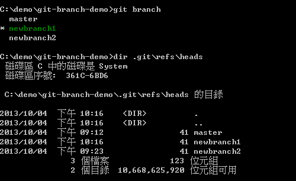
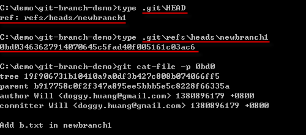

# Hari 11: Memahami Rujukan Objek Git dan Rujukan Simbolik

Selepas memahami "nama mutlak" objek Git, seterusnya kami akan memperkenalkan "nama rujukan" yang paling lazim digunakan dalam proses kawalan versi Git.

## Memahami Nama Rujukan Objek

Nama rujukan (ref) hanyalah "penunjuk" kepada objek Git, atau satu lagi "nama yang mudah diingati" berbanding "nama mutlak." Ia menggunakan nama yang dipratentukan atau ditentukan oleh pengguna untuk mewakili objek Git yang tertentu.

"Nama cabang" yang kita pelajari sebelum ini, HEAD yang telah kita gunakan (mewakili versi terkini), atau "nama tag" yang akan kita pelajari kemudian - kesemuanya ialah "nama rujukan," yang pada asasnya dicipta untuk memudahkan ingatan.

Kami akan menggunakan "nama cabang" sebagai contoh untuk menerangkan apakah struktur fizikal "nama rujukan." Dalam rajah berikut, kami menggunakan `git branch` untuk mendapatkan semua nama cabang. Anda boleh lihat bahawa kami kini mempunyai tiga cabang. Walau bagaimanapun, ketiga-tiga nama cabang ini sebenarnya ialah "nama rujukan," yang bermakna ketiga-tiga "nama rujukan" ini sepadan dengan tiga objek commit dalam repositori objek Git. Dalam rajah berikut, anda juga boleh lihat bahawa nama rujukan cabang ini sebenarnya hanyalah fail. Semua nama rujukan "cabang setempat" terletak dalam direktori `.git\refs\heads`:

Kemudian saya akan menggunakan rajah berikut untuk membuktikan bagaimana fail ini dikaitkan dengan "nama mutlak." Saya terlebih dahulu menggunakan `git branch` untuk mendapatkan semua nama cabang dan mendapati bahawa "direktori kerja" semasa menghala ke cabang `newbranch1`. Pada masa ini, kami boleh mendapatkan semua rekod versi cabang ini melalui `git log --pretty=oneline`. Secara lalai, "nama rujukan" cabang ini akan menghala ke "versi terkini" cabang tersebut. Kami hanya perlu membuka kandungan fail `.git\refs\heads\newbranch1` untuk melihat bahawa ini hanyalah fail teks biasa yang menghala ke "versi terkini" dalam sejarah versi. Akhir sekali, gunakan `git cat-file -p 0bd0` untuk mendapatkan kandungan objek commit itu dan `git show 0bd0` untuk mendapatkan rekod perubahan versi tersebut, sekali gus membuktikan bahawa fail ini ialah tujuan utama "nama rujukan."

Kami kemudian menggunakan perintah untuk melihat kandungan membaca objek commit tertentu menggunakan "nama mutlak" dan "nama rujukan," membuktikan bahawa hasil kedua-dua perintah ini adalah sama:

Dalam kebanyakan kes, "nama rujukan" biasanya menghala ke objek commit, tetapi ia tidak semestinya begitu. Anda juga boleh menghala ke jenis objek Git yang lain, seperti objek blob, objek tree, objek tag, dan sebagainya.

## Tentang Direktori .git/refs/

Daripada contoh di atas, anda sebenarnya boleh lihat bahawa semua "nama rujukan" ialah fail dan semuanya ditempatkan dalam direktori `git/refs/`. Lokasi direktori tempat nama rujukan Git ditempatkan terutamanya ada tiga:

* Cabang setempat: `.git/refs/heads/`
* Cabang jauh: `.git/refs/remotes/`
* Tag: `.git/refs/tags/`

Izinkan saya memberi anda satu contoh mudah. Jika anda mencipta cabang bernama `f2e`, pada masa ini anda akan mengetahui bahawa "nama rujukan" cabang setempat akan mencipta fail `.git/refs/heads/f2e`, seperti yang ditunjukkan dalam rajah berikut:

Sebenarnya, "nama penuh" bagi `f2e` ini sepatutnya dipanggil `refs/heads/f2e`. Cuma Git membenarkan anda memasukkan singkatan untuk memudahkan input nama rujukan yang pantas. Seperti yang ditunjukkan dalam rajah berikut, ketiga-tiga cara menggunakan "nama rujukan" ini semuanya boleh dilaksanakan:

Walau bagaimanapun, apabila anda memasukkan "singkatan" nama rujukan, Git akan mencari nama rujukan yang sesuai dalam tertib berikut secara lalai. Selagi fail yang sepadan dijumpai, ia akan segera memulangkan "nama mutlak objek" kandungan fail itu:

* `.git/<reference abbreviation>`
* `.git/refs/<reference abbreviation>`
* `.git/refs/tags/<reference abbreviation; tag name>`
* `.git/refs/heads/<reference abbreviation; local branch name>`
* `.git/refs/remotes/<reference abbreviation>`
* `.git/refs/remotes/<reference abbreviation; remote branch name>/HEAD`

Contohnya, apabila anda memasukkan perintah `git cat-file -p f2e`, Git akan mencari "fail nama rujukan" yang berkaitan dalam tertib berikut dan mengekstrak kandungan fail itu (iaitu nama mutlak objek Git):

* `.git/f2e` --> Fail tidak dijumpai
* `.git/refs/f2e` --> Fail tidak dijumpai
* `.git/refs/tags/f2e` --> Fail tidak dijumpai
* `.git/refs/heads/f2e` --> **Nama rujukan dijumpai, tiada carian lanjut**
* `.git/refs/remotes/f2e`
* `.git/refs/remotes/f2e/HEAD`

## Memahami Nama Rujukan Simbolik Objek (symref)

Nama rujukan simbolik (symref) sebenarnya juga ialah sejenis nama rujukan (ref), cuma dengan kandungan yang berbeza. Kami boleh lihat perbezaan kandungan daripada rajah berikut. "Rujukan simbolik" akan menghala ke "nama rujukan" lain dan kandungannya bermula dengan `ref:`:

Dalam alat Git, beberapa rujukan simbolik khas dikekalkan secara lalai untuk memudahkan akses pantas kepada objek commit yang lazim digunakan, dan objek ini disimpan dalam direktori `.git/` secara lalai. Rujukan simbolik ini mempunyai empat yang berikut:

* HEAD
* Akan sentiasa menghala ke "versi terkini" dalam "cabang" yang ditetapkan dalam "direktori kerja."
* Jadi apabila anda melaksanakan `git commit` dalam cabang ini, rujukan simbolik `HEAD` ini juga akan dikemas kini kepada objek commit versi terkini cabang itu.
* ORIG_HEAD
* Secara ringkasnya, ia ialah "versi sebelumnya" bagi objek commit HEAD, yang lazim digunakan untuk memulihkan perubahan versi sebelumnya.
* FETCH_HEAD
* Apabila menggunakan repositori jauh, anda mungkin menggunakan perintah `git fetch` untuk mendapatkan semula semua objek daripada repositori jauh. Rujukan simbolik FETCH_HEAD ini akan merekodkan "nama mutlak" HEAD (versi terkini) setiap cabang dalam repositori jauh.
* MERGE_HEAD
* Apabila anda melakukan kerja cantuman (topik cantuman akan disebutkan dalam artikel akan datang), nama mutlak objek commit daripada "sumber cantuman" akan direkodkan dalam rujukan simbolik MERGE_HEAD ini.

## Penggunaan Rujukan Umum dan Rujukan Simbolik

Kami tahu bahawa "nama rujukan" mempunyai tujuan khas dan biasanya digunakan dalam senario seperti "cabang setempat," "cabang jauh," dan "tag," tetapi sebenarnya anda boleh mencipta sebarang bilangan "nama rujukan tersuai." Anda boleh mencipta "rujukan umum" dengan bebas melalui `git update-ref`.

Saya mencuba mencipta rujukan umum bernama `InitialCommit` dan menghala ke versi pertama dalam repositori Git. Sila rujuk rajah berikut untuk turutan pelaksanaan perintah bagi mempelajari cara mencipta rujukan umum:

Selepas penciptaan, fail lalai akan ditempatkan dalam folder `.git`, dan pada masa ini, anda boleh mengakses kandungan objek Git tertentu dengan kedua-dua "nama mutlak" dan "nama rujukan":

**Nota**: Sila ingat bahawa nama rujukan boleh menghala ke mana-mana objek Git dan tidak terhad kepada objek commit.

Untuk mencipta nama rujukan yang lebih formal, adalah terbaik untuk menambah awalan `refs/`, contohnya: `git update-ref refs/InitialCommit [object_id]`.

Untuk memadam rujukan umum, anda boleh menggunakan pilihan `-d`. Seperti yang ditunjukkan dalam rajah berikut:

Untuk memaparkan semua rujukan, anda boleh menggunakan perintah `git show-ref`, seperti yang ditunjukkan dalam rajah berikut:

Untuk mencipta dan memadam "rujukan simbolik," anda boleh merujuk rajah berikut untuk penggunaan `git symbolic-ref`. Sila lihat rajah tersebut dan ceritakan kisahnya. Selepas memahaminya, anda akan benar-benar mendapati bahawa Git sangat fleksibel dan berkuasa dalam penggunaan rujukan. Selain itu, melaksanakan `git show-ref` hanya akan memaparkan rujukan dalam direktori `.git\refs`, dan ia adalah sama untuk kedua-dua "rujukan umum" dan "rujukan simbolik":

Terdahulu dalam artikel ini, disebutkan bahawa anda boleh mencipta rujukan ke direktori berikut:

* `.git/<reference abbreviation>`
* `.git/refs/<reference abbreviation>`
* `.git/refs/tags/<reference abbreviation; tag name>`
* `.git/refs/heads/<reference abbreviation; local branch name>`
* `.git/refs/remotes/<reference abbreviation>`
* `.git/refs/remotes/<reference abbreviation; remote branch name>/HEAD`

Rujukan tersuai biasanya dicipta dalam dua laluan pertama untuk mengelakkan kekeliruan dengan penggunaan "cabang setempat," "cabang jauh," dan "tag" kami. Walau bagaimanapun, anda sememangnya boleh menggunakan `git update-ref` untuk mencipta sebarang rujukan tersuai. Jika anda mencipta rujukan tersuai dalam `refs/heads/Will`, ia bersamaan dengan mencipta cabang bernama `Will`. Git sememangnya semudah itu. Semakin anda memahami struktur dalaman Git, semakin anda akan menyukai pelbagai ciri Git.

## Ringkasan Hari Ini

Kami tahu bahawa "nama rujukan (ref)" hanyalah "penunjuk" kepada objek Git, yang digunakan untuk menghala ke objek Git tertentu. Jadi anda boleh bayangkan "nama rujukan" sebagai alias untuk nama mutlak objek Git, yang digunakan untuk membantu ingatan. Dalam Git, terdapat banyak mekanisme untuk membantu anda mengawal projek, seperti "cabang," "tag," dan sebagainya. Mekanisme ini sebenarnya dicapai oleh "rujukan" di sebalik tabir.

Nama rujukan Git dibahagikan lagi kepada "rujukan umum" dan "rujukan simbolik." Kedua-duanya mempunyai tujuan yang sama, cuma kandungannya sedikit berbeza. "Rujukan simbolik" akan menghala ke "rujukan umum" lain, manakala "rujukan umum" menghala ke "nama mutlak" objek Git.

Izinkan saya menyusun semula perintah dan parameter Git yang dipelajari hari ini:

* git branch
* git log --pretty=oneline
* git log --oneline
* git cat-file -p [ref or object_id]
* git show [ref or object_id]
* git update-ref
* git symbolic-ref
* git show-ref

---

* [Kembali ke Jadual Kandungan](README.md)
* [Hari Sebelumnya: Memahami Nama Mutlak Objek Git](10.md)
* [Hari Berikutnya: Memahami Nama Relatif Objek Git](12.md)

---
