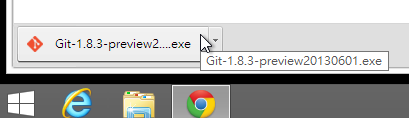
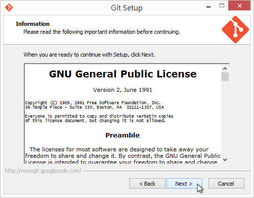
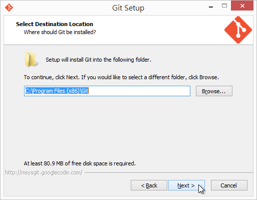
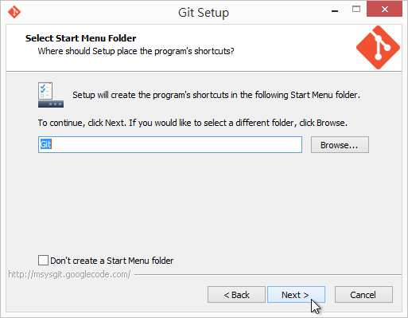

# วันที่ 02: เครื่องมือ Git จำเป็น 3 อย่างสำหรับแพลตฟอร์ม Windows

ในการเริ่มใช้การควบคุมเวอร์ชันด้วย Git ก่อนอื่นคุณต้องติดตั้งเครื่องมือ Git ที่เหมาะสมเสียก่อน บทความชุดนี้เน้นที่แพลตฟอร์ม Windows เป็นหลัก บทความนี้จะแนะนำเครื่องมือควบคุมเวอร์ชัน Git สามตัวที่เราใช้บ่อยที่สุด พร้อมแนะนำความเหมือนและความแตกต่างระหว่างเครื่องมือเหล่านี้ และควรใช้เครื่องมือใดในสถานการณ์ใด

## เครื่องมือแรก: [Git for Windows](https://msysgit.github.io/)

นี่คือชุดเครื่องมือแบบ Command Line ที่สามารถรันได้ใน **Command Prompt** ปัจจุบันเครื่องมือ GUI สำหรับ Git ทั้งหมดในท้องตลาดล้วนเรียกใช้เครื่องมือ Git ระดับล่างเหล่านี้ภายใน ดังนั้นมันจึงเป็นเครื่องมือจัดการ Git ที่จำเป็นและต้องติดตั้ง!

ด้านล่างนี้คือขั้นตอนการติดตั้ง:

* ก่อนอื่นให้ไปที่เว็บไซต์ทางการ https://msysgit.github.io/ เพื่อเตรียมดาวน์โหลดโปรแกรมติดตั้ง

* ดาวน์โหลดเวอร์ชันล่าสุด ไม่ว่าจะเป็นเวอร์ชันใดก็ตาม

* คลิกไฟล์ที่ดาวน์โหลดมาเพื่อติดตั้งโดยตรง

* หน้าเริ่มต้นของโปรแกรมติดตั้ง

* ยอมรับเงื่อนไขสัญญาอนุญาต GPL

* เลือกเส้นทางการติดตั้ง

* เลือกคอมโพเนนต์ **แนะนำให้ยกเลิกการเลือกตัวเลือก Windows Explorer integration!**  ( เนื่องจากเครื่องมือผสานการทำงานตัวนี้พื้นฐานเกินไป แนะนำให้ใช้เครื่องมือ [TortoiseGit](https://code.google.com/p/tortoisegit/) แทน )

* ตั้งชื่อกลุ่มโปรแกรม โดยคงตัวเลือกเริ่มต้นไว้

* ตรงนี้แนะนำให้ **เลือกตัวเลือก Run Git from the Windows Command Prompt!**  ( เนื่องจากผู้ใช้ Windows ส่วนใหญ่ไม่คุ้นเคยกับคำสั่ง Bash )

* การแปลง Line Ending แนะนำให้คงตัวเลือกเริ่มต้นไว้

* เริ่มการติดตั้ง

* ติดตั้งเสร็จสมบูรณ์

* หลังติดตั้งเสร็จ เปิด Command Prompt ขึ้นมาเพื่อเริ่มใช้งานได้โดยตรง

* คุณสามารถป้อนคำสั่ง `git --version` เพื่อตรวจสอบเวอร์ชันปัจจุบันของโปรแกรมเครื่องมือได้

## เครื่องมือที่สอง: [GitHub for Windows](https://windows.github.com/)

นี่คือเครื่องมือที่ [GitHub](https://github.com) พัฒนาขึ้นอย่างเป็นทางการสำหรับผู้ที่ยังไม่มีความเข้าใจ Git อย่างลึกซึ้ง มันใช้อินเทอร์เฟซ GUI ที่เรียบง่ายและเป็นมิตร โดยพยายามซ่อนแนวคิดและพารามิเตอร์คำสั่งของ Git ที่เข้าใจยากเหล่านั้นไว้ แม้ว่าเครื่องมือ GitHub for Windows จะเป็นมิตรกว่า Git for Windows มาก แต่สำหรับผู้ที่ไม่มีแนวคิดเรื่อง Git เลย การเริ่มต้นใช้เครื่องมือ GitHub for Windows ก็อาจไม่ง่ายนัก

> [GitHub for Windows](https://windows.github.com/) มีเครื่องมือ [Git Shell](https://github.com/dahlbyk/posh-git/) ในตัว ซึ่งใช้ [Git for Windows](https://msysgit.github.io/) ดังนั้นหากคุณไม่ได้ติดตั้ง Git for Windows คุณจะไม่สามารถใช้เครื่องมือ Git Shell ของ GitHub for Windows ได้

เครื่องมือนี้สามารถช่วยให้คุณทำงานควบคุมเวอร์ชันด้วย Git ได้ค่อนข้างมาก อย่างน้อยฟังก์ชันควบคุมเวอร์ชันพื้นฐานก็มีให้ครบ โดยมีความสามารถหลักดังต่อไปนี้:

* Clone Repositories
	* Clone Repository จาก GitHub (git clone)
* Browse History
	* เรียกดูประวัติเวอร์ชันของ Local Repository
* Commit Changes
	* Commit การเปลี่ยนแปลงไปยัง Local Repository
* Branch Code
	* สร้างและจัดการ Git Branch และสามารถสลับ Branch ใน Working Directory ได้
* Share on GitHub.com
	* ซิงโครไนซ์การเปลี่ยนแปลงกับ GitHub
	* ความหมายของ "Sync" ในที่นี้คือการรวม git pull และ git push เข้าด้วยกัน
	* เมื่อ GitHub for Windows ทำการซิงโครไนซ์ มันจะใช้ rebase ในการ Merge โดยค่าเริ่มต้น

นอกเหนือจากนี้ สิ่งที่ Git for Windows ทำได้ส่วนใหญ่ไม่สามารถทำได้ใน GitHub for Windows! หากคุณต้องการนำไปใช้กับโปรเจกต์พัฒนาขนาดใหญ่จริง ๆ คุณอาจต้องพิจารณาว่ามันเหมาะสมหรือไม่ แต่สำหรับผู้ที่ไม่ใช่นักพัฒนาซอฟต์แวร์ งานควบคุมเวอร์ชันแบบง่าย ๆ ก็น่าจะเพียงพอแล้ว

ด้านล่างนี้คือขั้นตอนการติดตั้ง GitHub for Windows:

* ก่อนอื่นให้ไปที่ https://windows.github.com/ เพื่อเตรียมดาวน์โหลดโปรแกรมติดตั้ง

* หลังจากดาวน์โหลดแล้ว ให้ดำเนินการติดตั้งโดยตรง

* การเข้าสู่ระบบต้องใช้บัญชี GitHub

* ตั้งค่าข้อมูลบัญชี

* ค้นหา Git Repository ในเครื่อง
	* หากคุณไม่เคยใช้ Git มาก่อน ตรงนี้ไม่ควรมีผลลัพธ์ใด ๆ

* หลังติดตั้งเสร็จ คุณจะเห็นอินเทอร์เฟซโปรแกรมหลักของ GitHub for Windows

## เครื่องมือที่สาม: [SourceTree](https://www.sourcetreeapp.com/)

[SourceTree](https://www.sourcetreeapp.com/) เป็นเครื่องมือที่ผมแนะนำเป็นอย่างยิ่งในปัจจุบัน ซึ่งรองรับทั้งแพลตฟอร์ม Windows และ Mac เครื่องมือนี้เป็นเครื่องมือ GUI ที่พัฒนาโดย Atlassian (บริษัทผู้สร้าง JIRA, Confluence, Bamboo) และให้บริการฟรี ด้วยเครื่องมือนี้ งานควบคุมเวอร์ชันด้วย Git เกือบทั้งหมดสามารถทำได้ (รวมถึงเวิร์กโฟลว์ git-flow) นับเป็นเครื่องมือควบคุมเวอร์ชัน Git ที่ทรงพลังมาก

> [SourceTree](https://www.sourcetreeapp.com/) ก็จำเป็นต้องติดตั้ง [Git for Windows](https://msysgit.github.io/) ก่อนเช่นกัน เพราะมันต้องอาศัยเครื่องมือ Command Line ของ Git ในการทำงาน

ด้านล่างนี้คือขั้นตอนการติดตั้ง SourceTree:

* ก่อนอื่นให้ไปที่ https://www.sourcetreeapp.com/ เพื่อเตรียมดาวน์โหลดโปรแกรมติดตั้ง

* ดาวน์โหลดโปรแกรมติดตั้ง

* หลังจากดาวน์โหลดแล้ว ให้ดำเนินการติดตั้งโดยตรง นี่คือโปรแกรมติดตั้งแบบกราฟิก

* คุณต้องยอมรับข้อตกลงสัญญาอนุญาต

* ต้องลงทะเบียนจึงจะใช้งานได้ (ไม่มีค่าใช้จ่าย)

* หากคุณไม่มีบัญชี Bitbucket หรือ Google คุณก็สามารถลงทะเบียนฟรีได้เช่นกัน

* ตัวช่วยตั้งค่า (Setup Wizard)

* การตั้งค่า SSH Key

* ว่าจะโหลด SSH Key จาก Pageant/PuTTY หรือไม่

* ติดตั้งเสร็จสมบูรณ์!

สรุปของวันนี้
------

วันนี้เราได้แนะนำเครื่องมือควบคุมเวอร์ชัน Git ที่ใช้กันทั่วไปสามตัวบนแพลตฟอร์ม Windows โดยสังเขป ตัวแรกคือ [Git for Windows](https://msysgit.github.io/) ตัวที่สองคือ [GitHub for Windows](https://windows.github.com/) และตัวที่สามคือ [SourceTree](https://www.sourcetreeapp.com/) เครื่องมือทั้งสามนี้ต่างมีจุดเด่นของตัวเอง แต่โดยส่วนตัวผมคิดว่า หากคุณต้องการเข้าใจการควบคุมเวอร์ชันด้วย Git อย่างลึกซึ้ง คุณควรใช้ Git for Windows และเรียนรู้การดำเนินการคำสั่ง Git ผ่าน Command Line หากคุณต้องการเครื่องมือ GUI ที่เข้าใจง่ายกว่า ก็ให้ใช้ [SourceTree](https://www.sourcetreeapp.com/)

ผมอยากเน้นย้ำว่า ในการจะเชี่ยวชาญการควบคุมเวอร์ชันด้วย Git อย่างแท้จริง คุณต้องเข้าใจว่า Git กำลังทำอะไรในระดับล่างสุด ดังนั้นในบทความต่อ ๆ ไป ผมจะแนะนำการใช้งานการควบคุมเวอร์ชันด้วย Git โดยใช้ [Git for Windows](https://msysgit.github.io/) เป็นหลัก และใช้ [SourceTree](https://www.sourcetreeapp.com/) เป็นเครื่องมือเสริม เพื่อช่วยให้คุณเข้าใจการดำเนินการควบคุมเวอร์ชันของ Git และการเปลี่ยนแปลงใน Repository ได้ดียิ่งขึ้น

---

* [กลับไปยังสารบัญ](README.md)
* [วันก่อนหน้า: ทำความเข้าใจการควบคุมเวอร์ชันด้วย Git](01.md)
* [วันถัดไป: การสร้าง Repository](03.md)

---
