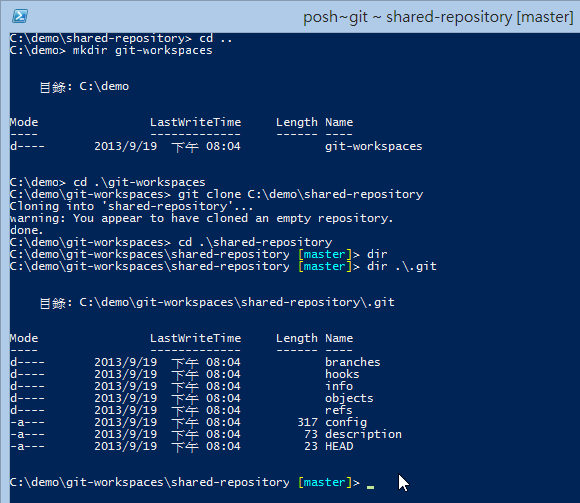

# วันที่ 03: การสร้าง Repository

ในการเริ่มใช้ Git สิ่งสำคัญที่สุดคือต้องมี Git Repository เสียก่อน แต่ Repository นี้มาจากไหน? บทความนี้จะแนะนำวิธีต่าง ๆ ในการสร้าง Repository

ในการสร้าง Repository นั้น อันที่จริงคุณมีตัวเลือกมากมาย ตัวอย่างเช่น:

* สร้าง Local Repository บนเครื่องของคุณ
* สร้าง Shared Repository บนเครื่องของคุณ
* สร้าง Remote Repository บน GitHub หรือแพลตฟอร์ม Git อื่น ๆ

ไม่ว่าจะอย่างไร คุณก็จำเป็นต้องมี Repository เสมอ เราจะอธิบายแต่ละวิธีดังต่อไปนี้:

## การสร้าง Local Repository บนเครื่องของคุณ

ก่อนอื่นเรามาเปิดเครื่องมือ Git Shell ของ [GitHub for Windows](https://windows.github.com/) กัน เครื่องมือนี้จริง ๆ แล้วเป็นอินเทอร์เฟซ Windows PowerShell แต่มีการตั้งค่าตัวแปรสภาพแวดล้อม (Environment Variable) และการตั้งค่า Command Prompt ที่เกี่ยวข้องกับ Git บางอย่าง:

เมื่อเปิดขึ้นมา มันจะไปยังโฟลเดอร์ `%USERPROFILE%\Documents\GitHub` โดยค่าเริ่มต้น นี่คือไดเรกทอรีรากของโปรเจกต์เริ่มต้นของ [GitHub for Windows](https://windows.github.com/) ซึ่งหมายความว่าโปรเจกต์ทั้งหมดที่ Clone จาก GitHub ผ่าน [GitHub for Windows](https://windows.github.com/) จะถูกวางไว้ในไดเรกทอรีนี้โดยค่าเริ่มต้น

ดังนั้นเราสามารถสร้างไดเรกทอรีใหม่ที่นี่โดยตรงเพื่อใช้เป็น "Working Directory" ของเรา เราสามารถป้อนคำสั่ง `mkdir git-demo` เพื่อสร้างไดเรกทอรี จากนั้นใช้ `cd git-demo` เพื่อเข้าไปยังไดเรกทอรีนั้น

เนื่องจากนี่เป็นไดเรกทอรีว่างเปล่าและยังไม่มี Git Repository ใด ๆ เราจึงสามารถใช้คำสั่ง `git init` เพื่อสร้าง Repository ได้ โดยค่าเริ่มต้น Repository จะถูกวางไว้ในไดเรกทอรี `.git` ภายใต้ Working Directory

ขั้นตอนการดำเนินการทั้งหมดแสดงในรูปต่อไปนี้:

หลังจากสร้างเสร็จ คุณควรสังเกตเห็นสิ่งที่แตกต่างไปใน Command Prompt ของ Git Shell นั่นคือมันจะเพิ่ม `[master]` ที่ถูกไฮไลต์ต่อท้ายเส้นทางปัจจุบัน Prompt นี้จะแสดงสถานะต่าง ๆ ของ `working directory` ปัจจุบันของคุณ หากคุณเข้าใจมัน มันจะเป็นแหล่งข้อมูลที่มีประโยชน์มาก ซึ่งช่วยให้คุณไม่ต้องพิมพ์คำสั่ง `git status` มากมายเพื่อตรวจสอบสถานะปัจจุบันของ Working Directory เมื่อใช้เครื่องมือ Command Line ในการใช้งาน Git ส่วนนี้จะอธิบายโดยเฉพาะในบทความถัดไป

## การสร้าง Shared Repository บนเครื่องของคุณ

Shared Repository หมายถึงการสร้าง Git Repository ที่ไม่มี Working Directory สถานการณ์นี้พบได้บ่อยในระบบปฏิบัติการ Linux เพราะระบบปฏิบัติการ Linux มักถูกใช้งานโดยหลายคนบนโฮสต์ Linux เครื่องเดียวกัน แม้ว่าวิธีนี้จะสามารถใช้บนระบบปฏิบัติการ Windows ได้เช่นกัน แต่สภาพแวดล้อมการพัฒนาของเราส่วนใหญ่อยู่ในสภาพแวดล้อม Windows Client และแทบไม่มีกรณีที่หลายคนใช้คอมพิวเตอร์เครื่องเดียวกัน

ในการสร้าง Shared Repository คุณสามารถใช้คำสั่ง `git init --bare` เพื่อสร้างได้ ดังแสดงในรูปต่อไปนี้ คุณจะเห็นว่าเมื่อใช้ `git init` ร่วมกับพารามิเตอร์ `--bare` มันจะสร้างไฟล์และโฟลเดอร์ที่เกี่ยวข้องกับ Git Repository ทั้งหมดในไดเรกทอรีปัจจุบัน คุณต้องให้ความสำคัญเป็นพิเศษว่า โฟลเดอร์นี้ไม่สามารถใช้เพื่อการพัฒนาโดยตรงได้ มันใช้ได้เพียงเพื่อเก็บข้อมูลที่เกี่ยวข้องกับ Git เท่านั้น ในกรณีส่วนใหญ่ คุณไม่ควรแก้ไขไฟล์ใด ๆ ในโฟลเดอร์นี้ด้วยตนเอง ทางที่ดีควรดำเนินการผ่านคำสั่ง git

เนื่องจากนี่คือ "Repository ล้วน ๆ ที่ไม่มี Working Directory" Shared Repository จึงมีอีกชื่อหนึ่งว่า "Bare Repository"

ผมต้องเน้นย้ำอีกครั้งว่า Git คือ "การควบคุมเวอร์ชันแบบกระจายศูนย์" และทุกคนมี Repository ที่สมบูรณ์ นั่นหมายความว่า เมื่อคุณต้องการสร้าง "Working Directory" คุณต้องนำเนื้อหาของ "Bare Repository" นี้กลับมาก่อน ในเวลานี้ คุณต้องใช้คำสั่ง `git clone [REPO_URI]` เพื่อ "Clone" สำเนากลับมา ผ่านกระบวนการ `git clone` ไม่เพียงแต่ Working Directory จะถูกสร้างขึ้นโดยอัตโนมัติ แต่ "Bare Repository" นี้ก็จะถูก Clone กลับมาอย่างสมบูรณ์ด้วย กระบวนการ Clone นี้เปรียบเสมือน "การสำรองข้อมูลอย่างสมบูรณ์" ที่คัดลอกบันทึกเวอร์ชันทั้งหมดใน Git Repository ไฟล์ทุกเวอร์ชัน เป็นต้น ข้อมูลทั้งหมดกลับมาอย่างครบถ้วน กระบวนการดำเนินการคำสั่งทั้งหมดสามารถดูได้ในรูปต่อไปนี้:

ในทางปฏิบัติ อาจมีหลายวิธีในการใช้ "Shared Repository" หรือ "Bare Repository":

* การพัฒนาแบบร่วมมือกันบนเครื่องที่หลายคนใช้งาน โดยคนส่วนใหญ่สามารถได้รับสิทธิ์แบบอ่านอย่างเดียว (Read-only) สำหรับ "โฟลเดอร์ Bare Repository" นี้ และมีเพียงคนเดียวหรือไม่กี่คนเท่านั้นที่มีสิทธิ์เขียน
* บางคนวาง Bare Repository ไว้บน Dropbox เพื่อซิงค์ Bare Repository นี้กับคอมพิวเตอร์หลายเครื่องของตน

โปรดทราบ: แม้ว่าไดเรกทอรี `.git` ภายใต้ "Working Directory" จะเป็น "Repository" เช่นกัน แต่ Repository ภายใต้ Working Directory ยังมีข้อมูล Index บางส่วนของ Working Directory ซึ่งบันทึกข้อมูลสถานะของ Working Directory ไว้ด้วย ข้อมูลสถานะนี้จะไม่ปรากฏใน "Shared Repository" ซึ่งมีเพียงข้อมูลเวอร์ชันเท่านั้น (นั่นคือข้อมูล Git Object)

## การสร้าง Remote Repository บน GitHub หรือแพลตฟอร์ม Git อื่น ๆ

อันที่จริง "Remote Repository" และ "Shared Repository" แทบจะเหมือนกัน ความแตกต่างมีเพียงว่า "Shared Repository" ส่วนใหญ่ใช้การเข้าถึงไฟล์โดยตรง ในขณะที่ "Remote Repository" มักใช้โปรโตคอลอย่าง SSH, Git Protocol, HTTP เป็นต้น เพื่อเข้าถึง Git Repository แบบ "ระยะไกล" ส่วนวิธีการใช้งานอื่น ๆ นั้นโดยพื้นฐานแล้วเหมือนกัน

ต่อไปนี้สาธิตการสร้าง Repository ผ่าน GitHub และ Clone Repository กลับมายังเครื่องโลคัล:

* ก่อนอื่นให้เข้าสู่ระบบ GitHub จากนั้นสร้าง Repository ใหม่

* ตั้งค่าข้อมูลที่เกี่ยวข้องสำหรับโปรเจกต์ GitHub และสร้าง Repository

* หลังจากสร้างเสร็จ มันจะแจ้งให้คุณทราบวิธีรับโปรเจกต์หรือนำเข้าโปรเจกต์ที่มีอยู่ในเครื่องของคุณไปยัง GitHub

* ดังแสดงข้างต้น เราสามารถคลิก "Set up in Desktop" ในส่วน Quick setup คอมพิวเตอร์ของคุณจะเปิดเครื่องมือ GitHub for Windows โดยอัตโนมัติ และ Clone Repository นี้กลับมาโดยอัตโนมัติพร้อมสร้าง Working Directory

* คุณยังสามารถคัดลอก URL ของ Remote Git Repository จากนั้นดำเนินการ `git clone [REPO_URL]` เพื่อ Clone สำเนากลับมาได้

## สรุปของวันนี้

ข้างต้นคือสามวิธีในการสร้าง Git Repository ขอผมเรียบเรียงคำสั่งและพารามิเตอร์ Git ที่เรียนรู้ในวันนี้อีกครั้ง:

* git init
* git init --bare
* git clone \[REPOSITORY\_URI]

## ลิงก์อ้างอิง

* [Git for Windows](https://msysgit.github.io/)
* [GitHub for Windows](https://windows.github.com/)

---

* [กลับไปยังสารบัญ](README.md)
* [วันก่อนหน้า: เครื่องมือ Git จำเป็น 3 อย่างสำหรับแพลตฟอร์ม Windows](02.md)
* [วันถัดไป: คำสั่ง Git สำหรับควบคุมเวอร์ชันที่ใช้บ่อย](04.md)

---
