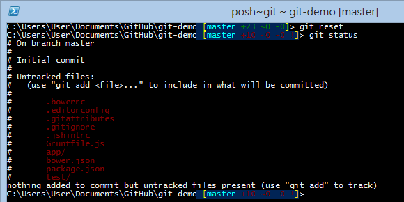

# วันที่ 04: คำสั่ง Git สำหรับควบคุมเวอร์ชันที่ใช้บ่อย

บทความนี้จะช่วยให้คุณเรียนรู้ภารกิจควบคุมเวอร์ชันที่สำคัญและพื้นฐานที่สุดหลายอย่าง รวมถึงการดำเนินการกับไฟล์พื้นฐาน เช่น การเพิ่ม ลบ เปลี่ยนชื่อไฟล์ การ Commit การเปลี่ยนแปลง (สร้างเวอร์ชันใหม่) และการสอบถามบันทึกประวัติ

## การเตรียม Working Directory

ทบทวนเนื้อหาจากบทความก่อนหน้า "วันที่ 03: การสร้าง Repository" เรามาสร้าง Local Repository กันโดยตรงเพื่อเริ่มแบบฝึกหัดทั้งหมดในบทความนี้

```
mkdir git-demo
cd git-demo
git init
```

## การเพิ่มไฟล์

เรามาวางไฟล์บางไฟล์ลงใน Working Directory กัน ไฟล์อะไรก็ได้ เพียงคัดลอกไฟล์และไดเรกทอรีที่มีอยู่บางส่วนเข้ามาใน Working Directory ปัจจุบัน

สำหรับบทความนี้ ผมจะใช้เครื่องมือ [YEOMAN](https://yeoman.io/) เพื่อสร้างเว็บไซต์ตัวอย่างแบบ Webapp อย่างรวดเร็ว ด้วยคำสั่งเพียงคำสั่งเดียว คุณก็สามารถสร้างเว็บไซต์ที่สมบูรณ์ได้:

```
yo webapp
```

**หมายเหตุ**: เกี่ยวกับการใช้ [YEOMAN](https://yeoman.io/) บนแพลตฟอร์ม Windows คุณสามารถอ้างอิงบทความของผู้เขียน [How to Install and Use Yeoman 1.0 Related Tools on Windows Platform](https://blog.miniasp.com/post/2013/08/11/Yeoman-1-0-Installation-and-Usage-on-Windows) ซึ่งอธิบายขั้นตอนการติดตั้งและการใช้งานอย่างครบถ้วนโดยละเอียด

หลังจากเพิ่มไฟล์แล้ว หากคุณยังอยู่ในอินเทอร์เฟซ Git Shell คุณควรเห็น Prompt ดังต่อไปนี้ทันที:


นั่นคือ Prompt ต่อไปนี้ซึ่งอยู่ต่อจากเส้นทาง (Path):

```
[master +10 ~0 -0 !]
```

ในส่วนของ Prompt นี้ คุณจะเห็นหลายสิ่ง:

* master หมายความว่า Working Directory ปัจจุบันคือ Branch **master** ซึ่งเป็นชื่อ Branch เริ่มต้นของ Git ด้วย
* ตัวเลข "สีแดง" ทั้งหมดหมายถึงไฟล์ที่ยังไม่ถูกติดตาม (Untracked) ซึ่งหมายความว่าการเปลี่ยนแปลงเหล่านี้จะไม่เข้าสู่การควบคุมเวอร์ชัน
* +10 หมายถึงไฟล์ที่ "เพิ่ม" 10 ไฟล์
* ~0 หมายถึงไฟล์ที่ "แก้ไข" 0 ไฟล์
* -0 หมายถึงไฟล์ที่ "ลบ" 0 ไฟล์

หากคุณต้องการเพิ่มไฟล์ใหม่เหล่านี้เข้าสู่การควบคุมเวอร์ชันของ Git คุณต้องดำเนินการคำสั่งต่อไปนี้:

```
git add .
```

ด้วยวิธีนี้ ไฟล์ ไดเรกทอรี และไฟล์ทั้งหมดในไดเรกทอรีย่อยภายใต้ Working Directory นี้ จะถูกเพิ่มเข้าไปใน [index] หรือ [cache] ของ Git Working Directory นี้ทั้งหมด โปรดทราบ: ในเวลานี้ ยังไม่มีการสร้างเวอร์ชันใด ๆ มันเพียงบอก Git ว่าไฟล์เหล่านี้ "กำลังจะ" ถูกเพิ่มเข้าไปใน Git Repository

ดังแสดงในรูปต่อไปนี้ นี่คือผลลัพธ์หลังจากที่ผมดำเนินการ `git add .` ที่นี่ ข้อความเตือนที่เกิดขึ้นตรงนี้ไม่ร้ายแรงนัก ผู้ที่สนใจทำความเข้าใจสามารถอ้างอิงบทความอีกชิ้นของผู้เขียน: [Notes on Git for Windows Line Ending Conversion (CRLF)](https://blog.miniasp.com/post/2013/09/15/Git-for-Windows-Line-Ending-Conversion-Notes)


อย่างไรก็ตาม สิ่งที่น่าสนใจคือ "ตัวเลขสีแดง" เดิมตอนนี้กลายเป็น "ตัวเลขสีเขียว" แล้ว ความหมายที่แสดงในที่นี้คือ:

* ตัวเลข "สีเขียว" ทั้งหมดหมายถึงไฟล์ที่อยู่ในสถานะ Staged (พร้อมแล้ว) ซึ่งหมายความว่าการเปลี่ยนแปลงเหล่านี้จะเข้าสู่การควบคุมเวอร์ชัน
* +23 หมายถึงไฟล์ที่ "เพิ่ม" 23 ไฟล์จะถูกสร้างเป็นเวอร์ชัน
* ~0 หมายถึงไฟล์ที่ "แก้ไข" 0 ไฟล์จะถูกสร้างเป็นเวอร์ชัน
* -0 หมายถึงไฟล์ที่ "ลบ" 0 ไฟล์จะถูกสร้างเป็นเวอร์ชัน

แต่เดิมมันมีเพียง +10 (สีแดง) ไม่ใช่หรือ? แล้วมันกลายเป็น +23 (สีเขียว) หลังจากดำเนินการได้อย่างไร?

เราดำเนินการ `git reset` เพื่อรีเซ็ตสถานะ Index ของ Working Directory จากนั้นดำเนินการ `git status` อีกครั้งเพื่อสอบถามสถานะโดยละเอียดของ Working Directory ปัจจุบัน ดังแสดงในรูปต่อไปนี้:



คุณจะเห็นว่าตรงนี้แสดงเฉพาะ "ไฟล์และไดเรกทอรีภายใต้ไดเรกทอรีระดับแรก" เท่านั้น เพราะในเวลานี้ git จะไม่ตรวจสอบว่ามีไฟล์ที่ยังไม่ถูกติดตามในไดเรกทอรีย่อยจำนวนเท่าใด

เมื่อเราดำเนินการ `git add .` แล้วดำเนินการ `git status` อีกครั้งเพื่อสอบถามสถานะ คุณจะพบว่าไฟล์ในไดเรกทอรีย่อยถูกเพิ่มเข้าไปทั้งหมดแล้ว ตัวเลขนี้จึงเพิ่มขึ้น ดังแสดงในรูปต่อไปนี้:


## การเพิ่มไฟล์บางส่วน

คำสั่ง `git add .` ที่เพิ่งกล่าวถึงจะเพิ่มไฟล์ทั้งหมด (รวมถึงไฟล์ในไดเรกทอรีย่อย) เข้าสู่ Index ของ Working Directory โดยอัตโนมัติ บางครั้งเราต้องการเพิ่มเพียงไดเรกทอรีที่ระบุหรือไฟล์ที่ระบุเข้าสู่เวอร์ชันเท่านั้น ในเวลานี้ คุณยังสามารถระบุไดเรกทอรีที่ต้องการหรือใช้ Wildcard ในการเพิ่มไฟล์ได้

เรามาดำเนินการ `git reset` อีกครั้งเพื่อรีเซ็ตสถานะ Index ของ Working Directory จากนั้นใช้ `git add app` เพื่อเพิ่มโฟลเดอร์ app และไฟล์ทั้งหมดภายใต้โฟลเดอร์นั้น และใช้ `git add .*` เพื่อเพิ่มไฟล์ทั้งหมดที่ขึ้นต้นด้วย "จุด" ดังแสดงในรูปต่อไปนี้:


**หมายเหตุ**: Wildcard `.*` ไม่สามารถเพิ่มไฟล์ "จุด" ได้ทั้งหมด เพราะอักขระแรกของ `.` สามารถจับคู่ได้เพียงไดเรกทอรีเดียว หากคุณต้องการเพิ่มไฟล์ทั้งหมดที่ขึ้นต้นด้วยจุด คุณควรใช้ `.??*` เพื่อให้แน่ใจว่ามันจับคู่ไฟล์ที่ขึ้นต้นด้วยจุด

## การ Commit การเปลี่ยนแปลง

หลังจากเพิ่มไฟล์เข้าสู่ Index แล้ว คุณสามารถ Commit การเปลี่ยนแปลงเพื่อสร้างเวอร์ชันได้ คำสั่ง Commit คือ:

```
git commit -m "Initial commit"
```

พารามิเตอร์ `-m` จะตามด้วยข้อความ Commit (Commit Message) ข้อความนี้จะถูกบันทึกไว้ในประวัติเวอร์ชัน แนะนำให้เขียนข้อความ Commit ที่มีความหมาย เพื่อช่วยให้คุณและผู้อื่นเข้าใจวัตถุประสงค์ของเวอร์ชันนี้ในอนาคต


## การดูประวัติ Commit

หลังจาก Commit แล้ว คุณสามารถใช้คำสั่ง `git log` เพื่อดูประวัติ Commit ได้:

```
git log
```


คุณยังสามารถใช้พารามิเตอร์ `git log --oneline` เพื่อแสดง Log แบบย่อได้:

```
git log --oneline
```


## การแก้ไขไฟล์

ตอนนี้เรามาลองแก้ไขไฟล์กัน เปิดไฟล์ใดก็ได้ใน Working Directory และทำการเปลี่ยนแปลงบางอย่าง จากนั้นบันทึกไฟล์

หลังจากแก้ไขแล้ว หากคุณดำเนินการ `git status` คุณจะเห็นข้อมูลเกี่ยวกับไฟล์ที่ถูกแก้ไข:


คุณจะเห็นว่าไฟล์ที่ถูกแก้ไขจะแสดงเป็นสีแดง และจำนวนไฟล์ที่ถูกแก้ไขจะแสดงเป็น ~1

## การดูความแตกต่างของไฟล์

ก่อนที่จะ Commit ไฟล์ที่แก้ไข คุณอาจต้องการดูว่ามีการเปลี่ยนแปลงอะไรบ้าง คุณสามารถใช้คำสั่ง `git diff` ได้:

```
git diff
```


คำสั่ง git diff จะแสดงความแตกต่างระหว่าง Working Directory กับ Index

## การ Commit ไฟล์ที่แก้ไข

ในการ Commit ไฟล์ที่แก้ไข คุณยังต้องดำเนินการ `git add` ก่อนเพื่อเพิ่มไฟล์ที่แก้ไขเข้าสู่ Index จากนั้นดำเนินการ `git commit`:

```
git add .
git commit -m "Update files"
```


## การลบไฟล์

หากคุณต้องการลบไฟล์และให้การลบนี้ถูกบันทึกไว้ในเวอร์ชัน คุณสามารถใช้คำสั่ง `git rm` ได้:

```
git rm [filename]
```

หลังจากดำเนินการคำสั่งนี้ ไฟล์จะถูกลบออกจากทั้ง Working Directory และ Index จากนั้นดำเนินการ `git commit` เพื่อ Commit การลบนี้


## การเปลี่ยนชื่อหรือย้ายไฟล์

หากคุณต้องการเปลี่ยนชื่อหรือย้ายไฟล์ คุณสามารถใช้คำสั่ง `git mv` ได้:

```
git mv [old_filename] [new_filename]
```

คำสั่งนี้จะเปลี่ยนชื่อหรือย้ายไฟล์ และเพิ่มการเปลี่ยนแปลงนี้เข้าสู่ Index โดยอัตโนมัติ จากนั้นดำเนินการ `git commit` เพื่อ Commit การเปลี่ยนแปลงนี้


## สรุปของวันนี้

วันนี้เราได้เรียนรู้คำสั่ง Git พื้นฐานหลายคำสั่ง สรุปได้ดังนี้:

* `git add [file]` - เพิ่มไฟล์เข้าสู่ Index
* `git add .` - เพิ่มไฟล์ทั้งหมดในไดเรกทอรีปัจจุบันเข้าสู่ Index
* `git commit -m "message"` - Commit การเปลี่ยนแปลงจาก Index เพื่อสร้างเวอร์ชันใหม่
* `git status` - ดูสถานะปัจจุบันของ Working Directory
* `git log` - ดูประวัติ Commit
* `git log --oneline` - ดูประวัติ Commit แบบย่อ
* `git diff` - ดูความแตกต่างระหว่าง Working Directory กับ Index
* `git rm [file]` - ลบไฟล์ออกจาก Working Directory และ Index
* `git mv [old] [new]` - เปลี่ยนชื่อหรือย้ายไฟล์
* `git reset` - รีเซ็ตสถานะ Index

## ลิงก์อ้างอิง

* [Git - Recording Changes to the Repository](https://git-scm.com/book/en/v2/Git-Basics-Recording-Changes-to-the-Repository)

---

* [กลับไปยังสารบัญ](README.md)
* [วันก่อนหน้า: การสร้าง Repository](03.md)
* [วันถัดไป: ทำความเข้าใจความสัมพันธ์ระหว่าง Repository, Working Directory, Objects และ Index](05.md)

---
