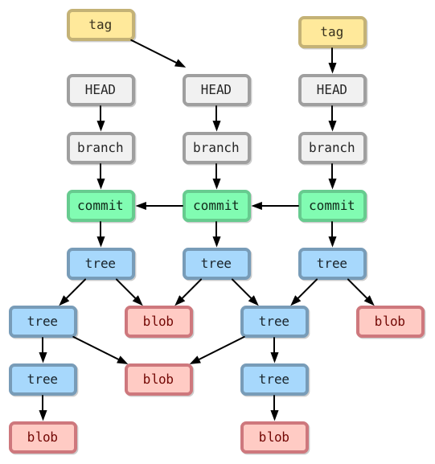

# วันที่ 06: วิเคราะห์โครงสร้างข้อมูลของ Git - โครงสร้าง Object

ในโครงสร้างข้อมูลของ Git "Object" เป็นไฟล์ประเภท "เปลี่ยนแปลงไม่ได้ (Immutable)" ไฟล์ทั้งหมดที่เก็บไว้ใน "Object Storage" โดยปกติจะเข้าไปแล้วไม่ออกมาอีก และเนื้อหาของมันจะไม่ถูกแก้ไข เหตุผลคือ หากคุณดัดแปลงเนื้อหาไฟล์ ค่าแฮช SHA1 ที่คำนวณจากเนื้อหาใหม่จะแตกต่างจากชื่อไฟล์ของ Object ต้นฉบับ ซึ่งจะทำให้ Git ไม่สามารถดำเนินการต่อไปได้ และในทางกลับกันก็ช่วยปกป้อง Git Repository ได้ในระดับหนึ่ง บทความนี้จะแนะนำโครงสร้าง Object ของ Git โดยละเอียดยิ่งขึ้น และสุดท้ายจะอธิบายกระบวนการและตรรกะของการสร้าง Object อย่างละเอียดผ่านวิดีโอด้วย

## เกี่ยวกับฐานข้อมูล Object

ดังที่กล่าวไว้ในบทความก่อนหน้า ไม่ว่าจะเป็น Blob Object หรือ Tree Object ทั้งหมดนี้ล้วนเป็น Object และ Object เหล่านี้จะถูกเก็บไว้ในสิ่งที่เรียกว่า "Object Storage" และ "Object Storage" นี้โดยค่าเริ่มต้นจะอยู่ในไดเรกทอรี objects ของ "Repository" ดังแสดงในรูปต่อไปนี้:

อย่างไรก็ตาม "Object" แต่ละตัวใน Git Repository จะทำการแฮช SHA1 กับ "เนื้อหาไฟล์" เพื่อคำนวณค่าแฮช และใช้ค่าแฮชนี้เป็นชื่อของ Object (ชื่อไฟล์) ยกตัวอย่าง 8a6b275638f3cf164395e65066a1132bb36b7896 Git จะนำอักขระสองตัวแรก (8a) มาเป็นไดเรกทอรีก่อน จากนั้นใช้ค่าแฮชที่เหลือเป็นชื่อไฟล์ (6b275638f3cf164395e65066a1132bb36b7896) ไดเรกทอรีและไฟล์ทางกายภาพของ Object เหล่านี้ก็จะถูกวางไว้ในไดเรกทอรี .git\objects ด้วย ดังแสดงในรูปต่อไปนี้:

## ประเภทของ Object

ใน "ฐานข้อมูล Object" นี้ มี Object อยู่ 4 ประเภท:

1. **blob object**: นี่คือ "เนื้อหา" ของไฟล์ใน Working Directory และเป็นเพียงเนื้อหาเท่านั้น เมื่อคุณดำเนินการคำสั่ง git add เนื้อหาของไฟล์ใหม่เหล่านี้จะถูกเขียนเป็น Blob Object ทันที ชื่อไฟล์คือผลลัพธ์การแฮชของเนื้อหา Object โดยไม่มีข้อมูลอื่นใด ข้อมูลอย่างเวลาไฟล์ ชื่อไฟล์ต้นฉบับ หรือข้อมูลไฟล์อื่น ๆ จะถูกเก็บไว้ใน Object ประเภทอื่น (นั่นคือ Tree Object)

2. **tree object**: Object ประเภทนี้เก็บข้อมูลทั้งหมดภายใต้ไดเรกทอรีหนึ่ง ๆ รวมถึงชื่อไฟล์ภายใต้ไดเรกทอรีนั้น ชื่อ Blob Object ที่สอดคล้องกัน Symbolic Link หรือ Tree Object อื่น ๆ เนื่องจาก Tree Object สามารถมี Tree Object อื่น ๆ อยู่ภายในได้ การเรียกดู Tree Object จึงเหมือนกับ "โฟลเดอร์" ในระบบไฟล์นั่นเอง พูดง่าย ๆ Tree Object คือ Snapshot ของโฟลเดอร์ภายใต้เวอร์ชันหนึ่ง ๆ

3. **commit object**: ใช้สำหรับบันทึกว่าเวอร์ชันนั้นประกอบด้วย Tree Object ใดบ้าง Commit Object แทน Git Commit หนึ่งครั้ง โดยบันทึกว่าเวอร์ชัน Commit หนึ่ง ๆ มี Tree Object ใดบ้าง รวมถึงเวลาที่ Commit เวอร์ชัน ข้อความ Commit เป็นต้น โดยปกติมันยังบันทึกชื่อของ Commit Object ก่อนหน้าด้วย (เฉพาะเวอร์ชัน Commit แรกเท่านั้นที่ไม่มีชื่อ Commit Object ก่อนหน้า)

4. **tag object**: นี่คือคอนเทนเนอร์ (Container) ชนิดหนึ่ง มักใช้เชื่อมโยงกับ Commit Object หนึ่ง ๆ (สามารถเชื่อมโยงกับ Blob และ Tree Object ที่ระบุได้เช่นกัน) และเก็บข้อมูลอ้างอิงเพิ่มเติมบางอย่าง (Metadata) เช่น ชื่อ Tag การใช้งาน Tag Object ที่พบบ่อยที่สุดคือการทำเครื่องหมาย Commit Object ของเวอร์ชันหนึ่ง ๆ ด้วยชื่อที่เข้าใจง่าย ซึ่งอาจหมายถึงเวอร์ชัน Release หนึ่ง ๆ หรือเวอร์ชันที่มีความสำคัญเป็นพิเศษ

Git จะสร้าง Blob Object ที่สอดคล้องกันสำหรับแต่ละไฟล์ในแต่ละเวอร์ชัน ในทำนองเดียวกัน ชื่อไฟล์ของ Blob Object ก็คำนวณด้วยวิธีข้างต้น จากไฟล์ Blob เหล่านี้ คุณจะไม่สามารถเห็นความสัมพันธ์ใด ๆ กับเวอร์ชันได้ คุณต้องใช้ Tree Object (Snapshot ของโฟลเดอร์) และ Commit Object (Snapshot ของแต่ละเวอร์ชัน) เพื่อเชื่อมโยงความสัมพันธ์ระหว่าง Blob เหล่านี้กับเวอร์ชัน

Object ทั้งหมดถูกบีบอัดด้วยอัลกอริทึม zlib ซึ่งไม่เพียงแต่ช่วยปรับปรุงประสิทธิภาพการเข้าถึงไฟล์ได้อย่างมีประสิทธิภาพเท่านั้น แต่ยังสามารถใช้อัลกอริทึม Delta Compression เพื่อประหยัดพื้นที่เมื่อทำการแพ็กในอนาคตได้อีกด้วย มันจะค้นหา Blob ที่คล้ายกันโดยอัตโนมัติ คำนวณความแตกต่างระหว่าง Blob โดยอัตโนมัติ และเก็บความแตกต่างเหล่านี้ไว้ในไฟล์ที่เรียกว่า *packfile* ซึ่งช่วยประหยัดพื้นที่ดิสก์ได้อย่างมาก โดยปกติ *packfiles* จะถูกวางไว้ในไดเรกทอรี .git\objects\pack ดังแสดงในรูปต่อไปนี้:

ความสัมพันธ์ระหว่าง Object ทั้งสี่ประเภทนี้สามารถอ้างอิงได้จากแผนภาพต่อไปนี้:

อย่างไรก็ตาม เพียงแค่มองข้อความและแผนภาพก็อาจยังยากที่จะเห็นความสัมพันธ์ระหว่าง Object ประเภทเหล่านี้ ไม่เป็นไร ผมได้บันทึกวิดีโอสอนไว้เป็นพิเศษเพื่อพยายามอธิบายโครงสร้าง Object ของ Git และกระบวนการสร้าง Object โดยใช้คำสั่ง git เพื่อให้ทุกคนเข้าใจอย่างชัดเจนยิ่งขึ้นว่า Git สร้างและจัดการไฟล์เหล่านี้อย่างไร

ลิงก์วิดีโอ YouTube: [Understanding the Relationship Between Object Database and Objects in Git Data Structure](https://www.youtube.com/watch?v=PZbSRy_ow0U)

## ข้อดีของโครงสร้าง Object

คุณน่าจะค่อย ๆ เข้าใจแล้วว่าการออกแบบ "Object" ของ Git นั้นสวยงามเพียงใด ในบทความแรก เราได้กล่าวถึงการออกแบบที่สำคัญหลายอย่างของ Git เรามาทบทวนการออกแบบบางอย่างที่เกี่ยวข้องกับลักษณะของ "Object" กันอีกครั้ง:

* จัดการโปรเจกต์ขนาดใหญ่ได้อย่างมีประสิทธิภาพ
* ไม่เพียงแต่ Repository ที่สมบูรณ์จะถูก Clone มาที่เครื่องโลคัลเท่านั้น แต่เนื่องจาก Blob Object ทั้งหมดสามารถระบุที่อยู่ได้ด้วย "เนื้อหา" (Content Addressable) การค้นหาเนื้อหาเดียวกันระหว่างเวอร์ชันต่าง ๆ จึงมีประสิทธิภาพมาก
* การปกป้องบันทึกประวัติ
* ในกระบวนการควบคุมเวอร์ชันด้วย Git แต่ละ Commit จะสร้าง Commit Object ขึ้นมา และชื่อของ Commit Object นี้ถูกสร้างขึ้นจากเนื้อหาของ Commit Object ยิ่งไปกว่านั้น Commit Object เชื่อมโยงกับ Tree Object และชื่อของ Tree Object ก็ถูกสร้างขึ้นจากเนื้อหาของ Tree Object Tree Object เชื่อมโยงกับ Blob และ Tree Object และชื่อของ Object เหล่านี้ก็ถูกสร้างขึ้นจากเนื้อหาเช่นกัน การเชื่อมโยงเป็นชั้น ๆ เช่นนี้ หากวันนี้คุณต้องการดัดแปลงประวัติของเวอร์ชันใดเวอร์ชันหนึ่งจริง ๆ ความยากนั้นค่อนข้างสูง!
* เนื่องจาก Git Repository มักถูก Clone หรือ Fork ตราบใดที่ Repository ถูก Clone หาก Object ใด ๆ ใน Repository ต้นทางถูกแก้ไข ก็จะเป็นเรื่องยากสำหรับ Repository ที่ Clone เหล่านี้ที่จะ Merge กลับเข้าไป ดังนั้นคุณแทบจะไม่สามารถดัดแปลงบันทึกเวอร์ชันตามอำเภอใจได้เลย
* การแพ็ก Object เป็นระยะ
* "Object" ที่เราพูดถึงใน Git จริง ๆ แล้วหมายถึงไฟล์ใน Repository ในกระบวนการเปลี่ยนแปลงเวอร์ชัน โค้ดหรือไฟล์อื่น ๆ ในโปรเจกต์จะถูกอัปเดต ทุกครั้งที่มีการอัปเดต ตราบใดที่เนื้อหาไฟล์แตกต่างกัน "Object" ใหม่ก็จะถูกสร้างขึ้น และไฟล์ทั้งหมดที่มีเนื้อหาแตกต่างกันเหล่านี้จะถูกเก็บรักษาไว้
* คุณคงจินตนาการได้ว่าเมื่อโปรเจกต์มีขนาดใหญ่ขึ้นและมีเวอร์ชันมากขึ้น ก็จะมี Object มากขึ้นเรื่อย ๆ แม้ว่าแต่ละไฟล์จะสามารถบีบอัดแยกกันเพื่อให้ไฟล์มีขนาดเล็กลงได้ แต่ไฟล์ที่มากเกินไปก็ยังทำให้การเข้าถึงไฟล์มีประสิทธิภาพน้อยลงเรื่อย ๆ ดังนั้น การออกแบบของ Git จึงมีกลไกที่สามารถแพ็กกลุ่ม Object เก่า ๆ ให้เป็น Packfile โดยอัตโนมัติเพื่อปรับปรุงประสิทธิภาพการเข้าถึงไฟล์
* ไฟล์ที่เพิ่มเข้ามาใหม่เหล่านั้นจะยังคงอยู่ในรูปของไฟล์เดี่ยว ซึ่งหมายความว่า "ไฟล์" ใน Git Repository คือ Git "Object" แต่จำเป็นต้อง Repack เป็นระยะ ๆ
* สันนิษฐานได้ว่า Git จะดำเนินการต่าง ๆ เช่น การ Repack โดยอัตโนมัติ แต่คุณยังสามารถออกคำสั่งเพื่อดำเนินการด้วยตัวเองได้ ตัวอย่างเช่น: git gc
* หากคุณต้องการตรวจสอบว่าระบบไฟล์ที่ Git ดูแลอยู่นั้นสมบูรณ์หรือไม่ คุณสามารถดำเนินการคำสั่งต่อไปนี้: git fsck

## สรุปของวันนี้

"Object" ใน Git มีความสำคัญมาก และลักษณะของมันก็มีความสำคัญมากเช่นกัน แม้ว่าโดยปกติเราไม่จำเป็นต้องสัมผัสไฟล์เหล่านี้โดยตรงในกระบวนการดำเนินการคำสั่ง Git แต่การเข้าใจการมีอยู่ของ Object เหล่านี้ก็ช่วยให้คุณเข้าใจโหมดการทำงานของ Git และแนวคิดการออกแบบอันเป็นเอกลักษณ์ของ Git ได้ดียิ่งขึ้นจริง ๆ

## ลิงก์อ้างอิง

* [Git Internals - Git Objects](https://git-scm.com/book/en/Git-Internals-Git-Objects)
* [Pro Git Book](https://progit.org/)
* [Git Magic - Traditional Chinese Version](https://www-cs-students.stanford.edu/~blynn/gitmagic/intl/zh_tw/)
* [Git (software) - Wikipedia, the free encyclopedia](https://en.wikipedia.org/wiki/Git_(software) "Git (software) - Wikipedia, the free encyclopedia")

---

* [กลับไปยังสารบัญ](README.md)
* [วันก่อนหน้า: ทำความเข้าใจความสัมพันธ์ระหว่าง Repository, Working Directory, Objects และ Index](05.md)
* [วันถัดไป: วิเคราะห์โครงสร้างข้อมูลของ Git - โครงสร้าง Index](07.md)

---
