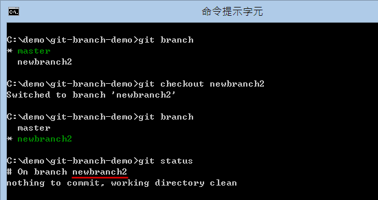

# วันที่ 08: แนวคิดพื้นฐานและการใช้งาน Branch

ใน Git **Branch** เป็นกลไกที่สำคัญมาก และต้องใช้ด้วยความระมัดระวังเป็นพิเศษ เพราะโปรเจกต์ไม่สามารถแยก Branch ออกไปได้อย่างไม่มีที่สิ้นสุด ในที่สุด Branch ก็ต้องถูก Merge กลับเข้ามา แต่การ Merge เป็นหัวข้อสำหรับภายหลัง บทความนี้จะช่วยให้คุณเรียนรู้แนวคิดพื้นฐานและการใช้งาน Git Branch ก่อน

## แนวคิดพื้นฐานของ Branch

วัตถุประสงค์หลักของการใช้กลไก "Branch" ในการควบคุมเวอร์ชันคือการแก้ปัญหาความขัดแย้งของเวอร์ชัน (Version Conflict) ในระหว่างกระบวนการพัฒนา ผมเชื่อว่าหลายคนที่เคยใช้กลไกควบคุมเวอร์ชันใด ๆ จะคิดว่า "การแยก Branch" คือตัวการที่ "ก่อให้เกิดความขัดแย้งของเวอร์ชัน" เพราะเมื่อคุณเริ่มแยก Branch คุณจะต้องนึกถึงเรื่องการ Merge อย่างแน่นอน หลังจากแยก Branch แล้ว หากมีใครแก้ไขบรรทัดเดียวกันของไฟล์เดียวกันกับคุณ มันจะก่อให้เกิด "ความขัดแย้งของเวอร์ชัน" เมื่อใดก็ตามที่เกิด Conflict ขึ้น คุณจะต้องลำบากไปแก้ไขมัน

เมื่อเกิด Conflict ขึ้น บางครั้งคุณสามารถตัดสินใจได้อย่างง่ายดายว่าจะใช้เวอร์ชันของคุณเองหรือเวอร์ชันของอีกฝ่าย แต่บางครั้งก็ไม่ง่ายอย่างนั้น เมื่อมันซับซ้อน คุณยังต้องตามหาคนที่แก้ไขบรรทัดเหล่านั้นตั้งแต่แรกจากชิ้นส่วนที่ขัดแย้งกัน ประสานผลกระทบของการเปลี่ยนแปลงของแต่ละฝ่ายที่มีต่อระบบ และในที่สุดก็ตัดสินใจว่าจะ Merge อย่างไร ปัญหาเหล่านี้เป็นเรื่องที่น่าเบื่อมาก ดังนั้นหลายคนจึงพยายามหลีกเลี่ยง "การแยก Branch" เพื่อหลีกเลี่ยง "Conflict"

อย่างไรก็ตาม หากทีมพัฒนามีขนาดใหญ่ขึ้นและฟังก์ชันของระบบมีมากขึ้นเรื่อย ๆ แม้ว่าคุณจะไม่แยก Branch ของเวอร์ชัน Conflict ของทุกคนก็ยังคงปรากฏออกมาอย่างไม่สิ้นสุด บางครั้งมันไม่ใช่ปัญหา Conflict ด้วยซ้ำ แต่เป็นกรณีที่ A ทำฟังก์ชันหนึ่งเสร็จแล้วถูกเวอร์ชันต่อมาของ B เขียนทับโดยไม่มี Conflict ใด ๆ ซึ่งไม่ใช่สิ่งที่ทุกคนอยากเห็น อย่างไรก็ตาม นี่ก็เป็นสถานการณ์ "Conflict ที่มองไม่เห็น" เช่นกัน

ในอดีต ในกลไกควบคุมเวอร์ชันแบบรวมศูนย์อย่าง Subversion ก็มีแนวคิดของการแยก Branch เช่นกัน ซึ่งสามารถทำงานได้ดีมาก แน่นอน หากสถาปัตยกรรมซอฟต์แวร์ของคุณไม่ดีพอ หากคุณไม่เข้าใจแนวคิดของการแยก Branch และการใช้เครื่องมืออย่างชัดเจน ผมเชื่อว่าการใช้ "Branch" ก็จะไม่ราบรื่น นี่เป็นผลลัพธ์ที่หลีกเลี่ยงไม่ได้ จะไม่มีเครื่องมือควบคุมเวอร์ชันใดในโลกนี้ที่ให้คุณ "เรียนรู้ได้โดยไม่ต้องพยายาม ไม่เจ็บปวด เรียนรู้การแยก Branch ได้โดยธรรมชาติ" มันขึ้นอยู่กับคน หากแนวคิดของคนผิด เครื่องมือใด ๆ ก็ใช้ไม่ได้ผลอย่างราบรื่น

เนื่องจาก Git เป็น "กลไกควบคุมเวอร์ชันแบบกระจายศูนย์" ในสถานการณ์การจัดการเวอร์ชันแบบกระจายศูนย์ สิ่งสุดท้ายที่คุณอยากทำคือ "การจัดการ" ดังนั้น Git จึงแทบไม่มีสิ่งที่เรียกว่ากลไกการจัดการหรือกลไกการควบคุมสิทธิ์ สิ่งเดียวที่มันต้องการทำคือให้ทุกคนสามารถ "แยก Branch" และ "Merge" ได้อย่างราบรื่น

ยกตัวอย่าง "Remote Repository" ที่กล่าวถึงใน [วันที่ 03: การสร้าง Repository] คุณสามารถจินตนาการได้ว่า: ตั้งแต่ช่วงเวลาที่เราใช้คำสั่ง `git clone` นั่นคือจุดเริ่มต้นของ "การแยก Branch" แล้ว คุณคัดลอก Repository ที่สมบูรณ์จาก Remote Repository จากนั้นเริ่มสร้างเวอร์ชันบนเครื่องโลคัลของคุณเอง หลังจากซอฟต์แวร์ถูกแก้ไขไปถึงระดับหนึ่ง คุณก็ "Merge" มันกลับไป เพียงแต่คำสั่ง Merge ในเวลานี้เรียกว่า `git push`

สถานการณ์ของการแยก Branch และ Merge นี้มีอยู่ทุกที่ในกระบวนการควบคุมเวอร์ชันของ Git Remote Repository สามารถมี Branch ได้ Local Repository สามารถมี Branch ได้ คุณสามารถ Merge (pull) จาก Remote Branch ใด ๆ ไปยัง Local Branch หรือคุณสามารถ Push Local Branch ไปยัง Remote Branch ได้ แน่นอน คุณยังสามารถ Merge จาก Local Branch ใด ๆ ไปยัง Local Branch อื่นได้อีกด้วย คงจินตนาการได้ว่า หาก "การแยก Branch" ไม่มีตรรกะการควบคุมที่ดี ในที่สุดคุณจะสามารถผสมผสานสถานการณ์การควบคุมเวอร์ชันที่ซับซ้อนอย่างยิ่งต่าง ๆ เข้าด้วยกัน ซึ่งไม่ใช่สิ่งที่ทุกคนอยากเห็น ดังนั้น การเรียนรู้ "การแยก Branch" และ "การ Merge" ให้ดีจึงสำคัญจริง ๆ ตัวอย่างเช่น git-flow เป็นโมเดลการจัดการ Branch ที่ได้รับความนิยมมาก นี่ไม่ใช่เครื่องมือ แต่เป็นตรรกะสำหรับจัดการ Branch ผมจะอธิบายส่วนนี้ในบทความต่อ ๆ ไปของผม

ในระหว่างการพัฒนา Linux Kernel มีนักพัฒนาหลายหมื่นคนจากทั่วโลกเข้าร่วมด้วยกัน เพื่อจัดการทีมพัฒนาขนาดใหญ่เช่นนี้ Git จึงถือกำเนิดขึ้น นี่คือกลไกควบคุมเวอร์ชันแบบกระจายศูนย์ ทุกคนมีเวอร์ชันที่สมบูรณ์ หลังจากเวอร์ชันถูกกระจายออกไป ทุกคนต้องจัดการเวอร์ชันของตนเอง จากนั้น Merge มันกลับมาตามข้อกำหนดของทีม อย่างไรก็ตาม ก่อนที่จะ Merge กลับ กลไกนี้ช่วยให้มั่นใจว่าทุกคนสามารถพัฒนาได้อย่างราบรื่นโดยไม่ได้รับผลกระทบจากเวอร์ชันของนักพัฒนาคนอื่น Git ทำสิ่งนี้ได้จริง พร้อมกับลดความซับซ้อนของการควบคุมเวอร์ชันลงด้วย

แน่นอน ผมต้องบอกด้วยว่า หากทีมที่เข้าร่วมการพัฒนาซอฟต์แวร์มีเพียงสองหรือสามคน และคนเหล่านี้ยังรวมตัวกันอยู่ ก็ไม่จำเป็นต้องใช้การควบคุมเวอร์ชันด้วย Git จริง ๆ การใช้ Subversion ก็เป็นตัวเลือกที่ดีมากเช่นกัน เรียบง่ายและเข้าใจง่าย หากพบปัญหาในระหว่างกระบวนการพัฒนา ก็สามารถแก้ไขได้โดยการประสานงานกับคนรอบข้าง วิธีนี้สะดวกกว่าการให้ทั้งทีมเข้าใจ Git มาก

หากทีมของคุณมีขนาดในระดับหนึ่ง หรือทุกคนไม่ได้ทำงานร่วมกัน และคุณจำเป็นต้องทำการควบคุมเวอร์ชัน บางที Git อาจเป็นตัวเลือกที่ดี อย่างไรก็ตาม การมีแนวคิดหรือนิสัยการควบคุมเวอร์ชันที่สอดคล้องกันในทีมงานก็เป็นสิ่งสำคัญมากเช่นกัน

## การเตรียม Working Directory

เรามาสร้าง Git Repository และ Working Directory ที่มีสองเวอร์ชันอย่างรวดเร็วผ่านคำสั่งต่อไปนี้:

```
mkdir git-branch-demo
cd git-branch-demo
git init

echo. > a.txt
git add .
git commit -m "Initial commit"

echo 1 > a.txt
git add .
git commit -m "a.txt: set 1 as content"
```

จากนั้นใช้ `git log` เพื่อรับข้อมูลเวอร์ชันดังนี้:

```
C:\demo\git-branch-demo>git log
commit b917758c0f2f347a895ee5bbb5e5c8228f66335a
Author: Will <doggy.huang@gmail.com>
Date:   Fri Oct 4 20:58:16 2013 +0800

    a.txt: set 1 as content

commit aa3e4fe2ee065b046e00a74b1f12a0b0f8154003
Author: Will <doggy.huang@gmail.com>
Date:   Fri Oct 4 20:04:39 2013 +0800

    Initial commit
```

จากนั้นเราใช้คำสั่ง `git branch` เพื่อทราบว่าเรามี Branch ชื่อ `master` อยู่แล้ว ซึ่งเป็น Branch เริ่มต้นใน Git Repository หากคุณพยายามลบ Branch นี้ผ่าน `git branch -d master` คุณจะได้รับข้อความแสดงข้อผิดพลาด `error: Cannot delete the branch 'master' which you are currently on.` ซึ่งหมายความว่า "เมื่อ Branch ของ Working Directory ปัจจุบันของคุณถูกตั้งค่าเป็น master คุณจะไม่สามารถลบ Branch ปัจจุบันได้" ซึ่งหมายความว่าคุณต้องสลับไปยัง "Branch อื่น" ก่อนจึงจะลบ Branch นี้ได้


แน่นอน ตอนนี้เรามีเพียง Branch เดียว ดังนั้นโดยธรรมชาติแล้วเราจึงไม่สามารถลบตัวเองได้

## การสร้าง Branch

มีวิธีที่พบบ่อยที่สุดสองวิธีในการสร้าง Branch:

1. สร้าง Branch แต่ให้ Working Directory ปัจจุบันคงอยู่บน Branch ของคุณเอง: `git branch [BranchName]`

   เมื่อผมดำเนินการคำสั่ง `git branch newbranch1` มันจะสร้าง Branch `newbranch1` ใหม่ขึ้นมา จากนั้นเราใช้ `git branch` เพื่อดูว่าปัจจุบันมี Branch อยู่กี่ Branch คุณจะเห็นสอง Branch แต่ Working Directory ปัจจุบันจะยังคงอยู่บน Branch `master` ดังแสดงในรูปต่อไปนี้:

   

   หากคุณสร้างเวอร์ชันใน Working Directory ปัจจุบันในเวลานี้ มันจะถูกสร้างใน Branch `master` เราสร้างไฟล์ใหม่ในเวลานี้และสร้างเวอร์ชันผ่าน `git commit` คำสั่งมีดังนี้:

   ```
    echo master > b.txt
    git add .
    git commit -m "Create b.txt with content 'master' in the master branch"
   ```

   โปรดจำไว้: ก่อนอื่นเราสร้างสองเวอร์ชันใน Branch `master` เริ่มต้น จากนั้นสร้าง Branch หนึ่ง แล้วจึงสร้างอีกเวอร์ชันหนึ่งใน Branch `master`

2. สร้าง Branch และสลับ Working Directory ปัจจุบันไปยัง Branch ใหม่: `git checkout -b [BranchName]`

   ต่อไป เราจะสร้าง Branch โดยใช้วิธีที่สอง เมื่อผมดำเนินการคำสั่ง `git checkout -b newbranch2` ไม่เพียงแต่ Branch ใหม่จะถูกสร้างขึ้น แต่ Working Directory ปัจจุบันก็จะถูกสลับไปยังอีก Branch หนึ่งด้วย สุดท้าย ใช้ `git branch` เพื่อดูว่าปัจจุบันมี Branch อยู่กี่ Branch คุณจะเห็นว่ามีสาม Branch แล้ว และ Working Directory ปัจจุบันถูกสลับไปยัง Branch `newbranch2` ที่เพิ่งสร้าง ดังแสดงในรูปต่อไปนี้:

   

   หากคุณสร้างเวอร์ชันใน Working Directory ปัจจุบันในเวลานี้ มันจะถูกสร้างใน Branch `newbranch2` เราสร้างไฟล์ใหม่ในเวลานี้และสร้างเวอร์ชันผ่าน `git commit` คำสั่งมีดังนี้:

   ```
    echo newbranch2 > b.txt
    git add .
    git commit -m "Modify b.txt with content 'newbranch2' in the newbranch2 branch"
   ```

   โปรดจำไว้: ก่อนอื่นเราสร้างสองเวอร์ชันใน Branch `master` เริ่มต้น จากนั้นสร้าง Branch หนึ่ง แล้วสร้างอีกเวอร์ชันหนึ่งใน Branch `master` จากนั้นสร้าง Branch `newbranch2` ใหม่โดยอิงจากสถานะปัจจุบันของ Branch `master` สลับ Working Directory ไปยัง Branch `newbranch2` แล้วจึงสร้างอีกเวอร์ชันหนึ่ง หากเราดำเนินการ `git log` ในเวลานี้ มันจะแสดงบันทึกเวอร์ชัน 4 รายการ เพราะ Branch จะสืบทอดประวัติที่สมบูรณ์ของ Branch ต้นทางโดยอัตโนมัติ

**หมายเหตุ**: สำหรับคำอธิบายคำสั่งและพารามิเตอร์โดยละเอียด คุณสามารถป้อน `git help branch` เพื่อสอบถามเอกสารฉบับสมบูรณ์ได้

```
git branch [branch_name]
```

## การสลับ Branch

หากคุณต้องการสลับ Working Directory ไปยัง Branch อื่น คุณสามารถป้อนคำสั่งต่อไปนี้ (โดยไม่มีพารามิเตอร์ -b):

```
git checkout [branch_name]
```

สมมติว่าเราต้องการสลับ Working Directory ไปยัง Branch `newbranch1` เราสามารถป้อน `git checkout newbranch1` เพื่อสลับไปได้ จากนั้นคุณสามารถใช้ `git branch` ได้ทันทีเพื่อตรวจสอบว่า Working Directory ปัจจุบันสลับไปแล้วหรือไม่ จากนั้นใช้ `git log` เพื่อตรวจสอบบันทึกประวัติของ Branch `newbranch1` ปัจจุบัน เนื่องจากนี่เป็น Branch แรกที่เราสร้าง ในทางทฤษฎีสถานะของ Branch นี้ควรมีบันทึกประวัติเพียงสองรายการเท่านั้น ดังแสดงในรูปต่อไปนี้:


**หมายเหตุ**: สำหรับคำอธิบายคำสั่งและพารามิเตอร์โดยละเอียด คุณสามารถป้อน `git help checkout` เพื่อสอบถามเอกสารฉบับสมบูรณ์ได้

```
git checkout [branch_name]
```

## การลบ Branch

หากคุณต้องการลบ Branch ที่มีอยู่ ดังที่เราได้กล่าวไว้ใน **การเตรียม Working Directory** คำสั่งมีดังนี้:

```
git branch -d [branch_name]
```

ก่อนหน้านี้ก็ได้กล่าวไว้เช่นกันว่า คุณไม่สามารถลบ Branch ที่ Working Directory ปัจจุบันระบุอยู่ได้ คุณต้องสลับไปยัง Branch อื่นก่อนจึงจะลบ Branch ปัจจุบันของคุณได้ ตัวอย่างเช่น หากคุณต้องการลบ Branch `newbranch1` ปัจจุบัน คุณต้องสลับไปยัง Branch อื่นก่อน เช่น Branch `master` จากนั้นจึงออกคำสั่ง `git branch -d newbranch1` เพื่อลบ Branch ดังแสดงในรูปต่อไปนี้:


## การตรวจสอบว่า Working Directory อยู่บน Branch ใด

คุณสามารถใช้คำสั่ง `git branch` เพื่อดูว่าปัจจุบันคุณอยู่บน Branch ใด ดังแสดงในรูปต่อไปนี้:



## การดูกราฟ Branch ทั้งหมดของ Git Repository

สุดท้ายนี้ ผมใช้เครื่องมือ SourceTree เพื่อแสดงกราฟ Branch ปัจจุบันของ Git Repository ปัจจุบันเรามีเพียงสอง Branch หนึ่งคือ Branch `master` และอีกหนึ่งคือ Branch `newbranch2` เพราะ Branch `newbranch1` ถูกลบไปในระหว่างการฝึกปฏิบัติแล้ว เพื่อให้ Branch ของเรามีความรู้สึกเป็น "ต้นไม้ (Tree)" ต่อไปผมจะสาธิตวิธีสร้าง Branch ที่มีสถานะเดียวกันกับ `newbranch1` ก่อนหน้านี้ขึ้นมาใหม่ และเพิ่มเวอร์ชันใหม่ภายใต้ Branch นี้

ผมไม่รู้ว่าคุณยังจำได้หรือไม่ เราสร้าง Branch `newbranch1` หลังจากสร้างสองเวอร์ชันใน Branch `master` ตอนนี้เรามาค้นหา Commit Object ID ของเวอร์ชันนี้กันก่อน ซึ่งสามารถรับได้ผ่าน `git log` ดังแสดงในรูปต่อไปนี้:


ดังนั้น Commit Object ID ของผมคือ: b917758c0f2f347a895ee5bbb5e5c8228f66335a

จากนั้นผมสลับ Working Directory ไปยังเวอร์ชันนี้ก่อน ซึ่งสามารถทำได้ผ่าน `git checkout [commit_id]`:

```
git checkout b917758c0f2f347a895ee5bbb5e5c8228f66335a
```

ในเวลานี้ หากคุณใช้ `git log` คุณควรเห็นบันทึกเวอร์ชันเพียงสองรายการเท่านั้น เพราะเราได้สลับสถานะของ Working Directory ไปยังเวอร์ชันนี้แล้ว จากรูปต่อไปนี้ คุณจะเห็นว่าเมื่อเราดำเนินการ `git checkout b917758c0f2f347a895ee5bbb5e5c8228f66335a` ข้อความหนึ่งคู่จะปรากฏขึ้น ข้อความเหล่านี้มีความสำคัญมากและต้องทำความเข้าใจ ดังแสดงในรูปต่อไปนี้:


ประการแรก เนื่องจากคุณสลับเวอร์ชันของ Working Directory ไปยังเวอร์ชัน "เก่า" คุณจะได้รับแจ้งว่า Working Directory นี้เข้าสู่สถานะที่เรียกว่า **detached HEAD** แล้ว นี่เป็นการเตือนว่า "Working Directory ปัจจุบันไม่ได้อยู่ที่เวอร์ชันล่าสุด" คุณสามารถสลับไปยังเวอร์ชันใดก็ได้ของ Git Repository ได้ทุกเมื่อ แต่เนื่องจากเวอร์ชันนี้มี "เวอร์ชันถัดไป" อยู่แล้ว หากคุณดำเนินการ `git commit` ใน "เวอร์ชันเก่า" ปัจจุบัน เวอร์ชันใหม่นี้จะไม่ถูกติดตามการเปลี่ยนแปลง ดังนั้นจึงไม่แนะนำให้ทำเช่นนี้

หากคุณต้องการสร้างเวอร์ชันที่ติดตามได้ในสถานะ **detached HEAD** วิธีที่ถูกต้องคือการติดตามผ่าน "การสร้าง Branch" ตอนนี้เราจะสร้าง Branch `newbranch1` ใหม่ในเวอร์ชันนี้และสลับ Working Directory ไปยัง Branch นั้น คำสั่งมีดังนี้:

```
git checkout -b newbranch1
```


จากนั้นเราสร้างไฟล์ใหม่ `b.txt` ที่มีเนื้อหา `newbranch1` และสร้างเวอร์ชันใหม่ คำสั่งมีดังนี้:

```
echo newbranch1 > b.txt
git add .
git commit -m "Add b.txt in newbranch1"
```

เอาล่ะ ตอนนี้เรามีสอง Branch นอกเหนือจาก `master` และทั้งสอง Branch ต่างก็มีเวอร์ชันของตัวเอง ลองคิดดูว่าต้นไม้นี้มีลักษณะอย่างไรในความคิดของคุณ!

ต่อไป เราเปิดเครื่องมือ SourceTree และเพิ่ม Working Directory นี้เข้าไปในเครื่องมือจัดการ SourceTree:


หลังจากเพิ่มแล้ว เราสลับไปยัง Branch ของ Git Repository นี้ มีทั้งหมดสาม Branch เรามาสลับไปทีละ Branch กัน:


เวอร์ชันที่เก่าที่สุดอยู่ด้านล่าง และเวอร์ชันล่าสุดอยู่ด้านบน เมื่อเราสลับไปยัง Branch ต่าง ๆ คุณจะเห็นว่าแผนภาพ Branch ทั้งสามนั้นเหมือนกัน ต่างกันเพียง "แถบแสง (Light Bar)" เริ่มต้นเท่านั้น ก่อนอื่น จากรูปภาพ สิ่งที่คุณเห็นคือ "Git Repository ทั้งหมด" พร้อมทุกเวอร์ชัน ทุก Branch และ Branch เริ่มต้นจากเวอร์ชันใด "แถบแสง" คือ "เวอร์ชันล่าสุด" ของ Branch นั้นตั้งอยู่ที่เวอร์ชันใดใน Git Repository ทั้งหมด

## สรุปของวันนี้

อันที่จริง การใช้ Branch ใน Git เป็นเรื่องง่าย ส่วนที่ยากคือการทำให้ทุกคนรู้ว่า "การแยก Branch" กำลังทำอะไรอยู่ และ **จินตนาการ** ของทุกคนเกี่ยวกับ "การแยก Branch" นั้นสอดคล้องกันหรือไม่ ตราบใดที่จินตนาการของทุกคนเกี่ยวกับการแยก Branch สอดคล้องกัน ก็จะไม่มีช่องว่างมากนักในการควบคุมเวอร์ชันของทีม

สำหรับผม ผมจะจินตนาการ Branch เป็นฟังก์ชันชนิด "Snapshot" ชนิดหนึ่ง ที่สร้าง Snapshot ของเวอร์ชัน Commit หนึ่ง ๆ และเวอร์ชันในประวัติของมัน จากนั้นคัดลอกออกมาหนึ่งชุด และตั้งชื่อ Branch ให้ คุณสามารถสร้างเวอร์ชันบน Branch เหล่านี้และรอการ Merge ในอนาคตได้

Git Repository ทั้งหมดจะเก็บ Branch และเวอร์ชันทั้งหมดไว้ และในที่สุดจะนำเสนอแผนภาพ Branch ที่มีโครงสร้างเป็นต้นไม้ สุดท้าย ผ่านเครื่องมือ SourceTree เราสามารถเห็นสถานการณ์ของ Branch และการเปลี่ยนแปลงเวอร์ชันใน Git Repository ได้อย่างชัดเจน ผมเห็นแผนภาพนี้ตั้งแต่เนิ่น ๆ แต่ครั้งแรกที่ผมดูมัน ผมไม่สามารถเข้าใจมันได้เลย ผมแค่คิดว่ามันเป็น "แผนภาพหนึ่ง" โดยไม่มีความรู้สึกใด ๆ แต่เนื่องจากผมเรียนรู้เกี่ยวกับ Git มากขึ้นเรื่อย ๆ แผนภาพ Branch นี้ช่วยให้ผมเข้าใจการเปลี่ยนแปลงใน Git Repository ทั้งหมดได้ในพริบตา และเข้าใจการเปลี่ยนแปลงเวอร์ชันของ Git ได้ดียิ่งขึ้น

ผมหวังว่าผ่านข้อความและการสาธิตคำสั่งพร้อมรูปภาพของผม จะสามารถช่วยให้คุณร่างโครงสร้าง Branch ในใจของคุณเอง และมีความเข้าใจโครงสร้าง Branch ของ Git ที่ลึกซึ้งยิ่งขึ้น

ขอผมเรียบเรียงคำสั่งและพารามิเตอร์ Git ที่เรียนรู้ในวันนี้อีกครั้ง:

* git branch
* git branch \[branch\_name]
* git checkout -b \[branch\_name]
* git checkout \[branch\_name]
* git branch -d \[branch\_name]
* git log

---

* [กลับไปยังสารบัญ](README.md)
* [วันก่อนหน้า: วิเคราะห์โครงสร้างข้อมูลของ Git - โครงสร้าง Index](07.md)
* [วันถัดไป: การเปรียบเทียบความแตกต่างของไฟล์และเวอร์ชัน](09.md)

---
