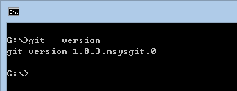
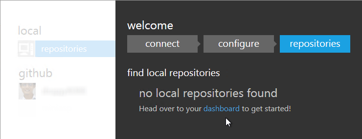
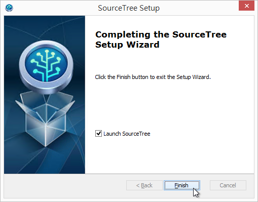

# Ngày 02: Ba công cụ Git thiết yếu cho nền tảng Windows

Để bắt đầu sử dụng quản lý phiên bản Git, trước tiên bạn cần cài đặt các công cụ Git phù hợp. Loạt bài viết này chủ yếu tập trung vào nền tảng Windows. Bài viết này sẽ giới thiệu ba công cụ quản lý phiên bản Git mà chúng ta sử dụng thường xuyên nhất, giới thiệu những điểm giống và khác nhau giữa các công cụ này, và khi nào nên sử dụng công cụ nào.

## Công cụ đầu tiên: [Git for Windows](https://msysgit.github.io/)

Đây là một bộ công cụ dòng lệnh có thể được thực thi trong **Command Prompt**. Hiện tại, tất cả các công cụ GUI cho Git trên thị trường thực ra đều thực thi các công cụ Git cấp thấp này ở bên trong, vì vậy đây là một công cụ quản lý Git thiết yếu bắt buộc phải cài đặt!

Dưới đây là quá trình cài đặt:

* Đầu tiên truy cập trang web chính thức https://msysgit.github.io/ để chuẩn bị tải xuống trình cài đặt

* Tải xuống phiên bản mới nhất bất kể là phiên bản nào

* Trực tiếp nhấp vào tệp đã tải xuống để cài đặt

* Trang chào mừng của chương trình cài đặt

* Đồng ý với các điều khoản giấy phép GPL

* Chọn đường dẫn cài đặt

* Chọn các thành phần. **Khuyến nghị bỏ chọn tùy chọn tích hợp Windows Explorer!**  ( Vì công cụ tích hợp này quá cơ bản, khuyến nghị sử dụng công cụ [TortoiseGit](https://code.google.com/p/tortoisegit/) để thay thế )

* Đặt tên nhóm chương trình, giữ các tùy chọn mặc định

* Tại đây khuyến nghị **chọn tùy chọn Run Git from the Windows Command Prompt!**  ( Vì hầu hết người dùng Windows không quen thuộc với các lệnh Bash )

* Chuyển đổi ký tự kết thúc dòng, khuyến nghị giữ các tùy chọn mặc định.

* Bắt đầu cài đặt

* Cài đặt hoàn tất

* Sau khi cài đặt, trực tiếp mở command prompt để bắt đầu sử dụng

* Bạn có thể nhập lệnh `git --version` để truy vấn phiên bản hiện tại của chương trình công cụ

## Công cụ thứ hai: [GitHub for Windows](https://windows.github.com/)

Đây là một công cụ được [GitHub](https://github.com) chính thức phát triển cho những người không hiểu sâu về Git. Nó sử dụng giao diện GUI đơn giản và thân thiện, cố gắng che giấu những khái niệm và tham số lệnh khó hiểu đó của Git. Mặc dù công cụ GitHub for Windows thân thiện hơn nhiều so với Git for Windows, đối với những người hoàn toàn không có khái niệm về Git, việc bắt đầu với công cụ GitHub for Windows có thể không dễ dàng.

> [GitHub for Windows](https://windows.github.com/) có một công cụ [Git Shell](https://github.com/dahlbyk/posh-git/) tích hợp sẵn, sử dụng [Git for Windows](https://msysgit.github.io/), vì vậy nếu bạn chưa cài đặt Git for Windows, bạn sẽ không thể sử dụng công cụ Git Shell của GitHub for Windows.

Công cụ này có thể giúp bạn hoàn thành khá nhiều công việc quản lý phiên bản Git. Ít nhất các chức năng quản lý phiên bản cơ bản đều được cung cấp, chủ yếu với các khả năng sau:

* Clone Repository
	* Clone repository từ GitHub (git clone)
* Duyệt lịch sử
	* Duyệt lịch sử phiên bản của các Repository cục bộ
* Commit các thay đổi
	* Commit các thay đổi vào Repository cục bộ
* Phân nhánh mã nguồn
	* Tạo và quản lý các Git branch, và có thể chuyển đổi branch trong working directory
* Chia sẻ trên GitHub.com
	* Đồng bộ hóa các thay đổi với GitHub
	* Ý nghĩa của "Sync" ở đây là tích hợp git pull và git push lại với nhau
	* Khi GitHub for Windows đồng bộ hóa, nó sử dụng rebase theo mặc định để hợp nhất.

Hầu hết những gì Git for Windows có thể làm ngoài những điều này đều không thể thực hiện được trong GitHub for Windows! Nếu bạn thực sự muốn áp dụng nó vào các dự án phát triển lớn hơn, bạn có thể cần cân nhắc xem nó có phù hợp hay không, nhưng đối với những người không phải lập trình viên phần mềm, công việc quản lý phiên bản đơn giản hẳn là quá đủ.

Dưới đây là quá trình cài đặt GitHub for Windows:

* Đầu tiên truy cập https://windows.github.com/ để chuẩn bị tải xuống trình cài đặt

* Sau khi tải xuống, thực thi cài đặt trực tiếp

* Đăng nhập yêu cầu một tài khoản GitHub

* Thiết lập thông tin tài khoản

* Tìm các Git Repository cục bộ
	* Nếu bạn chưa bao giờ sử dụng Git, sẽ không có kết quả nào ở đây

* Sau khi cài đặt, bạn sẽ thấy giao diện chương trình chính của GitHub for Windows

## Công cụ thứ ba: [SourceTree](https://www.sourcetreeapp.com/)

[SourceTree](https://www.sourcetreeapp.com/) hiện là một công cụ tôi rất khuyến nghị, có thể hỗ trợ cả nền tảng Windows và Mac. Công cụ này là một công cụ GUI được phát triển bởi Atlassian (công ty làm ra JIRA, Confluence, Bamboo) và được cung cấp miễn phí. Với công cụ này, hầu như tất cả công việc quản lý phiên bản Git đều có thể thực hiện được (bao gồm quy trình làm việc git-flow), đây là một công cụ quản lý phiên bản Git rất mạnh mẽ.

> [SourceTree](https://www.sourcetreeapp.com/) cũng yêu cầu phải cài đặt [Git for Windows](https://msysgit.github.io/) trước, vì nó dựa vào các công cụ dòng lệnh của Git để hoạt động.

Dưới đây là quá trình cài đặt SourceTree:

* Đầu tiên truy cập https://www.sourcetreeapp.com/ để chuẩn bị tải xuống trình cài đặt

* Tải xuống trình cài đặt

* Sau khi tải xuống, thực thi cài đặt trực tiếp, đây là một chương trình cài đặt đồ họa

* Bạn cần đồng ý với thỏa thuận cấp phép

* Cần đăng ký để sử dụng (việc này miễn phí)

* Nếu bạn không có tài khoản Bitbucket hoặc Google, bạn cũng có thể đăng ký miễn phí

* Trình hướng dẫn thiết lập

* Thiết lập khóa SSH

* Có tải SSH Key từ Pageant/PuTTY hay không

* Cài đặt hoàn tất!

Tóm tắt hôm nay
------

Hôm nay chúng ta đã giới thiệu ngắn gọn ba công cụ quản lý phiên bản Git phổ biến trên nền tảng Windows. Công cụ đầu tiên là [Git for Windows](https://msysgit.github.io/), công cụ thứ hai là [GitHub for Windows](https://windows.github.com/), và công cụ thứ ba là [SourceTree](https://www.sourcetreeapp.com/). Ba công cụ này đều có ưu điểm riêng, nhưng cá nhân tôi nghĩ nếu bạn muốn hiểu sâu về quản lý phiên bản Git, bạn nên sử dụng Git for Windows và học cách thực thi các lệnh Git thông qua dòng lệnh. Nếu bạn muốn một công cụ GUI trực quan hơn, hãy sử dụng [SourceTree](https://www.sourcetreeapp.com/).

Tôi muốn nhấn mạnh rằng để thực sự làm chủ quản lý phiên bản Git, bạn phải hiểu Git đang làm gì ở tầng dưới cùng. Vì vậy trong các bài viết tiếp theo, tôi về cơ bản sẽ giới thiệu thao tác quản lý phiên bản Git bằng [Git for Windows](https://msysgit.github.io/), và sử dụng [SourceTree](https://www.sourcetreeapp.com/) làm công cụ phụ trợ để giúp bạn hiểu rõ hơn các thao tác quản lý phiên bản của Git và những thay đổi trong Repository.

---

* [Quay lại Mục lục](README.md)
* [Ngày trước: Hiểu về quản lý phiên bản với Git](01.md)
* [Ngày tiếp theo: Tạo kho lưu trữ (Repository)](03.md)

---
