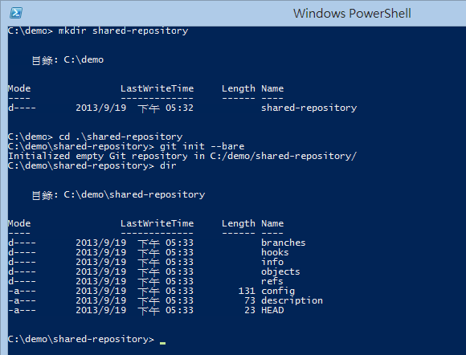

# Ngày 03: Tạo kho lưu trữ (Repository)

Để bắt đầu sử dụng Git, điều quan trọng nhất là phải có một Git Repository trước. Nhưng Repository này đến từ đâu? Bài viết này sẽ giới thiệu nhiều cách khác nhau để tạo một Repository.

Để tạo một Repository, thực ra bạn có nhiều lựa chọn, ví dụ:

* Tạo một Repository cục bộ trên máy của bạn
* Tạo một Repository dùng chung trên máy của bạn
* Tạo một Repository từ xa trên GitHub hoặc các nền tảng Git khác

Dù sao đi nữa, bạn luôn cần một Repository. Chúng tôi sẽ giải thích từng cách như sau:

## Tạo Repository cục bộ trên máy của bạn

Trước tiên hãy mở công cụ Git Shell của [GitHub for Windows](https://windows.github.com/). Công cụ này thực ra là một giao diện Windows PowerShell nhưng có một số biến môi trường liên quan đến Git và cài đặt dấu nhắc lệnh:

Sau khi mở, nó sẽ mặc định ở thư mục `%USERPROFILE%\Documents\GitHub`. Đây là thư mục gốc dự án mặc định của [GitHub for Windows](https://windows.github.com/), có nghĩa là tất cả các dự án được clone từ GitHub thông qua [GitHub for Windows](https://windows.github.com/) sẽ được đặt trong thư mục này theo mặc định.

Vì vậy chúng ta có thể trực tiếp tạo một thư mục mới tại đây để làm "working directory" của chúng ta. Chúng ta có thể nhập lệnh `mkdir git-demo` để tạo thư mục, sau đó sử dụng `cd git-demo` để vào thư mục đó.

Vì đây là một thư mục trống và không chứa bất kỳ Git Repository nào, chúng ta có thể sử dụng lệnh `git init` để tạo Repository. Theo mặc định, Repository sẽ được đặt trong thư mục `.git` dưới working directory.

Các bước thao tác hoàn chỉnh được thể hiện trong hình sau:

Sau khi tạo, bạn sẽ nhận thấy điều gì đó khác biệt trong dấu nhắc lệnh của Git Shell - nó thêm một `[master]` được làm nổi bật sau đường dẫn hiện tại. Dấu nhắc này sẽ hiển thị các trạng thái khác nhau của `working directory` hiện tại của bạn. Nếu bạn có thể hiểu nó, đây là một nguồn thông tin rất hữu ích có thể giúp bạn tránh phải gõ nhiều lệnh `git status` để truy vấn trạng thái hiện tại của working directory khi sử dụng các công cụ dòng lệnh để vận hành Git. Phần này sẽ được giải thích cụ thể trong bài viết tiếp theo.

## Tạo Repository dùng chung trên máy của bạn

Repository dùng chung đề cập đến việc tạo một Git Repository mà không có working directory. Tình huống này phổ biến hơn trên các hệ điều hành Linux vì hệ điều hành Linux thường được nhiều người sử dụng trên cùng một máy chủ Linux. Mặc dù điều này cũng có thể được sử dụng trên hệ điều hành Windows, môi trường phát triển của chúng ta chủ yếu ở môi trường Windows Client, và hiếm khi nhiều người dùng chung một máy tính.

Để tạo một Repository dùng chung, bạn có thể sử dụng lệnh `git init --bare` để tạo nó, như thể hiện trong hình sau. Bạn có thể thấy rằng khi `git init` được sử dụng với tham số `--bare`, nó tạo tất cả các tệp và thư mục liên quan đến Git Repository trong thư mục hiện tại. Bạn phải đặc biệt chú ý rằng thư mục này không thể được sử dụng trực tiếp cho mục đích phát triển. Nó chỉ có thể được sử dụng để lưu trữ thông tin liên quan đến Git. Trong hầu hết các trường hợp, bạn không nên chỉnh sửa thủ công bất kỳ tệp nào trong thư mục này. Tốt nhất là thao tác thông qua các lệnh git.

Vì đây là một "Repository thuần túy không có working directory", Repository dùng chung cũng có một tên gọi khác là "bare repository".

Tôi phải nhấn mạnh một lần nữa rằng Git là "quản lý phiên bản phân tán", và mọi người đều có một Repository hoàn chỉnh. Điều đó có nghĩa là, khi bạn muốn tạo một "working directory", trước tiên bạn phải lấy nội dung của "bare repository" này về. Lúc này, bạn phải sử dụng lệnh `git clone [REPO_URI]` để "clone" một bản sao về. Thông qua quá trình `git clone`, không chỉ một working directory sẽ được tự động tạo, mà "bare repository" này cũng sẽ được clone hoàn toàn về. Quá trình clone này giống như một "bản sao lưu hoàn chỉnh", sao chép tất cả bản ghi phiên bản trong Git Repository, tất cả các phiên bản của tệp, v.v., tất cả dữ liệu hoàn toàn trở lại. Toàn bộ quá trình thao tác lệnh có thể tham khảo trong hình sau:

Trong thực tế, có thể có một số cách để sử dụng "Repository dùng chung" hoặc "bare repository":

* Phát triển cộng tác trên một máy được nhiều người sử dụng, trong đó hầu hết mọi người có thể được cấp quyền chỉ đọc đối với "thư mục bare repository" này, và chỉ một người hoặc một vài người có quyền ghi.
* Một số người đặt bare repository trên Dropbox để đồng bộ hóa bare repository này với nhiều máy tính của họ.

Xin lưu ý: Mặc dù thư mục `.git` dưới "working directory" cũng là một "Repository", Repository dưới working directory cũng chứa một số thông tin index của working directory, ghi lại thông tin trạng thái của working directory. Thông tin trạng thái này sẽ không xuất hiện trong "Repository dùng chung", nơi chỉ chứa thông tin phiên bản (tức là thông tin Git object).

## Tạo Repository từ xa trên GitHub hoặc các nền tảng Git khác

Thực ra, "Repository từ xa" và "Repository dùng chung" gần như giống nhau. Sự khác biệt duy nhất là "Repository dùng chung" chủ yếu sử dụng truy cập tệp trực tiếp, trong khi "Repository từ xa" thường sử dụng các giao thức như SSH, giao thức Git, HTTP, v.v. để truy cập Git Repository "từ xa". Các phương pháp sử dụng khác về cơ bản là giống nhau.

Phần sau đây trình bày cách tạo một Repository thông qua GitHub và clone Repository về máy cục bộ:

* Đầu tiên đăng nhập vào GitHub, sau đó tạo một Repository mới

* Thiết lập thông tin liên quan cho dự án GitHub và tạo Repository

* Sau khi tạo, nó sẽ hướng dẫn bạn cách lấy dự án hoặc nhập dự án hiện có trên máy cục bộ của bạn lên GitHub

* Như thể hiện ở trên, chúng ta có thể nhấp vào "Set up in Desktop" trong phần Quick setup. Máy tính của bạn sẽ tự động mở công cụ GitHub for Windows và tự động clone Repository này về và tạo một working directory.

* Bạn cũng có thể sao chép URL của Git Repository từ xa, sau đó thực thi `git clone [REPO_URL]` để clone một bản sao về.

## Tóm tắt hôm nay

Trên đây là ba cách để tạo một Git Repository. Hãy để tôi sắp xếp lại các lệnh và tham số Git đã học hôm nay:

* git init
* git init --bare
* git clone \[REPOSITORY\_URI]

## Liên kết tham khảo

* [Git for Windows](https://msysgit.github.io/)
* [GitHub for Windows](https://windows.github.com/)

---

* [Quay lại Mục lục](README.md)
* [Ngày trước: Ba công cụ Git thiết yếu cho nền tảng Windows](02.md)
* [Ngày tiếp theo: Các lệnh quản lý phiên bản Git thường dùng](04.md)

---
