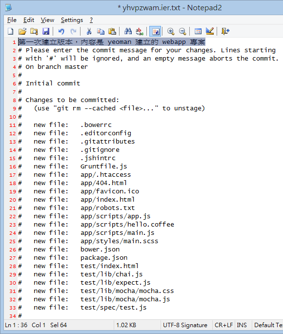
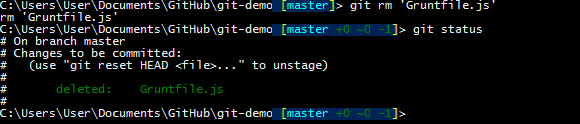
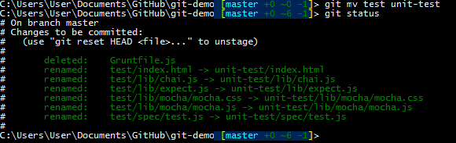
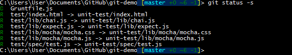

# Ngày 04: Các lệnh quản lý phiên bản Git thường dùng

Bài viết này sẽ giúp bạn học một số tác vụ quản lý phiên bản quan trọng và cơ bản nhất, bao gồm các thao tác tệp cơ bản như thêm, xóa, đổi tên tệp, commit các thay đổi (tạo phiên bản mới), và truy vấn bản ghi lịch sử.

## Chuẩn bị Working Directory

Ôn lại nội dung từ bài viết trước "Ngày 03: Tạo kho lưu trữ (Repository)", hãy trực tiếp tạo một Repository cục bộ để bắt đầu tất cả các bài tập trong bài viết này.

```
mkdir git-demo
cd git-demo
git init
```

## Thêm tệp

Hãy đặt một số tệp vào working directory. Bất kỳ tệp nào cũng được; chỉ cần sao chép một số tệp và thư mục hiện có vào working directory hiện tại.

Đối với bài viết này, tôi sẽ sử dụng công cụ [YEOMAN](https://yeoman.io/) để nhanh chóng tạo một trang web ví dụ webapp. Chỉ với một lệnh, bạn có thể tạo một trang web hoàn chỉnh:

```
yo webapp
```

**Lưu ý**: Về việc sử dụng [YEOMAN](https://yeoman.io/) trên nền tảng Windows, bạn có thể tham khảo bài viết của tác giả [Cách cài đặt và sử dụng các công cụ liên quan đến Yeoman 1.0 trên nền tảng Windows](https://blog.miniasp.com/post/2013/08/11/Yeoman-1-0-Installation-and-Usage-on-Windows), bài viết mô tả chi tiết quá trình cài đặt và sử dụng hoàn chỉnh.

Sau khi thêm tệp, nếu bạn vẫn đang ở trong giao diện Git Shell, bạn sẽ ngay lập tức thấy một dấu nhắc như sau:


Tức là, dấu nhắc sau đây nằm sau đường dẫn:

```
[master +10 ~0 -0 !]
```

Trong phần dấu nhắc này, bạn có thể thấy một số điều:

* master đại diện cho working directory hiện tại là branch **master**, cũng là tên branch mặc định của Git.
* Các số "màu đỏ" đều đại diện cho các tệp Untracked, có nghĩa là những thay đổi này sẽ không đi vào quản lý phiên bản.
* +10 đại diện cho 10 tệp "đã thêm"
* ~0 đại diện cho 0 tệp "đã sửa đổi"
* -0 đại diện cho 0 tệp "đã xóa"

Nếu bạn muốn thêm các tệp mới này vào quản lý phiên bản Git, bạn phải thực thi lệnh sau:

```
git add .
```

Bằng cách này, tất cả các tệp, thư mục, và tất cả các tệp trong các thư mục con dưới working directory này sẽ đều được thêm vào [index] hoặc [cache] của Git working directory này. Xin lưu ý: Tại thời điểm này, chưa có phiên bản nào được tạo. Nó chỉ cho Git biết rằng các tệp này "sắp" được thêm vào Git Repository.

Như thể hiện trong hình sau, đây là kết quả sau khi tôi thực thi `git add .` tại đây. Thông báo cảnh báo xuất hiện ở đây không quá nghiêm trọng. Những ai quan tâm đến việc tìm hiểu có thể tham khảo một bài viết khác của tác giả: [Ghi chú về chuyển đổi ký tự kết thúc dòng (CRLF) của Git for Windows](https://blog.miniasp.com/post/2013/09/15/Git-for-Windows-Line-Ending-Conversion-Notes).


Tuy nhiên, điều thú vị là các "số màu đỏ" ban đầu giờ đã chuyển thành "số màu xanh lá cây". Ý nghĩa được đại diện ở đây là:

* Các số "màu xanh lá cây" đều đại diện cho các tệp Staged (sẵn sàng), có nghĩa là những thay đổi này sẽ đi vào quản lý phiên bản.
* +23 đại diện cho 23 tệp "đã thêm" sẽ được tạo thành một phiên bản
* ~0 đại diện cho 0 tệp "đã sửa đổi" sẽ được tạo thành một phiên bản
* -0 đại diện cho 0 tệp "đã xóa" sẽ được tạo thành một phiên bản

Nhưng ban đầu chẳng phải chỉ là +10 (màu đỏ) sao? Làm thế nào nó trở thành +23 (màu xanh lá cây) sau khi thực thi?

Chúng ta thực thi `git reset` để đặt lại trạng thái index của working directory, sau đó thực thi lại `git status` để truy vấn trạng thái chi tiết của working directory hiện tại, như thể hiện trong hình sau:


Bạn có thể thấy rằng chỉ "các tệp và thư mục dưới thư mục cấp đầu tiên" được liệt kê ở đây vì git sẽ không kiểm tra có bao nhiêu tệp không được theo dõi trong các thư mục con vào lúc này.

Khi chúng ta thực thi `git add .` và sau đó thực thi lại `git status` để truy vấn trạng thái, bạn có thể thấy rằng các tệp trong các thư mục con đã đều được thêm vào, vì vậy con số này tăng lên, như thể hiện trong hình sau:


## Thêm một phần tệp

Lệnh `git add .` vừa đề cập sẽ tự động thêm tất cả các tệp (bao gồm các tệp trong thư mục con) vào working directory index. Đôi khi chúng ta chỉ muốn thêm các thư mục cụ thể hoặc các tệp cụ thể vào phiên bản. Lúc này, bạn cũng có thể chỉ định các thư mục cụ thể hoặc sử dụng ký tự đại diện (wildcard) để thêm tệp.

Hãy thực thi lại `git reset` để đặt lại trạng thái index của working directory, sau đó sử dụng `git add app` để thêm thư mục app và tất cả các tệp dưới nó, và sử dụng `git add .*` để thêm tất cả các tệp bắt đầu bằng "dấu chấm", như thể hiện trong hình sau:


**Lưu ý**: Ký tự đại diện `.*` không thể thêm tất cả các tệp "dấu chấm" vì ký tự đầu tiên của `.` chỉ có thể khớp với một thư mục. Nếu bạn muốn thêm tất cả các tệp bắt đầu bằng dấu chấm, bạn nên sử dụng `.??*` để đảm bảo nó khớp với các tệp bắt đầu bằng dấu chấm.

## Commit các thay đổi

Sau khi thêm tệp vào index, bạn có thể commit các thay đổi để tạo một phiên bản. Lệnh commit là:

```
git commit -m "Initial commit"
```

Tham số `-m` được theo sau bởi thông điệp commit (commit message). Thông điệp này sẽ được ghi lại trong lịch sử phiên bản. Khuyến nghị viết các thông điệp commit có ý nghĩa để giúp bạn và những người khác hiểu mục đích của phiên bản này trong tương lai.


## Xem lịch sử commit

Sau khi commit, bạn có thể sử dụng lệnh `git log` để xem lịch sử commit:

```
git log
```



Bạn cũng có thể sử dụng tham số `git log --oneline` để hiển thị phiên bản rút gọn của nhật ký:

```
git log --oneline
```


## Sửa đổi tệp

Bây giờ hãy thử sửa đổi tệp. Mở bất kỳ tệp nào trong working directory và thực hiện một số thay đổi, sau đó lưu nó.

Sau khi sửa đổi, nếu bạn thực thi `git status`, bạn sẽ thấy thông tin về các tệp đã sửa đổi:


Bạn có thể thấy rằng các tệp đã sửa đổi sẽ được hiển thị bằng màu đỏ, và số lượng tệp đã sửa đổi được hiển thị là ~1.

## Xem khác biệt của tệp

Trước khi commit các tệp đã sửa đổi, bạn có thể muốn xem những thay đổi nào đã được thực hiện. Bạn có thể sử dụng lệnh `git diff`:

```
git diff
```



Lệnh git diff sẽ hiển thị sự khác biệt giữa working directory và index.

## Commit các tệp đã sửa đổi

Để commit các tệp đã sửa đổi, bạn cũng cần thực thi `git add` trước để thêm các tệp đã sửa đổi vào index, sau đó thực thi `git commit`:

```
git add .
git commit -m "Update files"
```



## Xóa tệp

Nếu bạn muốn xóa tệp và muốn hành động xóa này được ghi lại trong phiên bản, bạn có thể sử dụng lệnh `git rm`:

```
git rm [filename]
```

Sau khi thực thi lệnh này, tệp sẽ bị xóa khỏi cả working directory và index. Sau đó thực thi `git commit` để commit hành động xóa này.



## Đổi tên hoặc di chuyển tệp

Nếu bạn muốn đổi tên hoặc di chuyển tệp, bạn có thể sử dụng lệnh `git mv`:

```
git mv [old_filename] [new_filename]
```

Lệnh này sẽ đổi tên hoặc di chuyển tệp và tự động thêm thay đổi này vào index. Sau đó thực thi `git commit` để commit thay đổi này.


## Tóm tắt hôm nay

Hôm nay chúng ta đã học một số lệnh Git cơ bản, được tóm tắt như sau:

* `git add [file]` - Thêm tệp vào index
* `git add .` - Thêm tất cả các tệp trong thư mục hiện tại vào index
* `git commit -m "message"` - Commit các thay đổi từ index để tạo một phiên bản mới
* `git status` - Xem trạng thái hiện tại của working directory
* `git log` - Xem lịch sử commit
* `git log --oneline` - Xem lịch sử commit rút gọn
* `git diff` - Xem sự khác biệt giữa working directory và index
* `git rm [file]` - Xóa tệp khỏi working directory và index
* `git mv [old] [new]` - Đổi tên hoặc di chuyển tệp
* `git reset` - Đặt lại trạng thái index

## Liên kết tham khảo

* [Git - Recording Changes to the Repository](https://git-scm.com/book/en/v2/Git-Basics-Recording-Changes-to-the-Repository)

---

* [Quay lại Mục lục](README.md)
* [Ngày trước: Tạo kho lưu trữ (Repository)](03.md)
* [Ngày tiếp theo: Hiểu mối quan hệ giữa Repository, Working Directory, Objects và Index](05.md)

---
