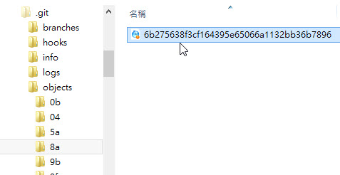

# Ngày 06: Phân tích cấu trúc dữ liệu Git - Cấu trúc Object

Trong cấu trúc dữ liệu của Git, "object" là một loại tệp "bất biến". Tất cả các tệp được lưu trữ trong "nơi lưu trữ object" thường chỉ đi vào mà không đi ra, và nội dung của chúng sẽ không bị sửa đổi. Lý do là nếu bạn can thiệp vào nội dung tệp, giá trị băm SHA1 được tính từ nội dung mới sẽ khác với tên tệp của object gốc, điều này sẽ khiến Git không thể tiếp tục thực thi, và tương đối cũng cung cấp một mức độ bảo vệ nhất định cho Git Repository. Bài viết này sẽ giới thiệu cấu trúc object của Git chi tiết hơn, và cuối cùng cũng sẽ giải thích chi tiết quá trình và logic cách các object được tạo ra thông qua một video.

## Về cơ sở dữ liệu Object

Như đã đề cập trong bài viết trước, cho dù là blob object hay tree object, đây đều là các object, và các object này sẽ được lưu trữ trong một cái gọi là "nơi lưu trữ object" (object storage), và "nơi lưu trữ object" này theo mặc định nằm trong thư mục objects của "Repository", như thể hiện trong hình sau:

Tuy nhiên, mỗi "object" trong Git Repository thực hiện một phép toán băm SHA1 trên "nội dung tệp" để tính ra một giá trị băm, và sử dụng giá trị băm này làm tên của object (tên tệp). Lấy 8a6b275638f3cf164395e65066a1132bb36b7896 làm ví dụ, Git trước tiên sẽ lấy hai ký tự đầu tiên (8a) làm thư mục, và sau đó sử dụng giá trị băm còn lại làm tên tệp (6b275638f3cf164395e65066a1132bb36b7896). Thư mục vật lý và các tệp của các object này cũng sẽ được đặt trong thư mục .git\objects, như thể hiện trong hình sau:

## Các loại Object

Trong "cơ sở dữ liệu object" này, có 4 loại object:

1. **blob object**: Đây là "nội dung" của một tệp trong working directory, và chỉ là nội dung. Khi bạn thực thi lệnh git add, nội dung của các tệp mới này sẽ ngay lập tức được ghi dưới dạng blob object. Tên tệp là kết quả băm của nội dung object, không có bất kỳ thông tin nào khác. Các thông tin như thời gian của tệp, tên tệp gốc, hoặc thông tin tệp khác sẽ được lưu trữ trong các loại object khác (tức là tree object).

2. **tree object**: Loại object này lưu trữ tất cả thông tin dưới một thư mục cụ thể, bao gồm tên tệp dưới thư mục đó, tên blob object tương ứng, liên kết tượng trưng (symbolic link), hoặc các tree object khác. Vì tree object có thể chứa các tree object khác, việc duyệt tree object thực ra giống như "thư mục" trong hệ thống tệp. Nói một cách đơn giản, tree object là ảnh chụp nhanh (snapshot) của một thư mục dưới một phiên bản cụ thể.

3. **commit object**: Được sử dụng để ghi lại những tree object nào được bao gồm trong phiên bản. Một commit object đại diện cho một Git commit, ghi lại những tree object nào có trong một phiên bản commit cụ thể, cũng như thời gian commit phiên bản, thông điệp commit, v.v. Thông thường, nó cũng ghi lại tên của commit object trước đó (chỉ phiên bản commit đầu tiên mới không có tên commit object trước đó).

4. **tag object**: Đây là một vật chứa, thường được sử dụng để liên kết với một commit object cụ thể (cũng có thể liên kết với blob và tree object cụ thể), và lưu trữ một số thông tin tham chiếu bổ sung (metadata), chẳng hạn như tên tag. Cách sử dụng phổ biến nhất của tag object là đánh dấu một phiên bản cụ thể của commit object bằng một cái tên dễ hiểu, có thể đại diện cho một phiên bản phát hành cụ thể hoặc một phiên bản có ý nghĩa đặc biệt.

Git sẽ tạo một blob object tương ứng cho mỗi tệp trong mỗi phiên bản. Tương tự, tên tệp của blob object được tính theo cách trên. Từ các tệp blob này, bạn không thể thấy bất kỳ mối quan hệ nào với phiên bản. Bạn phải sử dụng tree object (ảnh chụp nhanh của thư mục) và commit object (ảnh chụp nhanh của mỗi phiên bản) để liên kết mối quan hệ giữa các blob này và các phiên bản.

Tất cả các object đều được nén bằng thuật toán zlib, điều này không chỉ có thể cải thiện hiệu quả truy cập tệp một cách hiệu quả mà còn sử dụng thuật toán nén delta để tiết kiệm không gian khi đóng gói trong tương lai. Nó sẽ tự động tìm các blob tương tự, tự động tính toán sự khác biệt giữa các blob, và lưu trữ những khác biệt này trong một tệp gọi là *packfile*, có thể tiết kiệm đáng kể không gian đĩa). Thông thường, *packfile* được đặt trong thư mục .git\objects\pack, như thể hiện trong hình sau:

Mối quan hệ giữa bốn loại object này có thể tham khảo trong sơ đồ sau:

Tuy nhiên, chỉ nhìn vào văn bản và sơ đồ vẫn có thể khó thấy được mối quan hệ giữa các loại object này. Không sao cả. Tôi đã đặc biệt ghi lại một video hướng dẫn để cố gắng giải thích cấu trúc object của Git và quá trình tạo object bằng các lệnh git, để mọi người có thể hiểu rõ hơn cách Git tạo và quản lý các tệp này.

Liên kết video YouTube: [Hiểu mối quan hệ giữa cơ sở dữ liệu Object và các Object trong cấu trúc dữ liệu Git](https://www.youtube.com/watch?v=PZbSRy_ow0U)

## Ưu điểm của cấu trúc Object

Bạn hẳn đang dần hiểu thiết kế "object" của Git đẹp đến mức nào. Trong bài viết đầu tiên, chúng ta đã đề cập một số thiết kế quan trọng của Git. Hãy liệt kê lại một vài thiết kế liên quan đến đặc điểm của "object":

* Xử lý hiệu quả các dự án lớn
* Không chỉ một Repository hoàn chỉnh sẽ được clone về máy cục bộ, mà vì tất cả các blob object đều có thể định địa chỉ theo nội dung thông qua "nội dung", việc tìm cùng một nội dung giữa các phiên bản khác nhau rất hiệu quả.
* Bảo vệ bản ghi lịch sử
* Trong quá trình quản lý phiên bản Git, mỗi commit tạo ra một commit object, và tên của commit object này được tạo ra thông qua nội dung của commit object. Hơn nữa, commit object được liên kết với các tree object, và tên của tree object được tạo ra thông qua nội dung của tree object. Tree object được liên kết với blob và tree object, và tên của các object này cũng được tạo ra thông qua nội dung. Liên kết từng lớp như thế này, nếu hôm nay bạn thực sự muốn can thiệp vào lịch sử của một phiên bản nhất định, độ khó là khá cao!
* Vì Git Repository thường được clone hoặc fork, miễn là một Repository được clone, nếu bất kỳ object nào trong Repository nguồn bị sửa đổi, các Repository đã clone này sẽ khó hợp nhất trở lại, vì vậy bạn khó có thể tùy ý can thiệp vào bản ghi phiên bản.
* Đóng gói object định kỳ
* Các "object" mà chúng ta đề cập trong Git thực ra đại diện cho các tệp trong Repository. Trong quá trình thay đổi phiên bản, mã nguồn hoặc các tệp khác trong dự án sẽ được cập nhật. Mỗi lần nó được cập nhật, miễn là nội dung tệp khác nhau, một "object" mới sẽ được tạo, và tất cả các tệp có nội dung khác nhau này sẽ được giữ lại.
* Bạn có thể hình dung rằng khi một dự án trở nên lớn hơn và có nhiều phiên bản hơn, sẽ có ngày càng nhiều object. Mặc dù mỗi tệp có thể được nén riêng lẻ để làm cho tệp nhỏ hơn, quá nhiều tệp vẫn sẽ làm cho việc truy cập tệp ngày càng kém hiệu quả. Vì vậy, thiết kế của Git có một cơ chế có thể tự động đóng gói một nhóm các "object" cũ thành một packfile để cải thiện hiệu quả truy cập tệp.
* Những tệp mới được thêm vào đó sẽ vẫn tồn tại dưới dạng tệp đơn lẻ, điều này cũng có nghĩa là một "tệp" trong Git Repository là một "object" Git, nhưng nó cần được đóng gói lại sau một thời gian.
* Có lẽ, Git sẽ tự động thực hiện các hành động như đóng gói lại, nhưng bạn vẫn có thể tự ra lệnh để thực thi chúng. Ví dụ: git gc
* Nếu bạn muốn kiểm tra xem hệ thống tệp do Git duy trì có hoàn chỉnh hay không, bạn có thể thực thi lệnh sau: git fsck

## Tóm tắt hôm nay

"Object" trong Git rất quan trọng, và các đặc điểm của chúng cũng rất quan trọng. Mặc dù chúng ta thường không cần trực tiếp chạm vào các tệp này trong quá trình vận hành các lệnh Git, việc hiểu sự tồn tại của các object này thực sự giúp bạn hiểu rõ hơn chế độ vận hành của Git và các khái niệm thiết kế độc đáo của Git.

## Liên kết tham khảo

* [Git Internals - Git Objects](https://git-scm.com/book/en/Git-Internals-Git-Objects)
* [Pro Git Book](https://progit.org/)
* [Git Magic - Traditional Chinese Version](https://www-cs-students.stanford.edu/~blynn/gitmagic/intl/zh_tw/)
* [Git (software) - Wikipedia, the free encyclopedia](https://en.wikipedia.org/wiki/Git_(software) "Git (software) - Wikipedia, the free encyclopedia")

---

* [Quay lại Mục lục](README.md)
* [Ngày trước: Hiểu mối quan hệ giữa Repository, Working Directory, Objects và Index](05.md)
* [Ngày tiếp theo: Phân tích cấu trúc dữ liệu Git - Cấu trúc Index](07.md)

---
