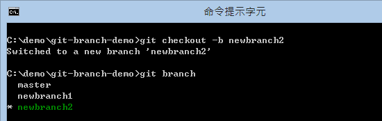
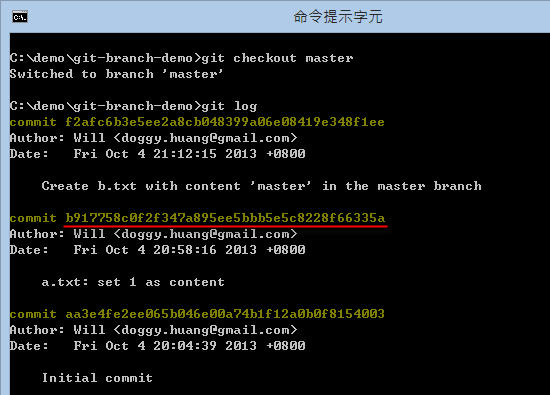

# Ngày 08: Khái niệm cơ bản và cách sử dụng Branch

Trong Git, **branch** là một cơ chế rất quan trọng và phải được sử dụng một cách đặc biệt cẩn thận vì một dự án không thể phân nhánh vô hạn. Cuối cùng, các branch phải được hợp nhất, nhưng hợp nhất là một chủ đề cho sau này. Bài viết này trước tiên sẽ giúp bạn học các khái niệm cơ bản và cách sử dụng Git branch.

## Khái niệm cơ bản của Branch

Mục đích chính của việc sử dụng cơ chế "branch" trong quản lý phiên bản là để giải quyết vấn đề xung đột phiên bản trong quá trình phát triển. Tôi tin rằng nhiều người đã sử dụng bất kỳ cơ chế quản lý phiên bản nào cũng sẽ nghĩ rằng "phân nhánh" là thủ phạm "gây ra xung đột phiên bản" bởi vì khi bạn bắt đầu phân nhánh, bạn chắc chắn sẽ nghĩ về vấn đề hợp nhất. Sau khi phân nhánh, nếu ai đó sửa đổi cùng một dòng của cùng một tệp như bạn, nó sẽ gây ra "xung đột phiên bản". Mỗi khi xung đột xảy ra, bạn phải mất công để giải quyết nó.

Khi xung đột xảy ra, đôi khi bạn có thể dễ dàng quyết định sử dụng phiên bản của mình hoặc phiên bản của đối tác, nhưng đôi khi không dễ dàng như vậy. Khi nó phức tạp, bạn còn phải tìm người đã sửa đổi những dòng này ban đầu dựa trên đoạn xung đột, phối hợp tác động của các thay đổi của nhau lên hệ thống, và cuối cùng quyết định cách hợp nhất. Những vấn đề như vậy rất tẻ nhạt, vì vậy nhiều người sẽ cố gắng tránh "phân nhánh" để tránh "xung đột".

Tuy nhiên, nếu nhóm phát triển trở nên lớn hơn và có ngày càng nhiều chức năng hệ thống, ngay cả khi bạn không phân nhánh phiên bản, xung đột của mọi người vẫn sẽ xuất hiện vô tận. Đôi khi nó thậm chí không phải là vấn đề xung đột, mà là A đã hoàn thành một chức năng và bị phiên bản tiếp theo của B ghi đè mà không có bất kỳ xung đột nào, điều này không phải là điều mọi người muốn thấy. Tuy nhiên, đây cũng là một tình huống "xung đột vô hình".

Trong quá khứ, trong cơ chế quản lý phiên bản tập trung Subversion, cũng có khái niệm phân nhánh, có thể hoạt động rất tốt. Tất nhiên, nếu kiến trúc phần mềm của bạn không đủ tốt, nếu bạn không rõ ràng về khái niệm phân nhánh và việc sử dụng công cụ, tôi tin rằng việc sử dụng "phân nhánh" sẽ không suôn sẻ. Đây là một kết quả tất yếu. Sẽ không bao giờ có một công cụ quản lý phiên bản nào trên thế giới này cho phép bạn "học mà không cần nỗ lực, không đau đớn, tự nhiên học được phân nhánh". Nó phụ thuộc vào con người. Nếu khái niệm của con người sai, không công cụ nào sẽ hoạt động suôn sẻ.

Vì Git là một "cơ chế quản lý phiên bản phân tán", trong kịch bản quản lý phiên bản phân tán, điều cuối cùng bạn muốn làm là "quản lý", vì vậy Git hiếm khi có cái gọi là cơ chế quản lý hoặc cơ chế kiểm soát quyền. Điều duy nhất nó muốn làm là cho phép mọi người "phân nhánh" và "hợp nhất" một cách suôn sẻ.

Lấy "Repository từ xa" được đề cập trong [Ngày 03: Tạo kho lưu trữ (Repository)] làm ví dụ, bạn có thể hình dung: từ khoảnh khắc chúng ta sử dụng lệnh `git clone`, đó thực ra là sự khởi đầu của "phân nhánh". Bạn sao chép một Repository hoàn chỉnh từ Repository từ xa, sau đó bắt đầu tạo các phiên bản trên máy cục bộ của riêng bạn. Sau khi phần mềm được sửa đổi đến một mức độ nhất định, bạn "hợp nhất" nó trở lại. Chỉ là lệnh hợp nhất lúc này được gọi là `git push`.

Tình huống phân nhánh và hợp nhất này ở khắp mọi nơi trong quá trình quản lý phiên bản Git. Repository từ xa có thể có branch, Repository cục bộ có thể có branch. Bạn có thể hợp nhất (pull) từ bất kỳ branch từ xa nào vào một branch cục bộ, hoặc bạn có thể push một branch cục bộ lên một branch từ xa. Tất nhiên, bạn cũng có thể hợp nhất từ bất kỳ branch cục bộ nào sang một branch cục bộ khác. Có thể hình dung rằng nếu "phân nhánh" không có một logic kiểm soát tốt, cuối cùng bạn có thể kết hợp các kịch bản quản lý phiên bản cực kỳ phức tạp khác nhau, điều này không phải là điều mọi người muốn thấy. Vì vậy, việc học tốt "phân nhánh" và "hợp nhất" là thực sự quan trọng. Ví dụ, git-flow là một mô hình quản lý branch rất phổ biến. Đây không phải là một công cụ, mà là một logic để quản lý các branch. Tôi sẽ giải thích phần này trong các bài viết sau của mình.

Trong quá trình phát triển nhân Linux, hàng chục nghìn lập trình viên từ khắp nơi trên thế giới đã cùng nhau tham gia. Để quản lý một nhóm phát triển lớn như vậy, Git đã ra đời. Đây là một cơ chế quản lý phiên bản phân tán. Mọi người đều có một phiên bản hoàn chỉnh. Sau khi phiên bản được phân phối, mọi người phải quản lý phiên bản của riêng mình và sau đó hợp nhất nó trở lại theo yêu cầu của nhóm. Tuy nhiên, trước khi hợp nhất trở lại, cơ chế này đảm bảo rằng mọi người có thể phát triển suôn sẻ mà không bị ảnh hưởng bởi phiên bản của bất kỳ lập trình viên nào khác. Git thực sự đã làm được điều này đồng thời cũng giảm độ phức tạp của quản lý phiên bản.

Tất nhiên, tôi cũng phải nói rằng nếu nhóm tham gia phát triển phần mềm chỉ có hai hoặc ba người, và những người này vẫn tụ tập cùng nhau, thì thực sự không cần thiết phải sử dụng quản lý phiên bản Git. Sử dụng Subversion cũng là một lựa chọn rất tốt, đơn giản và trực quan. Nếu gặp vấn đề trong quá trình phát triển, chúng có thể được giải quyết bằng cách phối hợp với những người xung quanh bạn. Điều này thuận tiện hơn nhiều so với việc để cả nhóm hiểu Git.

Nếu nhóm của bạn có một quy mô nhất định, hoặc mọi người không làm việc cùng nhau, và bạn cần thực hiện quản lý phiên bản, có lẽ Git là một lựa chọn tốt. Tuy nhiên, việc có một khái niệm hoặc thói quen quản lý phiên bản nhất quán trong nhóm làm việc cũng là một điều rất quan trọng.

## Chuẩn bị Working Directory

Chúng ta nhanh chóng tạo một Git Repository và working directory với hai phiên bản thông qua các lệnh sau:

```
mkdir git-branch-demo
cd git-branch-demo
git init

echo. > a.txt
git add .
git commit -m "Initial commit"

echo 1 > a.txt
git add .
git commit -m "a.txt: set 1 as content"
```

Sau đó sử dụng `git log` để lấy thông tin phiên bản như sau:

```
C:\demo\git-branch-demo>git log
commit b917758c0f2f347a895ee5bbb5e5c8228f66335a
Author: Will <doggy.huang@gmail.com>
Date:   Fri Oct 4 20:58:16 2013 +0800

    a.txt: set 1 as content

commit aa3e4fe2ee065b046e00a74b1f12a0b0f8154003
Author: Will <doggy.huang@gmail.com>
Date:   Fri Oct 4 20:04:39 2013 +0800

    Initial commit
```

Sau đó chúng ta sử dụng lệnh `git branch` để biết rằng chúng ta đã có một branch có tên là `master`, đây là branch mặc định trong Git Repository. Nếu bạn cố gắng xóa branch này thông qua `git branch -d master`, bạn sẽ nhận được thông báo lỗi `error: Cannot delete the branch 'master' which you are currently on.` Điều này có nghĩa là "khi branch working directory hiện tại của bạn được đặt thành master, bạn không thể xóa branch hiện tại", có nghĩa là trước tiên bạn phải chuyển sang "một branch khác" trước khi xóa branch này.


Tất nhiên, hiện tại chúng ta chỉ có một branch, vì vậy một cách tự nhiên chúng ta không thể tự xóa chính mình.

## Tạo Branch

Có hai cách phổ biến nhất để tạo branch:

1. Tạo một branch, nhưng giữ working directory hiện tại trên branch của riêng bạn: `git branch [BranchName]`

   Khi tôi thực thi lệnh `git branch newbranch1`, điều này sẽ tạo một branch `newbranch1` mới. Sau đó chúng ta sử dụng `git branch` để xem hiện tại có bao nhiêu branch. Bạn sẽ thấy hai branch, nhưng working directory hiện tại vẫn sẽ ở trên branch `master`, như thể hiện trong hình sau:

   

   Nếu bạn tạo một phiên bản trong working directory hiện tại vào lúc này, nó sẽ được tạo trong branch `master`. Chúng ta tạo một tệp mới vào lúc này và tạo một phiên bản thông qua `git commit`. Các lệnh như sau:

   ```
    echo master > b.txt
    git add .
    git commit -m "Create b.txt with content 'master' in the master branch"
   ```

   Xin hãy nhớ: Trước tiên chúng ta đã tạo hai phiên bản trong branch `master` mặc định, sau đó tạo một branch, và sau đó tạo một phiên bản khác trong branch `master`.

2. Tạo một branch và chuyển working directory hiện tại sang branch mới: `git checkout -b [BranchName]`

   Tiếp theo, chúng ta tạo một branch bằng phương pháp thứ hai. Khi tôi thực thi lệnh `git checkout -b newbranch2`, không chỉ một branch mới sẽ được tạo, mà working directory hiện tại cũng sẽ được chuyển sang một branch khác. Cuối cùng, sử dụng `git branch` để xem hiện tại có bao nhiêu branch. Bạn sẽ thấy rằng đã có ba branch, và working directory hiện tại đã được chuyển sang branch `newbranch2` vừa tạo, như thể hiện trong hình sau:

   

   Nếu bạn tạo một phiên bản trong working directory hiện tại vào lúc này, nó sẽ được tạo trong branch `newbranch2`. Chúng ta tạo một tệp mới vào lúc này và tạo một phiên bản thông qua `git commit`. Các lệnh như sau:

   ```
    echo newbranch2 > b.txt
    git add .
    git commit -m "Modify b.txt with content 'newbranch2' in the newbranch2 branch"
   ```

   Xin hãy nhớ: Trước tiên chúng ta đã tạo hai phiên bản trong branch `master` mặc định, sau đó tạo một branch, sau đó tạo một phiên bản khác trong branch `master`, sau đó tạo một branch `newbranch2` mới dựa trên trạng thái hiện tại của branch `master`, chuyển working directory sang branch `newbranch2`, và sau đó tạo một phiên bản khác. Nếu chúng ta thực thi `git log` vào lúc này, nó sẽ hiển thị 4 bản ghi phiên bản vì branch sẽ tự động kế thừa toàn bộ lịch sử của branch nguồn.

**Lưu ý**: Để biết mô tả chi tiết về lệnh và tham số, bạn có thể nhập `git help branch` để truy vấn tài liệu đầy đủ.

```
git branch [branch_name]
```

## Chuyển đổi Branch

Nếu bạn muốn chuyển working directory sang một branch khác, bạn có thể nhập lệnh sau (không có tham số -b):

```
git checkout [branch_name]
```

Giả sử chúng ta muốn chuyển working directory sang branch `newbranch1`, chúng ta có thể nhập `git checkout newbranch1` để chuyển sang. Sau đó bạn có thể ngay lập tức sử dụng `git branch` để kiểm tra xem working directory hiện tại đã chuyển sang chưa, và sau đó sử dụng `git log` để kiểm tra các bản ghi lịch sử của branch `newbranch1` hiện tại. Vì đây là branch đầu tiên chúng ta tạo, về mặt lý thuyết trạng thái branch này chỉ nên có hai bản ghi lịch sử, như thể hiện trong hình sau:


**Lưu ý**: Để biết mô tả chi tiết về lệnh và tham số, bạn có thể nhập `git help checkout` để truy vấn tài liệu đầy đủ.

```
git checkout [branch_name]
```

## Xóa Branch

Nếu bạn muốn xóa một branch hiện có, giống như chúng ta đã đề cập trong **Chuẩn bị Working Directory**, lệnh như sau:

```
git branch -d [branch_name]
```

Trước đó cũng đã đề cập rằng bạn không thể xóa branch được chỉ định bởi working directory hiện tại. Trước tiên bạn phải chuyển sang một branch khác trước khi xóa branch hiện tại của mình. Ví dụ, nếu bạn muốn xóa branch `newbranch1` hiện tại, thì trước tiên bạn phải chuyển sang một branch khác, chẳng hạn như branch `master`, và sau đó ra lệnh `git branch -d newbranch1` để xóa branch, như thể hiện trong hình sau:


## Kiểm tra Working Directory đang ở trên Branch nào

Bạn có thể sử dụng lệnh `git branch` để xem bạn hiện đang ở trên branch nào, như thể hiện trong hình sau:


## Xem đồ thị Branch hoàn chỉnh của Git Repository

Cuối cùng, tôi sử dụng công cụ SourceTree để hiển thị đồ thị branch hiện tại của Git Repository. Hiện tại, chúng ta chỉ có hai branch, một là branch `master`, và branch còn lại là branch `newbranch2`, vì branch `newbranch1` đã bị xóa trong quá trình thực hành. Để mang lại cho các branch của chúng ta cảm giác "cây", tiếp theo tôi sẽ trình bày cách tạo lại một branch có cùng trạng thái như `newbranch1` trước đó và thêm một phiên bản mới dưới branch này.

Tôi không biết bạn còn nhớ không, chúng ta đã tạo branch `newbranch1` sau khi tạo hai phiên bản trong branch `master`. Bây giờ trước tiên hãy tìm id của commit object của phiên bản này, có thể lấy được thông qua `git log`, như thể hiện trong hình sau:



Vì vậy id commit object của tôi là: b917758c0f2f347a895ee5bbb5e5c8228f66335a

Sau đó trước tiên tôi chuyển working directory sang phiên bản này, có thể hoàn thành thông qua `git checkout [commit_id]`:

```
git checkout b917758c0f2f347a895ee5bbb5e5c8228f66335a
```

Vào lúc này, nếu bạn sử dụng `git log`, bạn chỉ nên thấy hai bản ghi phiên bản vì chúng ta đã chuyển trạng thái của working directory sang phiên bản này. Từ hình sau, bạn có thể thấy rằng khi chúng ta thực thi `git checkout b917758c0f2f347a895ee5bbb5e5c8228f66335a`, một cặp thông báo sẽ xuất hiện. Những thông báo này rất quan trọng và phải được hiểu, như thể hiện trong hình sau:


Đầu tiên, vì bạn chuyển phiên bản của working directory sang một phiên bản "cũ", bạn sẽ được nhắc rằng working directory này đã vào trạng thái gọi là **detached HEAD**. Đây là một lời nhắc rằng "working directory hiện tại không ở phiên bản mới nhất". Bạn có thể chuyển sang bất kỳ phiên bản nào của Git Repository bất cứ lúc nào, nhưng vì phiên bản này đã có một "phiên bản tiếp theo", nếu bạn thực thi `git commit` trong "phiên bản cũ" hiện tại, phiên bản mới này sẽ không được theo dõi các thay đổi, vì vậy khuyến nghị không nên làm điều này.

Nếu bạn muốn tạo một phiên bản có thể theo dõi được trong trạng thái **detached HEAD**, thì phương pháp đúng là theo dõi thông qua "tạo một branch". Bây giờ chúng ta sẽ tạo một branch `newbranch1` mới trong phiên bản này và chuyển working directory sang. Lệnh như sau:

```
git checkout -b newbranch1
```


Sau đó chúng ta tạo một tệp mới `b.txt` với nội dung `newbranch1` và tạo một phiên bản mới. Các lệnh như sau:

```
echo newbranch1 > b.txt
git add .
git commit -m "Add b.txt in newbranch1"
```

Được rồi, bây giờ chúng ta có hai branch ngoài `master`, và cả hai branch đều có phiên bản của riêng chúng. Hãy nghĩ về cây này trông như thế nào trong tâm trí bạn!

Tiếp theo, chúng ta mở công cụ SourceTree và thêm working directory này vào công cụ quản lý SourceTree:


Sau khi thêm, chúng ta chuyển sang các branch của Git Repository này. Tổng cộng có ba branch. Hãy chuyển sang từng branch một:


Phiên bản sớm nhất ở dưới cùng, và phiên bản mới nhất ở trên cùng. Khi chúng ta chuyển sang các branch khác nhau, bạn có thể thấy rằng ba sơ đồ branch là giống nhau, chỉ có "thanh ánh sáng" mặc định là khác nhau. Đầu tiên, từ các hình ảnh, những gì bạn thấy là "toàn bộ Git Repository" với tất cả các phiên bản, tất cả các branch, và branch bắt đầu từ phiên bản nào. "Thanh ánh sáng" là "phiên bản mới nhất" của branch đó nằm ở phiên bản nào trong toàn bộ Git Repository.

## Tóm tắt hôm nay

Thực ra, việc sử dụng branch trong Git là một việc dễ dàng. Phần khó là để mọi người biết "phân nhánh" đang làm gì, và liệu **trí tưởng tượng** của mọi người về "phân nhánh" có nhất quán hay không. Miễn là trí tưởng tượng của mọi người về phân nhánh nhất quán, sẽ không có quá nhiều khoảng cách trong quản lý phiên bản nhóm.

Đối với tôi, tôi sẽ tưởng tượng một branch như một loại chức năng "ảnh chụp nhanh" (snapshot), tạo một ảnh chụp nhanh của một phiên bản commit nhất định và các phiên bản lịch sử của nó, sau đó sao chép một bản, và đặt cho nó một tên branch. Bạn có thể tạo các phiên bản trên các branch này và chờ đợi việc hợp nhất trong tương lai.

Toàn bộ Git Repository sẽ giữ lại tất cả các branch và phiên bản, và cuối cùng trình bày một sơ đồ branch có cấu trúc cây. Cuối cùng, thông qua công cụ SourceTree, chúng ta có thể thấy rõ tình huống branch và các thay đổi phiên bản trong Git Repository. Tôi đã thấy sơ đồ này từ rất sớm, nhưng lần đầu tiên tôi nhìn vào nó, tôi hoàn toàn không thể hiểu nó. Tôi chỉ nghĩ nó là "một sơ đồ" không có cảm giác gì. Nhưng kể từ khi tôi học ngày càng nhiều về Git, sơ đồ branch này cho phép tôi hiểu các thay đổi trong toàn bộ Git Repository trong nháy mắt và nắm bắt tốt hơn các thay đổi phiên bản của Git.

Tôi hy vọng rằng thông qua văn bản và trình diễn lệnh kèm hình ảnh của mình, tôi có thể giúp bạn phác thảo một cấu trúc branch trong tâm trí của chính bạn và hiểu sâu hơn về cấu trúc branch của Git.

Hãy để tôi sắp xếp lại các lệnh và tham số Git đã học hôm nay:

* git branch
* git branch \[branch\_name]
* git checkout -b \[branch\_name]
* git checkout \[branch\_name]
* git branch -d \[branch\_name]
* git log

---

* [Quay lại Mục lục](README.md)
* [Ngày trước: Phân tích cấu trúc dữ liệu Git - Cấu trúc Index](07.md)
* [Ngày tiếp theo: So sánh khác biệt giữa tệp và phiên bản](09.md)

---
