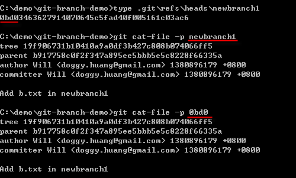

# Ngày 11: Hiểu tham chiếu Git Object và tham chiếu tượng trưng

Sau khi đã hiểu "tên tuyệt đối" của Git object, tiếp theo chúng ta sẽ giới thiệu "tên tham chiếu" — loại tên được dùng phổ biến nhất trong quá trình quản lý phiên bản bằng Git.

## Hiểu tên tham chiếu của Object

Tên tham chiếu (ref) đơn giản là một "con trỏ" trỏ tới Git object, hay nói cách khác là một "cái tên dễ nhớ" khác so với "tên tuyệt đối". Chúng dùng một cái tên được định sẵn hoặc do người dùng tự định nghĩa để đại diện cho một Git object cụ thể.

"Tên branch" mà chúng ta đã học trước đây, HEAD mà chúng ta vẫn hay dùng (đại diện cho phiên bản mới nhất), hay "tên tag" mà chúng ta sẽ học sau này — tất cả đều là "tên tham chiếu", về bản chất được tạo ra để giúp chúng ta dễ nhớ hơn.

Chúng ta sẽ dùng "tên branch" làm ví dụ để giải thích cấu trúc vật lý của "tên tham chiếu" là gì. Trong hình sau, chúng ta dùng `git branch` để lấy tất cả các tên branch. Bạn có thể thấy hiện tại chúng ta có ba branch. Tuy nhiên, ba tên branch này thực chất là "tên tham chiếu", nghĩa là ba "tên tham chiếu" này tương ứng với ba commit object trong kho Git object. Trong hình sau, bạn cũng có thể thấy các tên tham chiếu branch này thực chất chỉ là các tệp. Tất cả tên tham chiếu của "branch cục bộ" đều nằm trong thư mục `.git\refs\heads`:

Tiếp theo, tôi sẽ dùng hình sau để chứng minh tệp này liên kết với "tên tuyệt đối" như thế nào. Trước tiên, tôi dùng `git branch` để lấy tất cả các tên branch và thấy rằng "working directory" hiện tại đang trỏ tới branch `newbranch1`. Lúc này, chúng ta có thể lấy tất cả các bản ghi phiên bản của branch này thông qua `git log --pretty=oneline`. Theo mặc định, các "tên tham chiếu" của branch sẽ trỏ tới "phiên bản mới nhất" của branch. Chúng ta chỉ cần mở nội dung của tệp `.git\refs\heads\newbranch1` là sẽ thấy đây chỉ là một tệp văn bản thuần túy trỏ tới "phiên bản mới nhất" trong lịch sử phiên bản. Cuối cùng, dùng `git cat-file -p 0bd0` để lấy nội dung của commit object đó và `git show 0bd0` để lấy bản ghi thay đổi của phiên bản đó, qua đó chứng minh rằng các tệp này chính là mục đích chính của "tên tham chiếu".

Sau đó, chúng ta dùng lệnh để xem nội dung khi đọc một commit object cụ thể bằng "tên tuyệt đối" và "tên tham chiếu", chứng minh rằng kết quả của hai lệnh này là giống nhau:

Trong hầu hết các trường hợp, "tên tham chiếu" thường trỏ tới một commit object, nhưng không nhất thiết phải vậy. Bạn cũng có thể trỏ tới các loại Git object khác, chẳng hạn như blob object, tree object, tag object, v.v.

## Về thư mục .git/refs/

Từ các ví dụ trên, bạn có thể thấy thực tế mọi "tên tham chiếu" đều là các tệp và đều được đặt trong thư mục `git/refs/`. Các vị trí thư mục nơi đặt tên tham chiếu của Git chủ yếu có ba:

* Branch cục bộ: `.git/refs/heads/`
* Branch từ xa: `.git/refs/remotes/`
* Tag: `.git/refs/tags/`

Tôi sẽ cho bạn một ví dụ đơn giản. Nếu bạn tạo một branch có tên `f2e`, lúc này bạn sẽ biết rằng "tên tham chiếu" của branch cục bộ sẽ tạo ra tệp `.git/refs/heads/f2e`, như thể hiện trong hình sau:

Trên thực tế, "tên đầy đủ" của `f2e` này phải được gọi là `refs/heads/f2e`. Chỉ là Git cho phép bạn nhập dạng viết tắt để tiện nhập nhanh tên tham chiếu. Như thể hiện trong hình sau, cả ba cách sử dụng "tên tham chiếu" này đều khả thi:

Tuy nhiên, khi bạn nhập "dạng viết tắt" của tên tham chiếu, theo mặc định Git sẽ tìm kiếm tên tham chiếu phù hợp theo thứ tự sau. Chỉ cần tìm thấy tệp tương ứng, nó sẽ lập tức trả về "tên tuyệt đối của object" trong nội dung của tệp đó:

* `.git/<dạng viết tắt của tham chiếu>`
* `.git/refs/<dạng viết tắt của tham chiếu>`
* `.git/refs/tags/<dạng viết tắt của tham chiếu; tên tag>`
* `.git/refs/heads/<dạng viết tắt của tham chiếu; tên branch cục bộ>`
* `.git/refs/remotes/<dạng viết tắt của tham chiếu>`
* `.git/refs/remotes/<dạng viết tắt của tham chiếu; tên branch từ xa>/HEAD`

Ví dụ, khi bạn nhập lệnh `git cat-file -p f2e`, Git sẽ tìm "tệp tên tham chiếu" tương ứng theo thứ tự sau và trích xuất nội dung của tệp đó (tức là tên tuyệt đối của Git object):

* `.git/f2e` --> Không tìm thấy tệp
* `.git/refs/f2e` --> Không tìm thấy tệp
* `.git/refs/tags/f2e` --> Không tìm thấy tệp
* `.git/refs/heads/f2e` --> **Đã tìm thấy tên tham chiếu, không tìm tiếp nữa**
* `.git/refs/remotes/f2e`
* `.git/refs/remotes/f2e/HEAD`

## Hiểu tên tham chiếu tượng trưng của Object (symref)

Tên tham chiếu tượng trưng (symref) thực ra cũng là một loại tên tham chiếu (ref), chỉ khác ở nội dung. Chúng ta có thể thấy sự khác biệt về nội dung từ hình sau. "Tham chiếu tượng trưng" sẽ trỏ tới một "tên tham chiếu" khác và nội dung bắt đầu bằng `ref:`:

Trong các công cụ Git, một số tham chiếu tượng trưng đặc biệt được duy trì theo mặc định để tiện truy cập nhanh các commit object thường dùng, và các object này theo mặc định được lưu trong thư mục `.git/`. Có bốn tham chiếu tượng trưng như sau:

* HEAD
* Luôn trỏ tới "phiên bản mới nhất" trong "branch" được đặt trong "working directory".
* Vì vậy, khi bạn thực thi `git commit` trên branch này, tham chiếu tượng trưng `HEAD` này cũng sẽ được cập nhật tới commit object của phiên bản mới nhất của branch này.
* ORIG_HEAD
* Nói một cách đơn giản, nó là "phiên bản trước" của commit object HEAD, thường được dùng để khôi phục thay đổi của phiên bản trước.
* FETCH_HEAD
* Khi sử dụng remote repository, bạn có thể dùng lệnh `git fetch` để lấy tất cả các object từ remote repository. Tham chiếu tượng trưng FETCH_HEAD này sẽ ghi lại "tên tuyệt đối" của HEAD (phiên bản mới nhất) của mỗi branch trong remote repository.
* MERGE_HEAD
* Khi bạn thực hiện công việc merge (chủ đề về merge sẽ được đề cập trong các bài viết sau), tên tuyệt đối của commit object từ "nguồn merge" sẽ được ghi lại trong tham chiếu tượng trưng MERGE_HEAD này.

## Cách sử dụng tham chiếu thông thường và tham chiếu tượng trưng

Chúng ta biết rằng "tên tham chiếu" có những mục đích đặc biệt và thường được dùng trong các tình huống như "branch cục bộ", "branch từ xa" và "tag", nhưng thực tế bạn có thể tạo bất kỳ số lượng "tên tham chiếu tùy chỉnh" nào. Bạn có thể tự do tạo "tham chiếu thông thường" thông qua `git update-ref`.

Tôi thử tạo một tham chiếu thông thường có tên `InitialCommit` và trỏ tới phiên bản đầu tiên trong Git repository. Vui lòng tham khảo hình sau để biết trình tự thực thi lệnh và học cách tạo tham chiếu thông thường:

Sau khi tạo, tệp mặc định sẽ được đặt trong thư mục `.git`, và lúc này, bạn có thể truy cập nội dung của các Git object cụ thể bằng cả "tên tuyệt đối" và "tên tham chiếu":

**Lưu ý**: Hãy nhớ rằng tên tham chiếu có thể trỏ tới bất kỳ Git object nào và không bị giới hạn ở commit object.

Để tạo một tên tham chiếu chính quy hơn, tốt nhất nên thêm tiền tố `refs/`, ví dụ: `git update-ref refs/InitialCommit [object_id]`.

Để xóa một tham chiếu thông thường, bạn có thể dùng tùy chọn `-d`. Như thể hiện trong hình sau:

Để hiển thị tất cả các tham chiếu, bạn có thể dùng lệnh `git show-ref`, như thể hiện trong hình sau:

Để tạo và xóa "tham chiếu tượng trưng", bạn có thể tham khảo hình sau về cách sử dụng `git symbolic-ref`. Hãy nhìn vào hình và tự kể lại câu chuyện. Sau khi hiểu, bạn sẽ thực sự thấy Git rất linh hoạt và mạnh mẽ trong việc sử dụng tham chiếu. Ngoài ra, việc thực thi `git show-ref` sẽ chỉ hiển thị các tham chiếu trong thư mục `.git\refs`, và điều này đúng cho cả "tham chiếu thông thường" lẫn "tham chiếu tượng trưng":

Ở phần trước của bài viết này, chúng ta đã đề cập rằng bạn có thể tạo tham chiếu tới các thư mục sau:

* `.git/<dạng viết tắt của tham chiếu>`
* `.git/refs/<dạng viết tắt của tham chiếu>`
* `.git/refs/tags/<dạng viết tắt của tham chiếu; tên tag>`
* `.git/refs/heads/<dạng viết tắt của tham chiếu; tên branch cục bộ>`
* `.git/refs/remotes/<dạng viết tắt của tham chiếu>`
* `.git/refs/remotes/<dạng viết tắt của tham chiếu; tên branch từ xa>/HEAD`

Các tham chiếu tùy chỉnh thường được tạo ở hai đường dẫn đầu tiên để tránh nhầm lẫn với việc sử dụng "branch cục bộ", "branch từ xa" và "tag" của chúng ta. Tuy nhiên, bạn thực sự có thể dùng `git update-ref` để tạo bất kỳ tham chiếu tùy chỉnh nào. Nếu bạn tạo một tham chiếu tùy chỉnh trong `refs/heads/Will`, điều đó tương đương với việc tạo một branch có tên `Will`. Git thực sự đơn giản như vậy. Càng hiểu rõ cấu trúc bên trong của Git, bạn sẽ càng yêu thích các tính năng đa dạng của Git.

## Tóm tắt hôm nay

Chúng ta biết rằng "tên tham chiếu (ref)" đơn giản là một "con trỏ" trỏ tới Git object, được dùng để trỏ tới các Git object cụ thể. Vì vậy, bạn có thể hình dung "tên tham chiếu" như bí danh của tên tuyệt đối của Git object, được dùng để hỗ trợ ghi nhớ. Trong Git, có nhiều cơ chế giúp bạn kiểm soát dự án, chẳng hạn như "branch", "tag", v.v. Các cơ chế này thực ra đều được thực hiện bởi "tham chiếu" ở tầng bên dưới.

Tên tham chiếu của Git được chia nhỏ hơn thành "tham chiếu thông thường" và "tham chiếu tượng trưng". Cả hai có cùng mục đích, chỉ khác nhau một chút về nội dung. "Tham chiếu tượng trưng" sẽ trỏ tới một "tham chiếu thông thường" khác, trong khi "tham chiếu thông thường" trỏ tới "tên tuyệt đối" của một Git object.

Hãy để tôi sắp xếp lại các lệnh và tham số Git đã học hôm nay:

* git branch
* git log --pretty=oneline
* git log --oneline
* git cat-file -p [ref or object_id]
* git show [ref or object_id]
* git update-ref
* git symbolic-ref
* git show-ref

---

* [Quay lại Mục lục](README.md)
* [Ngày trước: Hiểu tên tuyệt đối của Git Object](10.md)
* [Ngày tiếp theo: Hiểu tên tương đối của Git Object](12.md)

---
